# The Restaurant Reaction

> Allergy and Immunology

## Overview

| | |
|---|---|
| **Scenario key** | `Anaphylaxis` |
| **Scenario ID** | `7b58c15e-cccf-4fa9-9b4d-b872e41b83a7` |
| **Story pages** | 14 |
| **Decision points** | 5 (12 choices) |
| **Endings** | 5 (0 checkpoint, 5 fail) |
| **Concepts** | `Bedside Manner & The Therapeutic Alliance`, `Pharmacokinetics & Delayed Resuscitation`, `Pharmacokinetics & Professional Arrogance`, `Preventative Medicine & Patient Education`, `Receptor Pharmacology & Iatrogenic Collapse` |
| **Graph file** | [`anaphylaxis.json`](anaphylaxis.json) |

This is a branching case study. The learner reads each story page, then at every decision point picks one of the choices. A *misstep* leads to a fail ending that sends the learner back to try again; the *correct* path continues the story and reaches checkpoint endings that mark the concepts learned.

## Flowchart

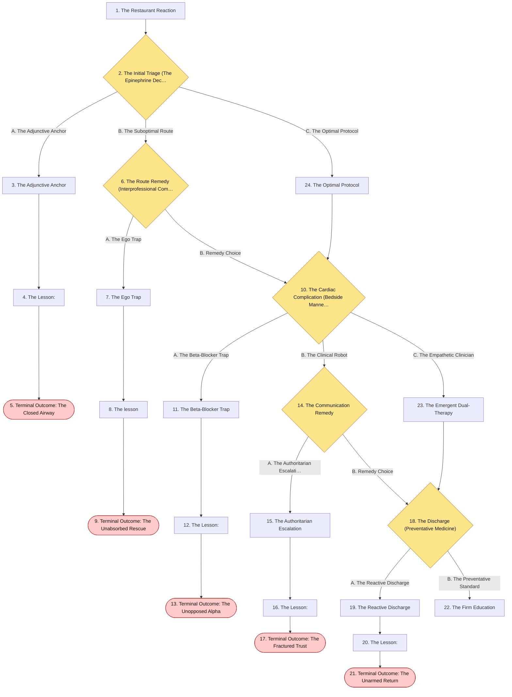

## The Story

### 1. The Restaurant Reaction

Patient Profile: Leo, a 15-year-old male.
Initial State: Leo is rushed into the emergency department by his parents. He is visibly gasping for air and his face is covered in a raised, erythematous rash. His mother screams that they were at a seafood restaurant, and within an hour of eating, he started choking. His medical history is significant for asthma and a severe allergic reaction to peanuts and shellfish .  Vitals: Blood Pressure $85/50$ mmHg, Pulse $130/min$, Respirations $28/min$, Oxygen Saturation 89% on room air.

**Next:** [2. The Initial Triage (The Epinephrine Decision)](#decision-node-1)

---

### 2. Decision: The Initial Triage (The Epinephrine Decision)

Leo is experiencing a rapid-onset, life-threatening systemic allergic reaction . He meets the diagnostic criteria by involving at least two organ systems: skin/mucosa (urticaria/swollen lips) and respiratory (dyspnea/wheezes) . Furthermore, his hypotension and tachycardia indicate cardiovascular involvement . You must initiate immediate pharmacological intervention.

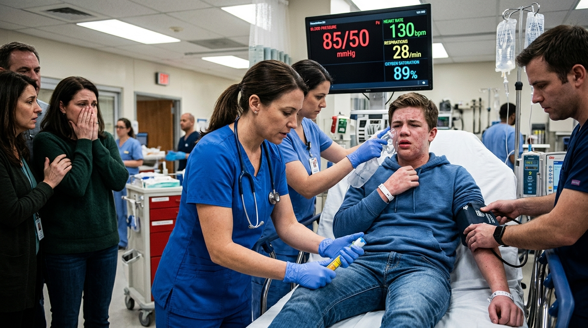

**What do you do?**

- **A. The Adjunctive Anchor** _(wrong)_ — Because his airway is still partially open, you decide to start with IV Diphenhydramine (an antihistamine) and IV Methylprednisolone (a glucocorticoid) to calm the immune response, holding off on Epinephrine to avoid stressing his heart. → [3. The Adjunctive Anchor](#information-node-3)
- **B. The Suboptimal Route** _(misstep)_ — You correctly order Epinephrine, but you instruct the nurse to administer it via the Subcutaneous (SubQ) route, as you believe it will be less painful for the pediatric patient. → [6. The Route Remedy (Interprofessional Communication)](#decision-node-7)
- **C. The Optimal Protocol** _(correct)_ — You ensure his airway, breathing, and circulation are intact. You immediately order Intramuscular (IM) Epinephrine as your absolute first-line therapy . → [24. The Optimal Protocol](#information-node-14)

---

### 3. The Adjunctive Anchor

You push the IV steroids and antihistamines. Over the next ten minutes, the medications slowly circulate, but they do nothing to halt the immediate mucosal edema in Leo's throat. His airway swells completely shut. He loses consciousness due to hypoxia and profound hypotensive shock. By the time you realize your error and call for the crash cart to establish a surgical airway, he progresses into cardiac arrest.

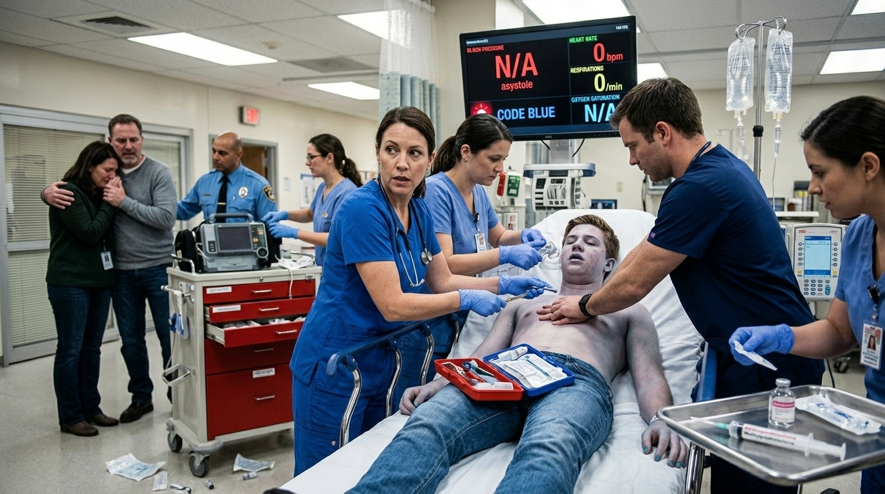

**Next:** [4. The Lesson:](#information-node-4)

---

### 4. The Lesson:

Anaphylaxis is a Type I hypersensitivity reaction where massive mast cell and basophil activation leads to a catastrophic release of inflammatory mediators . This causes rapid airway obstruction and cardiovascular collapse. Glucocorticoids and antihistamines have a significantly slower onset of action and should only be used as adjunctive therapy to epinephrine . They do not possess the immediate, life-saving vasoconstrictive or bronchodilatory properties required to reverse anaphylactic shock. Withholding epinephrine in anaphylaxis is a lethal medical error.

**Next:** [5. Terminal Outcome: The Closed Airway](#termination-node-5)

---

### 5. Ending: Terminal Outcome: The Closed Airway

> **Result:** fail · **Concept:** `Pharmacokinetics & Delayed Resuscitation`

Final Outcome: Fatal / Anaphylactic Shock & Airway Obstruction

The Flaw: Utilizing slow-onset adjunctive medications as first-line therapy instead of the mandatory IM Epinephrine.

Actionable Improvement: Intramuscular (IM) Epinephrine is always the first-line therapy for anaphylaxis . Never delay it for steroids or antihistamines.

_End of this path._

---

### 6. Decision: The Route Remedy (Interprofessional Communication)

The triage nurse pauses with the syringe. "Doctor, the standard protocol for anaphylactic shock is the Intramuscular (IM) route, usually in the lateral thigh. Subcutaneous absorption can be highly unpredictable in shock. Do you want me to switch to IM?"

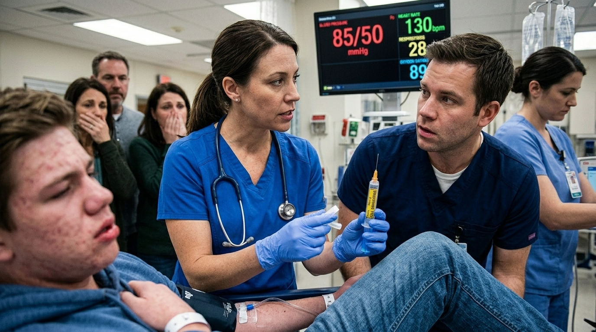

**What do you do?**

- **A. The Ego Trap** _(wrong)_ — You snap at the nurse for questioning your orders in an emergency. You demand she administer the injection subcutaneously into his arm immediately. → [7. The Ego Trap](#information-node-9)
- **B. Remedy Choice** _(correct)_ — You realize the nurse is absolutely correct. Shock causes peripheral vasoconstriction, rendering subcutaneous absorption useless. You thank the nurse for the safety catch and change the order to IM Epinephrine. → [10. The Cardiac Complication (Bedside Manner & Pathophysiology)](#decision-node-36)

---

### 7. The Ego Trap

The nurse reluctantly gives the subcutaneous injection. Because Leo is hypotensive ($85/50$), there is virtually no capillary blood flow in his subcutaneous tissue. The epinephrine sits pooled under his skin, completely unabsorbed. His anaphylaxis progresses unimpeded. His cardiovascular system collapses, and he codes in the trauma bay while the life-saving drug remains trapped millimeters below his epidermis.

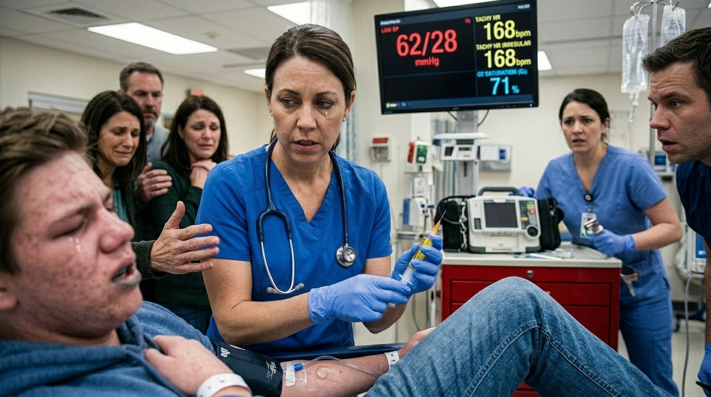

**Next:** [8. The lesson](#information-node-44)

---

### 8. The lesson

Intramuscular (IM) epinephrine is the preferred route of administration for anaphylaxis. During anaphylactic shock, the patient is hypotensive, and the body shunts blood away from the skin and subcutaneous tissues to protect vital organs. Injecting epinephrine subcutaneously deposits the drug into an avascular space where it cannot be absorbed into the systemic circulation. Letting ego override a standard-of-care protocol reminder from a nurse guarantees treatment failure.

**Next:** [9. Terminal Outcome: The Unabsorbed Rescue](#termination-node-11)

---

### 9. Ending: Terminal Outcome: The Unabsorbed Rescue

> **Result:** fail · **Concept:** `Pharmacokinetics & Professional Arrogance`

inal Outcome: Fatal / Failure of Drug Delivery

The Flaw: Utilizing an incorrect route of administration (SubQ) that prevents drug absorption during shock, and dismissing a critical safety catch from the nursing staff.

Actionable Improvement: Always use the IM route for Epinephrine in anaphylaxis. Respect the interprofessional safety net.

_End of this path._

---

### 10. Decision: The Cardiac Complication (Bedside Manner & Pathophysiology)

Leo receives the IM Epinephrine. The $\beta_2$ agonism successfully results in bronchodilation, and the $\alpha_1$ agonism successfully decreases his mucosal edema . His breathing improves dramatically.  However, five minutes later, Leo clutches his chest, sweating profusely. "My chest is burning! It feels like an elephant is sitting on me!" he cries.

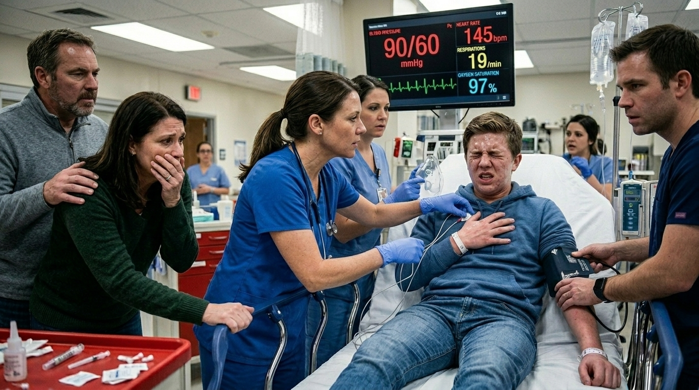

**What do you do?**

- **A. The Beta-Blocker Trap** _(wrong)_ — You assume the epinephrine's $\beta_1$ agonism caused dangerous tachycardia. To protect his heart, you order a rapid push of IV Metoprolol (a beta-blocker) to slow his heart rate and reduce the myocardial oxygen demand. → [11. The Beta-Blocker Trap](#information-node-18)
- **B. The Clinical Robot** _(misstep)_ — You immediately order a stat ECG and troponins. When Leo's mother frantically grabs your arm and asks if her son is having a heart attack, you ignore her entirely, tell her to step out of the way, and stare at the monitor. → [14. The Communication Remedy](#decision-node-38)
- **C. The Empathetic Clinician** _(correct)_ — You order a stat ECG and troponins. You look directly at the mother and say, "The allergic reaction can cause a spasm in the blood vessels of his heart, a rare condition called Kounis syndrome . We are checking his heart right now and treating him for it." → [23. The Emergent Dual-Therapy](#information-node-21)

---

### 11. The Beta-Blocker Trap

You push the IV Metoprolol. The drug immediately binds and blocks all of Leo's beta receptors. The epinephrine in his system now exclusively stimulates the alpha-1 receptors. His blood vessels clamp down violently, sending his blood pressure skyrocketing momentarily before his blocked heart fails against the massive afterload. Concurrently, the loss of beta-2 stimulation causes his lungs to spasm shut. He enters a lethal, medication-induced cardiac arrest.

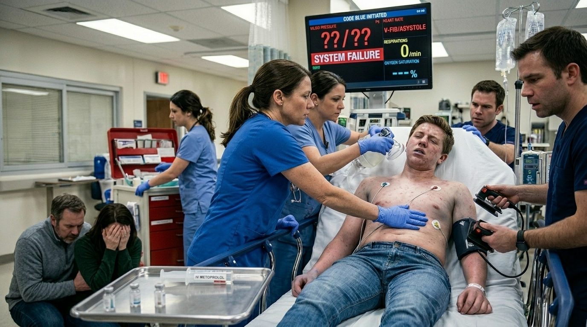

**Next:** [12. The Lesson:](#information-node-19)

---

### 12. The Lesson:

Administering a beta-blocker to a patient in active anaphylaxis is a catastrophic pharmacological error. Epinephrine saves lives in anaphylaxis through $\alpha_1$ (vasoconstriction), $\beta_1$ (increased chronotropy/inotropy), and $\beta_2$ (bronchodilation) agonism . If you introduce a beta-blocker, you completely strip away the $\beta_1$ and $\beta_2$ effects. This leads to unopposed $\alpha_1$ agonism, causing extreme, unmitigated systemic vasoconstriction, paradoxical bronchospasm, and immediate cardiovascular collapse.

**Next:** [13. Terminal Outcome: The Unopposed Alpha](#termination-node-20)

---

### 13. Ending: Terminal Outcome: The Unopposed Alpha

> **Result:** fail · **Concept:** `Receptor Pharmacology & Iatrogenic Collapse`

Final Outcome: Fatal / Iatrogenic Receptor Blockade

The Flaw: Administering a beta-blocker during an epinephrine-dependent anaphylactic event, causing unopposed alpha agonism.

Actionable Improvement: Never give beta-blockers during anaphylaxis. If chest pain occurs, consider Kounis syndrome (allergic angina/ACS) and treat with nitrates or calcium channel blockers if indicated, but never beta-blockers .

_End of this path._

---

### 14. Decision: The Communication Remedy

The mother is hysterical, believing you are ignoring her because her son is dying. She physically steps between you and the bed, screaming for answers.

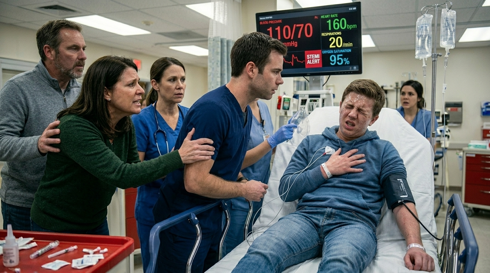

**What do you do?**

- **A. The Authoritarian Escalation** _(wrong)_ — You yell at her for interfering with patient care and order hospital security to physically drag her out of the trauma bay. → [15. The Authoritarian Escalation](#information-node-26)
- **B. Remedy Choice** _(correct)_ — You realize your hyper-focus destroyed the room's calm. You take 10 seconds to stop, make eye contact, validate her fear, and briefly explain that you are investigating allergic angina (Kounis syndrome) . She exhales, nods, and steps back to let you work. → [18. The Discharge (Preventative Medicine)](#decision-node-41)

---

### 15. The Authoritarian Escalation

In pediatrics and emergency medicine, the patient and their guardians are a single unit. While a physician must maintain control of a code situation, utilizing security to forcibly remove a terrified parent who simply asked a question is an egregious violation of medical ethics and bedside manner. It completely destroys the trust required for long-term patient education and follow-up.

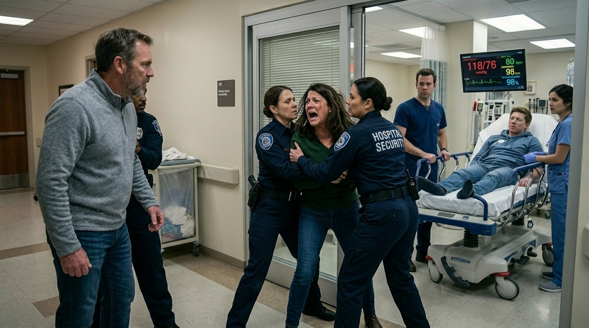

**Next:** [16. The Lesson:](#information-node-28)

---

### 16. The Lesson:

Security drags the screaming mother into the hallway. You successfully manage Leo's transient Kounis syndrome, and he stabilizes. However, the psychological damage is permanent. The parents refuse to let you speak to them, sign Leo out Against Medical Advice (AMA) the moment he is extubated, and file a formal grievance with the medical board for traumatic, unprofessional conduct. Because they leave abruptly, Leo receives no discharge education on triggers.

**Next:** [17. Terminal Outcome: The Fractured Trust](#termination-node-32)

---

### 17. Ending: Terminal Outcome: The Fractured Trust

> **Result:** fail · **Concept:** `Bedside Manner & The Therapeutic Alliance`

Final Outcome: Clinical Success / Catastrophic Ethical Failure

The Flaw: Utilizing authoritarian force rather than basic clinical empathy to manage a terrified family member.

Actionable Improvement: Ten seconds of clear, empathetic communication during a crisis saves hours of conflict and preserves the therapeutic alliance.

_End of this path._

---

### 18. Decision: The Discharge (Preventative Medicine)

Leo's ECG normalizes, and his troponins are negative. His Kounis syndrome was a transient allergic angina that resolved as the anaphylaxis was treated . After 12 hours of observation, he is stable and ready to go home.  

You must write his discharge orders and counsel the family.

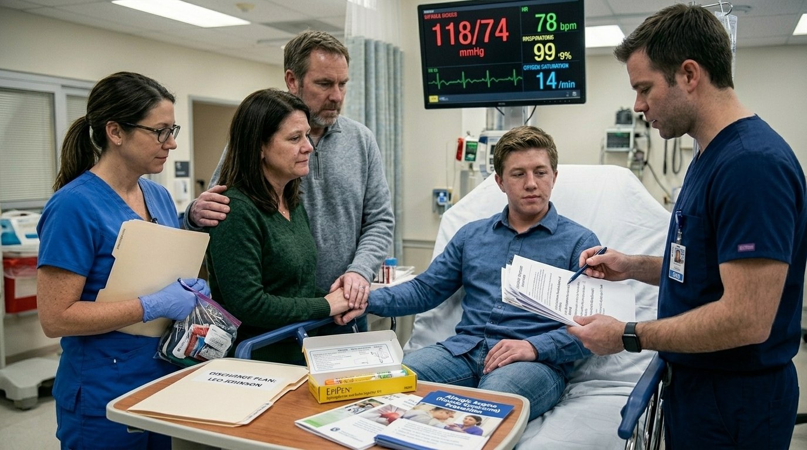

**What do you do?**

- **A. The Reactive Discharge** _(wrong)_ — You prescribe a 5-day taper of oral prednisone and an over-the-counter antihistamine. You tell him that since he survived this attack, his immune system might be stronger next time, but he should generally try to avoid seafood. → [19. The Reactive Discharge](#information-node-29)
- **B. The Preventative Standard** _(correct)_ — You prescribe an epinephrine autoinjector (EpiPen). You sit down and provide strict patient education on how to use it. You counsel him that he must absolutely avoid his triggers (peanuts and shellfish) and refer him to an outpatient allergist . → [22. The Firm Education](#information-node-45)

---

### 19. The Reactive Discharge

Anaphylaxis is a lifelong, life-threatening condition. The foundation of long-term prognosis and prevention relies entirely on avoiding triggers and comprehensive patient education . Discharging a patient who just experienced anaphylactic shock without a prescription for a rescue epinephrine autoinjector is an act of medical malpractice. Oral steroids and antihistamines will not save them if they are exposed again in the community.

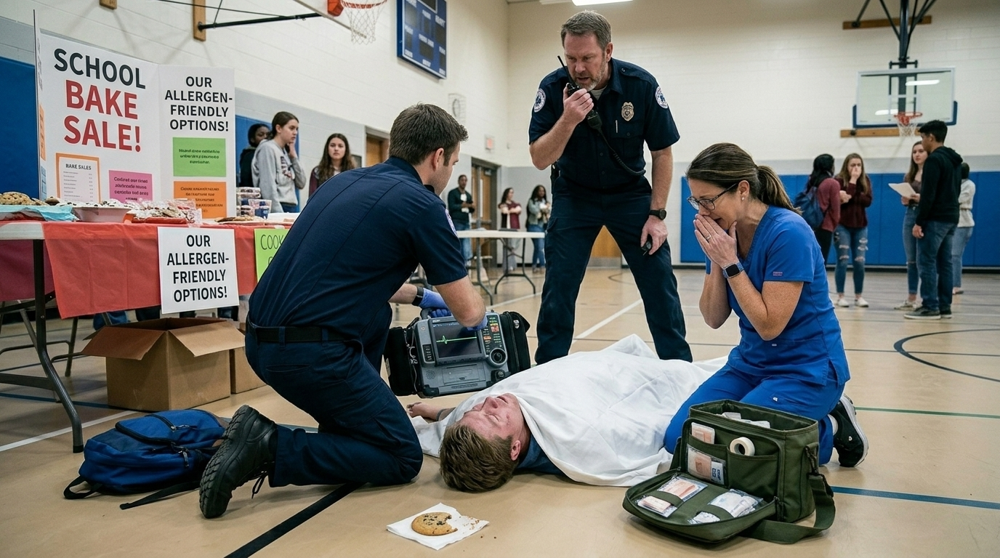

**Next:** [20. The Lesson:](#information-node-34)

---

### 20. The Lesson:

You send Leo home without an EpiPen or strict trigger-avoidance education . Three weeks later, he accidentally consumes cross-contaminated food at a school bake sale. His throat closes within minutes. Because he has no rescue epinephrine on hand, the school nurse is powerless. He dies before the paramedics arrive. Your failure to arm your patient with life-saving prevention tools resulted in a completely avoidable death.

**Next:** [21. Terminal Outcome: The Unarmed Return](#termination-node-33)

---

### 21. Ending: Terminal Outcome: The Unarmed Return

> **Result:** fail · **Concept:** `Preventative Medicine & Patient Education`

Final Outcome: Fatal / Negligent Discharge Planning

The Flaw: Failing to prescribe an epinephrine autoinjector and omitting strict patient education/trigger avoidance .  

Actionable Improvement: Every patient who experiences anaphylaxis MUST be discharged with an EpiPen, instructions on its use, and a referral to an allergist.

_End of this path._

---

### 22. The Firm Education

You flawlessly managed a highly volatile Type I Hypersensitivity reaction. You correctly utilized IM Epinephrine as your first-line agent, navigated the rare complication of Kounis syndrome without falling into pharmacological traps, and executed the standard-of-care prevention protocols to keep the patient safe long-term.

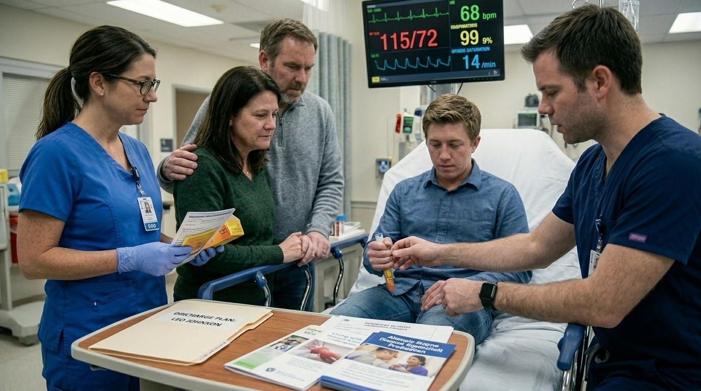

---

### 23. The Emergent Dual-Therapy

You correctly recognized that medical therapy alone is useless because the necrotic tissue has no blood supply. Invasive fungal disease requires both Amphotericin B and emergent surgical debridement.

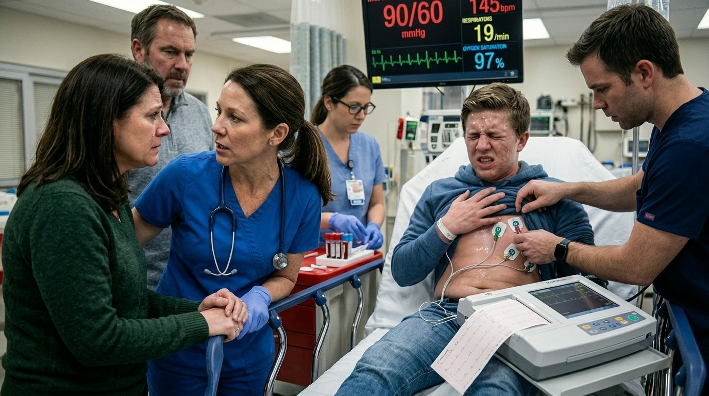

**Next:** [18. The Discharge (Preventative Medicine)](#decision-node-41)

---

### 24. The Optimal Protocol

You correctly recognized that IM Epinephrine is the preferred route of administration and the only acceptable first-line treatment for anaphylaxis . Proceed to Node 2.

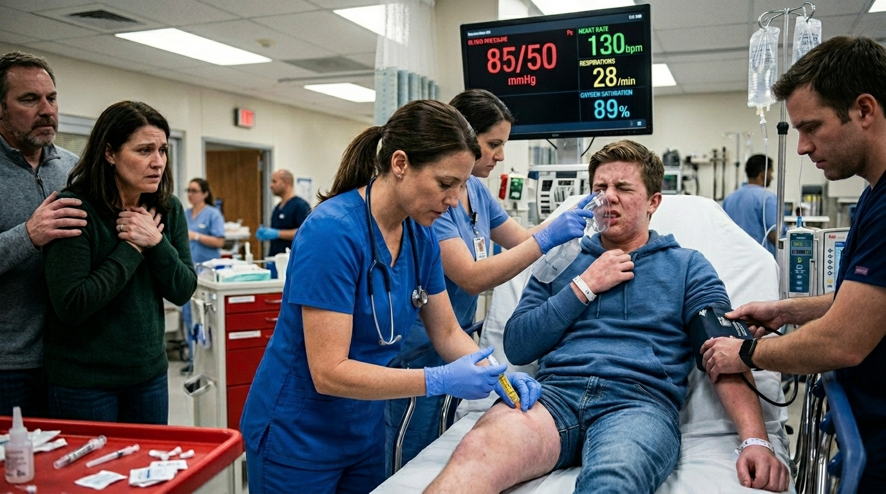

**Next:** [10. The Cardiac Complication (Bedside Manner & Pathophysiology)](#decision-node-36)

---
