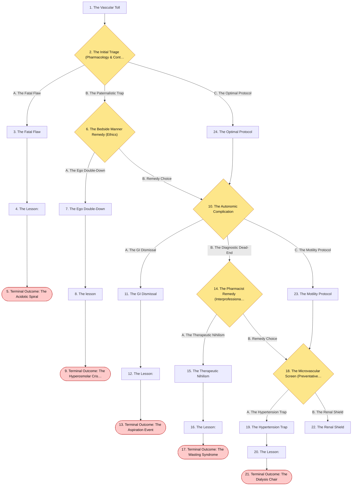
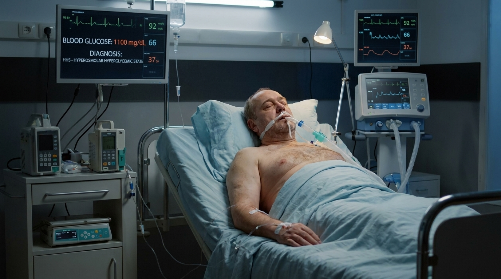
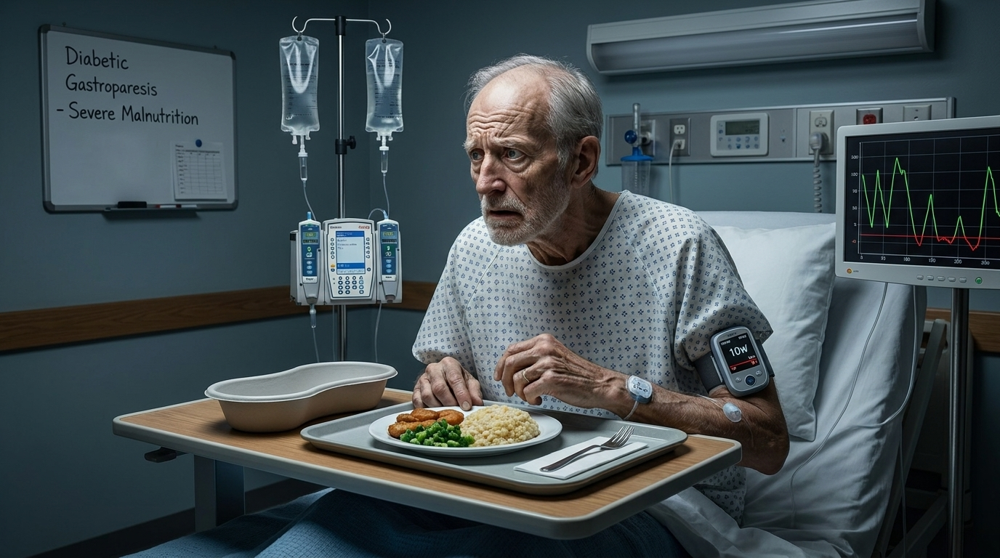
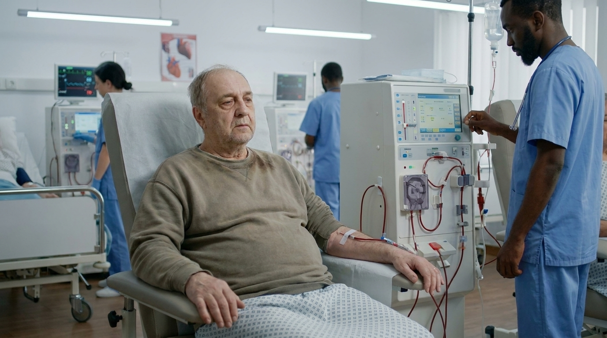
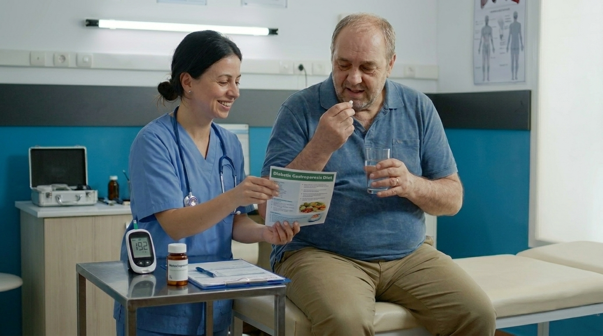

# The Vascular Toll

> Endocrinology

## Overview

| | |
|---|---|
| **Scenario key** | `Diabetes Mellitus` |
| **Scenario ID** | `109e2500-cd86-4c66-a5e8-f48db0905912` |
| **Story pages** | 14 |
| **Decision points** | 5 (12 choices) |
| **Endings** | 5 (0 checkpoint, 5 fail) |
| **Concepts** | `Autonomic Neuropathy & Diagnostic Anchoring`, `Medical Ethics & Patient Abandonment`, `Pharmacokinetics & Iatrogenic Toxicity`, `Pharmacological Avoidance & Severe Malnutrition`, `[Renal Protection & Hemodynamic Misconceptions` |
| **Graph file** | [`diabetes-mellitus.json`](diabetes-mellitus.json) |

This is a branching case study. The learner reads each story page, then at every decision point picks one of the choices. A *misstep* leads to a fail ending that sends the learner back to try again; the *correct* path continues the story and reaches checkpoint endings that mark the concepts learned.

## Flowchart

## The Story

### 1. The Vascular Toll

Patient Profile: Harold, a 52-year-old male.Initial State: Harold presents to the primary care clinic with a three-month history of worsening fatigue, extreme thirst (polydipsia), and waking up 4-5 times a night to urinate (polyuria) . He has a BMI of 33 and a medical history of hypertension and osteoarthritis. A random blood glucose test in the clinic reads $315~mg/dL$, and his Hemoglobin A1c is $9.8\%$. Basic metabolic labs reveal a serum Creatinine of $2.2~mg/dL$ (indicating significant renal insufficiency).

**Next:** [2. The Initial Triage (Pharmacology & Contraindications)](#decision-node-1)

---

### 2. Decision: The Initial Triage (Pharmacology & Contraindications)

Harold meets the diagnostic criteria for Type II Diabetes Mellitus (random glucose $\ge 200~mg/dL$ with classic symptoms, plus an A1c $\ge 6.5\%$) . He needs immediate pharmacological intervention to lower his blood sugar.

**What do you do?**

- **A. The Fatal Flaw** _(wrong)_ — Because he is an obese patient with Type II diabetes, you immediately prescribe Metformin, as it is the undisputed first-line oral agent for this demographic. → [3. The Fatal Flaw](#information-node-3)
- **B. The Paternalistic Trap** _(misstep)_ — You sigh, look at his BMI, and tell him, "You did this to yourself with a poor diet. You've ruined your pancreas." You prescribe insulin without further explanation and walk out of the room. → [6. The Bedside Manner Remedy (Ethics)](#decision-node-7)
- **C. The Optimal Protocol** _(correct)_ — You explain the diagnosis of Type II diabetes and heavily counsel him on lifestyle modifications (diet, exercise, and weight loss). You explicitly note that his renal insufficiency prevents him from taking the standard first-line pill (Metformin), so you discuss alternative therapies, such as initiating insulin . → [24. The Optimal Protocol](#information-node-14)

---

### 3. The Fatal Flaw

You prescribe the Metformin. Harold takes it faithfully for a week. Because his failing kidneys cannot clear the drug, it builds up in his bloodstream, shifting his cellular metabolism. He develops severe abdominal pain, profound hyperventilation (Kussmaul breathing to blow off $CO_2$), and lethargy. He is rushed to the emergency department in profound shock with a serum pH of 6.9 and a lactate of 15. Despite aggressive ICU resuscitation and emergency hemodialysis to clear the drug, he suffers fatal cardiac arrhythmias due to the severe acidosis.

**Next:** [4. The Lesson:](#information-node-4)

---

### 4. The Lesson:

While Metformin is the absolute first-line oral agent for Type II Diabetes (especially in patients with obesity), it carries two massive, highly-testable contraindications: it cannot be used in patients with renal insufficiency, and it must be held during the use of IV contrast for imaging . Metformin is cleared exclusively by the kidneys. In a patient with a Creatinine of $2.2~mg/dL$, the drug is not excreted. It accumulates to toxic levels, blocking hepatic gluconeogenesis and forcing cells into anaerobic metabolism. This rapidly precipitates severe, life-threatening lactic acidosis.

**Next:** [5. Terminal Outcome: The Acidotic Spiral](#termination-node-5)

---

### 5. Ending: Terminal Outcome: The Acidotic Spiral

> **Result:** fail · **Concept:** `Pharmacokinetics & Iatrogenic Toxicity`

Final Outcome: Fatal / Iatrogenic Lactic Acidosis

The Flaw: Prescribing Metformin to a patient with acute or chronic renal insufficiency.

Actionable Improvement: Always check a basic metabolic panel (BUN/Creatinine) before initiating Metformin. If the GFR is significantly low, you must use alternative agents (like insulin or sulfonylureas).

_End of this path._

---

### 6. Decision: The Bedside Manner Remedy (Ethics)

Harold looks devastated and humiliated by your accusation. He stands up, crosses his arms, and says, "If I ruined myself, then I guess there's no point in taking your shots. I'm going home."

**What do you do?**

- **A. The Ego Double-Down** _(wrong)_ — You tell him that as a doctor, it is your job to give him the hard truth. You tell him he can leave if he wants, but he'll be back when he loses a toe. You discharge him. → [7. The Ego Double-Down](#information-node-9)
- **B. Remedy Choice** _(correct)_ — You realize your fat-shaming and paternalistic tone destroyed the therapeutic alliance. You stop him, apologize sincerely, and explain the actual pathophysiology—that Type II diabetes is a complex condition driven by end-organ resistance to insulin, not just "ruining the pancreas" . He sits back down and agrees to learn how to use the insulin. → [10. The Autonomic Complication](#decision-node-36)

---

### 7. The Ego Double-Down

Harold leaves the clinic and vows never to return to a doctor. Over the next three months, his blood glucose climbs steadily, drawing massive amounts of fluid out of his tissues through osmotic diuresis. He becomes profoundly dehydrated. He is eventually found comatose in his apartment and brought to the ICU with a blood glucose of $1,100~mg/dL$. He has developed Hyperosmolar Hyperglycemic State (HHS), a deadly acute manifestation of unmanaged Type II diabetes. He suffers a severe anoxic brain injury during a hypotensive code.

**Next:** [8. The lesson](#information-node-44)

---

### 8. The lesson

Type II Diabetes is a chronic, high-maintenance disease that requires extensive patient buy-in, education, and trust. Utilizing shame, guilt, or medical gaslighting to force compliance almost universally results in patient alienation. When diabetic patients are lost to follow-up, their disease progresses unmitigated, leading to catastrophic, highly preventable acute emergencies.

**Next:** [9. Terminal Outcome: The Hyperosmolar Crisis](#termination-node-11)

---

### 9. Ending: Terminal Outcome: The Hyperosmolar Crisis

> **Result:** fail · **Concept:** `Medical Ethics & Patient Abandonment`

Final Outcome: Fatal / Lost to Follow-Up & HHS

The Flaw: Using shame and hostility, destroying the therapeutic alliance, and driving a critically ill patient away from care.

Actionable Improvement: Chronic disease management requires empathy and partnership. Explain the pathophysiology objectively and collaboratively.

_End of this path._

---

### 10. Decision: The Autonomic Complication

Harold has been your patient for several years. His blood sugars are reasonably controlled on a complex insulin regimen. He comes in today complaining of severe nausea, bloating, and vomiting undigested food several hours after he eats. He feels full after taking only two or three bites of a meal.

**What do you do?**

- **A. The GI Dismissal** _(wrong)_ — You diagnose him with standard gastroesophageal reflux disease (GERD) and prescribe a high-dose proton pump inhibitor (Omeprazole), telling him to avoid spicy foods. → [11. The GI Dismissal](#information-node-18)
- **B. The Diagnostic Dead-End** _(misstep)_ — You recognize this as Diabetic Gastroparesis, an autonomic neuropathy . You recommend lifestyle and dietary modifications (eating smaller, more frequent meals), but inform him there are no medications that can help his stomach empty faster. → [14. The Pharmacist Remedy (Interprofessional)](#decision-node-38)
- **C. The Motility Protocol** _(correct)_ — You recognize Diabetic Gastroparesis. You recommend lifestyle modifications (small, low-fat, low-fiber meals) and prescribe a prokinetic agent—either Metoclopramide or Erythromycin—to stimulate gastric emptying . → [23. The Motility Protocol](#information-node-21)

---

### 11. The GI Dismissal

Harold takes the Omeprazole, but his stomach remains paralyzed. Three days later, he eats a large dinner. Because the food cannot empty into his duodenum, it sits pooling in his stomach. When he lies down to sleep, the massive volume of retained food and gastric juices passively regurgitates up his esophagus. He aspirates the contents deep into his lungs. He develops severe, bilateral aspiration pneumonitis and progresses to acute respiratory distress syndrome (ARDS), requiring prolonged mechanical ventilation.

**Next:** [12. The Lesson:](#information-node-19)

---

### 12. The Lesson:

Chronic hyperglycemia causes microvascular damage to the vasa nervorum (the tiny blood vessels supplying the nerves). When this damages the vagus nerve, it causes autonomic dysfunction, classically presenting as Diabetic Gastroparesis (delayed gastric emptying) . The stomach essentially becomes paralyzed, leading to early satiety, bloating, and vomiting of undigested food. Treating this neurological paralysis with an antacid (PPI) does absolutely nothing to restore gastric motility.

**Next:** [13. Terminal Outcome: The Aspiration Event](#termination-node-20)

---

### 13. Ending: Terminal Outcome: The Aspiration Event

> **Result:** fail · **Concept:** `Autonomic Neuropathy & Diagnostic Anchoring`

Final Outcome: Severe Morbidity / Iatrogenic Aspiration

The Flaw: Failing to recognize a classic microvascular complication of diabetes (gastroparesis) and treating it as a benign acid issue.

Actionable Improvement: Early satiety and vomiting in a long-standing diabetic is gastroparesis until proven otherwise. Treat with prokinetics (Metoclopramide or Erythromycin).

_End of this path._

---

### 14. Decision: The Pharmacist Remedy (Interprofessional)

You enter the prescription for smaller meal sizes into the chart. The clinical pharmacist pages you. "Doctor, I saw the diagnosis of Diabetic Gastroparesis. Are you planning to add Metoclopramide or Erythromycin to assist with his gastric motility? It's indicated for these severe symptoms."

**What do you do?**

- **A. The Therapeutic Nihilism** _(wrong)_ — You tell the pharmacist, "Those drugs have too many side effects. I don't want to use them. He just needs to chew his food better." You refuse the order. → [15. The Therapeutic Nihilism](#information-node-26)
- **B. Remedy Choice** _(correct)_ — You realize you forgot about the prokinetic agents. You thank the pharmacist for the safety net and immediately add a prescription for Metoclopramide to help empty his stomach. → [18. The Microvascular Screen (Preventative Medicine)](#decision-node-41)

---

### 15. The Therapeutic Nihilism

You refuse to prescribe the prokinetics. Harold's gastroparesis worsens. Every time he eats, he vomits. Over the next two months, he becomes terrified of food. He suffers severe malnutrition, losing 40 pounds. His severe, unpredictable caloric intake makes his insulin dosing impossible to manage, resulting in wild swings between diabetic ketoacidosis and profound hypoglycemia. He is eventually admitted for a severe hypoglycemic seizure caused by taking his insulin when his stomach was completely paralyzed.

**Next:** [16. The Lesson:](#information-node-28)

---

### 16. The Lesson:

While Metoclopramide carries risks (such as tardive dyskinesia with long-term use), it is the gold-standard treatment for severe diabetic gastroparesis. Refusing to utilize indicated therapies out of an exaggerated fear of side effects—especially when prompted by a pharmacy colleague—leaves the patient suffering from a debilitating and dangerous condition.

**Next:** [17. Terminal Outcome: The Wasting Syndrome](#termination-node-32)

---

### 17. Ending: Terminal Outcome: The Wasting Syndrome

> **Result:** fail · **Concept:** `Pharmacological Avoidance & Severe Malnutrition`

Final Outcome: Severe Morbidity / Hypoglycemic Seizure

The Flaw: Refusing to utilize standard-of-care medication for a severe complication, leading to systemic instability.

Actionable Improvement: Diabetic gastroparesis requires active management. Use Metoclopramide or Erythromycin to keep the GI tract moving.

_End of this path._

---

### 18. Decision: The Microvascular Screen (Preventative Medicine)

Harold's gastroparesis is now well-managed. You are conducting his routine annual diabetic screening. You order a Urine Albumin-to-Creatinine ratio, which is the most sensitive test to detect moderately elevated levels of urinary albumin excretion (early diabetic nephropathy) .  The results return showing moderately elevated microalbuminuria. However, when the nurse checks his blood pressure, it is perfectly normal at $118/76$ mmHg.

**What do you do?**

- **A. The Hypertension Trap** _(wrong)_ — Because his blood pressure is completely normal, you tell him his kidneys are showing some stress, but you don't want to start any blood pressure medications because it might make him hypotensive. You plan to just recheck the urine next year. → [19. The Hypertension Trap](#information-node-29)
- **B. The Renal Shield** _(correct)_ — Despite his normal blood pressure, you immediately prescribe an Angiotensin-Converting Enzyme (ACE) inhibitor or an Angiotensin II Receptor Blocker (ARB) . You explain that in the setting of diabetic kidney disease, these drugs are used to protect the kidneys, not just lower blood pressure. → [22. The Renal Shield](#information-node-45)

---

### 19. The Hypertension Trap

You withhold the ACE inhibitor because you are afraid of lowering his normal blood pressure. Without efferent arteriole dilation, the hyperfiltration in Harold's kidneys continues unabated. The microalbuminuria progresses to macroalbuminuria. Over the next five years, the constant pressure destroys his glomeruli entirely. He develops irreversible End-Stage Renal Disease (ESRD) and is forced onto hemodialysis three days a week for the rest of his life, a catastrophic outcome that could have been delayed or prevented with a simple, standard-of-care pill.

**Next:** [20. The Lesson:](#information-node-34)

---

### 20. The Lesson:

Diabetic nephropathy is a microvascular complication caused by chronic hyperglycemia damaging the efferent arterioles of the glomerulus, causing hyperfiltration and spilling of albumin into the urine . Angiotensin-Converting Enzyme inhibitors (ACEi) and Angiotensin II Receptor Blockers (ARBs) dilate this efferent arteriole, reducing the intraglomerular pressure and halting the destruction of the kidney . They are strictly indicated in diabetics with microalbuminuria regardless of whether the patient has systemic hypertension.

**Next:** [21. Terminal Outcome: The Dialysis Chair](#termination-node-33)

---

### 21. Ending: Terminal Outcome: The Dialysis Chair

> **Result:** fail · **Concept:** `[Renal Protection & Hemodynamic Misconceptions`

Final Outcome: Severe Morbidity / End-Stage Renal Disease

The Flaw: Failing to initiate ACE inhibitors or ARBs in a diabetic with microalbuminuria simply because they lacked systemic hypertension.

Actionable Improvement: If the Urine Albumin-to-Creatinine ratio is elevated, start an ACEi or ARB immediately to protect the kidneys

_End of this path._

---

### 22. The Renal Shield

You flawlessly navigated the complex, multi-system management of Diabetes Mellitus. You avoided the deadly trap of Metformin in renal failure, successfully diagnosed and treated autonomic gastroparesis, and initiated the exact gold-standard renal-protective medication the moment microalbuminuria was detected, saving his kidneys from irreversible destruction.

---

### 23. The Motility Protocol

You correctly identified a microvascular autonomic complication of diabetes and initiated the exact standard-of-care pharmacological therapy.

**Next:** [18. The Microvascular Screen (Preventative Medicine)](#decision-node-41)

---

### 24. The Optimal Protocol

You correctly recognized a strict, life-threatening contraindication to the most commonly prescribed diabetes medication and properly centered lifestyle modifications as a core pillar of treatment.

**Next:** [10. The Autonomic Complication](#decision-node-36)

---
