# The Daycare Diarrhea Dilemma

> Infectious disease/GI

## Overview

| | |
|---|---|
| **Scenario key** | `Diarrhea` |
| **Scenario ID** | `59928a2a-6ad4-4957-a5f6-836373bc868b` |
| **Story pages** | 14 |
| **Decision points** | 5 (12 choices) |
| **Endings** | 5 (0 checkpoint, 5 fail) |
| **Concepts** | `Antibiotic Indications & Invasive Enteritis`, `Bedside Manner & Patient Abandonment`, `Diagnostic Parsimony & Delayed Resuscitation`, `Pharmacological Contraindications & Toxin Retention`, `Supportive Care & Hypovolemic Shock` |
| **Graph file** | [`diarrhea.json`](diarrhea.json) |

This is a branching case study. The learner reads each story page, then at every decision point picks one of the choices. A *misstep* leads to a fail ending that sends the learner back to try again; the *correct* path continues the story and reaches checkpoint endings that mark the concepts learned.

## Flowchart

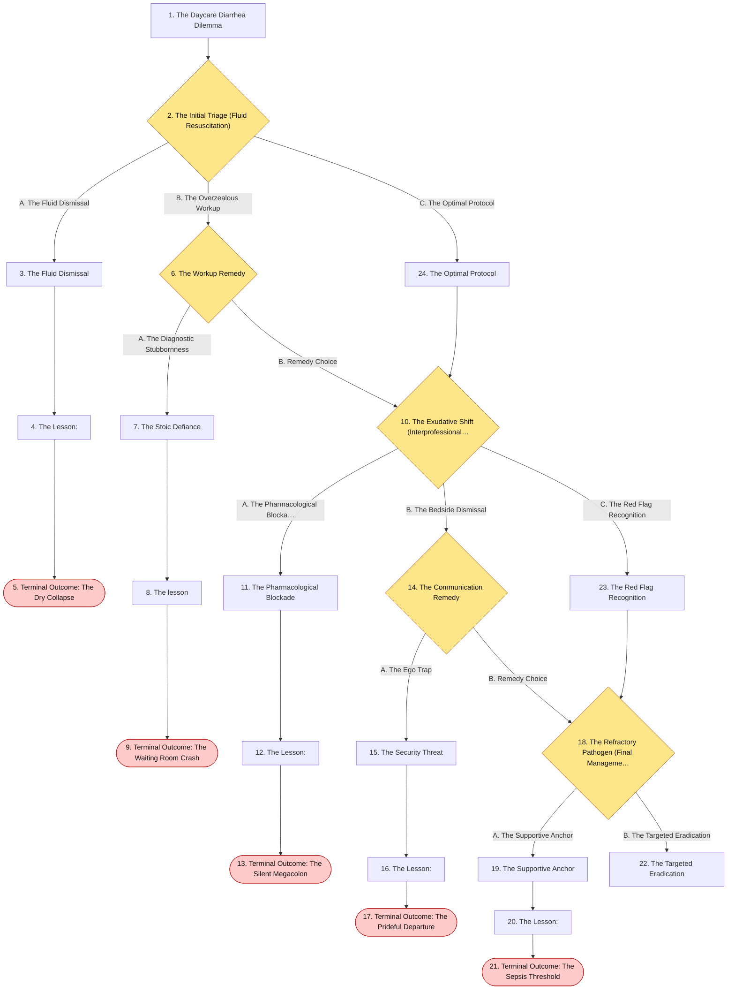

## The Story

### 1. The Daycare Diarrhea Dilemma

Patient Profile: Leo, a 3-year-old male.
Initial State: Leo is brought to the pediatric urgent care clinic by his parents. He has experienced 2 days of frequent, watery diarrhea (5-6 bowel movements per day). He attends daycare twice a week, where several other children have had similar symptoms . He has no fever and no blood in his stool. On physical exam, he appears fatigued. He has sunken eyes, poor skin turgor, and a delayed capillary refill, indicating moderate dehydration .

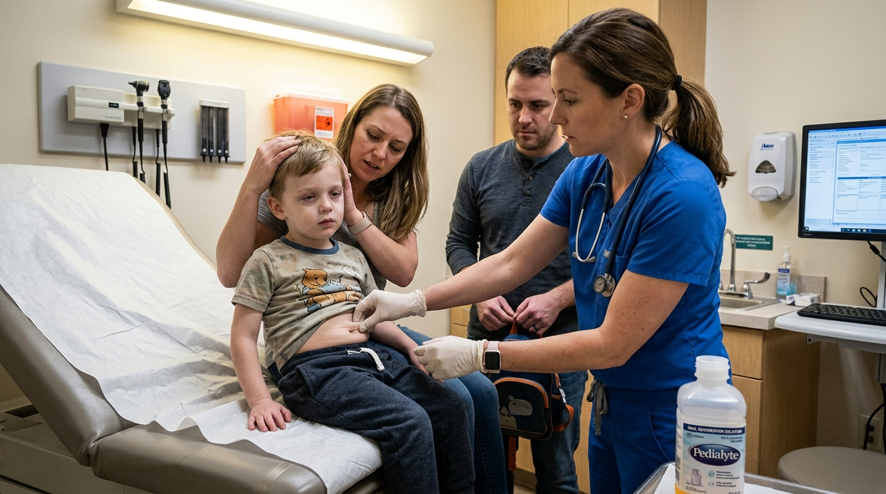

**Next:** [2. The Initial Triage (Fluid Resuscitation)](#decision-node-1)

---

### 2. Decision: The Initial Triage (Fluid Resuscitation)

You must establish the initial management plan for this acute, likely infectious, diarrhea.

**What do you do?**

- **A. The Fluid Dismissal** _(wrong)_ — You reassure the parents that this is a self-limiting viral infection. You discharge him immediately with no specific instructions, telling them to just let it run its course. → [3. The Fluid Dismissal](#information-node-3)
- **B. The Overzealous Workup** _(misstep)_ — You decide you need to know exactly what bug is causing this. You order a comprehensive stool panel (Ova & Parasite, C. difficile toxin, bacterial culture) and keep him in the clinic waiting for the results before treating. → [6. The Workup Remedy](#decision-node-7)
- **C. The Optimal Protocol** _(correct)_ — You recognize the primary threat is dehydration. You immediately initiate Oral Rehydration therapy (the preferred modality) and explain to the parents that there is no need for advanced stool studies in a well-appearing child without red-flag symptoms . → [24. The Optimal Protocol](#information-node-14)

---

### 3. The Fluid Dismissal

You send Leo home without oral rehydration protocols. Over the next 12 hours, his watery diarrhea continues. Because his intravascular volume is already depleted (indicated by his delayed capillary refill), his blood pressure plummets. He becomes completely unresponsive at home. By the time EMS arrives, he is in profound hypovolemic shock. He suffers ischemic acute tubular necrosis (kidney failure) due to severe, untreated dehydration.

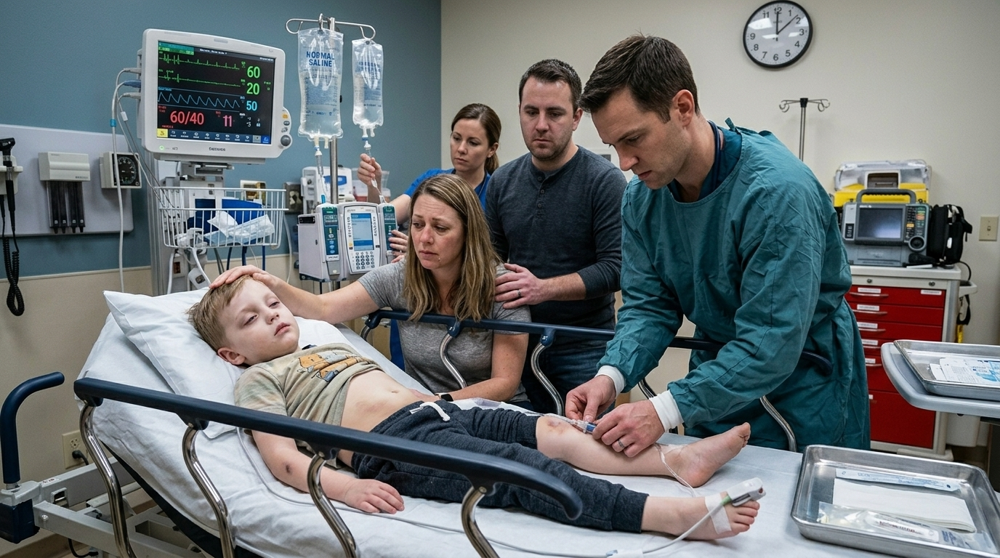

**Next:** [4. The Lesson:](#information-node-4)

---

### 4. The Lesson:

Acute diarrhea is the second leading cause of childhood mortality worldwide, primarily due to catastrophic fluid loss. While the infectious etiology (like Rotavirus, common in daycare) may be self-limiting, the resulting dehydration is not. Leo presented with clear, objective signs of dehydration (sunken eyes, poor skin turgor, delayed capillary refill) . Discharging him without initiating aggressive oral or intravenous rehydration fails to treat the most immediate, life-threatening complication of his illness.

**Next:** [5. Terminal Outcome: The Dry Collapse](#termination-node-5)

---

### 5. Ending: Terminal Outcome: The Dry Collapse

> **Result:** fail · **Concept:** `Supportive Care & Hypovolemic Shock`

Final Outcome: Fatal Deficit / Hypovolemic Shock

The Flaw: Failing to recognize objective signs of dehydration and omitting mandatory supportive rehydration therapy.

Actionable Improvement: Supportive care with oral rehydration (or IV rehydration if severe) is the absolute cornerstone of treating acute diarrhea . Always treat the fluid loss first.

_End of this path._

---

### 6. Decision: The Workup Remedy

The pediatric nurse looks at your order for the massive stool panel. "Doctor, he only has watery diarrhea for two days with no fever or blood. Do we really need to run a full infectious panel right now instead of just getting him to drink an electrolyte solution?"

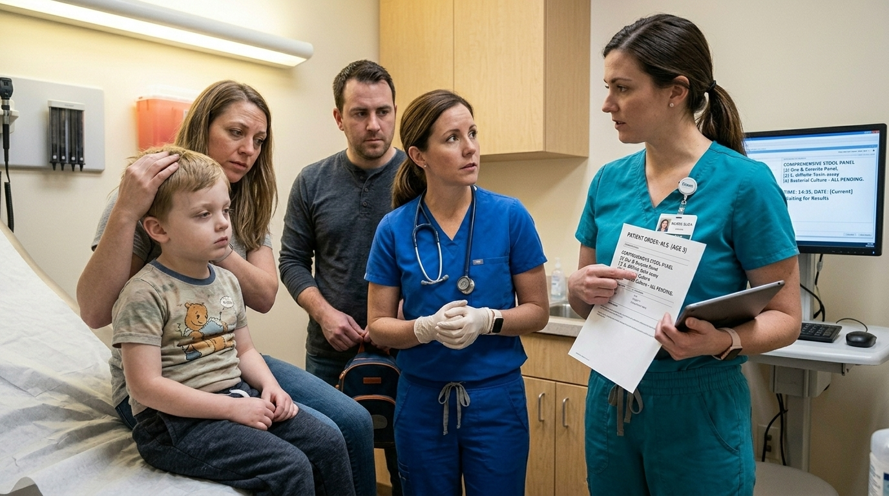

**What do you do?**

- **A. The Diagnostic Stubbornness** _(wrong)_ — You tell the nurse not to question you. You force Leo to stay in the clinic for hours waiting to produce a stool sample, delaying his rehydration therapy. → [7. The Stoic Defiance](#information-node-9)
- **B. Remedy Choice** _(correct)_ — You recall the guidelines. You cancel the advanced stool studies, recognizing they are not routinely required for acute diarrhea without red flags. You switch your focus to Oral Rehydration therapy. → [10. The Exudative Shift (Interprofessional Communication)](#decision-node-36)

---

### 7. The Stoic Defiance

You force the child to wait for the stool studies. Because he is continually losing fluid through diarrhea and is receiving no oral rehydration, his mild dehydration progresses to severe dehydration. He becomes lethargic and hypotensive in the waiting room, requiring an emergency rapid response and central line placement for IV resuscitation. You caused iatrogenic harm by delaying simple, supportive care.

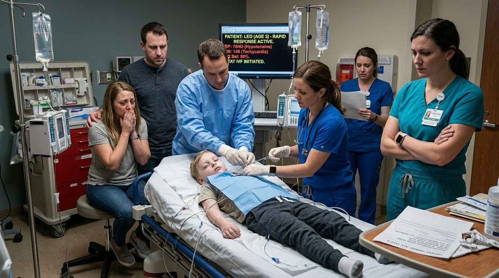

**Next:** [8. The lesson](#information-node-44)

---

### 8. The lesson

Acute diarrhea does not routinely require laboratory evaluation unless specific clinical red flags are present (e.g., high fever, bloody diarrhea, severe abdominal pain, immunocompromise) . Delaying the most critical intervention—oral rehydration —to hunt for a specific viral or bacterial name in a stable child is a severe triage error.

**Next:** [9. Terminal Outcome: The Waiting Room Crash](#termination-node-11)

---

### 9. Ending: Terminal Outcome: The Waiting Room Crash

> **Result:** fail · **Concept:** `Diagnostic Parsimony & Delayed Resuscitation`

Final Outcome: Failure / Iatrogenic Clinical Deterioration

The Flaw: Prioritizing unnecessary laboratory testing over immediate, standard-of-care supportive rehydration.

Actionable Improvement: Do not order advanced stool studies in healthy, well-appearing individuals with acute watery diarrhea. Hydration comes first.

_End of this path._

---

### 10. Decision: The Exudative Shift (Interprofessional Communication)

Leo goes home and tolerates the oral rehydration well. However, three days later, his parents bring him back. His clinical picture has completely changed.He now has a high fever of $39.5^{\circ}C$ $(103.1^{\circ}F)$, severe abdominal cramping, and he is passing frequent, small-volume, bloody stools . This represents a shift to an exudative/inflammatory diarrhea.

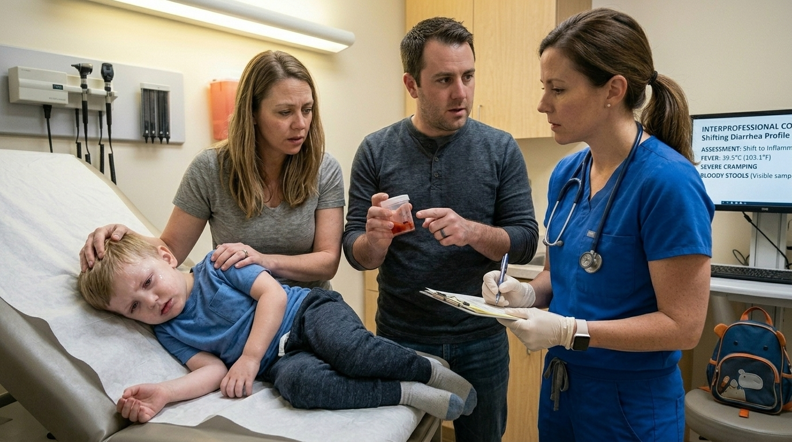

**What do you do?**

- **A. The Pharmacological Blockade** _(wrong)_ — You want to stop the bloody diarrhea immediately. You prescribe Loperamide (an anti-motility agent) to slow his gut down and stop the bowel movements. → [11. The Pharmacological Blockade](#information-node-18)
- **B. The Bedside Dismissal** _(misstep)_ — The mother is crying, asking if she caused this by giving him dairy earlier in the week. You roll your eyes, say "Dairy doesn't cause bloody diarrhea, obviously," and walk out to order labs without comforting her. → [14. The Communication Remedy](#decision-node-38)
- **C. The Red Flag Recognition** _(correct)_ — You recognize the high fever, severe pain, and bloody diarrhea as strict indications for laboratory evaluation . You admit him for IV rehydration and order a comprehensive stool culture, warning the parents he likely contracted an invasive bacteria like Shigella from daycare. → [23. The Red Flag Recognition](#information-node-21)

---

### 11. The Pharmacological Blockade

You prescribe the Loperamide. The medication paralyzes Leo's bowels. The Shigella bacteria, no longer being flushed out by diarrhea, rapidly invades his intestinal walls. His colon massively dilates as the infection becomes trapped. He develops toxic megacolon, which perforates and spills feces directly into his sterile peritoneal cavity. He dies from overwhelming intra-abdominal sepsis.

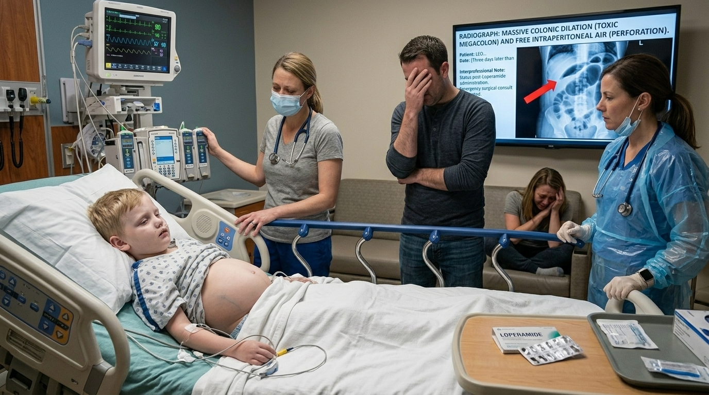

**Next:** [12. The Lesson:](#information-node-19)

---

### 12. The Lesson:

Exudative/inflammatory diarrhea, characterized by frequent, small-volume, bloody stools, indicates a disrupted and inflamed mucosa, often caused by invasive bacteria like Shigella, Salmonella, or Campylobacter . Using an anti-motility agent (like loperamide) in this setting is strictly contraindicated. Slowing the gut motility traps the invasive bacteria and their toxins inside the intestines. This actively prolongs infectious diarrhea (specifically Shigella-induced gastroenteritis) and can precipitate fatal complications like toxic megacolon .

**Next:** [13. Terminal Outcome: The Silent Megacolon](#termination-node-20)

---

### 13. Ending: Terminal Outcome: The Silent Megacolon

> **Result:** fail · **Concept:** `Pharmacological Contraindications & Toxin Retention`

Final Outcome: Fatal / Iatrogenic Toxic Megacolon

The Flaw: Prescribing an anti-motility agent for invasive, inflammatory (bloody) diarrhea.

Actionable Improvement: Never use loperamide or bismuth salicylate in patients with high fever or bloody diarrhea. Anti-motility agents may prolong the illness.

_End of this path._

---

### 14. Decision: The Communication Remedy

You step into the hallway. The charge nurse stops you. "Doctor, the mother is packing up her son's things. She feels judged and says she is taking him to a different hospital because you won't explain what is happening."

**What do you do?**

- **A. The Ego Trap** _(wrong)_ — You tell the nurse, "Let her leave. I don't have time for anxious parents who don't understand medicine." You discharge the patient Against Medical Advice (AMA). → [15. The Security Threat](#information-node-26)
- **B. Remedy Choice** _(correct)_ — You realize your arrogance damaged the therapeutic alliance. You re-enter the room, apologize sincerely, and explain that daycare is a major risk factor for bugs like Shigella, reassuring her that she did nothing wrong. She agrees to stay. → [18. The Refractory Pathogen (Final Management)](#decision-node-41)

---

### 15. The Security Threat

The mother leaves with Leo. Because they do not have a medical background, they assume they just need to push water. They do not know about the risks of severe bacterial enteritis. Over the next two days, Leo's Shigella infection spreads to his bloodstream. He goes into septic shock at home. By the time they arrive at a different emergency room, his organs are failing. You face severe disciplinary action for effectively abandoning a highly vulnerable patient.

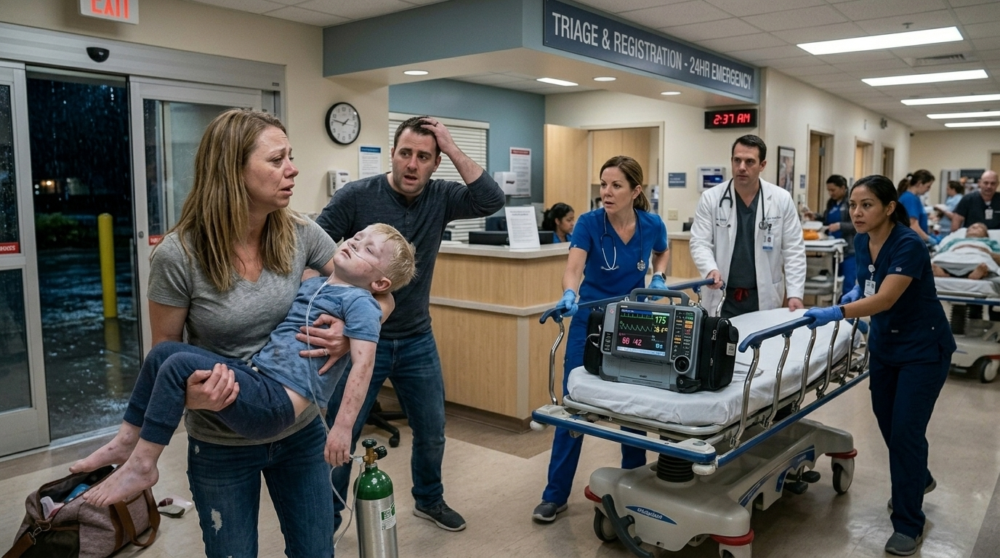

**Next:** [16. The Lesson:](#information-node-28)

---

### 16. The Lesson:

Pediatric medicine requires treating the parents as much as the child. Dismissing a parent's valid anxiety regarding a sudden, terrifying symptom (bloody diarrhea) destroys trust. Allowing a child with an acute, high-fever, inflammatory gastroenteritis to leave the hospital because you refuse to apologize for poor bedside manner is an ethical failure that directly endangers the patient's life.

**Next:** [17. Terminal Outcome: The Prideful Departure](#termination-node-32)

---

### 17. Ending: Terminal Outcome: The Prideful Departure

> **Result:** fail · **Concept:** `Bedside Manner & Patient Abandonment`

Final Outcome: Failure / Ethical Violation & Patient Harm

The Flaw: Prioritizing physician ego over parental communication, resulting in an unstable patient losing access to care.

Actionable Improvement: Always validate parental concerns. A 30-second explanation builds the trust necessary to keep a sick child in the hospital.

_End of this path._

---

### 18. Decision: The Refractory Pathogen (Final Management)

Leo is admitted to the pediatric ward. His stool cultures return positive for Shigella, confirming an exudative/inflammatory etiology .  Despite 24 hours of aggressive IV rehydration and electrolyte repletion , Leo is deteriorating. He has severe, unrelenting bloody diarrhea, his fever remains at $39.8^{\circ}C$, and he looks toxic
You review his outpatient maintenance medications.

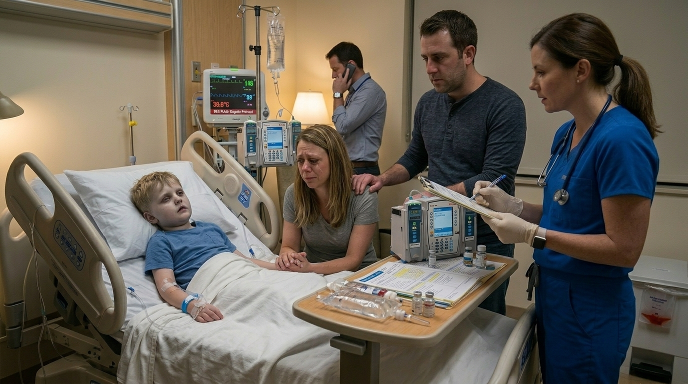

**What do you do?**

- **A. The Supportive Anchor** _(wrong)_ — You firmly believe that all diarrheal illnesses are self-limiting. You refuse to prescribe antibiotics, stating that they might cause C. difficile, and you insist on continuing supportive IV fluids only. → [19. The Supportive Anchor](#information-node-29)
- **B. The Targeted Eradication** _(correct)_ — You recognize that he has a moderate-to-severe bacterial etiology that is explicitly not responsive to rehydration alone. You prescribe a targeted antibiotic to eradicate the Shigella . → [22. The Targeted Eradication](#information-node-45)

---

### 19. The Supportive Anchor

You withhold the antibiotics. The Shigella bacteria, unchecked by any pharmacological intervention, breaches the mucosal barrier of his intestines entirely. The bacteria enter his systemic circulation. He develops severe gram-negative bacteremia, progressing rapidly to septic shock. His blood pressure collapses despite maximum IV fluid resuscitation, and he requires intubation and pressor support in the ICU.

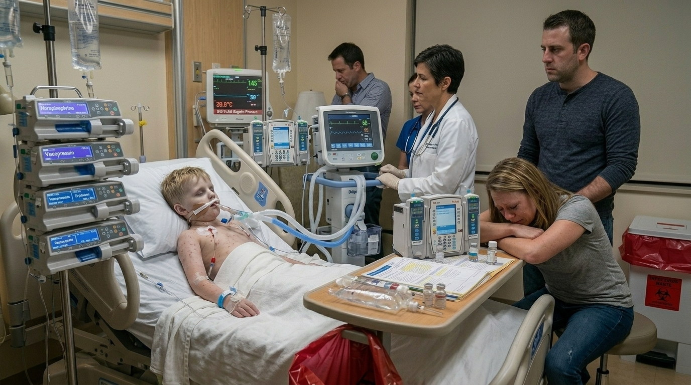

**Next:** [20. The Lesson:](#information-node-34)

---

### 20. The Lesson:

While supportive care (rehydration) is the primary treatment for the vast majority of diarrheal illnesses, there is a strict clinical threshold where supportive care is no longer sufficient. Antibiotics are explicitly indicated for bacterial etiologies causing moderate or severe diarrhea that is not responsive to rehydration . Withholding antibiotics from a toxic-appearing child with a confirmed, severe invasive Shigella infection out of an overabundance of caution regarding antibiotic stewardship allows the bacteria to overwhelm the host.

**Next:** [21. Terminal Outcome: The Sepsis Threshold](#termination-node-33)

---

### 21. Ending: Terminal Outcome: The Sepsis Threshold

> **Result:** fail · **Concept:** `Antibiotic Indications & Invasive Enteritis`

Final Outcome: Severe Morbidity / Untreated Bacteremia

The Flaw: Failing to escalate therapy to antibiotics when a bacterial etiology causes severe, refractory symptoms .  

Actionable Improvement: Know the exceptions to the "supportive care only" rule. Severe, bloody, bacterial diarrhea unresponsive to hydration requires targeted antibiotic therapy .

_End of this path._

---

### 22. The Targeted Eradication

You flawlessly managed a complex pediatric gastrointestinal presentation. You started with the correct conservative oral rehydration, accurately recognized the clinical shift to an inflammatory etiology requiring advanced studies, and correctly applied the strict indication for antibiotic therapy when supportive care failed. Leo recovers fully.

---

### 23. The Red Flag Recognition

You correctly identified the shift from uncomplicated watery diarrhea to complicated inflammatory diarrhea, triggering the correct diagnostic workup.

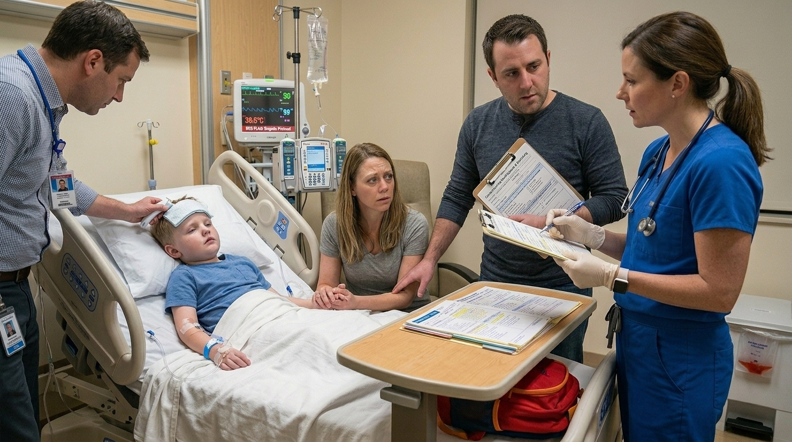

**Next:** [18. The Refractory Pathogen (Final Management)](#decision-node-41)

---

### 24. The Optimal Protocol

You correctly prioritized supportive care and avoided unnecessary, expensive testing for acute, uncomplicated watery diarrhea.

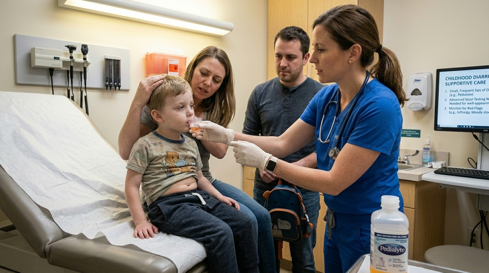

**Next:** [10. The Exudative Shift (Interprofessional Communication)](#decision-node-36)

---
