# The Gradient Collapse

> Pharmacology/Multi-systems

## Overview

| | |
|---|---|
| **Scenario key** | `Electrolytes and drug interaction` |
| **Scenario ID** | `68713678-c90e-468a-9dc4-a632b6707e47` |
| **Story pages** | 14 |
| **Decision points** | 5 (12 choices) |
| **Endings** | 5 (0 checkpoint, 5 fail) |
| **Concepts** | `Cardiac Electrophysiology & Resuscitation Sequencing`, `Cerebral Edema & Triage Severity`, `Osmotic Shifts & Iatrogenic Demyelination`, `Pharmacokinetics & Professional Arrogance`, `Pharmacological Interactions & Iatrogenic Recurrence` |
| **Graph file** | [`electrolytes-and-drug-interaction.json`](electrolytes-and-drug-interaction.json) |

This is a branching case study. The learner reads each story page, then at every decision point picks one of the choices. A *misstep* leads to a fail ending that sends the learner back to try again; the *correct* path continues the story and reaches checkpoint endings that mark the concepts learned.

## Flowchart

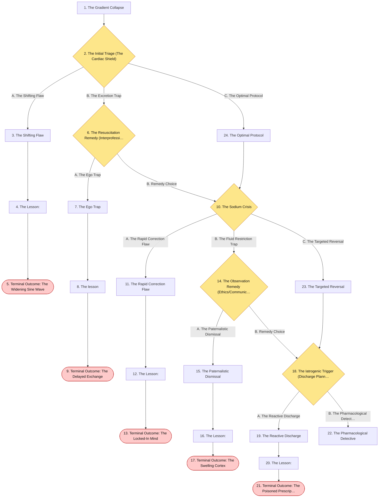

## The Story

### 1. The Gradient Collapse

Patient Profile: Arthur, a 64-year-old male.
Initial State: Arthur is brought to the emergency department via EMS after collapsing at home. His wife reports he has been complaining of severe muscle weakness, cramping, and a "fluttering" chest over the last 24 hours . His medical history includes diabetic nephropathy (chronic kidney disease) and hypertension.  Vitals: Blood Pressure $105/60$ mmHg, Pulse $48/min$ and irregular, Respirations $18/min$.
A stat electrocardiogram (ECG) reveals peaked T waves and widened QRS complexes . His rapid basic metabolic panel shows a critically high serum potassium of $7.6~mEq/L$.

**Next:** [2. The Initial Triage (The Cardiac Shield)](#decision-node-1)

---

### 2. Decision: The Initial Triage (The Cardiac Shield)

Arthur is experiencing life-threatening severe hyperkalemia with active cardiac dysfunction. You must initiate immediate pharmacological resuscitation before he decompensates into a fatal arrhythmia.

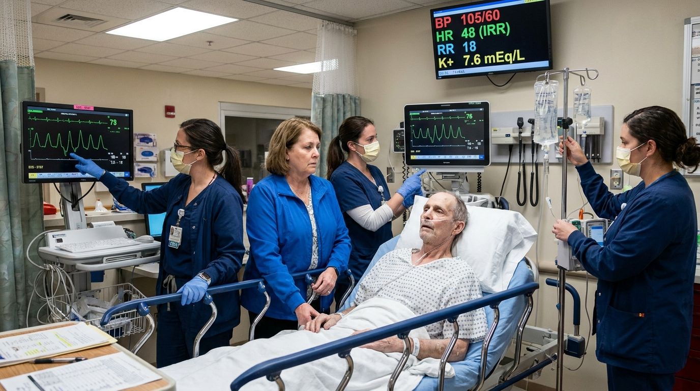

**What do you do?**

- **A. The Shifting Flaw** _(wrong)_ — You immediately order a rapid IV push of Insulin combined with Dextrose, along with Albuterol ($\beta_2$-adrenergic agonist) nebulizers, to quickly drive the potassium back inside his cells and lower the serum levels. → [3. The Shifting Flaw](#information-node-3)
- **B. The Excretion Trap** _(misstep)_ — You order an oral dose of Sodium Polystyrene Sulfonate (a cation exchange resin) to bind the potassium in his gut and excrete it from his body, avoiding IV medications because of his kidney disease. → [6. The Resuscitation Remedy (Interprofessional)](#decision-node-7)
- **C. The Optimal Protocol** _(correct)_ — Before attempting to lower his potassium levels, you order an immediate, rapid push of IV Calcium Gluconate to stabilize the electrical gradient of his heart . Once the calcium is administered, you order the IV Insulin and Dextrose to shift the potassium. → [24. The Optimal Protocol](#information-node-14)

---

### 3. The Shifting Flaw

You push the insulin and dextrose. While the medications circulate and slowly begin activating the $Na^+/K^+$ ATPase pumps, Arthur's myocardial membrane potential continues to degrade. His widened QRS complexes merge into his peaked T waves, forming a classic, terminal "sine wave" pattern on the monitor. He goes into ventricular fibrillation. Because his cardiac myocytes are profoundly depolarized by the potassium, defibrillation shocks are completely ineffective. He dies in the trauma bay.

**Next:** [4. The Lesson:](#information-node-4)

---

### 4. The Lesson:

Severe hyperkalemia depolarizes the resting membrane potential of cardiac myocytes, leading to widened QRS complexes and eventual ventricular fibrillation. While Insulin/Glucose and $\beta_2$-agonists correctly shift potassium into the cells , they take 15 to 30 minutes to begin working. In a patient with active ECG changes, the heart will arrest before the shift occurs. IV Calcium Gluconate must be given first; it does not lower potassium levels, but it immediately raises the threshold potential, rapidly stabilizing the myocardium and preventing lethal arrhythmias while you wait for the shifting agents to work .

**Next:** [5. Terminal Outcome: The Widening Sine Wave](#termination-node-5)

---

### 5. Ending: Terminal Outcome: The Widening Sine Wave

> **Result:** fail · **Concept:** `Cardiac Electrophysiology & Resuscitation Sequencing`

Final Outcome: Fatal / Iatrogenic Cardiac Arrest

The Flaw: Failing to stabilize the myocardial membrane with Calcium Gluconate prior to administering intracellular shifting agents.

Actionable Improvement: In hyperkalemia with ECG changes, the sequence is strict: 1) Stabilize the heart (IV Calcium Gluconate), 2) Shift the K+ (Insulin/Dextrose, Albuterol), 3) Remove the K+ (Furosemide, resins, or dialysis)

_End of this path._

---

### 6. Decision: The Resuscitation Remedy (Interprofessional)

You enter the order for Sodium Polystyrene Sulfonate. The critical care nurse looks at the monitor, then at you. "Doctor, his heart rate is dropping to 40 and his QRS is massive. That resin takes hours to clear potassium through the gut. We need to stabilize his myocardium right now with Calcium."

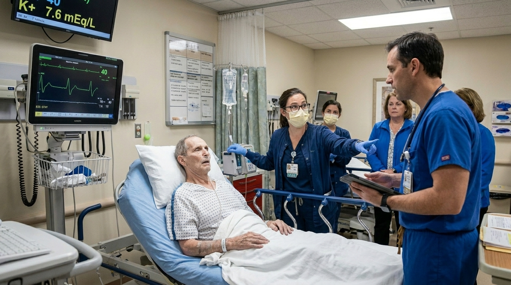

**What do you do?**

- **A. The Ego Trap** _(wrong)_ — You snap at the nurse, telling her that resins are the only way to actually remove the potassium from the body . You order her to administer the oral resin and wait. → [7. The Ego Trap](#information-node-9)
- **B. Remedy Choice** _(correct)_ — You realize you confused the long-term removal step with the immediate acute stabilization step. You thank the nurse for the rapid safety catch, cancel the resin, and order stat IV Calcium Gluconate followed by Insulin/Dextrose. → [10. The Sodium Crisis](#decision-node-36)

---

### 7. The Ego Trap

The nurse reluctantly administers the oral resin. It enters Arthur's stomach, hours away from having any measurable effect on his serum potassium. Ten minutes later, Arthur's severe bradycardia degrades into a pulseless electrical activity (PEA) arrest. Despite aggressive CPR, the unopposed potassium in his blood prevents his heart from restarting. You lost the patient because you refused to admit a pharmacological error.

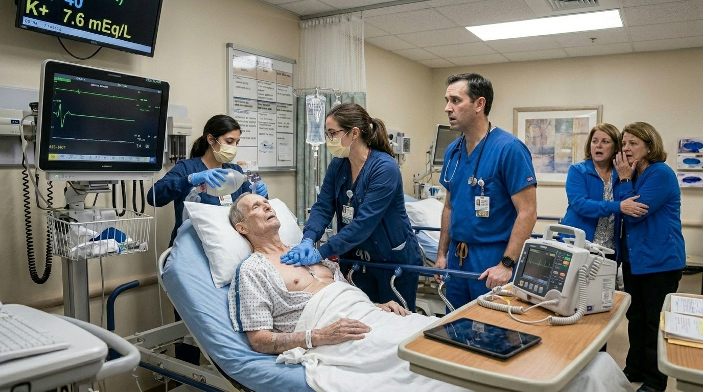

**Next:** [8. The lesson](#information-node-44)

---

### 8. The lesson

Sodium Polystyrene Sulfonate (Kayexalate) is a cation exchange resin that binds potassium in the gastrointestinal tract to lower total body potassium . However, its onset of action is 2 to 24 hours. Using a slow-acting gastrointestinal medication to treat an active, life-threatening cardiac dysrhythmia is a fatal misunderstanding of pharmacokinetics. Allowing physician ego to override a critical safety alert from a nurse virtually guarantees patient harm.

**Next:** [9. Terminal Outcome: The Delayed Exchange](#termination-node-11)

---

### 9. Ending: Terminal Outcome: The Delayed Exchange

> **Result:** fail · **Concept:** `Pharmacokinetics & Professional Arrogance`

Final Outcome: Fatal / Negligent Resuscitation Delay

The Flaw: Utilizing a slow-onset medication for an immediate life-threat and dismissing interprofessional safety interventions.

Actionable Improvement: Never use exchange resins as monotherapy for acute, symptomatic hyperkalemia. Calcium must be given immediately.

_End of this path._

---

### 10. Decision: The Sodium Crisis

Arthur's heart is stabilized, and his potassium shifts down to $5.5~mEq/L$. He is admitted to the ICU.Three hours later, his full metabolic panel returns. His serum sodium is critically low at $112~mmol/L$ (severe hyponatremia) . His wife notes he has been drinking gallons of water over the past week due to an unquenchable thirst. He is currently euvolemic on exam, but he suddenly develops a generalized tonic-clonic seizure in his bed.

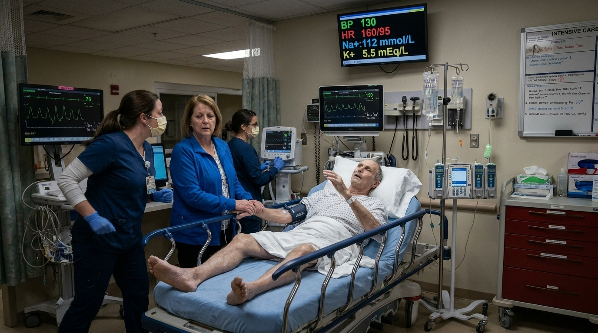

**What do you do?**

- **A. The Rapid Correction Flaw** _(wrong)_ — You recognize the severe hyponatremia. To stop the seizures and save his brain, you order a massive, rapid, continuous infusion of 3% Hypertonic Saline to bring his serum sodium back to a normal level (135 mmol/L) within the next 4 hours. → [11. The Rapid Correction Flaw](#information-node-18)
- **B. The Fluid Restriction Trap** _(misstep)_ — You diagnose euvolemic hyponatremia (likely psychogenic polydipsia) . Because he is seizing, you quickly order a strict free water restriction, telling the ICU nurse to give him absolutely no IV fluids so his body can correct the imbalance naturally. → [14. The Observation Remedy (Ethics/Communication)](#decision-node-38)
- **C. The Targeted Reversal** _(correct)_ — You recognize that active seizures indicate severe hyponatremia requiring immediate pharmacological intervention . You order a carefully calculated bolus of 3% Hypertonic Saline to raise his serum sodium by just enough to stop the seizures (approx. 4-6 mEq/L), strictly ensuring you do not correct the sodium by more than 8 mEq/L in a 24-hour period. → [23. The Targeted Reversal](#information-node-21)

---

### 11. The Rapid Correction Flaw

You rapidly push the 3% Hypertonic Saline until his sodium hits 135 mmol/L. The seizures stop, and Arthur initially wakes up. However, 48 hours later, he begins to develop profound dysarthria and dysphagia. The rapid fluid shift has stripped the myelin from his pontine neurons . He progresses to quadriplegia. He becomes permanently "locked-in"—fully conscious and awake, but completely paralyzed except for vertical eye movements. You caused an irreversible, catastrophic neurological injury.

**Next:** [12. The Lesson:](#information-node-19)

---

### 12. The Lesson:

When severe hyponatremia develops over time, the brain's neurons adapt by exporting organic osmolytes to prevent cellular swelling. If you rapidly infuse hypertonic saline to bring the serum sodium back to "normal" too quickly, the extracellular fluid becomes hypertonic relative to the adapted neurons. Water is violently sucked out of the brain cells, causing them to acutely shrink. This causes irreversible destruction of the myelin sheaths, classically in the pons—a condition known as Osmotic Demyelination Syndrome (formerly Central Pontine Myelinolysis) .

**Next:** [13. Terminal Outcome: The Locked-In Mind](#termination-node-20)

---

### 13. Ending: Terminal Outcome: The Locked-In Mind

> **Result:** fail · **Concept:** `Osmotic Shifts & Iatrogenic Demyelination`

Final Outcome: Severe Morbidity / Iatrogenic Osmotic Demyelination Syndrome

The Flaw: Correcting chronic hyponatremia too rapidly with hypertonic saline.

Actionable Improvement: Never correct sodium faster than 0.5 mEq/L per hour (or a maximum of 8 mEq/L in 24 hours). Raise it just enough to stop the seizures, then correct the rest slowly.

_End of this path._

---

### 14. Decision: The Observation Remedy (Ethics/Communication)

Arthur is actively seizing. The ICU nurse looks at you in disbelief. "Doctor, free water restriction is for asymptomatic hyponatremia . He is having active neurological seizures from severe hyponatremia! He needs hypertonic saline now!"

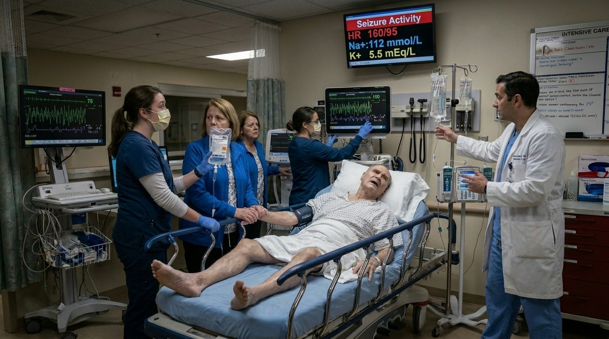

**What do you do?**

- **A. The Paternalistic Dismissal** _(wrong)_ — You tell the nurse, "Giving him IV fluids when he is already water-intoxicated makes no physiological sense. Strap him down, give him Lorazepam, and restrict his water." → [15. The Paternalistic Dismissal](#information-node-26)
- **B. Remedy Choice** _(correct)_ — You realize the severity of the symptoms completely changes the management algorithm. You quickly apologize, abandon the water restriction, and order a carefully controlled bolus of 3% Hypertonic Saline to break the seizure → [18. The Iatrogenic Trigger (Discharge Planning)](#decision-node-41)

---

### 15. The Paternalistic Dismissal

You withhold the hypertonic saline. You push Lorazepam, but because the underlying cause (intracellular swelling) is not addressed, the seizures continue. Arthur's brain cells continue to pull in water from the hypoosmolar blood. His brain swells against the rigid confines of his skull. He develops Cushing's triad (bradycardia, hypertension, irregular breathing) and fatally herniates his brainstem through the foramen magnum.

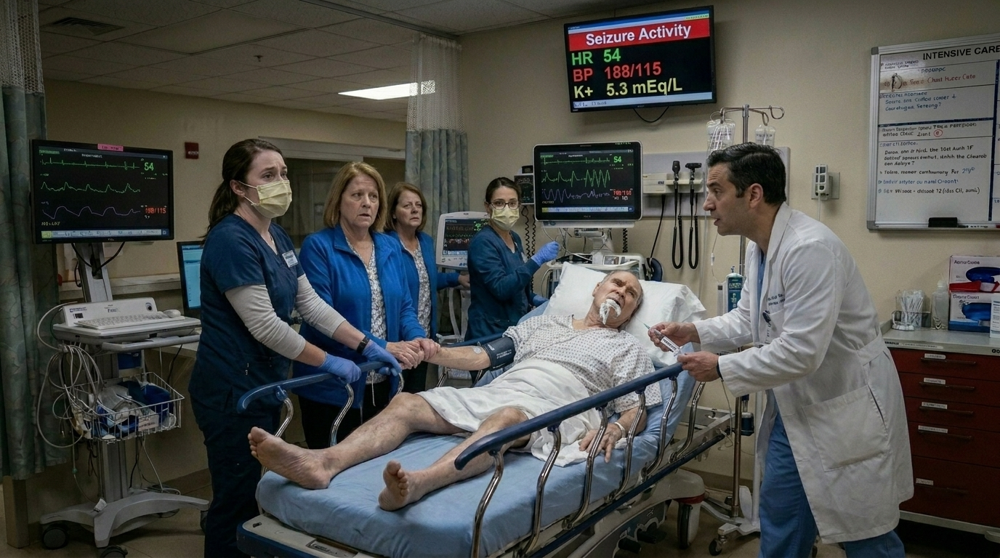

**Next:** [16. The Lesson:](#information-node-28)

---

### 16. The Lesson:

While free water restriction is the correct treatment for asymptomatic or mild euvolemic hyponatremia , it takes days to shift the serum concentration. Active seizures and coma define severe hyponatremia. The brain is actively swelling due to the hypoosmolar extracellular fluid. The only way to acutely reverse cerebral edema and stop the seizures is to administer 3% Hypertonic Saline . Refusing standard-of-care emergency therapy due to a misunderstanding of concentration gradients is a fatal error.

**Next:** [17. Terminal Outcome: The Swelling Cortex](#termination-node-32)

---

### 17. Ending: Terminal Outcome: The Swelling Cortex

> **Result:** fail · **Concept:** `Cerebral Edema & Triage Severity`

Final Outcome: Fatal / Unmanaged Cerebral Edema

The Flaw: Utilizing an asymptomatic treatment (water restriction) for a severe, life-threatening neurological emergency.

Actionable Improvement: Severe, symptomatic hyponatremia (seizures/coma) mandates the use of 3% Hypertonic Saline .

_End of this path._

---

### 18. Decision: The Iatrogenic Trigger (Discharge Planning)

Arthur recovers fully from his electrolyte disasters. His sodium is normal, and his potassium is stable at $4.5~mEq/L$.Before discharging him, you review his outpatient medication list to determine what triggered his initial hyperkalemic cardiac crisis. He has diabetic nephropathy, and his home medications include an Angiotensin Converting Enzyme (ACE) inhibitor for renal protection. Two weeks ago, his primary care doctor prescribed Trimethoprim-Sulfamethoxazole (TMP-SMX) for a suspected prostate/urinary infection.

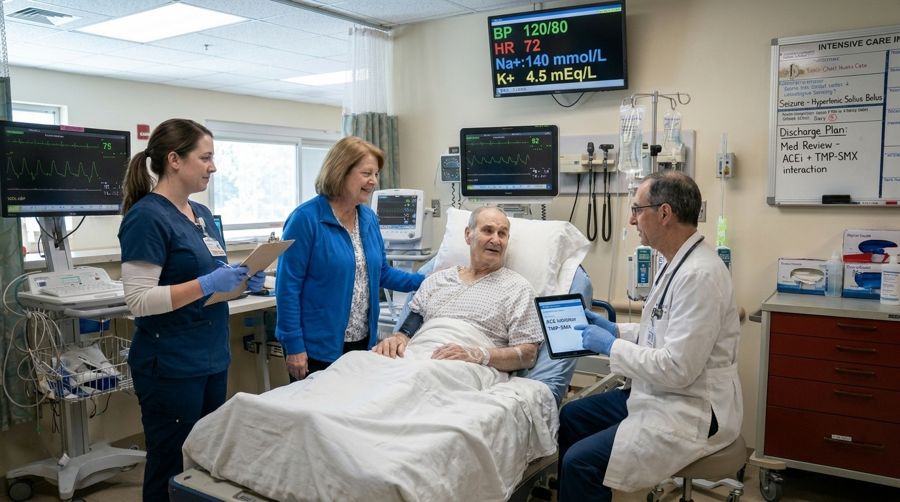

**What do you do?**

- **A. The Reactive Discharge** _(wrong)_ — You tell Arthur his kidneys just "had a bad week." You discharge him on all of his previous home medications—including the ACE inhibitor and the TMP-SMX—and tell him to avoid eating bananas and potatoes. → [19. The Reactive Discharge](#information-node-29)
- **B. The Pharmacological Detective** _(correct)_ — You immediately recognize the lethal drug interaction. You explain that both ACE inhibitors and TMP-SMX independently cause potassium retention by disrupting aldosterone and potassium channels in the kidney . You discontinue the TMP-SMX, switch his antibiotic to a safer alternative, and arrange for close outpatient lab monitoring. → [22. The Pharmacological Detective](#information-node-45)

---

### 19. The Reactive Discharge

Arthur goes home and resumes his prescribed medications. The TMP-SMX and the ACE inhibitor continue to synergistically block potassium excretion in his already compromised kidneys. Four days later, he suffers a massive recurrence of severe hyperkalemia. He collapses in his kitchen. Because you failed to identify and remove the offending pharmacological triggers, EMS cannot revive him

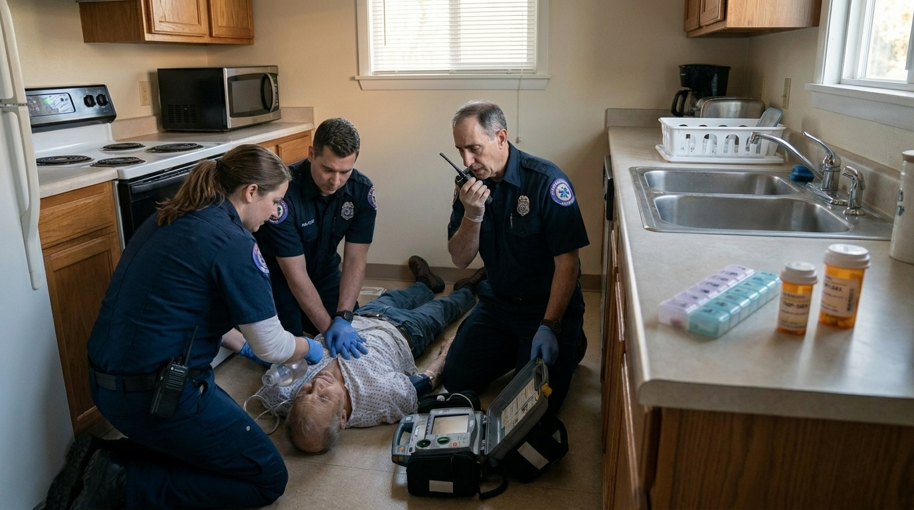

**Next:** [20. The Lesson:](#information-node-34)

---

### 20. The Lesson:

Electrolyte emergencies rarely happen in a vacuum; they are frequently iatrogenic. In a patient with underlying renal insufficiency (diabetic nephropathy), combining an ACE inhibitor (which blocks aldosterone, leading to potassium retention) with Trimethoprim-Sulfamethoxazole (where Trimethoprim acts like a potassium-sparing diuretic by blocking ENaC channels in the collecting duct) is a well-known, highly dangerous combination . Discharging the patient back into the community on the exact same medications that caused his cardiac arrest is gross negligence.

**Next:** [21. Terminal Outcome: The Poisoned Prescription](#termination-node-33)

---

### 21. Ending: Terminal Outcome: The Poisoned Prescription

> **Result:** fail · **Concept:** `Pharmacological Interactions & Iatrogenic Recurrence`

Final Outcome: Fatal / Negligent Discharge & Drug Interaction

The Flaw: Failing to perform a medication reconciliation to identify drugs known to cause hyperkalemia (ACE inhibitors, TMP-SMX) .  

Actionable Improvement: Always investigate why an electrolyte abnormality occurred. TMP-SMX should be used with extreme caution in patients on ACE inhibitors or with underlying kidney disease.

_End of this path._

---

### 22. The Pharmacological Detective

You flawlessly managed a complex dual-electrolyte disaster. You correctly prioritized cardiac stabilization in severe hyperkalemia, safely navigated the narrow therapeutic window of hypertonic saline to reverse cerebral edema, and identified a highly-testable iatrogenic drug interaction, preventing a fatal recurrence upon discharge.

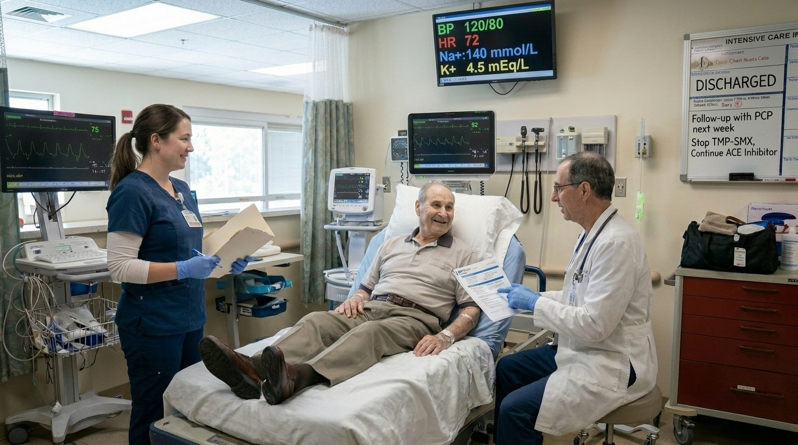

---

### 23. The Targeted Reversal

You correctly treated the acute neurological emergency with hypertonic saline while adhering to the strict limits required to prevent catastrophic myelin damage.

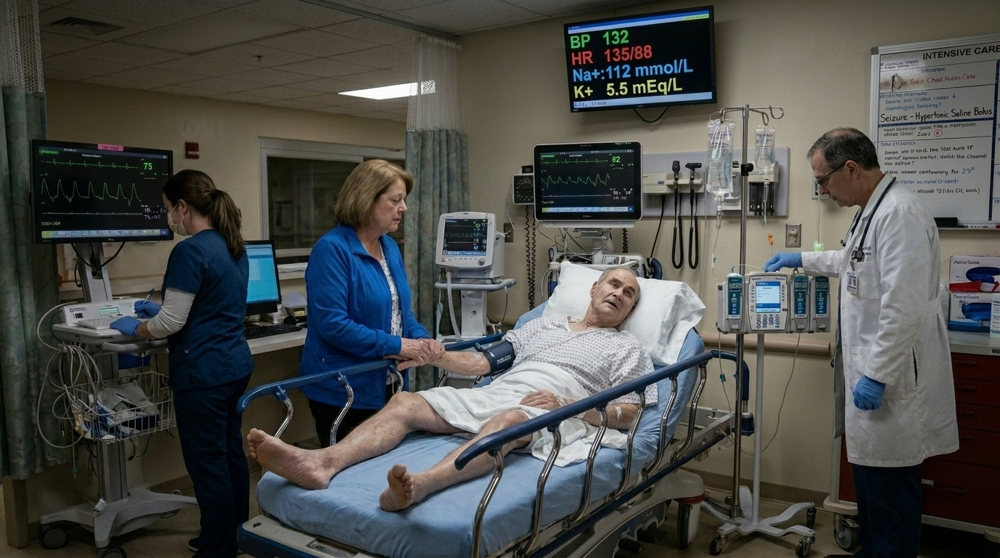

**Next:** [18. The Iatrogenic Trigger (Discharge Planning)](#decision-node-41)

---

### 24. The Optimal Protocol

You correctly recognized that stabilizing the cardiac membrane takes absolute precedence over lowering the serum potassium in a patient with active ECG changes.

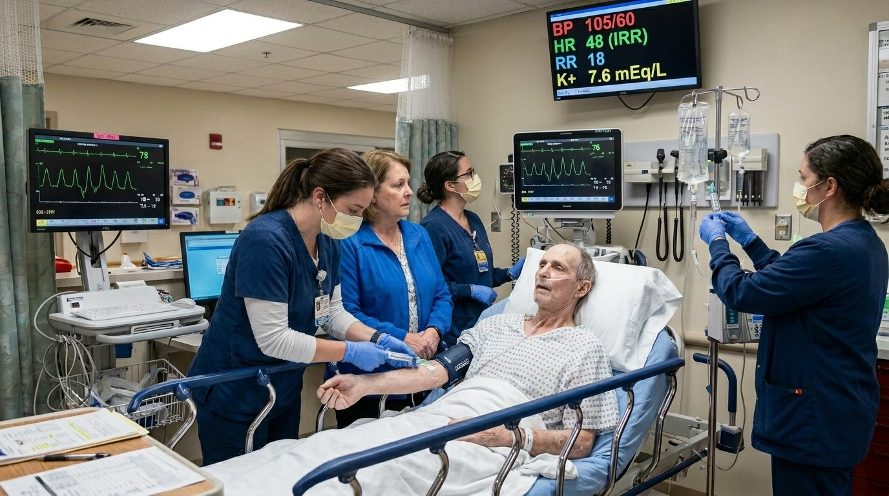

**Next:** [10. The Sodium Crisis](#decision-node-36)

---
