# The Waddell Impact

> Multi-system trauma

## Overview

| | |
|---|---|
| **Scenario key** | `Emergency care/Surgery` |
| **Scenario ID** | `36470af0-bf97-4f85-bd4a-d2ae5e4f85e4` |
| **Story pages** | 14 |
| **Decision points** | 5 (12 choices) |
| **Endings** | 5 (0 checkpoint, 5 fail) |
| **Concepts** | `Interprofessional Collaboration & Airway Physiology`, `Operative Sequencing & Limb Salvage`, `Primary Survey & Environmental Triage`, `Time Toxicity & Definitive Hemorrhage Control`, `Vascular Hard Signs & Occult Hemorrhage` |
| **Graph file** | [`emergency-care-surgery.json`](emergency-care-surgery.json) |

This is a branching case study. The learner reads each story page, then at every decision point picks one of the choices. A *misstep* leads to a fail ending that sends the learner back to try again; the *correct* path continues the story and reaches checkpoint endings that mark the concepts learned.

## Flowchart

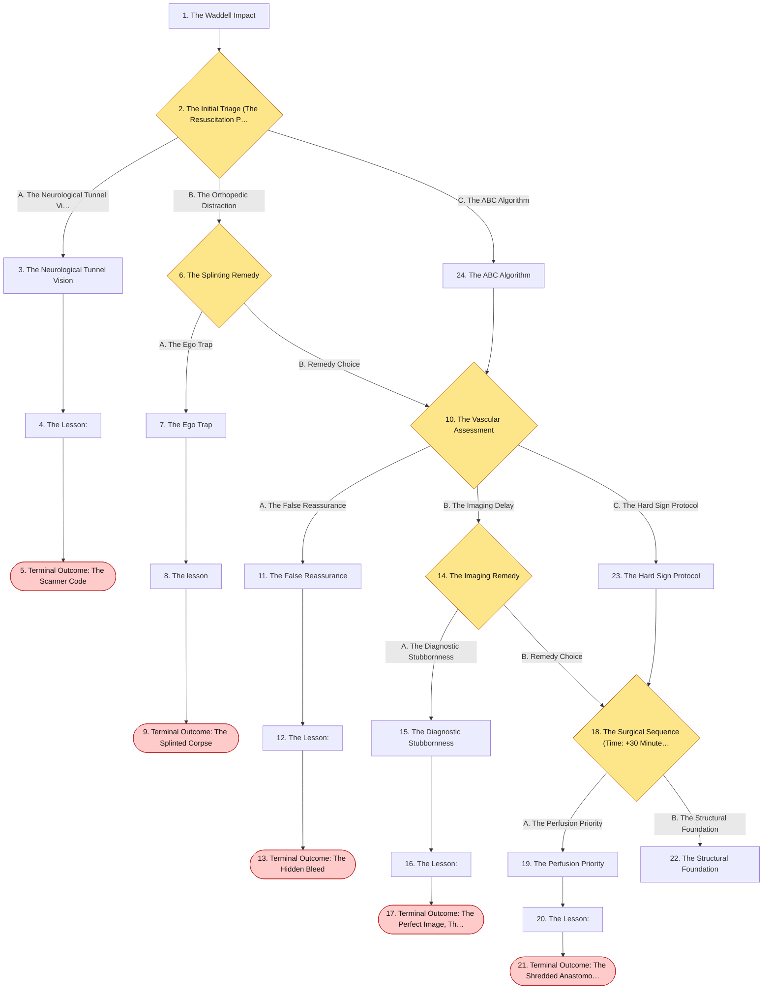

## The Story

### 1. The Waddell Impact

Patient Profile: Leo, a 12-year-old male.Initial State: Leo is brought into the trauma bay via EMS after a pedestrian-automobile impact. He was struck by a vehicle traveling approximately 40 mph. He has an obviously deformed left femur, a large contusion on his chest, and a severe right-sided scalp laceration. He is moaning incomprehensibly and does not open his eyes to pain. His Glasgow Coma Scale (GCS) is calculated at 7.Vitals: Blood Pressure $85/50$ mmHg, Pulse $135/min$, Respirations $8/min$ and shallow, Oxygen Saturation 86% on room air.

**Next:** [2. The Initial Triage (The Resuscitation Protocol)](#decision-node-1)

---

### 2. Decision: The Initial Triage (The Resuscitation Protocol)

The trauma bay is chaotic. You are the team leader. Leo's mother is screaming in the hallway. A pediatric trauma involving a pedestrian often presents with multisystem damage known as Waddell's triad (femur fracture, intrathoracic/abdominal injury, and contralateral head injury) . You must direct the initial resuscitation.

**What do you do?**

- **A. The Neurological Tunnel Vision** _(wrong)_ — Because he has a severe mechanism of injury, a contralateral head laceration, and a low GCS, you prioritize his brain. You order the team to immediately transfer him to the CT scanner for a stat non-contrast head CT to rule out an epidural hematoma. → [3. The Neurological Tunnel Vision](#information-node-3)
- **B. The Orthopedic Distraction** _(misstep)_ — You see the massively deformed femur and recognize the potential for hemorrhagic shock. You order the nurses to establish two large-bore IVs for fluid resuscitation, type and cross him for blood, and you begin manually applying a traction splint to the leg. → [6. The Splinting Remedy](#decision-node-7)
- **C. The ABC Algorithm** _(correct)_ — You look at his respiratory rate and his GCS of 7. You halt the room, grab the laryngoscope, and perform an immediate endotracheal intubation to secure his airway before addressing the fractures or the head trauma. → [24. The ABC Algorithm](#information-node-14)

---

### 3. The Neurological Tunnel Vision

You rapidly move Leo onto the CT table. As the machine spins up, his already shallow respirations cease entirely. Because he is enclosed in the scanner, your team does not notice his apnea until the monitor alarms flatline. By the time you pull him out of the scanner and attempt a difficult intubation on a hypoxic, arresting child, he has suffered irreversible anoxic brain injury.

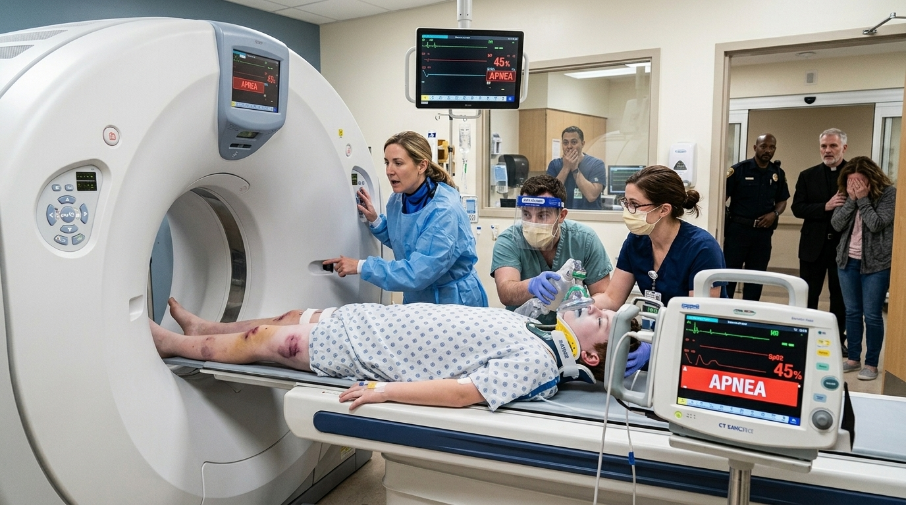

**Next:** [4. The Lesson:](#information-node-4)

---

### 4. The Lesson:

While identifying a traumatic brain injury is critical, there is an absolute rule in trauma management: never send an unstable patient to the CT scanner. Furthermore, the foundation of trauma care is the ABCs (Airway, Breathing, Circulation). Leo has an unprotected airway (GCS < 8), poor respiratory effort, and hypoxemia. Moving him into an isolated scanner without securing his airway guarantees respiratory collapse.

**Next:** [5. Terminal Outcome: The Scanner Code](#termination-node-5)

---

### 5. Ending: Terminal Outcome: The Scanner Code

> **Result:** fail · **Concept:** `Primary Survey & Environmental Triage`

Final Outcome: Fatal / Iatrogenic Anoxic Brain Injury

The Flaw: Violating the ABCs of resuscitation and placing an unstable, un-intubated patient in a radiology suite.

Actionable Improvement: Never forget the ABCs of resuscitation. Secure the airway first, especially for any patient with a GCS < 8. Do not send unstable patients to the CT scanner.

_End of this path._

---

### 6. Decision: The Splinting Remedy

You are focused on splinting the leg. The respiratory therapist (RT) taps your shoulder urgently. "Doctor, his respiratory rate is dropping to 6, and his sats are 84%. He can't protect his airway with this GCS. We need to tube him right now.

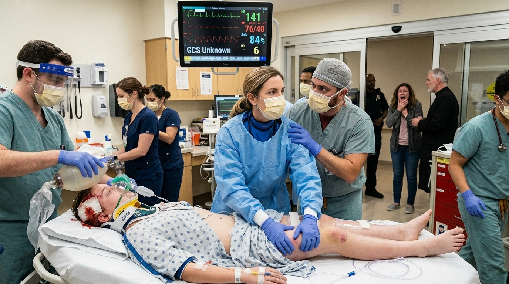

**What do you do?**

- **A. The Ego Trap** _(wrong)_ — You snap at the RT, telling them not to interrupt you while you are stabilizing a major long-bone fracture. You order them to just put a non-rebreather mask on him while you finish the splint. → [7. The Ego Trap](#information-node-9)
- **B. Remedy Choice** _(correct)_ — You immediately drop the traction splint, acknowledge the RT's correct assessment of the primary survey, and move to the head of the bed to intubate and secure the airway . → [10. The Vascular Assessment](#decision-node-36)

---

### 7. The Ego Trap

You aggressively finish applying the traction splint. Meanwhile, Leo's unprotected airway occludes entirely due to pooling blood from his facial trauma. The non-rebreather mask is useless because he is not exchanging air. He goes into a hypoxic bradycardic arrest. You successfully stabilized the bone, but you lost the patient to a completely preventable airway obstruction.

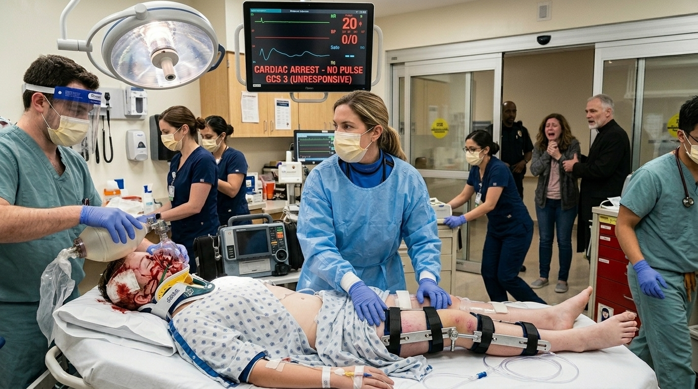

**Next:** [8. The lesson](#information-node-44)

---

### 8. The lesson

Effective trauma resuscitation relies on flat hierarchies and clear interprofessional communication. The respiratory therapist correctly identified two absolute indications for intubation: failure to oxygenate/ventilate and an inability to protect the airway (GCS < 8) . Treating a bone fracture before securing a failing airway violates the fundamental ABC algorithm. Allowing physician ego to override a critical safety call from a team member is a profound failure of crew resource management.

**Next:** [9. Terminal Outcome: The Splinted Corpse](#termination-node-11)

---

### 9. Ending: Terminal Outcome: The Splinted Corpse

> **Result:** fail · **Concept:** `Interprofessional Collaboration & Airway Physiology`

Final Outcome: Fatal / Hypoxic Arrest & Professional Negligence

The Flaw: Prioritizing orthopedic stabilization over the airway, and silencing a valid clinical warning from a colleague out of ego.

Actionable Improvement: The airway is always first. Listen to your team members when they call out an ABC failure.

_End of this path._

---

### 10. Decision: The Vascular Assessment

You have successfully intubated Leo. His oxygen saturations improve to 99%. With the airway secure, you move to the secondary survey.

You expose his left leg. He has a displaced fracture of the distal femur. The nurse checks his foot and calls out, "Distal pedal pulses are palpable." However, as you observe the back of the knee, you notice a massive, firm hematoma that is visibly and rapidly expanding.

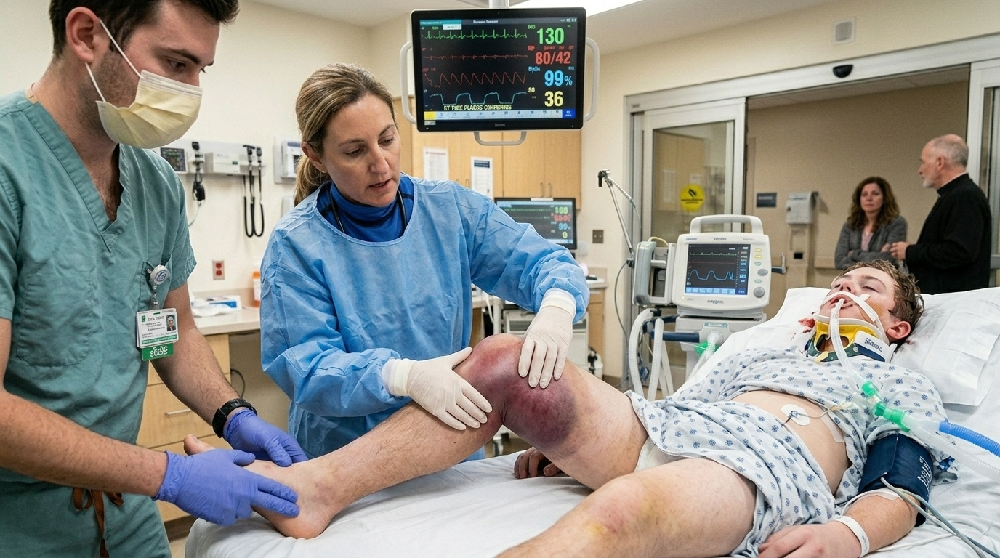

**What do you do?**

- **A. The False Reassurance** _(wrong)_ — Because the distal pedal pulses are present, you determine there is no major vascular compromise. You order the nurses to clean the area and administer tetanus prophylaxis. → [11. The False Reassurance](#information-node-18)
- **B. The Imaging Delay** _(misstep)_ — You recognize there might be vascular injury. Because his vitals are stabilizing, you order a CT angiogram of the lower extremity to precisely map the injury before calling the surgeons. → [14. The Imaging Remedy](#decision-node-38)
- **C. The Hard Sign Protocol** _(correct)_ — Despite the presence of pulses, you recognize the rapidly expanding hematoma as a "hard sign" of vascular injury. You immediately page the trauma surgery team for emergent surgical exploration in the OR. → [23. The Hard Sign Protocol](#information-node-21)

---

### 11. The False Reassurance

You clean the superficial abrasions and wait for orthopedics to arrive. Over the next thirty minutes, the expanding hematoma ruptures through the deep fascial layers of Leo's thigh. The popliteal artery, which was completely transected but temporarily tamponading itself, begins to hemorrhage massively into the massive potential space of his leg. He rapidly bleeds out internally and goes into profound hemorrhagic shock.

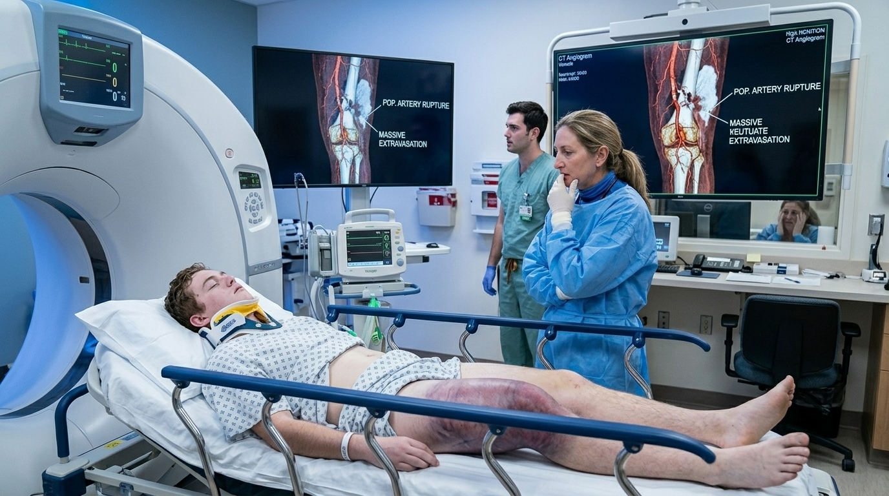

**Next:** [12. The Lesson:](#information-node-19)

---

### 12. The Lesson:

The presence of distal pulses does absolutely not rule out a vascular injury. An artery can be partially torn or actively bleeding into a fascial compartment while still allowing enough flow to produce a faint distal pulse. A worsening, expanding hematoma is a definitive, "hard" sign of clear vascular injury. Cleaning the wound and giving tetanus is the next best step only if there is no nearby vasculature involved

**Next:** [13. Terminal Outcome: The Hidden Bleed](#termination-node-20)

---

### 13. Ending: Terminal Outcome: The Hidden Bleed

> **Result:** fail · **Concept:** `Vascular Hard Signs & Occult Hemorrhage`

Final Outcome: Fatal / Missed Vascular Injury & Hemorrhagic Shock

The Flaw: Relying solely on distal pulses to rule out vascular trauma while ignoring a rapidly expanding hematoma.

Actionable Improvement: A worsening hematoma is a clear vascular injury requiring the next best step: surgical exploration .

_End of this path._

---

### 14. Decision: The Imaging Remedy

You order the CT Angiogram. As the team prepares to transport him, the hematoma doubles in size, and his blood pressure begins to acutely drop.

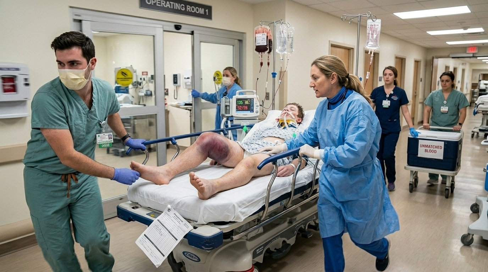

**What do you do?**

- **A. The Diagnostic Stubbornness** _(wrong)_ — You tell the team to push rapid fluids and force him into the scanner anyway, insisting the surgeons will refuse to operate without a "roadmap" of the vessels. → [15. The Diagnostic Stubbornness](#information-node-26)
- **B. Remedy Choice** _(correct)_ — You realize the expanding hematoma indicates active, severe bleeding. Imaging is for stable patients with "soft" signs. You cancel the CT and immediately rush him to the OR for surgical exploration . → [18. The Surgical Sequence (Time: +30 Minutes)](#decision-node-41)

---

### 15. The Diagnostic Stubbornness

You rush Leo to the CT scanner. The contrast is injected, producing a beautiful, high-resolution 3D reconstruction of a completely blown popliteal artery pouring contrast into his thigh. However, during the 15 minutes required to obtain the scan, Leo exsanguinates internally. You get the perfect anatomical picture, but the patient dies on the scanner table before the surgeons can make an incision.

**Next:** [16. The Lesson:](#information-node-28)

---

### 16. The Lesson:

CT Angiography is indicated to assess nearby vasculature only if the patient has stable vitals and lacks "hard signs" of arterial injury. A rapidly worsening hematoma combined with a dropping blood pressure dictates immediate surgical exploration . Delaying operative hemorrhage control to obtain an anatomical "roadmap" in an actively bleeding patient is a lethal error.

**Next:** [17. Terminal Outcome: The Perfect Image, The Dead Patient](#termination-node-32)

---

### 17. Ending: Terminal Outcome: The Perfect Image, The Dead Patient

> **Result:** fail · **Concept:** `Time Toxicity & Definitive Hemorrhage Control`

Final Outcome: Fatal / Exsanguination due to Imaging Delay

The Flaw: Obtaining advanced imaging in the presence of clear, hard signs of vascular injury (expanding hematoma).  

Actionable Improvement: If you see a worsening hematoma or absent pulses, bypass the scanner. The diagnosis is made clinically; the treatment is surgical exploration .

_End of this path._

---

### 18. Decision: The Surgical Sequence (Time: +30 Minutes)

You are in the operating room. The orthopedic and vascular surgery teams are assembled. Upon opening the posterior thigh, you discover a chaotic injury: the femur is shattered, the popliteal artery is torn, and the tibial nerve is severed.

You must determine the correct order of repair for the bone, artery, and nerve.

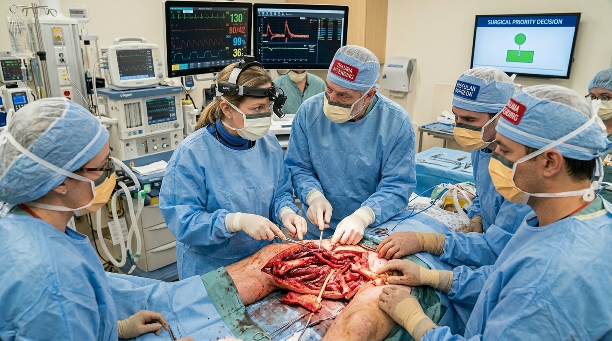

**What do you do?**

- **A. The Perfusion Priority** _(wrong)_ — Because tissue dies without blood, you direct the vascular surgeon to immediately repair the popliteal artery first to restore perfusion to the lower leg. Once the artery is secure, the orthopedic surgeon can fix the bone. → [19. The Perfusion Priority](#information-node-29)
- **B. The Structural Foundation** _(correct)_ — You direct the orthopedic surgeon to repair the bone first. Once the structural framework is rigid, the vascular surgeon repairs the artery, followed by the nerve repair. Finally, you perform prophylactic fasciotomies. → [22. The Structural Foundation](#information-node-45)

---

### 19. The Perfusion Priority

The vascular surgeon spends 45 minutes meticulously repairing the popliteal artery. Blood flow is restored. Then, the orthopedic surgeon steps in. As they apply heavy traction to align the shattered femur and hammer in the intramedullary nail, the sharp bone fragments shift violently. The mechanical stress completely shreds the fresh vascular repair. The artery blows open again, destroying the vessel beyond repair. Due to the massive, unfixable tissue damage, Leo requires an above-the-knee amputation.

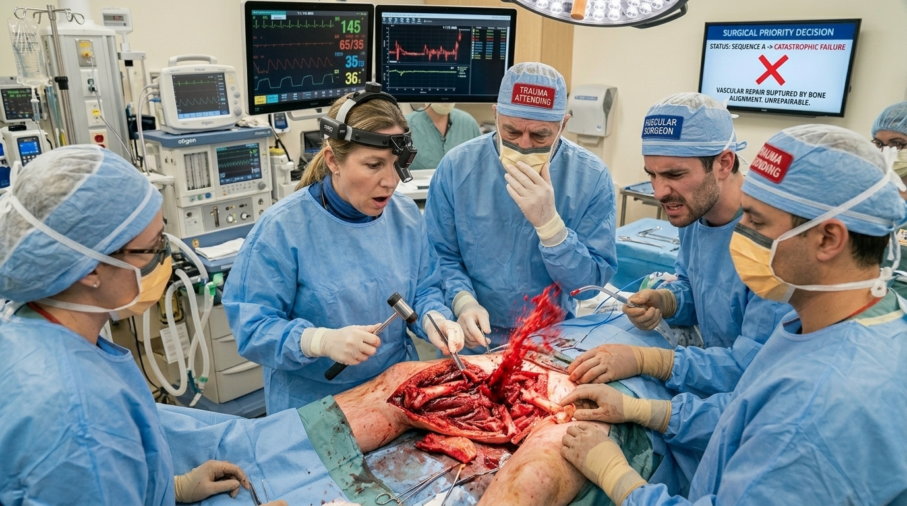

**Next:** [20. The Lesson:](#information-node-34)

---

### 20. The Lesson:

While it intuitively makes sense to restore blood flow as fast as possible, fixing a delicate vascular anastomosis next to a highly unstable, jagged bone fracture is a recipe for disaster. Orthopedic fixation involves traction, drilling, hammering, and significant mechanical manipulation—it is "rough work". If the artery is repaired first, the subsequent orthopedic manipulation will immediately tear the delicate vascular sutures apart, destroying the repair and causing massive re-bleeding.

**Next:** [21. Terminal Outcome: The Shredded Anastomosis](#termination-node-33)

---

### 21. Ending: Terminal Outcome: The Shredded Anastomosis

> **Result:** fail · **Concept:** `Operative Sequencing & Limb Salvage`

Final Outcome: Severe Morbidity / Iatrogenic Amputation

The Flaw: Reversing the correct operative sequence and subjecting a delicate vascular repair to extreme mechanical orthopedic stress.

Actionable Improvement: Memorize the triad of limb salvage repair: 1. Bone (build the foundation) -> 2. Artery (restore flow) -> 3. Nerve (restore function) -> Prophylactic Fasciotomy (prevent compartment syndrome) .

_End of this path._

---

### 22. The Structural Foundation

ou flawlessly navigated a complex, multisystem trauma. You secured the airway first, recognized the hard signs of vascular injury, and executed the exact operative sequence required to salvage the limb: bone, then artery, then nerve, followed by fasciotomies to prevent compartment syndrome . Leo survives with his leg intact.

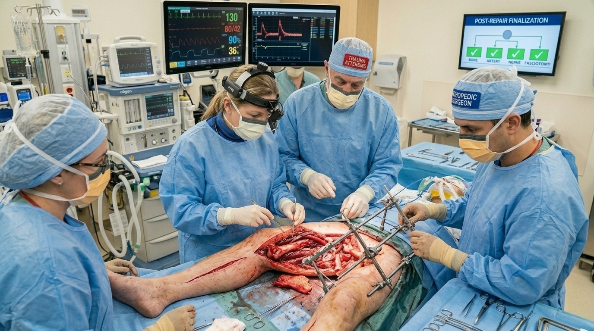

---

### 23. The Hard Sign Protocol

You correctly recognized that the presence of distal pulses does not rule out a vascular injury. A worsening hematoma is a clear vascular injury requiring immediate surgical exploration

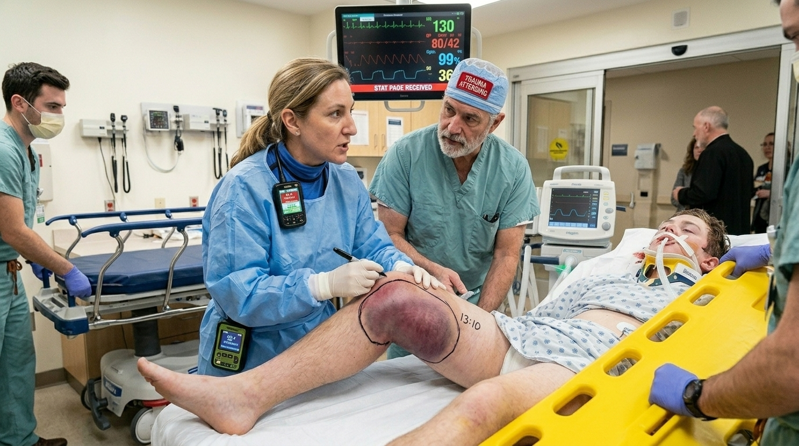

**Next:** [18. The Surgical Sequence (Time: +30 Minutes)](#decision-node-41)

---

### 24. The ABC Algorithm

You correctly recognized that the next best step is never management of the pathology if the patient's vitals are unstable or could lose an airway. An inability to protect the airway (GCS < 8) and failure to oxygenate are absolute indications for immediate intubation

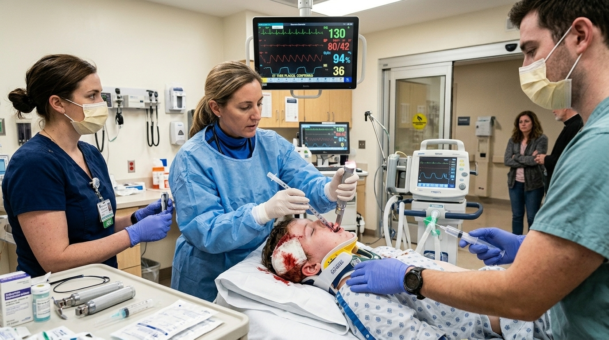

**Next:** [10. The Vascular Assessment](#decision-node-36)

---
