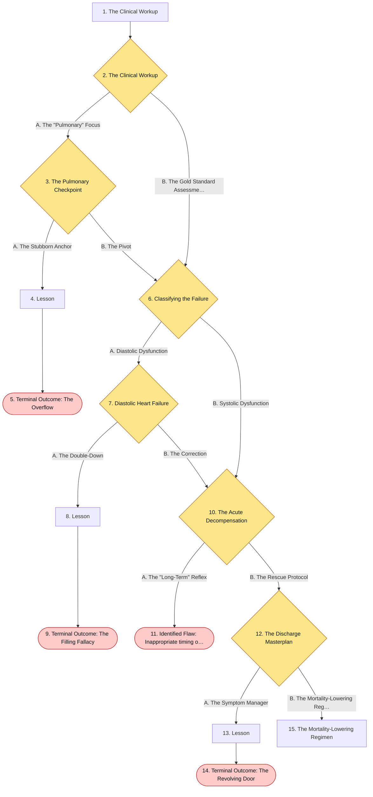
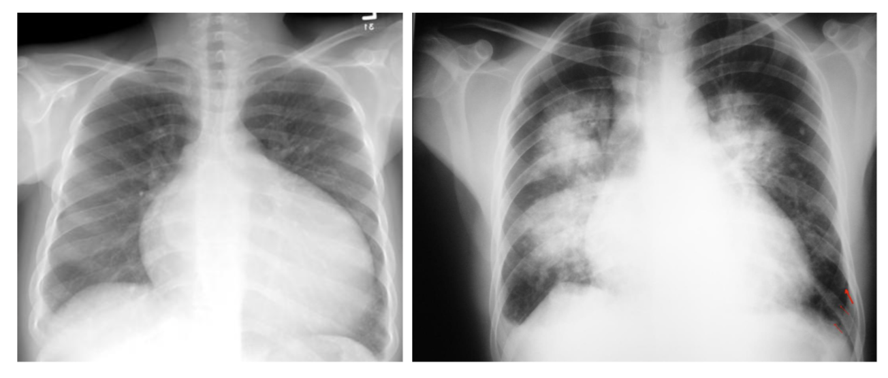
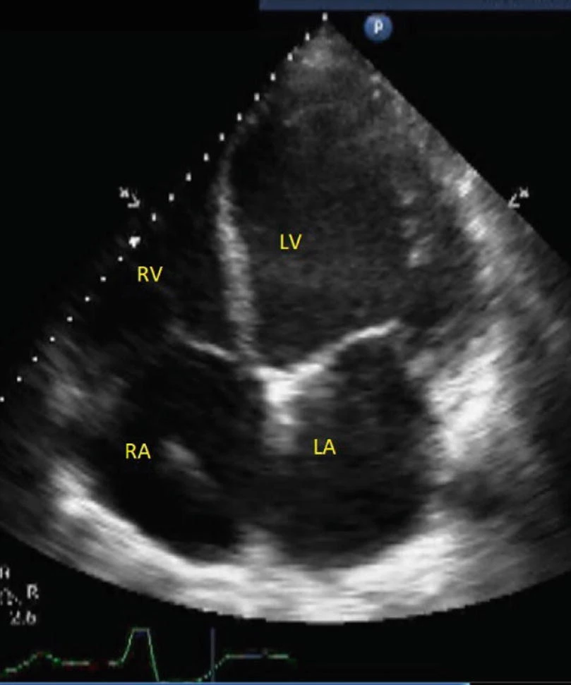
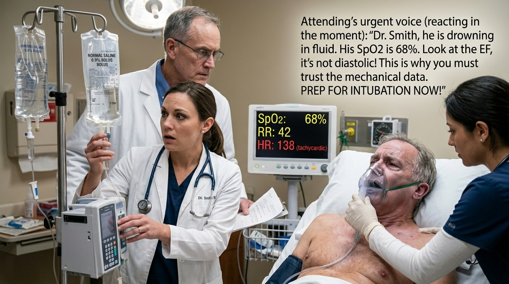
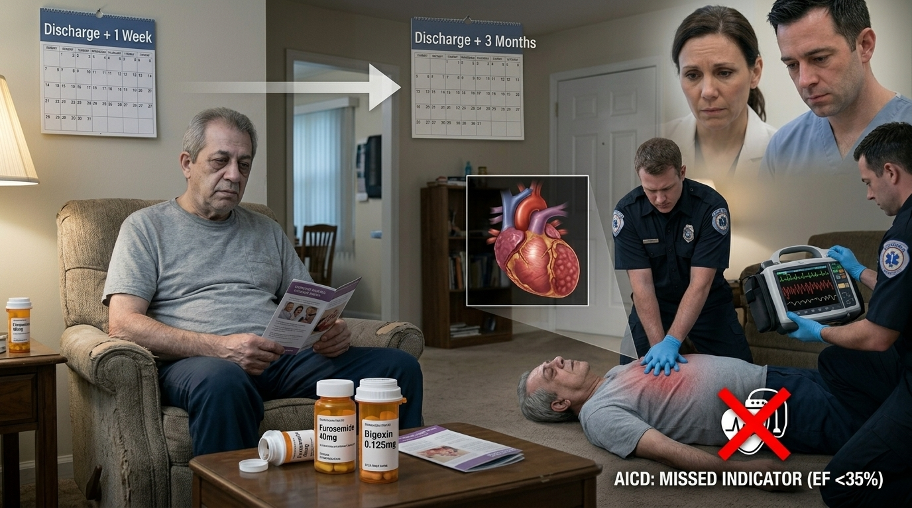

# The Drowning Heart

> acute and chronic management of Heart Failure

## Overview

| | |
|---|---|
| **Scenario key** | `Heart Failure` |
| **Scenario ID** | `893731bc-9779-4eb9-85cb-1e056bb74819` |
| **Story pages** | 5 |
| **Decision points** | 6 (12 choices) |
| **Endings** | 4 (0 checkpoint, 4 fail) |
| **Concepts** | `Diagnostic Anchoring & Iatrogenic Volume Overload`, `Diagnostic Anchoring & Volume Overload`, `Iatrogenic Shock / Worsening Pulmonary Edema`, `Neurohormonal Blockade & Mortality Reduction` |
| **Graph file** | [`heart-failure.json`](heart-failure.json) |

This is a branching case study. The learner reads each story page, then at every decision point picks one of the choices. A *misstep* leads to a fail ending that sends the learner back to try again; the *correct* path continues the story and reaches checkpoint endings that mark the concepts learned.

## Flowchart

## The Story

### 1. The Clinical Workup

Patient Profile: Mr. Elias Vance, 60-year-old male.

Initial State: He presents to the clinic reporting several months of progressively worsening dyspnea on exertion, severe fatigue, and lower-extremity swelling. He mentions he can no longer sleep flat in bed and has to prop himself up on three pillows (orthopnea). His medical history is significant for sarcoidosis

**Next:** [2. The Clinical Workup](#decision-node-1)

---

### 2. Decision: The Clinical Workup

You step into the exam room. Mr. Vance looks exhausted. On physical exam, you note pronounced jugular venous distention (JVD) and 2+ pitting edema in his lower extremities. When you listen to his lungs, you hear bilateral crackles (rales) at the bases.

**What do you do?**

- **A. The "Pulmonary" Focus** _(misstep)_ — Assume his dyspnea and crackles are primarily a primary pulmonary issue related to his sarcoidosis. Order a chest X-ray, prescribe an albuterol inhaler, and advise him to elevate his legs at night. → [3. The Pulmonary Checkpoint](#decision-node-13)
- **B. The Gold Standard Assessment** _(correct)_ — Recognize the classic signs of heart failure. Order an immediate Echocardiogram to evaluate his cardiac function and a stat B-type natriuretic peptide (BNP) level. → [6. Classifying the Failure](#decision-node-4)

---

### 3. Decision: The Pulmonary Checkpoint

You treated Mr. Vance for a sarcoidosis-related pulmonary exacerbation. Two hours later, his dyspnea has not improved with the albuterol. The chest radiograph you ordered returns. The read shows significant cardiomegaly, pulmonary vascular congestion, and prominent Kerley-B lines.

**What do you do?**

- **A. The Stubborn Anchor** _(wrong)_ — Conclude that the sarcoidosis has caused severe interstitial lung disease. Order high-dose IV corticosteroids to reduce lung inflammation and admit him to the medical floor for observation. → [4. Lesson](#information-node-16)
- **B. The Pivot** _(correct)_ — Recognize the pattern. Kerley-B lines indicate interstitial edema, and cardiomegaly points to a pump failure. You realize the fluid accumulating in his alveoli is due to left heart pressure overload. You immediately cancel the steroids, order a stat Echocardiogram, and push IV loop diuretics → [6. Classifying the Failure](#decision-node-4)

---

### 4. Lesson

Dyspnea is a symptom, not a diagnosis. While this patient has a history of sarcoidosis (which can cause lung disease), you must evaluate the entire clinical picture. Jugular venous distention, orthopnea, pitting lower extremity edema, and Kerley-B lines on a chest radiograph are the classic tetrad of congestive heart failure. Treating volume-overloaded heart failure with IV fluids and high-dose steroids (which cause fluid retention) will rapidly exacerbate the hydrostatic pressure in the pulmonary capillaries, drowning the patient in their own fluids.

**Next:** [5. Terminal Outcome: The Overflow](#termination-node-17)

---

### 5. Ending: Terminal Outcome: The Overflow

> **Result:** fail · **Concept:** `Diagnostic Anchoring & Iatrogenic Volume Overload`

Final Outcome: Failure / Iatrogenic Respiratory Failure

The Flaw: Ignoring objective physical exam findings (JVD, pitting edema) and imaging data (Kerley-B lines, cardiomegaly) that contradicted your initial assumption.

Identified Weakness: Differentiating cardiac vs. pulmonary causes of dyspnea.

Actionable Improvement: When a patient presents with dyspnea, always systematically check the "pump, pipes, and tissue." Remember that a normal BNP excludes a diagnosis of CHF; if you are unsure, pull the biomarker.

_End of this path._

---

### 6. Decision: Classifying the Failure

The echocardiogram results are back. It shows an ejection fraction (EF) of 35%.

**What do you do?**

- **A. Diastolic Dysfunction** _(wrong)_ — Diagnose him with Diastolic Dysfunction → [7. Diastolic Heart Failure](#decision-node-18)
- **B. Systolic Dysfunction** _(correct)_ — Diagnose him with Systolic Dysfunction (Heart Failure with reduced Ejection Fraction - HFrEF) → [10. The Acute Decompensation](#decision-node-7)

---

### 7. Decision: Diastolic Heart Failure

You document "Diastolic Heart Failure" based on his history of sarcoidosis, knowing sarcoidosis can cause a restrictive cardiomyopathy. The cardiology attending reviews your note and stops you in the hall.

"Dr. Smith, you noted diastolic dysfunction here. But the echo shows an EF of 35%. Walk me through your mechanical reasoning."

**What do you do?**

- **A. The Double-Down** _(wrong)_ — Argue that the sarcoid granulomas stiffened the heart, decreasing compliance and causing problems with relaxation and filling, which is the definition of diastolic failure. → [8. Lesson](#information-node-23)
- **B. The Correction** _(correct)_ — Pause and re-evaluate the physics. "You are right. Diastolic dysfunction typically has a normal ejection fraction. An EF < 45% means a loss of contractile strength. This is Systolic Dysfunction. → [10. The Acute Decompensation](#decision-node-7)

---

### 8. Lesson

Ejection fraction is the great divider in heart failure algorithms. While it is true that sarcoidosis can cause a restrictive cardiomyopathy leading to diastolic dysfunction, you must treat the patient in front of you, not just their past medical history. Diastolic dysfunction is defined as an impairment in the filling of the heart and typically presents with a normal ejection fraction. An echocardiogram showing an ejection fraction of 35% definitively indicates a loss of contractile strength—the hallmark of systolic dysfunction. Insisting on diastolic heart failure despite a low EF leads to fundamentally flawed, and often lethal, management choices—such as aggressively pushing IV fluids to "help the stiff ventricle fill," which completely overwhelms an already failing pump

**Next:** [9. Terminal Outcome: The Filling Fallacy](#termination-node-24)

---

### 9. Ending: Terminal Outcome: The Filling Fallacy

> **Result:** fail · **Concept:** `Diagnostic Anchoring & Volume Overload`

The Flaw: Ignoring the definitive diagnostic criteria of heart failure classification. An ejection fraction < 45% is the hallmark of systolic dysfunction, regardless of the underlying etiology.

Identified Weakness: Echocardiogram interpretation and distinguishing between the hemodynamics of HFrEF (systolic) and HFpEF (diastolic).

Actionable Improvement: Always classify heart failure based on the echocardiogram's ejection fraction first. Remember that right and left heart pressures are extremely delicate in systolic dysfunction; adding unnecessary volume to a weak pump will immediately cause pulmonary edema

_End of this path._

---

### 10. Decision: The Acute Decompensation

Before you can send Mr. Vance home, he suddenly begins coughing up frothy sputum. He is visibly struggling to breathe. His oxygen saturation (SpO2) drops to 88% on room air. He is in acute decompensated heart failure with acute pulmonary edema.

**What do you do?**

- **A. The "Long-Term" Reflex** _(wrong)_ — You want to protect his heart long-term. You immediately administer an oral Beta-blocker (like metoprolol) to reduce his mortality and push an ACE-inhibitor. → [11. Identified Flaw: Inappropriate timing of mortality-lowering drugs.](#termination-node-25)
- **B. The Rescue Protocol** _(correct)_ — Administer supplemental oxygen (since SpO2 is <90%), push IV loop diuretics for acute symptom relief, and administer nitrates → [12. The Discharge Masterplan](#decision-node-10)

---

### 11. Ending: Identified Flaw: Inappropriate timing of mortality-lowering drugs.

> **Result:** fail · **Concept:** `Iatrogenic Shock / Worsening Pulmonary Edema`

Your Choice: Administered Beta-blockers during an episode of acute decompensated heart failure.The Flaw: Conflating chronic management with acute resuscitation. The patient's heart was already failing to pump blood effectively forward, causing fluid to back up into his lungs (pulmonary edema). Beta-blockers decrease the heart's contractility and heart rate. Giving this to a heart that is acutely failing pushes the patient off the physiological cliff. The Correction: The immediate goal in acute decompensation is offloading the pressure and fluid. This requires supplemental oxygen, loop diuretics, and nitrates. Mortality-lowering drugs (ACE-i, Beta-blockers, Spironolactone) are initiated only after the patient is euvolemic and stable.

_End of this path._

---

### 12. Decision: The Discharge Masterplan

Mr. Vance is stabilized after a few days in the hospital. You are writing his long-term discharge orders. You need to design a regimen that specifically targets reducing his mortality, knowing his EF is severe (< 35%).

**What do you do?**

- **A. The Symptom Manager** _(wrong)_ — Discharge him on daily Loop Diuretics to keep the fluid off, and Digoxin to help his heart squeeze better. → [13. Lesson](#information-node-21)
- **B. The Mortality-Lowering Regimen** _(correct)_ — Discharge him on an ACE-inhibitor (or ARB), a Beta-blocker (e.g., carvedilol), and Spironolactone. Furthermore, because his EF is < 35%, you place a referral for an Automatic Implantable Cardioverter/Defibrillator (AICD) → [15. The Mortality-Lowering Regimen](#information-node-26)

---

### 13. Lesson

There is a critical difference between treating the symptoms of heart failure and treating the pathology of heart failure. Loop diuretics are excellent for acute symptom relief by pulling off fluid, but they are not effective long-term due to nephrogenic adaptations. Digoxin acts as a positive inotrope and can reduce hospitalizations in severe systolic dysfunction, but it does not improve mortality. To actually extend a patient's life, you must block the neurohormonal pathways (renin-angiotensin-aldosterone system and sympathetic nervous system) that cause toxic cardiac remodeling. Furthermore, an EF < 35% is highly arrhythmogenic.

**Next:** [14. Terminal Outcome: The Revolving Door](#termination-node-22)

---

### 14. Ending: Terminal Outcome: The Revolving Door

> **Result:** fail · **Concept:** `Neurohormonal Blockade & Mortality Reduction`

The Flaw: Prescribing a medication regimen focused purely on hemodynamics and symptom relief while neglecting proven mortality-lowering therapies and device indications.

Identified Weakness: Chronic heart failure pharmacology and ICD placement criteria.

Actionable Improvement: Memorize the foundational triad of mortality-lowering drugs for HFrEF: Beta-blockers , ACE-inhibitors/ARBs , and Spironolactone/Eplerenone. Additionally, strictly flag any patient with an EF < 35% for an ICD evaluation to prevent fatal arrhythmias.

_End of this path._

---

### 15. The Mortality-Lowering Regimen

You have built a hemodynamically optimal plan. ACE-inhibitors, Beta-blockers, and Spironolactone all specifically lower mortality in systolic dysfunction. Furthermore, recognizing that an EF < 35% in a dilated cardiomyopathy meets the strict indication for an AICD shows excellent clinical foresight.

---
