# The Ring-Enhancing Dilemma

> Infectious disease

## Overview

| | |
|---|---|
| **Scenario key** | `HIV` |
| **Scenario ID** | `75d0dc16-6f8c-4b30-b210-ca0acf62d9db` |
| **Story pages** | 14 |
| **Decision points** | 5 (12 choices) |
| **Endings** | 5 (0 checkpoint, 5 fail) |
| **Concepts** | `Bedside Manner & Viral Resistance`, `Diagnostic Algorithms & Unnecessary Surgical Risk`, `Immune Reconstitution & Paradoxical Inflammation`, `Obstetric Guidelines & Vertical Transmission`, `Pharmacology & Prophylaxis vs. Treatment` |
| **Graph file** | [`hiv.json`](hiv.json) |

This is a branching case study. The learner reads each story page, then at every decision point picks one of the choices. A *misstep* leads to a fail ending that sends the learner back to try again; the *correct* path continues the story and reaches checkpoint endings that mark the concepts learned.

## Flowchart

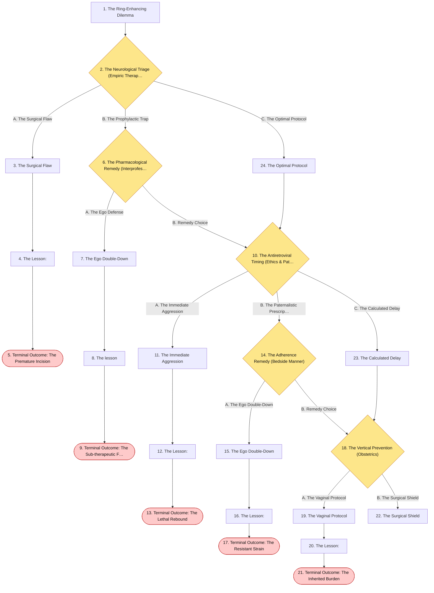

## The Story

### 1. The Ring-Enhancing Dilemma

Patient Profile: David, a 38-year-old male.
Initial State: David is brought to the emergency department by his partner after suffering a new-onset generalized tonic-clonic seizure. He has been experiencing severe headaches and progressive left-sided weakness over the past two weeks. He has no known past medical history, but admits to a history of intravenous drug use several years ago. A rapid fourth-generation combination HIV-1/2 immunoassay is positive, and his CD4+ T-cell count returns critically low at $45~cells/\mu L$ . A stat MRI of the brain reveals multiple ring-enhancing lesions with surrounding edema in the basal ganglia.

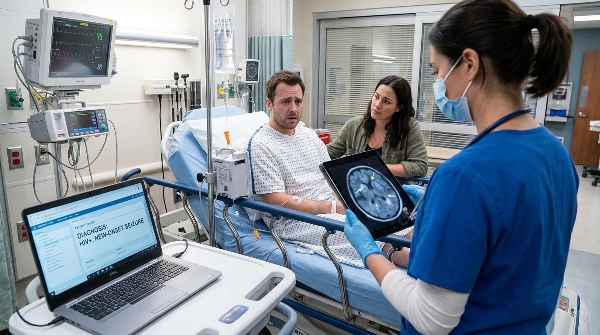

**Next:** [2. The Neurological Triage (Empiric Therapy)](#decision-node-1)

---

### 2. Decision: The Neurological Triage (Empiric Therapy)

David is stabilized after his seizure. You must decide the immediate next step in managing these intracranial lesions in a newly diagnosed, severely immunocompromised HIV patient.

**What do you do?**

- **A. The Surgical Flaw** _(wrong)_ — Because brain lesions can be fatal, you immediately consult neurosurgery to perform a stereotactic brain biopsy to obtain a definitive tissue diagnosis before starting any antimicrobial therapy. → [3. The Surgical Flaw](#information-node-3)
- **B. The Prophylactic Trap** _(misstep)_ — You diagnose Toxoplasmosis. You start him on high-dose intravenous Trimethoprim-sulfamethoxazole (TMP-SMX) to treat the infection. → [6. The Pharmacological Remedy (Interprofessional)](#decision-node-7)
- **C. The Optimal Protocol** _(correct)_ — You suspect Toxoplasma gondii encephalitis. Because he has a CD4 count < 100, focal neurologic findings, and ring-enhancing lesions, you immediately initiate empiric therapy with Pyrimethamine-sulfadiazine and plan to repeat head imaging in 10-14 days. → [24. The Optimal Protocol](#information-node-14)

---

### 3. The Surgical Flaw

You send David for an emergent brain biopsy. Due to his advanced HIV and poor nutritional status, he has poor wound healing and altered coagulation. During the stereotactic needle insertion, a small vessel is clipped, causing a massive intraparenchymal hemorrhage. He herniates and dies on the operating table. The pathology report later confirms Toxoplasma gondii—a highly treatable infection that would have completely resolved with oral medications.

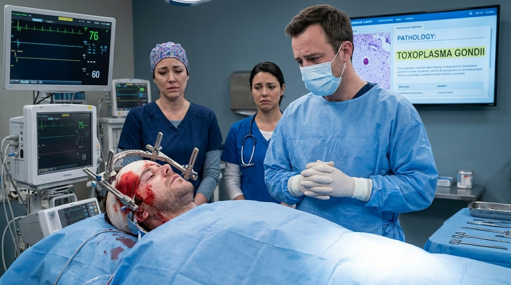

**Next:** [4. The Lesson:](#information-node-4)

---

### 4. The Lesson:

In an HIV patient with a CD4 count $< 100~cells/\mu L$ presenting with focal neurologic deficits and ring-enhancing lesions, the most likely etiology is Toxoplasma gondii. Because this presentation is so classic, the standard of care is to start empiric treatment with Pyrimethamine-sulfadiazine for 10-14 days. A brain biopsy is highly invasive and is strictly reserved for patients who fail to improve clinically or radiographically after the 10-14 day empiric trial (which would raise suspicion for Central Nervous System EBV Lymphoma).

**Next:** [5. Terminal Outcome: The Premature Incision](#termination-node-5)

---

### 5. Ending: Terminal Outcome: The Premature Incision

> **Result:** fail · **Concept:** `Diagnostic Algorithms & Unnecessary Surgical Risk`

Final Outcome: Fatal / Iatrogenic Hemorrhage

The Flaw: Performing an invasive brain biopsy before attempting a 10-14 day trial of empiric Pyrimethamine-sulfadiazine for suspected Toxoplasmosis.  

Actionable Improvement: Treat classic ring-enhancing lesions in advanced AIDS empirically first. Only biopsy if the lesions do not shrink after 14 days of therapy.

_End of this path._

---

### 6. Decision: The Pharmacological Remedy (Interprofessional)

You enter the order for TMP-SMX. The infectious disease pharmacist pages you immediately. "Doctor, I see you ordered TMP-SMX for this patient's active brain lesions. While that drug is used for prophylaxis, the standard active empiric treatment for Toxoplasma is different. Would you like to adjust the order?"

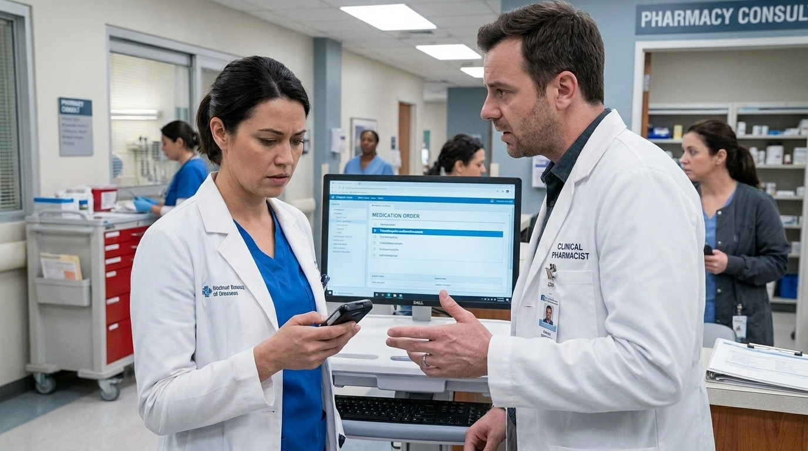

**What do you do?**

- **A. The Ego Defense** _(wrong)_ — You tell the pharmacist that TMP-SMX covers Toxoplasma just fine and refuse to change your order, demanding they verify the medication immediately. → [7. The Ego Double-Down](#information-node-9)
- **B. Remedy Choice** _(correct)_ — You realize your error. TMP-SMX is used prophylactically when CD4 < 100, but the active treatment regimen is Pyrimethamine-sulfadiazine. You thank the pharmacist and correct the order. → [10. The Antiretroviral Timing (Ethics & Pathophysiology)](#decision-node-36)

---

### 7. The Ego Double-Down

You force the TMP-SMX order through. Because the medication is inadequate for resolving a massive, active parasitic burden in the brain parenchyma, the Toxoplasma gondii continues to multiply. The lesions expand, drastically increasing David's intracranial pressure. Ten days later, he suffers a status epilepticus event that cannot be broken. He suffers permanent anoxic brain injury.

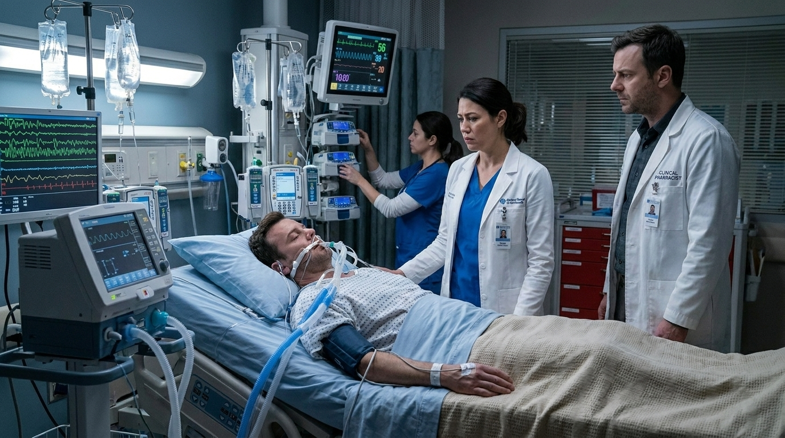

**Next:** [8. The lesson](#information-node-44)

---

### 8. The lesson

Understanding the difference between prophylaxis and active treatment is critical in infectious disease. Trimethoprim-sulfamethoxazole is used to prevent Toxoplasmosis (and Pneumocystis jirovecii) when the CD4 count drops below 100. However, once the patient has an active, invasive brain abscess, the required empiric treatment is Pyrimethamine-sulfadiazine (often given with leucovorin). Using a prophylactic agent for a fulminant CNS infection results in sub-therapeutic eradication.

**Next:** [9. Terminal Outcome: The Sub-therapeutic Failure](#termination-node-11)

---

### 9. Ending: Terminal Outcome: The Sub-therapeutic Failure

> **Result:** fail · **Concept:** `Pharmacology & Prophylaxis vs. Treatment`

Final Outcome: Severe Morbidity / Treatment FailureThe Flaw: Conflating prophylactic therapy (TMP-SMX) with the required active empiric therapy (Pyrimethamine-sulfadiazine) for Toxoplasmosis.  Actionable Improvement: Respect pharmacy interventions. Always use Pyrimethamine-sulfadiazine for active Toxo lesions.

_End of this path._

---

### 10. Decision: The Antiretroviral Timing (Ethics & Pathophysiology)

David responds beautifully to the Pyrimethamine-sulfadiazine. By day 12, his repeat MRI shows the lesions have shrunk by 60%, and his left-sided weakness is resolving.  

He is currently recovering in the infectious disease unit. It is now time to address his underlying HIV infection.

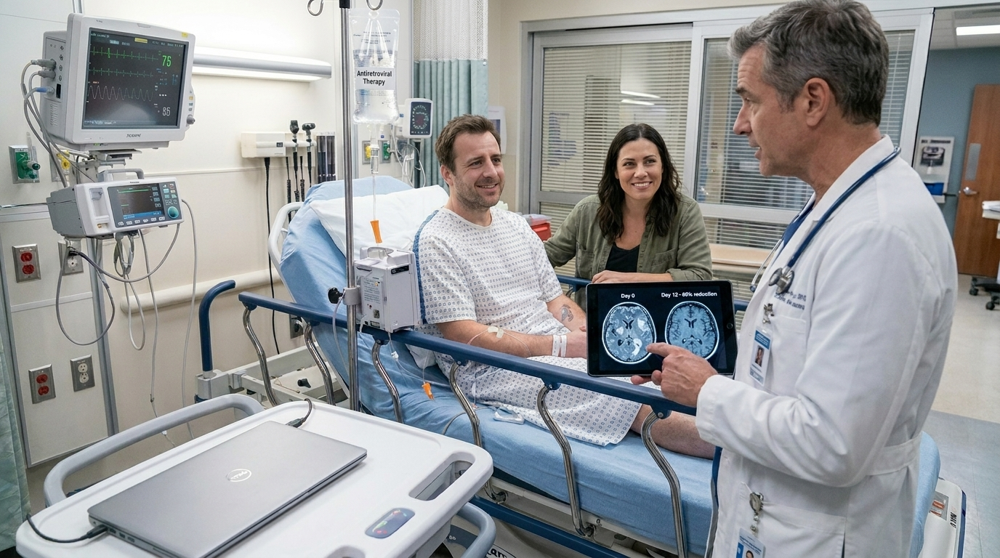

**What do you do?**

- **A. The Immediate Aggression** _(wrong)_ — You want to wipe out the virus as fast as possible. On day 2 of his hospital admission—while his brain lesions were still massively inflamed—you simultaneously started him on a 3-drug Antiretroviral Therapy (ART) regimen consisting of 2 nucleoside reverse transcriptase inhibitors (NRTIs) and an integrase inhibitor . → [11. The Immediate Aggression](#information-node-18)
- **B. The Paternalistic Prescription** _(misstep)_ — Now that his infection is clearing, you prescribe his ART. You drop the pill bottles on his tray, tell him he brought this on himself with his past drug use, and state that if he doesn't take these pills every day, he will die. You discharge him without further counseling. → [14. The Adherence Remedy (Bedside Manner)](#decision-node-38)
- **C. The Calculated Delay** _(correct)_ — You correctly waited until his acute Toxoplasma infection was clinically improving before initiating his ART (2 NRTIs and an integrase inhibitor) . You sit down with him, explain the medications, and assess his readiness to begin lifelong daily therapy. → [23. The Calculated Delay](#information-node-21)

---

### 11. The Immediate Aggression

You start the ART on day 2. David's viral load plummets and his immune system rapidly "wakes up." His new CD4 cells migrate to his brain, recognize the massive Toxoplasma antigens, and launch a furious cytokine storm. This IRIS event causes his brain to swell catastrophically within his skull . He develops uncal herniation and dies from respiratory arrest before neurosurgery can perform a decompressive craniectomy.

**Next:** [12. The Lesson:](#information-node-19)

---

### 12. The Lesson:

Starting Antiretroviral Therapy (ART) causes a rapid, massive rebound of the patient's CD4+ T-cell count. If a patient has a severe, acute opportunistic infection (especially in the Central Nervous System), this sudden influx of active immune cells will attack the infection site with overwhelming force. This is known as Immune Reconstitution Inflammatory Syndrome (IRIS) . In the rigid confines of the skull, the resulting paradoxical inflammatory edema is often fatal. This is why clinicians often treat the acute infection before initiating ART.

**Next:** [13. Terminal Outcome: The Lethal Rebound](#termination-node-20)

---

### 13. Ending: Terminal Outcome: The Lethal Rebound

> **Result:** fail · **Concept:** `Immune Reconstitution & Paradoxical Inflammation`

Final Outcome: Fatal / Iatrogenic IRIS

The Flaw: Failing to delay ART initiation until the acute opportunistic CNS infection was under clinical control.  

Actionable Improvement: Beware of IRIS. In patients with acute severe OIs (like Toxo, Cryptococcus, or TB), treat the infection first, then start ART a few weeks later once the antigen burden is reduced

_End of this path._

---

### 14. Decision: The Adherence Remedy (Bedside Manner)

David is offended and overwhelmed. He looks at the complex medication bottles and says, "If you're just going to judge me, I don't want your help. I'll figure this out on my own." He threatens to leave Against Medical Advice (AMA).

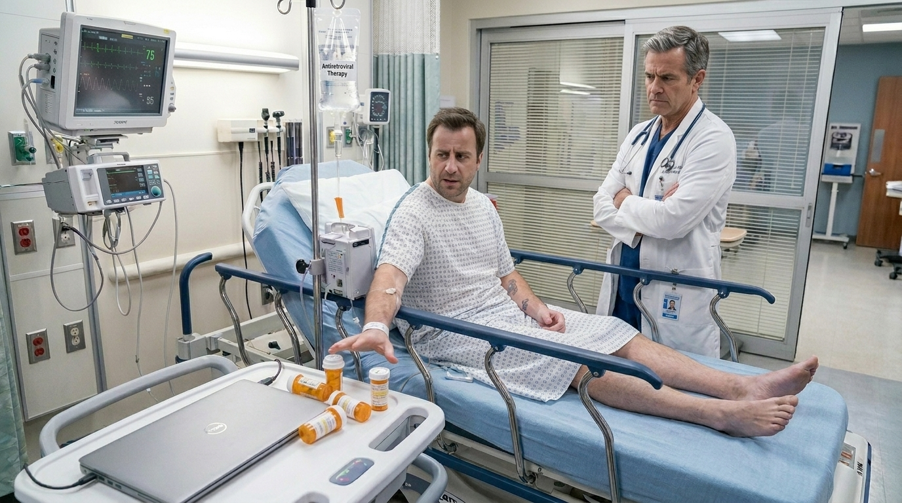

**What do you do?**

- **A. The Ego Double-Down** _(wrong)_ — You tell him, "Fine, leave. But you'll be back here in a coma." You sign the AMA paperwork and let him walk out without securing outpatient follow-up. → [15. The Ego Double-Down](#information-node-26)
- **B. Remedy Choice** _(correct)_ — You realize your judgmental tone destroyed his trust. You apologize sincerely, sit down at eye level, and explain that the most common cause of treatment failure is simply nonadherence because the regimens can be overwhelming. You work with him to set alarms on his phone. → [18. The Vertical Prevention (Obstetrics)](#decision-node-41)

---

### 15. The Ego Double-Down

David leaves the hospital. Because you did not establish a supportive plan, he takes his pills inconsistently—only when he remembers. The intermittent exposure to the antiretrovirals acts as a perfect selection pressure. His HIV mutates, developing resistance to NRTIs and integrase inhibitors. Nine months later, he returns with a CD4 count of 12 and disseminated Kaposi sarcoma. Because he harbors a highly resistant strain, standard salvage therapies fail, and he passes away.

**Next:** [16. The Lesson:](#information-node-28)

---

### 16. The Lesson:

The most common cause of HIV treatment failure is nonadherence. Antiretroviral therapy requires near-perfect daily compliance to prevent the virus from mutating. Using shame and medical gaslighting destroys the therapeutic alliance. If an HIV patient is alienated from the healthcare system and takes their medication inconsistently, they will rapidly develop multi-drug resistant HIV, effectively rendering standard pharmacological therapies useless.

**Next:** [17. Terminal Outcome: The Resistant Strain](#termination-node-32)

---

### 17. Ending: Terminal Outcome: The Resistant Strain

> **Result:** fail · **Concept:** `Bedside Manner & Viral Resistance`

Final Outcome: Fatal / Medical Alienation & Drug Resistance

The Flaw: Utilizing paternalism and shame, resulting in poor adherence and catastrophic viral mutation.  

Actionable Improvement: HIV management is a partnership. Empower the patient to adhere to their regimen through education, not fear.

_End of this path._

---

### 18. Decision: The Vertical Prevention (Obstetrics)

David is doing well on his ART. During a follow-up visit, he brings his new partner, Sarah. Sarah is 36 weeks pregnant. After learning of David's diagnosis, she requested a screening and tested positive for HIV today.You immediately order an HIV RNA viral load for Sarah. The results show she has a viral load of $5,500~copies/mL$. You must formulate a delivery plan to protect the fetus.

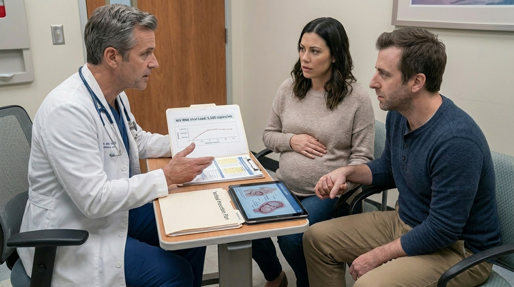

**What do you do?**

- **A. The Vaginal Protocol** _(wrong)_ — You start Sarah on ART today. Because she is now on medications, you advise her obstetrician that she can proceed with a standard vaginal delivery when she goes into natural labor at 40 weeks. → [19. The Vaginal Protocol](#information-node-29)
- **B. The Surgical Shield** _(correct)_ — Because her HIV RNA is $> 1,000~copies/mL$, you immediately coordinate with obstetrics to schedule a Cesarean section at 38 weeks (before the rupture of membranes). You also order intravenous Zidovudine to be administered to Sarah during the intrapartum period . → [22. The Surgical Shield](#information-node-45)

---

### 19. The Vaginal Protocol

You allow Sarah to labor naturally at 40 weeks. Her water breaks, and the fetus spends 12 hours passing through the birth canal, bathed in secretions carrying a viral load of 5,500 copies/mL. Despite initiating postpartum Zidovudine, lamivudine, and nevirapine for the infant , the massive intrapartum exposure overwhelms the prophylaxis. The newborn tests positive for HIV at one month of age. You have condemned a child to a lifelong, complex chronic illness due to a failure to follow strict obstetric surgical indications.

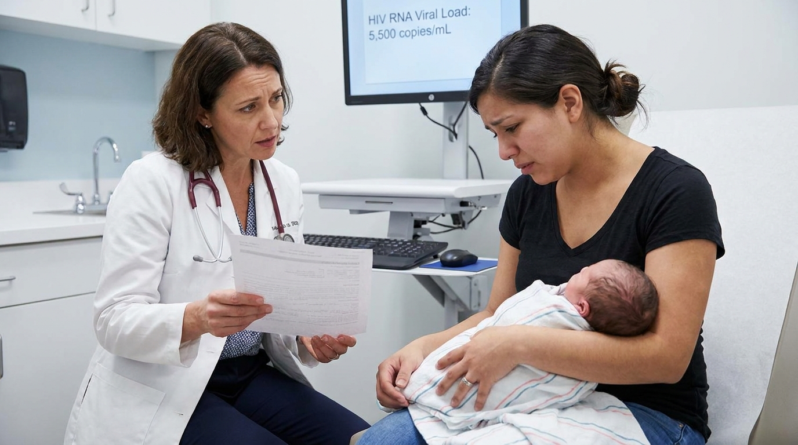

**Next:** [20. The Lesson:](#information-node-34)

---

### 20. The Lesson:

Vertical transmission of HIV from mother to fetus most commonly occurs during the intrapartum period (delivery) when the infant is exposed to maternal blood and cervicovaginal secretions. The management of delivery is strictly dictated by the mother's viral load. If the HIV RNA is $\le 1000~copies/mL$, vaginal delivery is safe . However, if the HIV RNA is $> 1000~copies/mL$ (as in Sarah's case), the risk of transmission is unacceptably high. The absolute standard of care is to perform a Cesarean section at 38 weeks to prevent the baby from being exposed via the rupture of membranes, alongside administering IV Zidovudine during the procedure .

**Next:** [21. Terminal Outcome: The Inherited Burden](#termination-node-33)

---

### 21. Ending: Terminal Outcome: The Inherited Burden

> **Result:** fail · **Concept:** `Obstetric Guidelines & Vertical Transmission`

Final Outcome: Severe Morbidity / Iatrogenic Vertical TransmissionThe Flaw: Permitting a vaginal delivery in an HIV-positive mother with a viral load $> 1000~copies/mL$.  Actionable Improvement: Memorize the 1,000 copy threshold. $>1000$ = C-section at 38 weeks + IV Zidovudine .

_End of this path._

---

### 22. The Surgical Shield

You flawlessly managed a complex presentation of advanced AIDS. You used the correct empiric targeted therapy for a classic opportunistic infection, safely navigated the timing of ART to prevent IRIS, and executed the exact obstetric guidelines required to prevent the vertical transmission of HIV to a newborn.

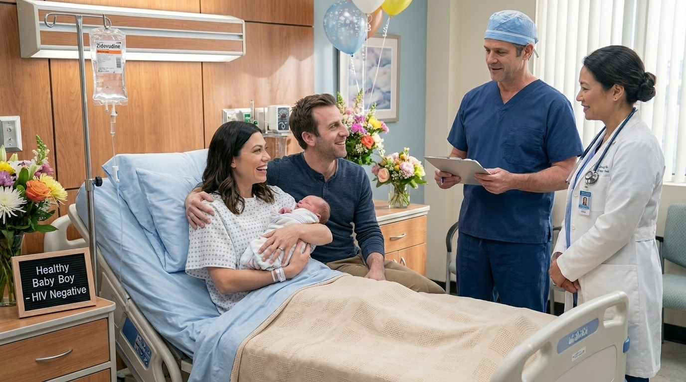

---

### 23. The Calculated Delay

You successfully avoided a deadly inflammatory syndrome by delaying ART during an acute CNS infection, and you fostered a therapeutic alliance for chronic disease management.

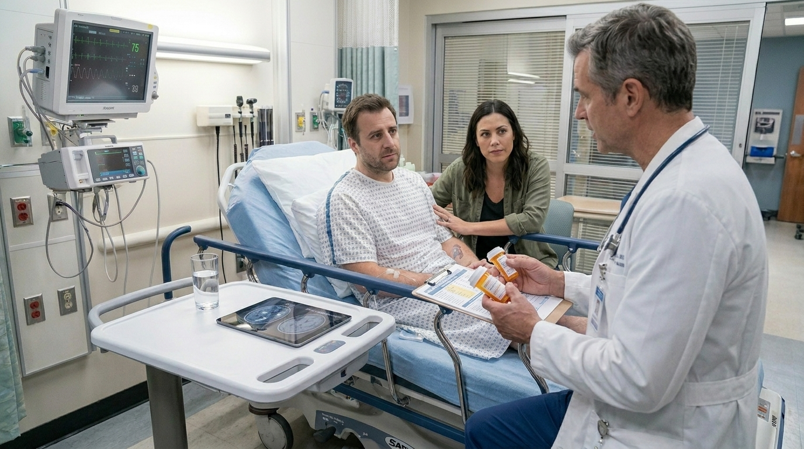

**Next:** [18. The Vertical Prevention (Obstetrics)](#decision-node-41)

---

### 24. The Optimal Protocol

You correctly followed the algorithmic standard of care for HIV patients with ring-enhancing lesions, avoiding unnecessary surgical risk and utilizing the correct targeted antimicrobial.

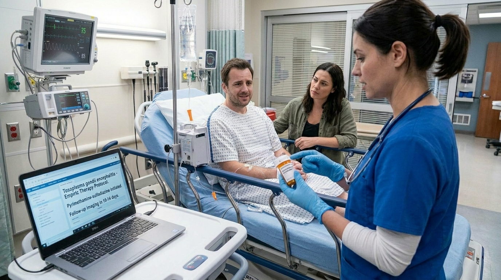

**Next:** [10. The Antiretroviral Timing (Ethics & Pathophysiology)](#decision-node-36)

---
