# Time is Brain

> acute management of an ischemic stroke

## Overview

| | |
|---|---|
| **Scenario key** | `ischemic stroke` |
| **Scenario ID** | `6675f71e-8125-42ed-8fba-f2aeeae6f86f` |
| **Story pages** | 12 |
| **Decision points** | 4 (10 choices) |
| **Endings** | 5 (1 checkpoint, 4 fail) |
| **Concepts** | `Medial ethics and autonomy `, `Stroke Triage & Time-to-Intervention`, `Thrombolytic Contraindications & Hemorrhagic Conversion`, `Triage Modalities & Time Toxicity`, `Vascular Neuroanatomy & Lesion Localization` |
| **Graph file** | [`ischemic-stroke.json`](ischemic-stroke.json) |

This is a branching case study. The learner reads each story page, then at every decision point picks one of the choices. A *misstep* leads to a fail ending that sends the learner back to try again; the *correct* path continues the story and reaches checkpoint endings that mark the concepts learned.

## Flowchart

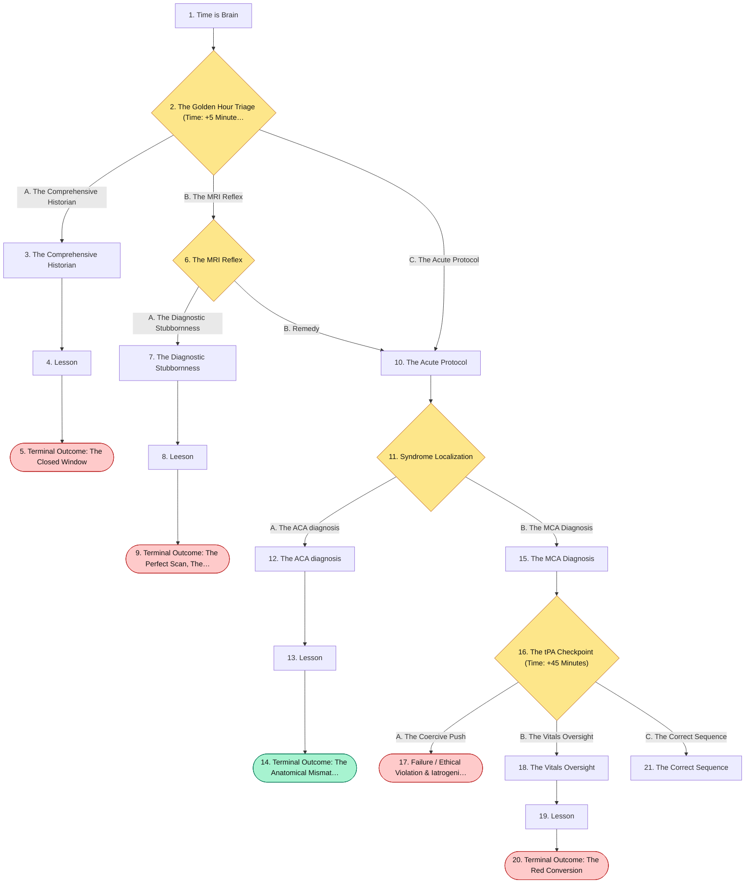

## The Story

### 1. Time is Brain

Patient Profile: Mr. Arthur Davies, a 55-year-old male.

Initial State: He presents to the emergency department for difficulty with speech and weakness in the right upper extremity. He has a medical history of atrial fibrillation, hypertension, hyperlipidemia, and type 2 diabetes mellitus. He smokes approximately 1 pack of cigarettes daily. His wife states he was last known to be neurologically normal exactly 2 hours prior to presentation.

**Next:** [2. The Golden Hour Triage (Time: +5 Minutes)](#decision-node-1)

---

### 2. Decision: The Golden Hour Triage (Time: +5 Minutes)

You evaluate Mr. Davies in the trauma bay. Physical examination is notable for 2/5 power in the right upper extremity and severe word-finding difficulty. He looks terrified, and his wife is crying, asking if he is going to die.

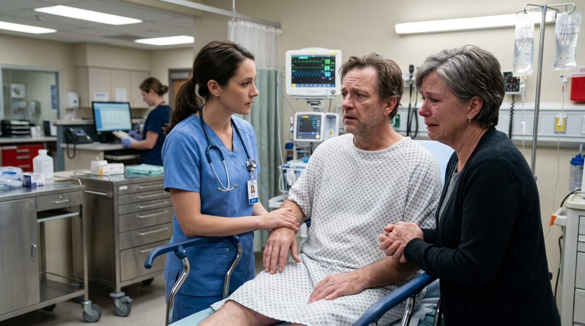

**What do you do?**

- **A. The Comprehensive Historian** _(wrong)_ — Sit down, hold the wife's hand, and spend the next 20 minutes gathering a meticulous family history, surgical history, and social history to build rapport before moving him to the scanner. → [3. The Comprehensive Historian](#information-node-6)
- **B. The MRI Reflex** _(misstep)_ — Reassure the wife briefly. Order a stat MRI of the brain because you know an MRI can aid in assessing infarct volume for further management. → [6. The MRI Reflex](#decision-node-9)
- **C. The Acute Protocol** _(correct)_ — Quickly but calmly explain to the wife, "He is showing signs of a stroke, and we have a very narrow window to treat him. We are moving him right now." You immediately order a stat non-contrast head CT and a stat fingerstick blood glucose → [10. The Acute Protocol](#information-node-5)

---

### 3. The Comprehensive Historian

You spend precious time gathering a pristine history. By the time you get Mr. Davies to the CT scanner and wait for the results, 4.5 hours have passed since his last known normal. You have officially pushed him outside the window for intravenous tPA. The stroke evolves. He suffers permanent right-sided paralysis and profound aphasia that could have been mitigated with rapid intervention.

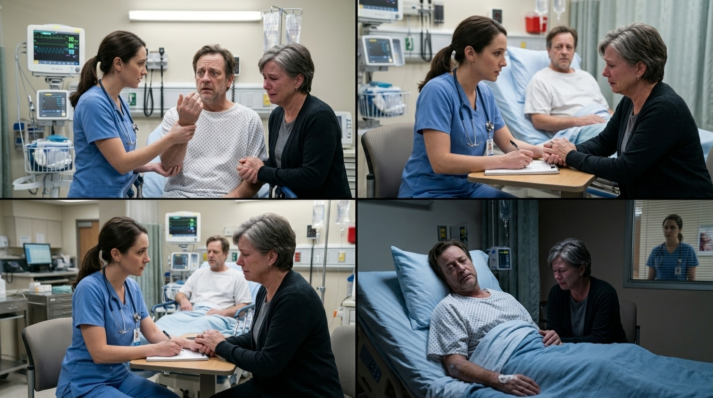

**Next:** [4. Lesson](#information-node-7)

---

### 4. Lesson

Bedside manner is crucial, but in acute neurology, "time is brain." After 5 minutes of profound hypoxia, irreversible neuronal damage occurs. The administration window for intravenous tPA (alteplase) is strictly limited to 3-4.5 hours from the last known normal time. Spending 20 minutes on non-essential history during the acute presentation burns through the most critical therapeutic window in medicine. Empathy in an emergency is demonstrated through rapid, competent, and decisive action, paired with clear, concise communication.

**Next:** [5. Terminal Outcome: The Closed Window](#termination-node-8)

---

### 5. Ending: Terminal Outcome: The Closed Window

> **Result:** fail · **Concept:** `Stroke Triage & Time-to-Intervention`

Final Outcome: Failure / Preventable Neurological Deficit

The Flaw: Prioritizing non-acute data gathering over life-saving, time-sensitive imaging protocols.

Actionable Improvement: In a "code stroke," immediately establish the "last known normal" time, perform a rapid NIH Stroke Scale (evaluating level of consciousness, motor drift, language/aphasia, etc. ), get a fingerstick glucose, and move directly to the CT scanner.

_End of this path._

---

### 6. Decision: The MRI Reflex

The MRI tech calls you. "Doc, the MRI is going to take at least 45 minutes to set up and run, and he has a pacemaker we haven't cleared yet."

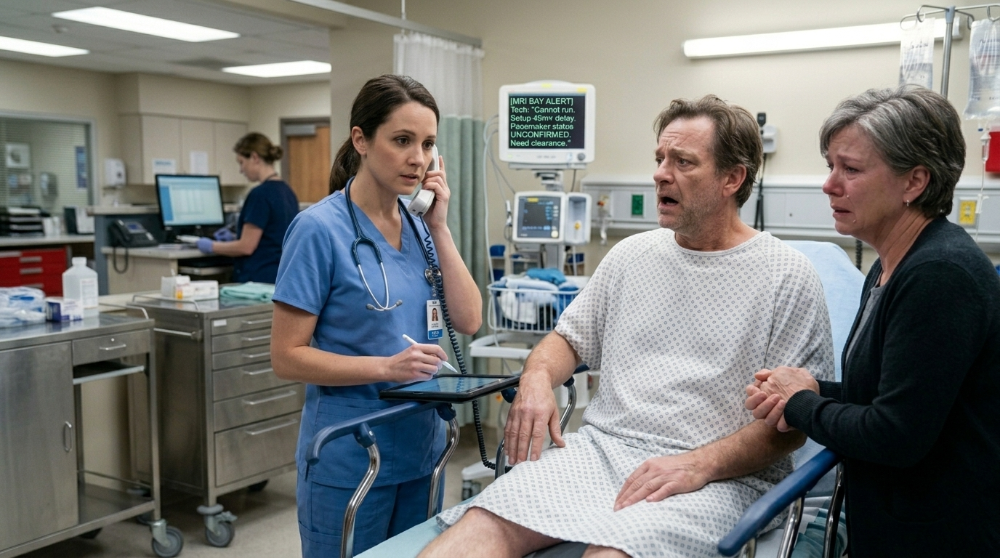

**What do you do?**

- **A. The Diagnostic Stubbornness** _(wrong)_ — Instead of canceling the MRI when the tech warns you about the delay, you refuse to switch modalities. You page Cardiology stat to clear the pacemaker and order the MRI tech to keep the patient in the queue, arguing that an MRI is strictly superior for visualizing the exact volume of the infarct. → [7. The Diagnostic Stubbornness](#information-node-28)
- **B. Remedy** _(correct)_ — You realize MRI is too slow for acute triage. You cancel the MRI and immediately reroute him for a stat non-contrast head CT. → [10. The Acute Protocol](#information-node-5)

---

### 7. The Diagnostic Stubbornness

You wait 40 minutes for the on-call cardiologist to arrive and interrogate the pacemaker. Once cleared, the MRI takes another 45 minutes to acquire. By the time the beautiful, high-resolution images are read—confirming a massive left MCA territory infarct—the patient is 4 hours and 15 minutes from his last known normal. Factoring in the time required to mix the tPA and manage his blood pressure, the strict 4.5-hour window slams shut. You are forced to rely solely on medical management with aspirin and a statin. Mr. Davies survives, but suffers permanent, severe right-sided hemiplegia and expressive aphasia that could have been prevented.

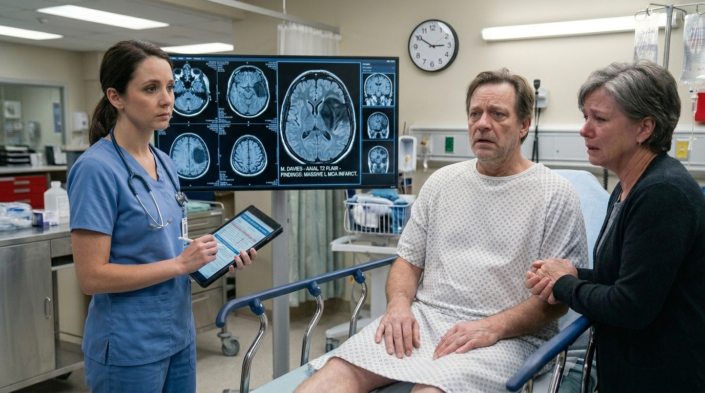

**Next:** [8. Leeson](#information-node-29)

---

### 8. Leeson

In the hyperacute phase of a stroke, the primary goal of imaging is not to visualize the ischemic tissue; it is to definitively rule out an intracerebral hemorrhage  so you can safely administer tPA. A non-contrast head CT takes 60 seconds and accomplishes this perfectly.

While it is true that an MRI/MRA provides superior visualization of the actual infarct volume, waiting for it—especially when navigating safety hurdles like un-cleared pacemakers—is a catastrophic clinical error. Perfection is the enemy of the good in stroke triage. You must act on the fastest available modality to secure the 3-to-4.5-hour tPA window.

**Next:** [9. Terminal Outcome: The Perfect Scan, The Dead Brain](#termination-node-30)

---

### 9. Ending: Terminal Outcome: The Perfect Scan, The Dead Brain

> **Result:** fail · **Concept:** `Triage Modalities & Time Toxicity`

Final Outcome: Failure / Missed Thrombolytic Window

The Flaw: Delaying acute, life-saving pharmacological management to obtain a "superior" but vastly slower imaging modality.

Actionable Improvement: Memorize the strict imaging indication for a "code stroke": A stat non-contrast head CT must be performed immediately to exclude hemorrhage. Never delay tPA administration for an MRI if the head CT is clear.

_End of this path._

---

### 10. The Acute Protocol

A non-contrast head CT must be performed first to exclude an intracerebral hemorrhage. Furthermore, checking blood glucose immediately is critical in all suspected stroke patients, as hypoglycemia can perfectly mimic a stroke.

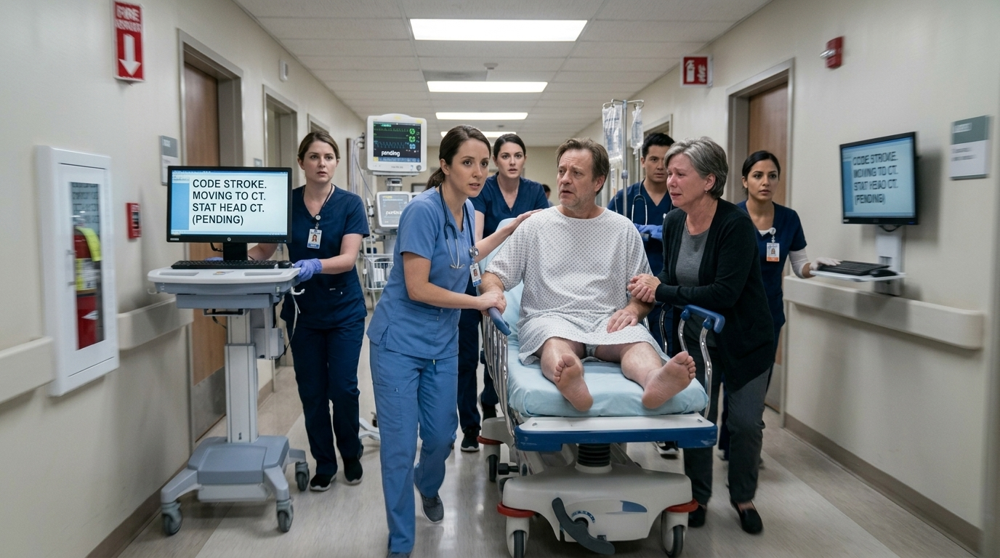

**Next:** [11. Syndrome Localization](#decision-node-11)

---

### 11. Decision: Syndrome Localization

The non-contrast head CT results are back: there is no evidence of an intracranial hemorrhage. His fingerstick glucose is 110 mg/dL. Based on his 2/5 power in the right upper extremity and Broca's aphasia, you need to localize the lesion.

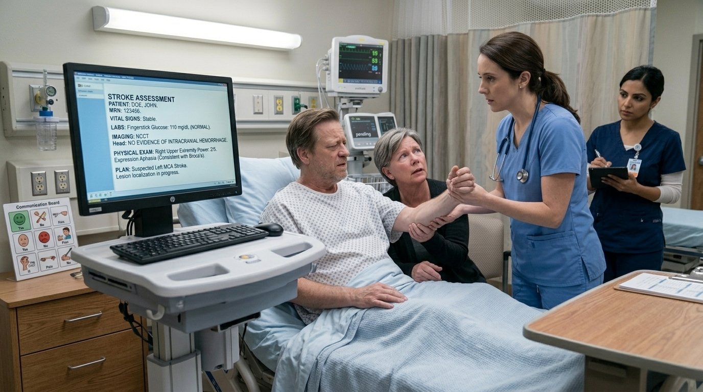

**What do you do?**

- **A. The ACA diagnosis** _(wrong)_ — Diagnose an Anterior Cerebral Artery (ACA) stroke and prep for tPA. → [12. The ACA diagnosis](#information-node-15)
- **B. The MCA Diagnosis** _(correct)_ — Diagnose a Left Middle Cerebral Artery (MCA) stroke, specifically involving the superior division in the dominant hemisphere. → [15. The MCA Diagnosis](#information-node-14)

---

### 12. The ACA diagnosis

You document an ACA territory infarct. The attending neurologist reviews your note, evaluates the patient's severe aphasia and arm weakness, and immediately corrects your localization. While the patient still receives treatment, your fundamental failure to map basic cortical signs (Broca's area, upper extremity motor cortex ) to their vascular supply (MCA) severely damages your credibility with the neurology team.

**Next:** [13. Lesson](#information-node-16)

---

### 13. Lesson

Understanding vascular territories is the bedrock of vascular neurology. Different occlusions cause highly predictable, distinct physical exam findings. An Anterior Cerebral Artery (ACA) stroke typically presents with contralateral weakness and sensory loss predominantly in the lower extremity . Mr. Davies presented with right upper extremity weakness and aphasia.

**Next:** [14. Terminal Outcome: The Anatomical Mismatch](#termination-node-17)

---

### 14. Checkpoint: Terminal Outcome: The Anatomical Mismatch

> **Result:** checkpoint · **Concept:** `Vascular Neuroanatomy & Lesion Localization`

Final Outcome: Suboptimal / Critical Knowledge Gap

The Flaw: Misidentifying the Middle Cerebral Artery (MCA) syndrome as an Anterior Cerebral Artery (ACA) syndrome.

Actionable Improvement: Memorize the homunculus. MCA = face and arm. ACA = leg

_End of this path._

---

### 15. The MCA Diagnosis

You correctly identified that contralateral weakness in the face and upper limb, combined with Broca's aphasia, localizes to the superior division of the MCA in the dominant hemisphere.

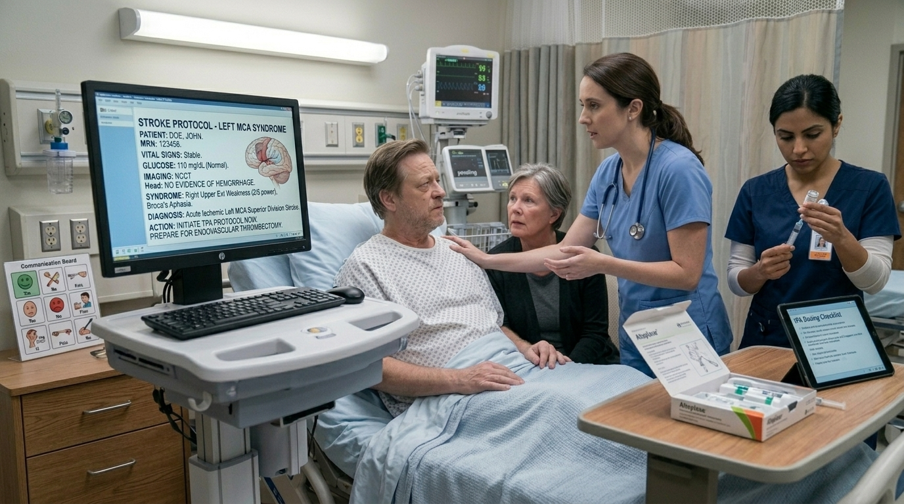

**Next:** [16. The tPA Checkpoint (Time: +45 Minutes)](#decision-node-18)

---

### 16. Decision: The tPA Checkpoint (Time: +45 Minutes)

You have diagnosed a left MCA ischemic stroke. He is 2 hours and 45 minutes from his last known normal , placing him squarely in the 3-4.5 hour tPA window. However, the nurse calls out his vital signs: his blood pressure is persistently 195/115 mmHg.You need to obtain consent from his wife to administer tPA (alteplase), but she is hesitating because she read online that "clot busters cause brain bleeding."

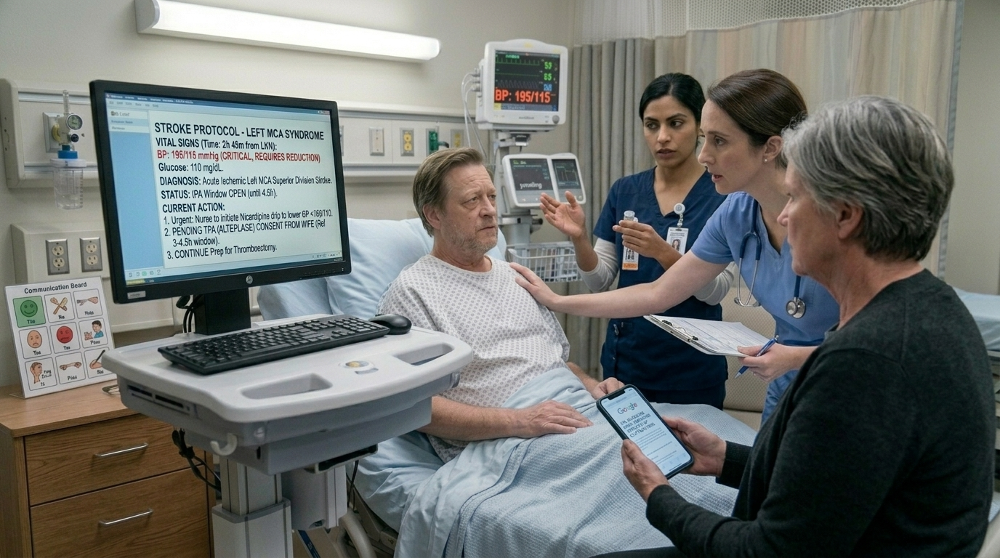

**What do you do?**

- **A. The Coercive Push** _(wrong)_ — Tell the wife firmly, "If you don't sign this right now, he is going to be a vegetable. We don't have time for internet research." You push the tPA immediately to save his brain. → [17. Failure / Ethical Violation & Iatrogenic Harm](#termination-node-23)
- **B. The Vitals Oversight** _(wrong)_ — Empathize with her fears, explain that while intracerebral hemorrhage is a complication, the risk of permanent paralysis is higher without it. She consents. You order the tPA to be pushed immediately. → [18. The Vitals Oversight](#information-node-25)
- **C. The Correct Sequence** _(correct)_ — Validate her fear of bleeding, explaining the risks and benefits clearly. Secure consent. Then, immediately order IV antihypertensives (like labetalol or nicardipine) to lower his blood pressure. Once his BP drops below 185/110 mmHg, you administer the tPA. → [21. The Correct Sequence](#information-node-22)

---

### 17. Ending: Failure / Ethical Violation & Iatrogenic Harm

> **Result:** fail · **Concept:** `Medial ethics and autonomy `

The Flaw: Utilizing medical coercion and extreme hyperbole to force consent, completely destroying the therapeutic alliance. Furthermore, in your anger, you completely ignored an absolute contraindication to tPA administration.

Actionable Improvement: In high-stress situations, bedside manner must remain professional. "Shared MDM (Medical Decision Making) in these cases" is essential, especially considering that TNK/tPA carries severe risks.

_End of this path._

---

### 18. The Vitals Oversight

You administer the tPA while his blood pressure remains at 195/115. The medication breaks down the clot, restoring blood flow to the ischemic, weakened blood vessels in his brain. The extreme hypertensive pressure ruptures the fragile, necrotic capillary beds. Mr. Davies suddenly loses consciousness and begins to seize. A stat repeat head CT shows a massive intracerebral hemorrhage—a direct, fatal complication of ignoring the blood pressure parameters.

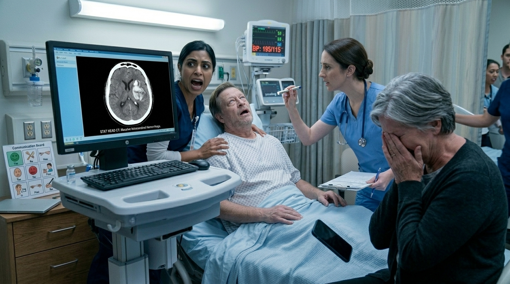

**Next:** [19. Lesson](#information-node-26)

---

### 19. Lesson

Intravenous tPA is a powerful, high-risk medication. You must mentally run through the strict contraindications before every single administration. Persistent hypertension, defined as a systolic blood pressure > 185 mmHg or a diastolic blood pressure > 110 mmHg, is an absolute contraindication for tPA administration. Administering a systemic thrombolytic when the cerebral vasculature is under that much sheer stress dramatically increases the risk of blowing a vessel.

**Next:** [20. Terminal Outcome: The Red Conversion](#termination-node-24)

---

### 20. Ending: Terminal Outcome: The Red Conversion

> **Result:** fail · **Concept:** `Thrombolytic Contraindications & Hemorrhagic Conversion`

Final Outcome: Fatal / Iatrogenic Intracerebral Hemorrhage

The Flaw: Administering tPA to a patient with a blood pressure > 185/110 mmHg.

Actionable Improvement: Always check the contraindication checklist. If a stroke patient is hypertensive above the threshold, you must medically manage the blood pressure first before pushing the thrombolytic.

_End of this path._

---

### 21. The Correct Sequence

ou flawlessly navigated a high-stress ethical conversation with the family while strictly adhering to the pharmacological contraindications of fibrinolytic therapy.

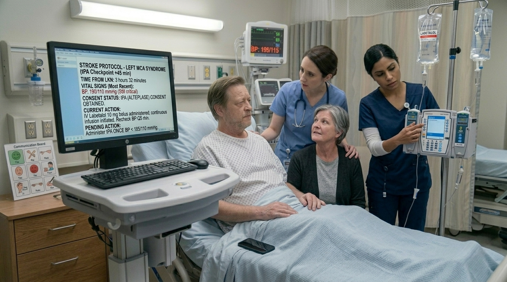

---
