# The Peripheral Shadow

> Oncology

## Overview

| | |
|---|---|
| **Scenario key** | `Lung cancer` |
| **Scenario ID** | `54e5667a-1fed-4dbe-809e-d0bb4aa50607` |
| **Story pages** | 14 |
| **Decision points** | 5 (12 choices) |
| **Endings** | 5 (0 checkpoint, 5 fail) |
| **Concepts** | `Diagnostic Algorithms & Iatrogenic Risk`, `Medical Gaslighting & Reversible Delirium`, `Paraneoplastic Syndromes & Diagnostic Anchoring`, `Preventative Medicine & Screening Guidelines`, `Resource Utilization & Diagnostic Hubris` |
| **Graph file** | [`lung-cancer.json`](lung-cancer.json) |

This is a branching case study. The learner reads each story page, then at every decision point picks one of the choices. A *misstep* leads to a fail ending that sends the learner back to try again; the *correct* path continues the story and reaches checkpoint endings that mark the concepts learned.

## Flowchart

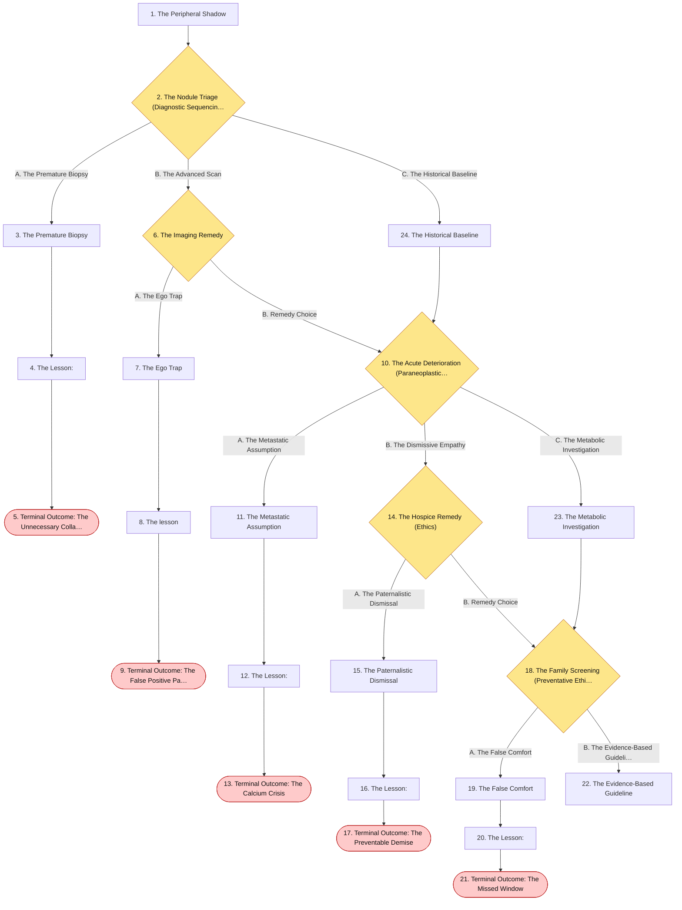

## The Story

### 1. The Peripheral Shadow

Patient Profile: Mr. Arthur Pendelton, a 65-year-old male.
Initial State: He presents to the outpatient clinic with a progressively worsening cough and significant fatigue over the last 6 months. He notes a recent episode of hemoptysis (blood-streaked sputum) and a 12-pound unintentional weight loss . He has a 40 pack-year smoking history. Physical examination is notable for distinct finger clubbing. You order a routine chest radiograph, which reveals a solitary, eccentric pulmonary nodule measuring 11 mm in the right upper lobe.

**Next:** [2. The Nodule Triage (Diagnostic Sequencing)](#decision-node-1)

---

### 2. Decision: The Nodule Triage (Diagnostic Sequencing)

Mr. Pendelton is extremely anxious upon hearing the word "nodule" and asks if he needs to go straight to surgery. You need to determine the very first step in evaluating this incidental solitary pulmonary nodule.

**What do you do?**

- **A. The Premature Biopsy** _(wrong)_ — Because the nodule is > 8 mm and has an eccentric (malignant) feature, you immediately consult interventional radiology to perform a CT-guided percutaneous needle biopsy to confirm the cancer. → [3. The Premature Biopsy](#information-node-3)
- **B. The Advanced Scan** _(misstep)_ — You immediately order a full-body Positron Emission Tomography (PET) scan to check for metastasis before doing anything else. → [6. The Imaging Remedy](#decision-node-7)
- **C. The Historical Baseline** _(correct)_ — You pause, reassure the patient, and instruct your staff to retrieve his prior chest X-rays from a pneumonia admission three years ago to evaluate for any interval change. → [24. The Historical Baseline](#information-node-14)

---

### 3. The Premature Biopsy

You send Mr. Pendelton for the biopsy. During the procedure, the biopsy needle punctures the visceral pleura, causing a massive tension pneumothorax. He requires emergency chest tube placement and a prolonged ICU stay. Days later, you locate his old medical records, which show the exact same 11 mm nodule present on a scan from five years ago. It was a benign, calcified granuloma. You subjected the patient to a life-threatening complication for a lesion that required absolutely zero intervention.

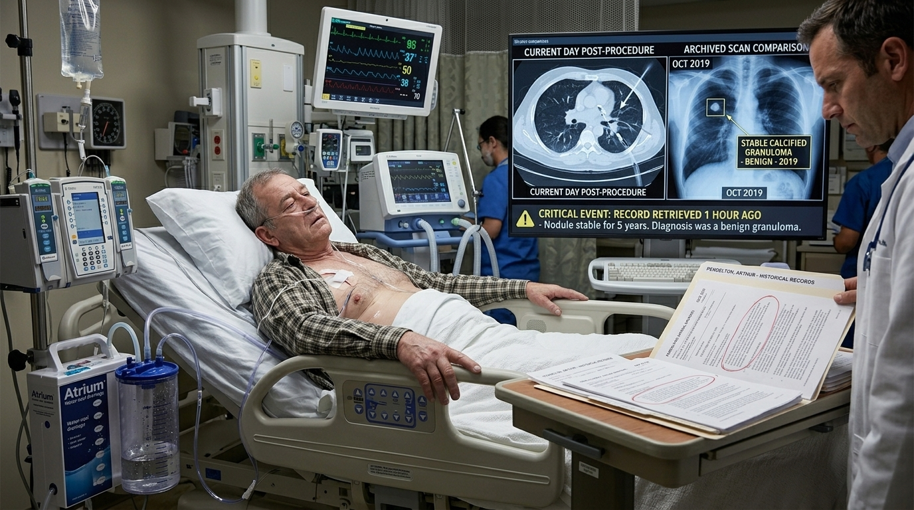

**Next:** [4. The Lesson:](#information-node-4)

---

### 4. The Lesson:

While an 11 mm eccentric nodule is highly suspicious for malignancy, jumping straight to a biopsy for an incidental solitary pulmonary nodule (SPN) is a dangerous violation of the diagnostic algorithm. The initial step must always be to compare the current image to prior chest X-rays. If the nodule was present on a scan from three years ago and has not changed in size, it is overwhelmingly likely to be a benign granuloma or hamartoma, requiring no further intervention. Lung biopsies carry a significant risk of iatrogenic pneumothorax and hemorrhage.

**Next:** [5. Terminal Outcome: The Unnecessary Collapse](#termination-node-5)

---

### 5. Ending: Terminal Outcome: The Unnecessary Collapse

> **Result:** fail · **Concept:** `Diagnostic Algorithms & Iatrogenic Risk`

Final Outcome: Failure / Iatrogenic Pneumothorax

The Flaw: Skipping the most critical, non-invasive first step of the SPN algorithm: comparing to prior imaging.

Actionable Improvement: Never biopsy a newly discovered pulmonary nodule without first exhausting efforts to find and compare old imaging to prove interval growth.

_End of this path._

---

### 6. Decision: The Imaging Remedy

You order the PET scan. The radiologist rejects the order, noting that standard criteria for evaluating a new nodule have not been met yet.

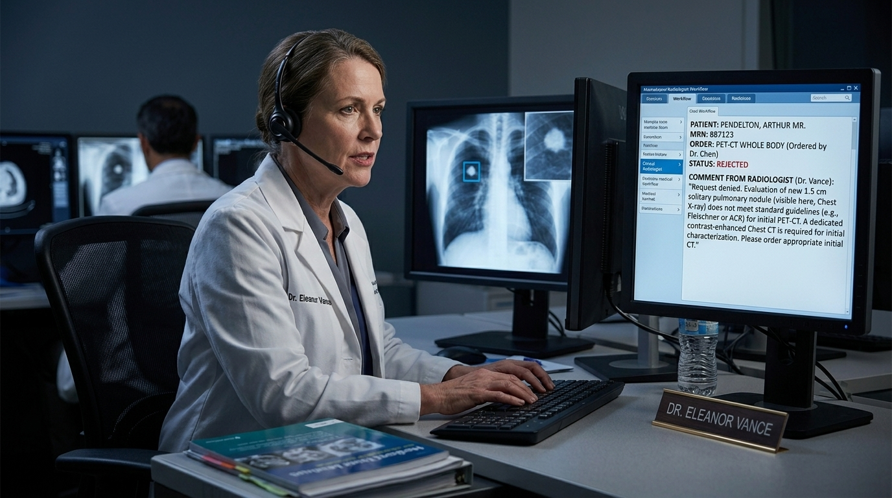

**What do you do?**

- **A. The Ego Trap** _(wrong)_ — You angrily call the radiologist and demand they push the PET scan through, arguing that your clinical suspicion for cancer overrides their administrative protocols. → [7. The Ego Trap](#information-node-9)
- **B. Remedy Choice** _(correct)_ — You review the guidelines, cancel the PET scan, and request the patient's old chest X-rays to establish a baseline comparison first. Merge to Node 2. → [10. The Acute Deterioration (Paraneoplastic Syndrome)](#decision-node-36)

---

### 7. The Ego Trap

You pull rank and force the PET scan. The scan shows mild hypermetabolic uptake in the nodule. Convinced it is cancer, you send him for surgical resection. The pathologist analyzes the removed lobe and finds a completely benign, slightly inflamed infectious granuloma that had been there for a decade. By ignoring the radiologist and the standard algorithm, you authorized the surgical removal of a healthy piece of lung.

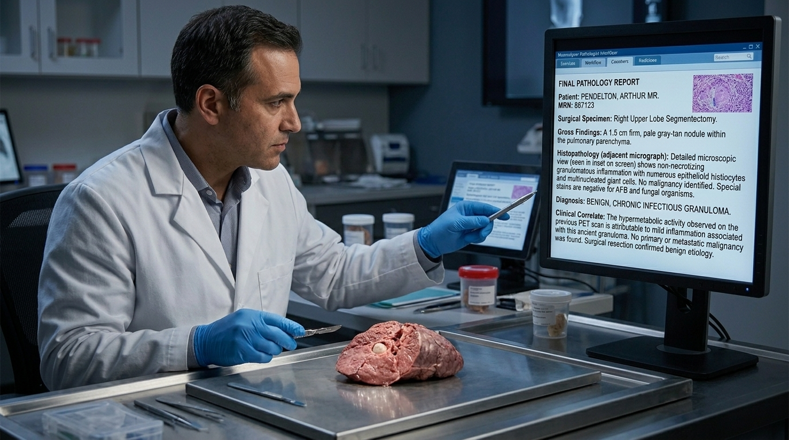

**Next:** [8. The lesson](#information-node-44)

---

### 8. The lesson

Interprofessional collaboration is crucial in oncology. Radiologists act as gatekeepers to prevent unnecessary, high-radiation, and expensive testing. A PET scan is a staging tool or an evaluation tool for intermediate-probability nodules, but it is completely useless—and often yields false positives—if the nodule's baseline chronicity hasn't been established. Forcing a test out of ego rather than following the diagnostic algorithm leads to systemic waste and patient harm.

**Next:** [9. Terminal Outcome: The False Positive Panic](#termination-node-11)

---

### 9. Ending: Terminal Outcome: The False Positive Panic

> **Result:** fail · **Concept:** `Resource Utilization & Diagnostic Hubris`

Final Outcome: Failure / Unnecessary Surgical Resection

The Flaw: Using an advanced metabolic scan without first establishing anatomical chronicity via old X-rays.

Actionable Improvement: Follow the stepwise approach. Old X-rays first. If new/growing, then CT chest. Only then do you calculate probability for PET vs. Biopsy .

_End of this path._

---

### 10. Decision: The Acute Deterioration (Paraneoplastic Syndrome)

You have successfully intubated Leo. His oxygen saturations improve to 99%. With the airway secure, you move to the secondary survey.

You expose his left leg. He has a displaced fracture of the distal femur. The nurse checks his foot and calls out, "Distal pedal pulses are palpable." However, as you observe the back of the knee, you notice a massive, firm hematoma that is visibly and rapidly expanding.

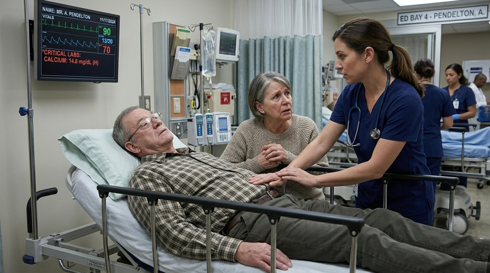

**What do you do?**

- **A. The Metastatic Assumption** _(wrong)_ — You assume the lung cancer has metastasized to his brain, causing the confusion. You immediately order an MRI of the brain and consult radiation oncology for whole-brain radiation. → [11. The Metastatic Assumption](#information-node-18)
- **B. The Dismissive Empathy** _(misstep)_ — You hold his wife's hand and gently explain that severe fatigue and confusion are just a normal, sad part of advanced cancer progression. You recommend discharging him home with hospice care. → [14. The Hospice Remedy (Ethics)](#decision-node-38)
- **C. The Metabolic Investigation** _(correct)_ — You recognize his symptoms (lethargy, confusion, constipation) as classic signs of a metabolic emergency, specifically hypercalcemia. You immediately order a basic metabolic panel (BMP) and ionized calcium level, knowing that Squamous Cell Carcinoma of the lung can secrete PTHrP. → [23. The Metabolic Investigation](#information-node-21)

---

### 11. The Metastatic Assumption

You send Mr. Pendelton for a brain MRI, which takes hours. While he is in the scanner, his unmonitored calcium level climbs to 16.0 mg/dL. The severe hypercalcemia drastically shortens his QT interval. He develops a fatal ventricular arrhythmia in the MRI tube and cannot be resuscitated. You missed a completely reversible metabolic emergency because you anchored on metastasis.

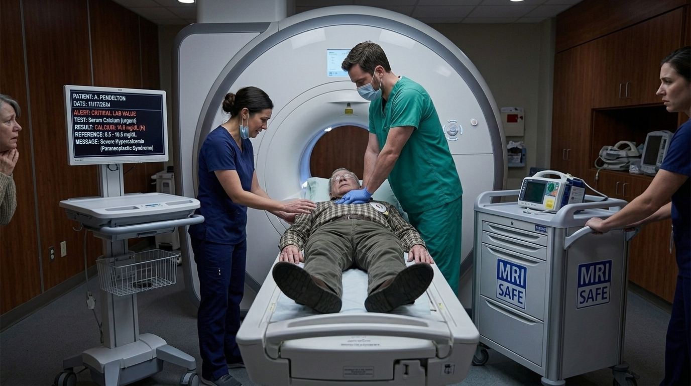

**Next:** [12. The Lesson:](#information-node-19)

---

### 12. The Lesson:

While brain metastases are a real complication of lung cancer, an acute onset of severe lethargy, confusion, and systemic symptoms (like constipation and abdominal pain) in a patient with a lung mass must immediately raise suspicion for a paraneoplastic syndrome. Squamous cell carcinoma of the lung frequently secretes Parathyroid Hormone-related Peptide (PTHrP), acting as a PTH receptor agonist and causing severe hypercalcemia. Hypercalcemia presents with "stones, bones, groans (abdominal pain/constipation), and psychiatric overtones (confusion)."

**Next:** [13. Terminal Outcome: The Calcium Crisis](#termination-node-20)

---

### 13. Ending: Terminal Outcome: The Calcium Crisis

> **Result:** fail · **Concept:** `Paraneoplastic Syndromes & Diagnostic Anchoring`

Final Outcome: Fatal / Unmanaged Hypercalcemic Crisis

The Flaw: Assuming neurological symptoms in a cancer patient are strictly due to brain metastasis without ruling out critical metabolic derangements (hypercalcemia via PTHrP).  

Actionable Improvement: Always check a BMP/Calcium level in a lung cancer patient presenting with altered mental status.

_End of this path._

---

### 14. Decision: The Hospice Remedy (Ethics)

Mr. Pendelton's wife is furious. "He was doing crossword puzzles yesterday!" she yells. "This isn't a slow decline; something is acutely wrong with him right now!"

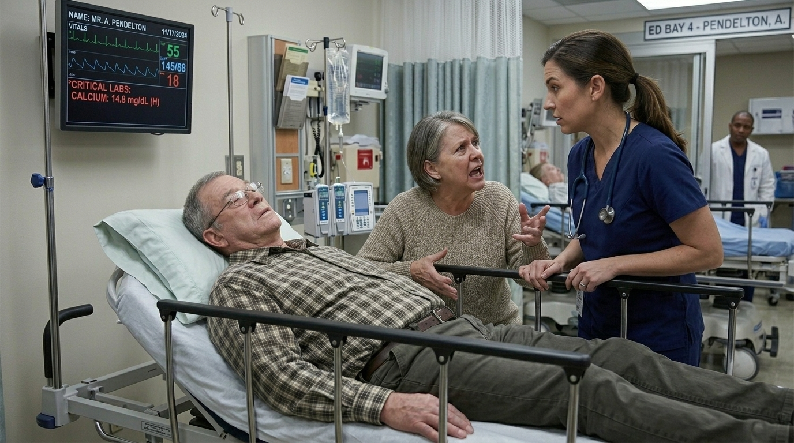

**What do you do?**

- **A. The Paternalistic Dismissal** _(wrong)_ — You tell her she is in denial about his prognosis. You refuse to order labs and discharge him to home hospice. → [15. The Paternalistic Dismissal](#information-node-26)
- **B. Remedy Choice** _(correct)_ — You realize she is right. Acute confusion is delirium, not normal disease progression. You apologize for your dismissiveness and immediately order stat lab work, discovering a critically high calcium level. → [18. The Family Screening (Preventative Ethics)](#decision-node-41)

---

### 15. The Paternalistic Dismissal

You discharge him to hospice. Within 24 hours, his untreated hypercalcemia causes a comatose state, leading to cardiac arrest. When the hospice intake nurse reviews the chart and sees that no basic labs were drawn despite an acute mental status change, you face a massive malpractice lawsuit for failure to diagnose and treat a standard paraneoplastic complication.

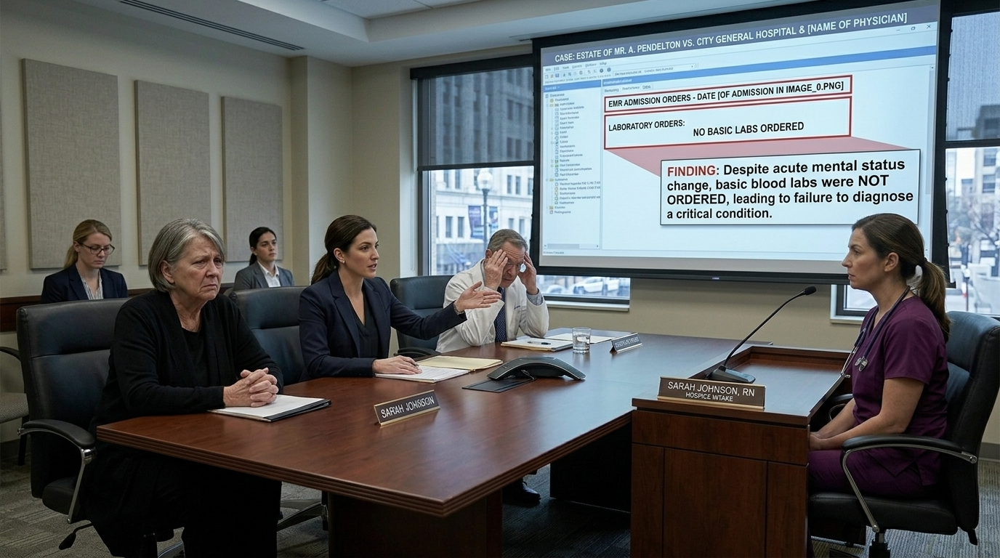

**Next:** [16. The Lesson:](#information-node-28)

---

### 16. The Lesson:

Dismissing an acute, dramatic change in a patient's baseline as "normal disease progression" without a medical workup is severe clinical negligence. Family members are the most accurate historians regarding a patient's baseline. Ignoring their objective timeline out of paternalism destroys the therapeutic alliance and guarantees missed diagnoses of reversible conditions (like UTIs, hypercalcemia, or drug toxicity).

**Next:** [17. Terminal Outcome: The Preventable Demise](#termination-node-32)

---

### 17. Ending: Terminal Outcome: The Preventable Demise

> **Result:** fail · **Concept:** `Medical Gaslighting & Reversible Delirium`

Final Outcome: Fatal / Malpractice & Ethical Violation

The Flaw: Medical gaslighting; ignoring a family member's accurate history and failing to work up acute delirium in an oncology patient.

Actionable Improvement: Never assume acute confusion is terminal decline without checking basic labs (CBC, BMP, Calcium, Urinalysis) first.

_End of this path._

---

### 18. Decision: The Family Screening (Preventative Ethics)

Mr. Pendelton is treated with aggressive IV fluids and bisphosphonates for his hypercalcemia. A biopsy confirms Squamous Cell Carcinoma, and he is scheduled for staging.

His younger brother, Thomas, is visiting him in the hospital. Thomas is 55 years old. He smoked 1 pack a day for 25 years but quit completely 10 years ago. Thomas is terrified by his brother's diagnosis and asks you, "Doc, should I be getting my lungs checked? I feel perfectly fine, but I smoked for a long time."

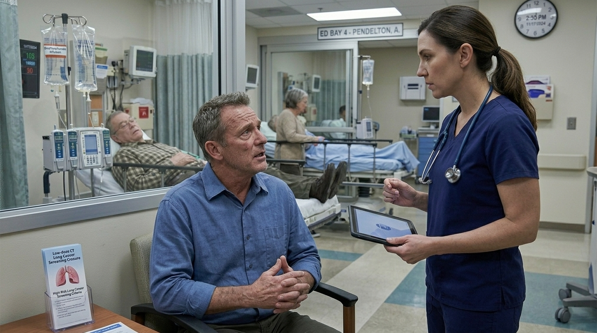

**What do you do?**

- **A. The False Comfort** _(wrong)_ — You tell Thomas, "Because you quit over 5 years ago, your lungs have healed. You only need a screening if you start coughing up blood or losing weight." → [19. The False Comfort](#information-node-29)
- **B. The Evidence-Based Guideline** _(correct)_ — You explain that despite having quit, his age (55) and his 25 pack-year history place him at high risk. You strongly recommend he follow up with his primary care doctor immediately to schedule an annual low-dose computerized tomography (CT) scan of the chest . → [22. The Evidence-Based Guideline](#information-node-45)

---

### 19. The False Comfort

Thomas trusts your advice and does not get screened. Three years later, at age 58, he develops a cough and weight loss. A chest X-ray reveals a massive, centrally located tumor that has already invaded his mediastinum and metastasized to his liver. It is completely inoperable. Your failure to apply the standard screening criteria cost him his only window for a curative resection

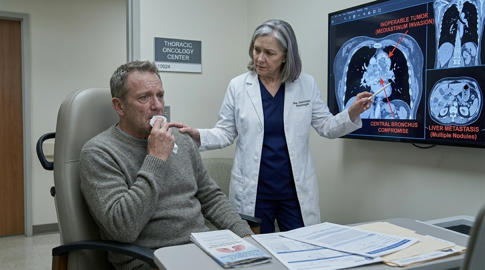

**Next:** [20. The Lesson:](#information-node-34)

---

### 20. The Lesson:

Lung cancer screening guidelines are highly specific and designed to catch asymptomatic cancers early. Screening with a low-dose CT scan of the chest is explicitly indicated in patients 50-80 years of age who have a $\ge 20$ pack-year smoking history AND either currently smoke or have quit within the past 15 years . Thomas meets all criteria (55yo, 25 pack-years, quit 10 years ago). Waiting for symptoms like hemoptysis guarantees that the cancer will be in an advanced, often incurable stage upon diagnosis.

**Next:** [21. Terminal Outcome: The Missed Window](#termination-node-33)

---

### 21. Ending: Terminal Outcome: The Missed Window

> **Result:** fail · **Concept:** `Preventative Medicine & Screening Guidelines`

Final Outcome: Failure / Missed Preventative ScreeningThe Flaw: Misunderstanding the USPSTF lung cancer screening guidelines and providing false reassurance to a high-risk patient.Actionable Improvement: Memorize the 50-80, 20, 15 rule: Age 50-80, $\ge 20$ pack-years, currently smoking or quit within 15 years requires an annual low-dose CT scan .

_End of this path._

---

### 22. The Evidence-Based Guideline

You flawlessly navigated the diagnostic workup for a solitary pulmonary nodule, recognized and managed a life-threatening paraneoplastic syndrome, and applied the exact preventative screening guidelines to save the patient's brother from the same fate.

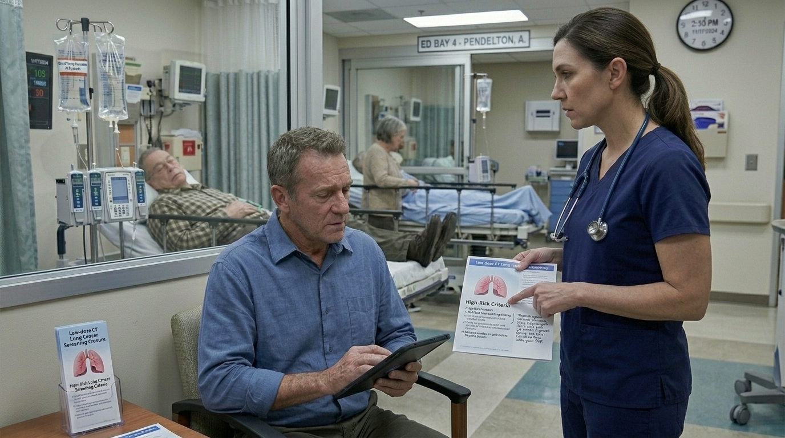

---

### 23. The Metabolic Investigation

You successfully avoided diagnostic anchoring. Instead of blaming "brain mets," you identified a highly treatable, life-threatening paraneoplastic syndrome.

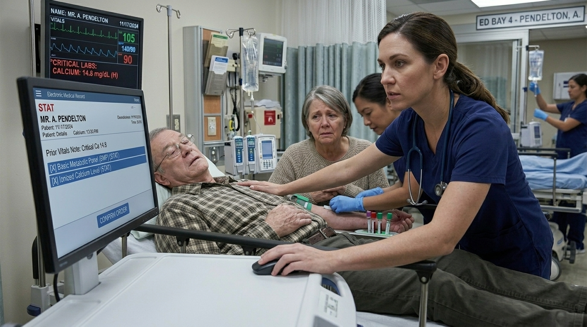

**Next:** [18. The Family Screening (Preventative Ethics)](#decision-node-41)

---

### 24. The Historical Baseline

You successfully obtain Mr. Pendelton's old X-rays. They show his lungs were completely clear three years ago. This is a new, growing 11 mm lesion. A subsequent chest CT confirms a highly suspicious lesion.

Before the biopsy can be scheduled, Mr. Pendelton's wife brings him into the emergency department. He is profoundly lethargic, confused, and complaining of severe constipation and diffuse abdominal pain.

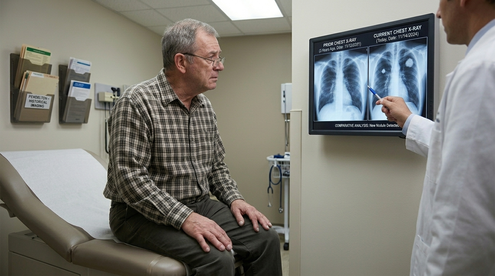

**Next:** [10. The Acute Deterioration (Paraneoplastic Syndrome)](#decision-node-36)

---
