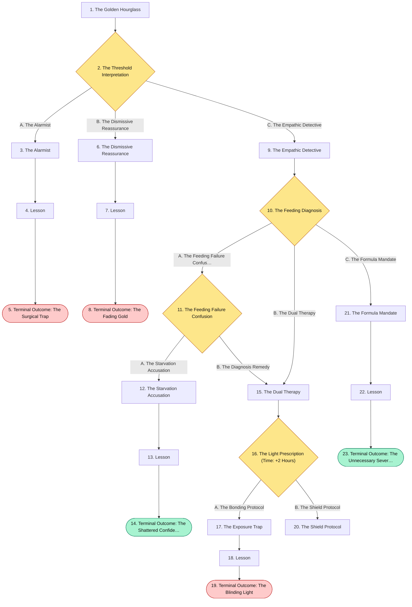
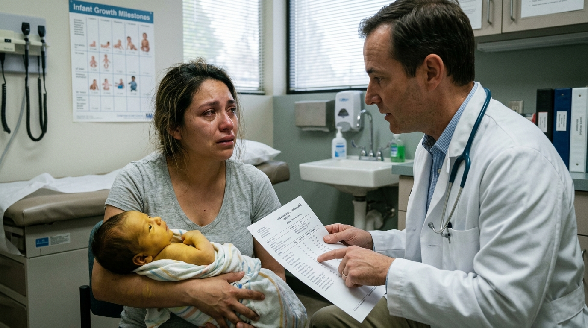
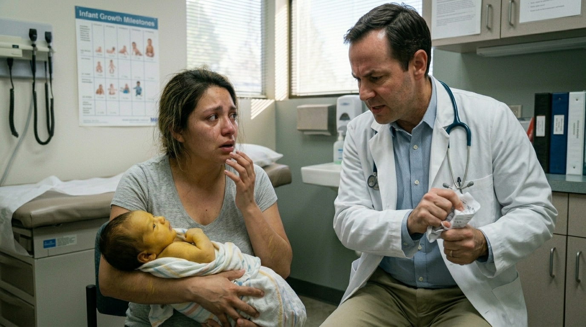
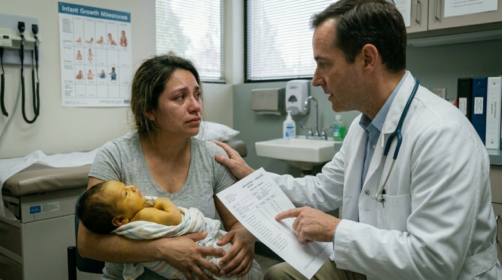
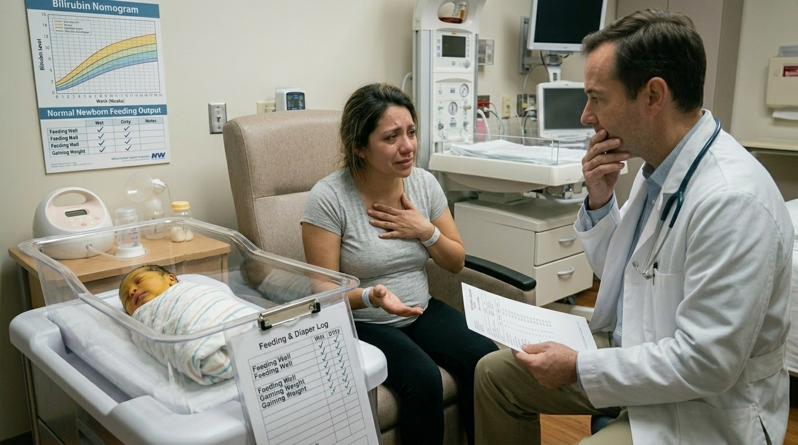
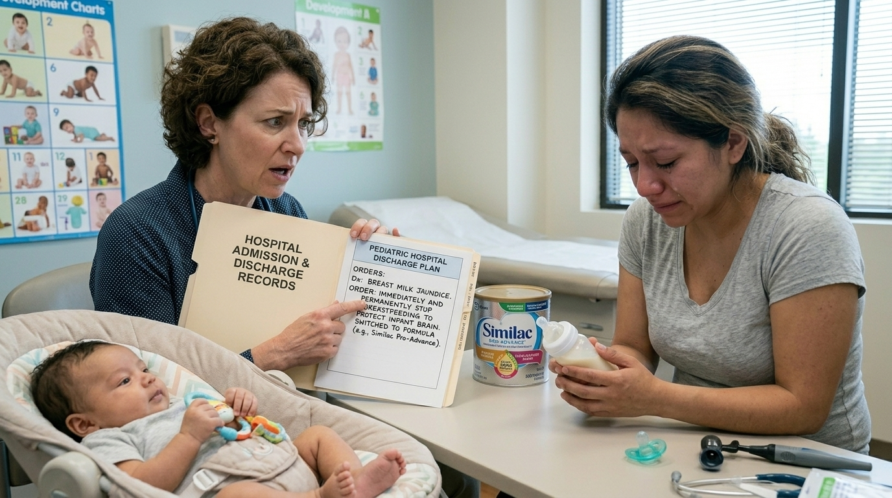
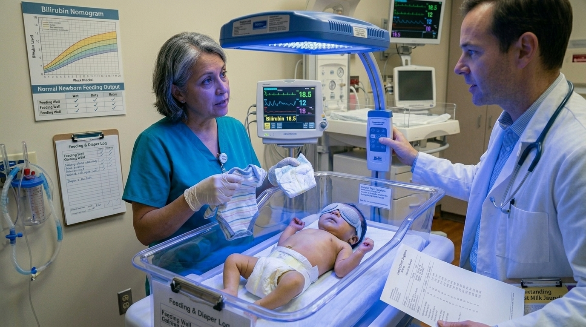
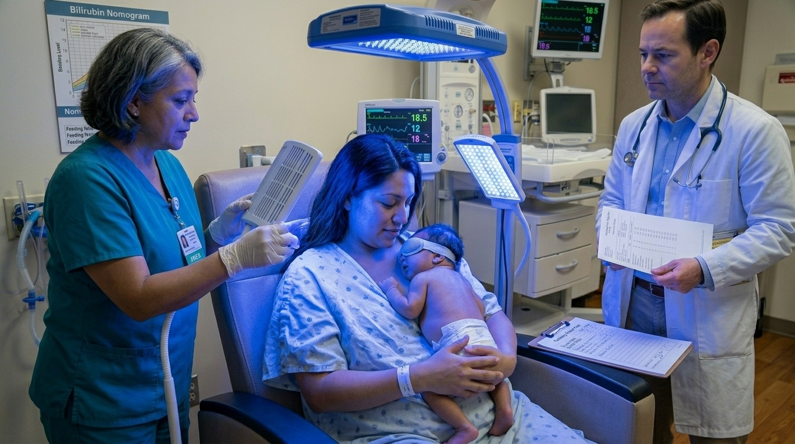
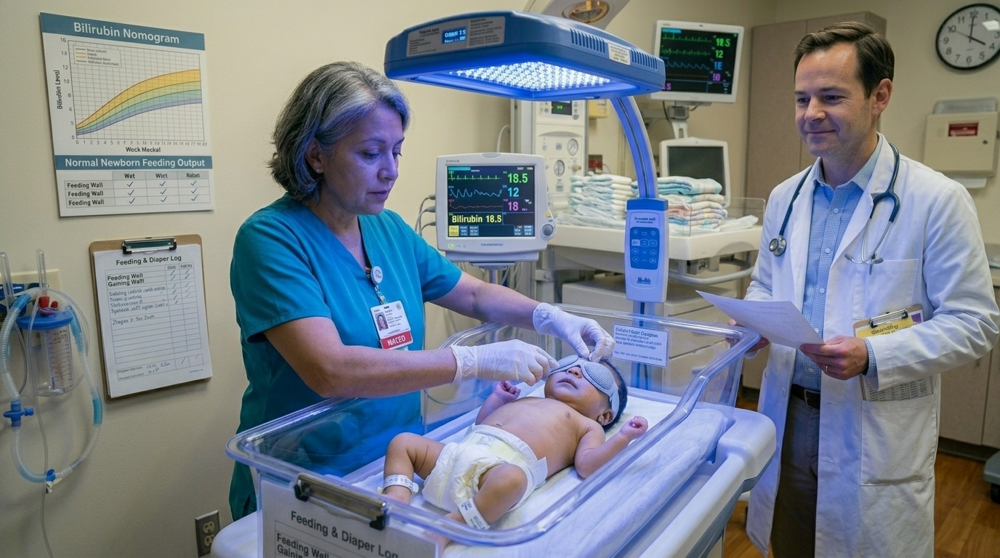
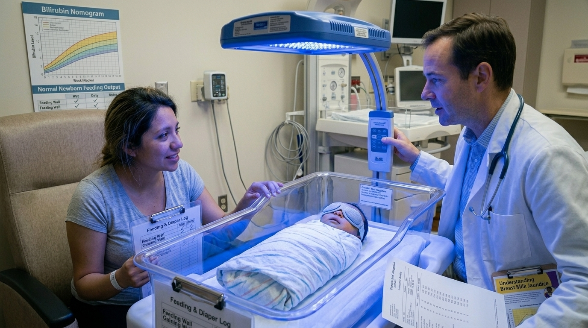

# The Golden Hourglass

> Diagnois and management

## Overview

| | |
|---|---|
| **Scenario key** | `neonatal jaundice` |
| **Scenario ID** | `6513c5af-9c3b-4962-ae77-c3361d692507` |
| **Story pages** | 14 |
| **Decision points** | 4 (10 choices) |
| **Endings** | 5 (2 checkpoint, 3 fail) |
| **Concepts** | `Diagnostic Anchoring & Medical Gaslighting`, `Fractionated Bilirubin & Iatrogenic Panic`, `Iatrogenic Complications & Treatment Safety`, `Maternal Autonomy & Outdated Protocols`, `Pathologic Criteria & Neurological Toxicity` |
| **Graph file** | [`neonatal-jaundice.json`](neonatal-jaundice.json) |

This is a branching case study. The learner reads each story page, then at every decision point picks one of the choices. A *misstep* leads to a fail ending that sends the learner back to try again; the *correct* path continues the story and reaches checkpoint endings that mark the concepts learned.

## Flowchart

## The Story

### 1. The Golden Hourglass

Patient Profile: Baby Mateo, a 2-week-old male.
Initial State: Mateo is brought into the pediatric clinic by his mother, Elena, who is tearful and exhausted. She notes that Mateo has developed a yellowish discoloration of his skin that has progressed from his head down to his toes, and the whites of his eyes (sclera) are yellow. He was born at term and has been exclusively breastfed.

**Next:** [2. The Threshold Interpretation](#decision-node-1)

---

### 2. Decision: The Threshold Interpretation

You immediately order a neonatal bilirubin panel. The labs return showing a Total Bilirubin of 18~mg/dL and a Direct (conjugated) Bilirubin of 0.8~mg/dL.
Elena sees the lab slip and panics. "My sister's baby had jaundice, but it went away in a few days. Is my baby's liver failing?" You must interpret the fractionated bilirubin and counsel her appropriately.

**What do you do?**

- **A. The Alarmist** _(wrong)_ — Validate her fear of liver failure. Because his total bilirubin is so high, tell her you suspect Extrahepatic Biliary Atresia and order a stat surgical consultation. → [3. The Alarmist](#information-node-5)
- **B. The Dismissive Reassurance** _(wrong)_ — Tell her to take a deep breath. Explain that physiologic jaundice occurs in up to 50% of neonates and that she should just take him home and put his crib near a sunny window. → [6. The Dismissive Reassurance](#information-node-8)
- **C. The Empathic Detective** _(correct)_ — Hold her hand and reassure her that his liver is not failing, pointing out that his "direct" bilirubin is completely normal. However, gently explain that jaundice persisting beyond 10-14 days is considered "pathologic" and requires you to investigate why his indirect levels are so high → [9. The Empathic Detective](#information-node-10)

---

### 3. The Alarmist

You send Mateo to the pediatric surgery ward. The surgeons review your labs, immediately cancel the consult, and report you to the attending for gross misinterpretation of basic hepatobiliary labs. The mother, having spent hours believing her baby needed a liver transplant, loses all trust in you.

**Next:** [4. Lesson](#information-node-6)

---

### 4. Lesson

Understanding the difference between direct (conjugated) and indirect (unconjugated) hyperbilirubinemia is the most critical juncture in neonatal jaundice. Extrahepatic biliary atresia is a structural blockage that causes a buildup of conjugated (direct) bilirubin. Mateo's direct bilirubin is 0.8mg/dL, which is entirely normal. His jaundice is driven entirely by indirect bilirubin (17.2mg/dL). By misinterpreting the fractionated lab results, you subjected a newborn to an unnecessary surgical workup and caused the mother profound psychological trauma.

**Next:** [5. Terminal Outcome: The Surgical Trap](#termination-node-7)

---

### 5. Ending: Terminal Outcome: The Surgical Trap

> **Result:** fail · **Concept:** `Fractionated Bilirubin & Iatrogenic Panic`

The Flaw: Conflating indirect (unconjugated) and direct (conjugated) hyperbilirubinemia etiologies.Actionable Improvement: Always subtract the direct bilirubin from the total bilirubin. If the direct bilirubin is <2~mg/dL or < 20% of the total, the etiology is unconjugated (e.g., hemolysis, breast milk jaundice)

_End of this path._

---

### 6. The Dismissive Reassurance

You send Mateo home. Over the next 48 hours, his indirect bilirubin creeps above 20 mg/dL. Because the unconjugated bilirubin is highly lipid-soluble, it crosses the immature blood-brain barrier. It irreversibly deposits in his basal ganglia, pons, and cerebellum. Mateo develops high-pitched crying, hypertonia, and seizures. He suffers permanent, devastating neurological damage known as Kernicterus

**Next:** [7. Lesson](#information-node-9)

---

### 7. Lesson

While physiologic jaundice is incredibly common, it has strict temporal and quantitative boundaries. It typically occurs between days 3 and 5 and begins to fall thereafter. Any jaundice that persists beyond 10-14 days, or features a total serum bilirubin > 12 mg/dL in a term infant, is definitively pathologic and requires a workup. Furthermore, a level of 18 mg/dL is dangerously close to the 20 mg/dL threshold that causes irreversible brain damage.

**Next:** [8. Terminal Outcome: The Fading Gold](#termination-node-11)

---

### 8. Ending: Terminal Outcome: The Fading Gold

> **Result:** fail · **Concept:** `Pathologic Criteria & Neurological Toxicity`

Final Outcome: Fatal / Irreversible Kernicterus

The Flaw: Dismissing pathologic red flags (age > 14 days, TSB > 12) as benign physiologic jaundice.

Actionable Improvement: Memorize the 6 criteria for pathologic jaundice. A Total Bilirubin of 18 mg/dL is an immediate indication for intervention, not observation.

_End of this path._

---

### 9. The Empathic Detective

You successfully de-escalated maternal panic by ruling out liver failure (biliary atresia), while correctly recognizing that a 14-day duration and a level of 18 mg/dL mandates a full pathologic workup.

**Next:** [10. The Feeding Diagnosis](#decision-node-30)

---

### 10. Decision: The Feeding Diagnosis

Mateo is admitted for monitoring. You order a Coombs' test, which returns negative, ruling out immune-mediated hemolytic disorders (like ABO incompatibility). His hemoglobin is normal. Elena mentions Mateo is feeding wonderfully, gaining weight, and having plenty of wet and dirty diapers.You correctly narrow the diagnosis down to Breast Milk Jaundice, which typically presents between the 4th and 7th day of life and can cause indirect bilirubin to rise as high as 27 mg/dL during the 3rd week.

**What do you do?**

- **A. The Feeding Failure Confusion** _(misstep)_ — You tell Elena this is "Breastfeeding Failure Jaundice." You advise her that she isn't producing enough milk, which is why he can't excrete the bilirubin. → [11. The Feeding Failure Confusion](#decision-node-16)
- **B. The Dual Therapy** _(correct)_ — Diagnose Breast Milk Jaundice. Explain that her breast milk contains substances that temporarily slow his liver's ability to process bilirubin. Reassure her she does not need to stop breastfeeding. However, because his level is 18 mg/dL, you initiate phototherapy to safely break down the bilirubin → [15. The Dual Therapy](#information-node-17)
- **C. The Formula Mandate** _(wrong)_ — Diagnose Breast Milk Jaundice. Tell Elena that because her milk is causing the jaundice, she must immediately and permanently stop breastfeeding to protect his brain. → [21. The Formula Mandate](#information-node-33)

---

### 11. Decision: The Feeding Failure Confusion

Elena looks devastated and defensive. "But he is gaining weight perfectly and has 8 dirty diapers a day! How can I be failing?"

**What do you do?**

- **A. The Starvation Accusation** _(wrong)_ — Instead of apologizing and correcting your terminology, you double down. You dismiss Elena's report of his weight gain and 8 wet diapers a day. You tell her she is in denial about her low milk supply and admit the baby to the floor for aggressive IV fluid hydration and mandatory formula supplementation to "flush out" the bilirubin. → [12. The Starvation Accusation](#information-node-21)
- **B. The Diagnosis Remedy** _(correct)_ — You realize you conflated two different entities. Breastfeeding failure causes jaundice due to reduced intake and dehydration . You quickly apologize, explaining you meant "Breast Milk Jaundice," which happens even when the baby is feeding perfectly. → [15. The Dual Therapy](#information-node-17)

---

### 12. The Starvation Accusation

You admit Mateo. Elena spends the night sobbing in the hospital room, convinced she has been starving her newborn. Mateo is subjected to the pain of an unnecessary IV line for fluid resuscitation. The next morning, the attending physician rounds, reviews the admission weight (which shows excellent growth since birth), the robust diaper count, and immediately halts your orders. The attending realizes Mateo has classic Breast Milk Jaundice, where no intervention like stopping breastfeeding is needed. You are pulled into the hallway and severely reprimanded for ignoring objective clinical data and inflicting extreme, iatrogenic psychological trauma on a new mother to protect your ego.

**Next:** [13. Lesson](#information-node-22)

---

### 13. Lesson

Differentiating between the two breast-related jaundices is not just an issue of semantics; it dictates entirely different clinical pathways. Breast feeding failure is a hydration and intake problem caused by insufficient breast milk consumption. This reduced oral intake results in inadequate quantities of bowel movements to excrete bilirubin from the body, presenting with weight loss and dry diapers. Conversely, Breast milk jaundice occurs because the infant liver is not mature enough to process lipids in the milk; these babies are perfectly hydrated and growing. Ignoring a mother's accurate report of excellent diaper counts and weight gain to aggressively treat a dehydration issue that does not exist is a profound failure of clinical observation and bedside empathy.

**Next:** [14. Terminal Outcome: The Shattered Confidence](#termination-node-23)

---

### 14. Checkpoint: Terminal Outcome: The Shattered Confidence

> **Result:** checkpoint · **Concept:** `Diagnostic Anchoring & Medical Gaslighting`

Final Outcome: Failure / Iatrogenic Psychological Trauma & Unnecessary Intervention

The Flaw: Conflating an intake/dehydration problem (Breastfeeding Failure) with a metabolic processing issue (Breast Milk Jaundice), and dismissing objective clinical evidence (weight gain, diapers) that contradicted your initial bias.

Actionable Improvement: Always trust the objective data. If a baby is gaining weight and stooling appropriately, they do not have breastfeeding failure jaundice. Furthermore, remember that in true Breast Milk Jaundice, the mother does not need to stop breastfeeding.

_End of this path._

---

### 15. The Dual Therapy

You correctly distinguished between breastfeeding failure and breast milk jaundice, supported maternal bonding, and initiated the correct evidence-based treatment for his high bilirubin level

**Next:** [16. The Light Prescription (Time: +2 Hours)](#decision-node-20)

---

### 16. Decision: The Light Prescription (Time: +2 Hours)

You successfully initiate phototherapy, as blue-light therapy is indicated when bilirubin levels are >15-20 mg/dL regardless of the cause.The neonatal nurse is setting up the UV lights over Mateo's bassinet and asks how you want the infant prepped for the therapy.

**What do you do?**

- **A. The Bonding Protocol** _(wrong)_ — Instruct the nurse to let the mother hold Mateo bare-chested under the lights so they can maintain skin-to-skin contact, ensuring maximum light exposure to his face and back. → [17. The Exposure Trap](#information-node-25)
- **B. The Shield Protocol** _(correct)_ — Instruct the nurse to place Mateo in the bassinet naked to maximize skin exposure, but strictly order the application of opaque eye shields and a diaper to cover his genitals. → [20. The Shield Protocol](#information-node-29)

---

### 17. The Exposure Trap

Mateo is held under the intense blue lights for 24 hours. While his bilirubin levels drop beautifully, the continuous UV exposure causes severe, irreversible retinal damage. Furthermore, the lack of a diaper exposes his testicles to potential gonadal mutation. By neglecting the basic safety protocols of a common pediatric therapy, you inflicted permanent, life-altering harm on a newborn.

**Next:** [18. Lesson](#information-node-26)

---

### 18. Lesson

Phototherapy is a highly effective treatment that converts toxic unconjugated bilirubin into water-soluble isomers that can be excreted. However, prolonged exposure to intense UV blue-light carries severe risks. Allowing an infant to undergo phototherapy without strict protective barriers exposes their highly sensitive tissues to direct radiation.

**Next:** [19. Terminal Outcome: The Blinding Light](#termination-node-27)

---

### 19. Ending: Terminal Outcome: The Blinding Light

> **Result:** fail · **Concept:** `Iatrogenic Complications & Treatment Safety`

Final Outcome: Fatal Deficit / Iatrogenic Retinal Damage

The Flaw: Administering phototherapy without protective eye and genital shielding.

Actionable Improvement: Memorize the complications of phototherapy: retinal damage, gonadal mutation, dehydration, and bronze baby syndrome (if given for direct hyperbilirubinemia) . Always order strict eye masks and diaper coverage.

_End of this path._

---

### 20. The Shield Protocol

You successfully managed a dangerous hyperbilirubinemia presentation. You diagnosed the precise etiology, supported the mother's feeding choices, and flawlessly executed the treatment protocol while mitigating all iatrogenic risks.

---

### 21. The Formula Mandate

Elena is heartbroken but follows your orders. She switches to formula, and her breast milk supply completely dries up. Mateo's jaundice resolves, but you have permanently severed their breastfeeding journey. When her outpatient pediatrician reviews the hospital records, they are appalled that you mandated the cessation of breastfeeding for a condition that explicitly requires "no intervention needed" regarding maternal milk supply.

**Next:** [22. Lesson](#information-node-34)

---

### 22. Lesson

Breast Milk Jaundice is a benign, transient condition caused by the immature infant liver struggling to process lipids in the breast milk. It is not a contraindication to breastfeeding. While stopping breastfeeding will cause bilirubin levels to fall rapidly, if breastfeeding continues, the levels will still fall slowly and safely on their own. Ordering a mother to terminate breastfeeding entirely for this condition is medically obsolete and violates patient autonomy.

**Next:** [23. Terminal Outcome: The Unnecessary Severance](#termination-node-35)

---

### 23. Checkpoint: Terminal Outcome: The Unnecessary Severance

> **Result:** checkpoint · **Concept:** `Maternal Autonomy & Outdated Protocols`

Final Outcome: Failure / Poor Bedside Manner & Incorrect Protocol

The Flaw: Mandating an extreme lifestyle and nutritional change for a benign, self-resolving condition.

_End of this path._

---
