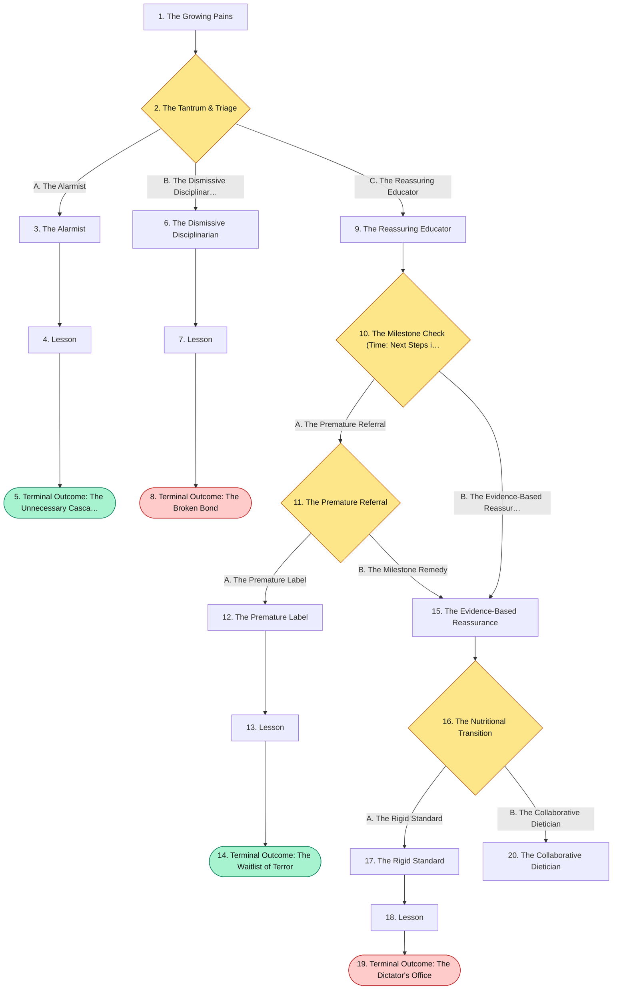
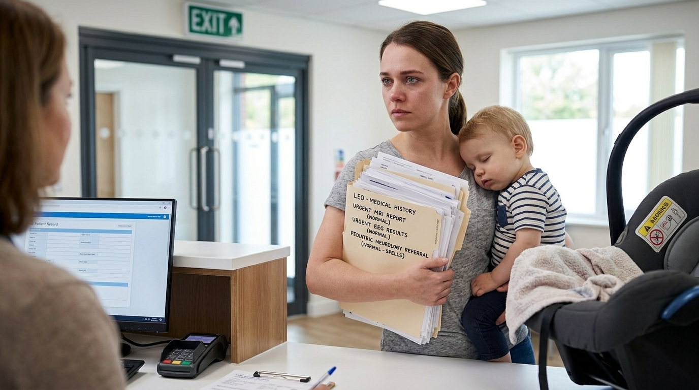
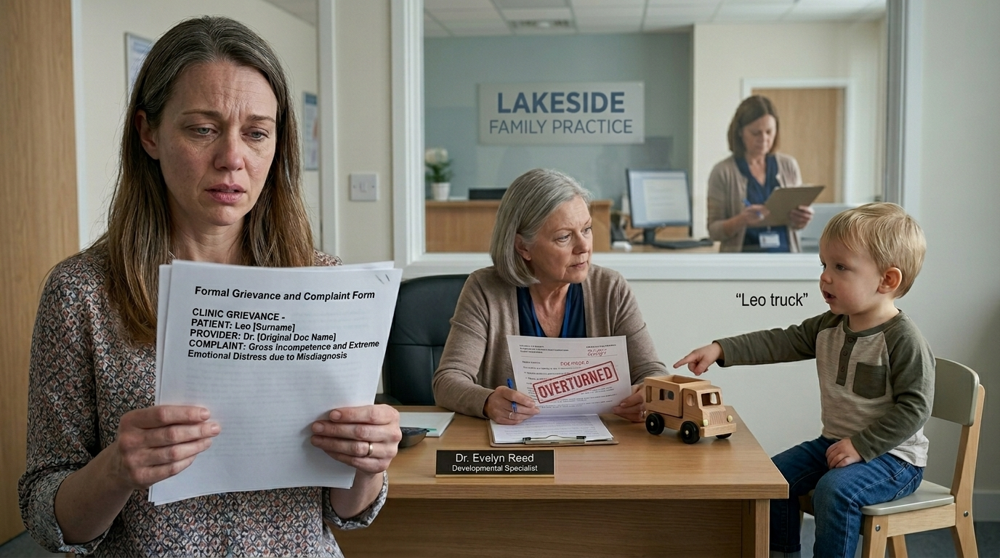
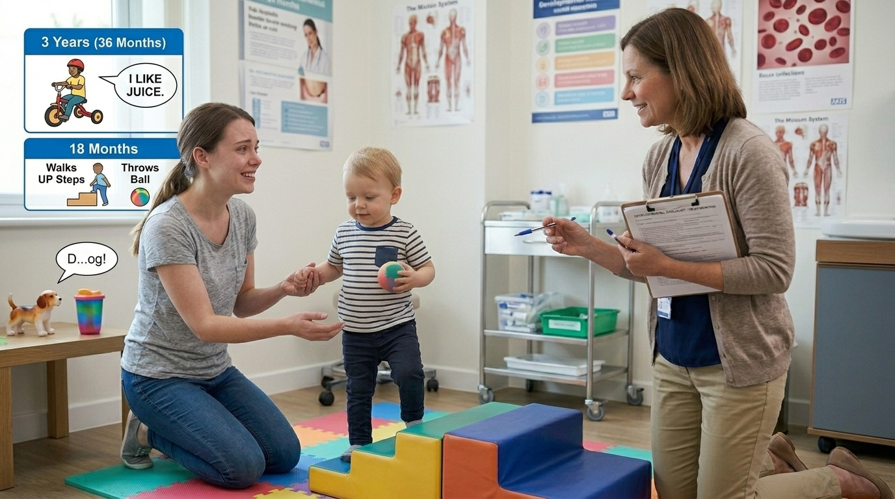

# The Growing Pains

> Evaluation and parent education

## Overview

| | |
|---|---|
| **Scenario key** | `pediatric developmental milestones` |
| **Scenario ID** | `eb529391-b069-49f7-96af-fe537aec070e` |
| **Story pages** | 12 |
| **Decision points** | 4 (9 choices) |
| **Endings** | 4 (2 checkpoint, 2 fail) |
| **Concepts** | `Benign Pediatric Variants & Iatrogenic Trauma`, `Milestone Timelines & Iatrogenic Anxiety`, `Nutritional Guidelines & Maternal Autonomy`, `Pediatric Ethics & Involuntary Reflexes` |
| **Graph file** | [`pediatric-developmental-milestones.json`](pediatric-developmental-milestones.json) |

This is a branching case study. The learner reads each story page, then at every decision point picks one of the choices. A *misstep* leads to a fail ending that sends the learner back to try again; the *correct* path continues the story and reaches checkpoint endings that mark the concepts learned.

## Flowchart

## The Story

### 1. The Growing Pains

Patient Profile: Leo, an 18-month-old male.
Initial State: Leo is brought into the clinic by his first-time mother, Sarah. She is highly anxious. She reports that Leo recently started throwing severe tantrums when frustrated. During these tantrums, he cries vigorously, holds his breath, turns blue around the lips, and briefly passes out. Additionally, she is worried because he isn't speaking in full sentences yet.

**Next:** [2. The Tantrum & Triage](#decision-node-1)

---

### 2. Decision: The Tantrum & Triage

Sarah describes the passing-out episodes in tears. "I think he is having seizures," she says. "He turns completely blue and just goes limp." You need to address her primary fear while diagnosing the etiology of the syncopal episodes.

**What do you do?**

- **A. The Alarmist** _(wrong)_ — Validate her fear of a seizure disorder immediately. Order an urgent EEG, a brain MRI, and refer him to pediatric neurology to rule out epilepsy. → [3. The Alarmist](#information-node-6)
- **B. The Dismissive Disciplinarian** _(wrong)_ — Tell her these are just behavioral tantrums. Advise her to implement strict punishments or splash cold water on his face to snap him out of it when he holds his breath. → [6. The Dismissive Disciplinarian](#information-node-9)
- **C. The Reassuring Educator** _(correct)_ — Gently explain that these are cyanotic breath-holding spells, a benign autonomic response triggered by emotional insults like anger or frustration. Assure her that education and reassurance are the primary treatments. You order a CBC and ferritin level to check for anemia, as iron supplementation can reduce spell frequency. → [9. The Reassuring Educator](#information-node-5)

---

### 3. The Alarmist

You send a terrified mother and her toddler through a gauntlet of terrifying and expensive neurological tests. Leo has to be sedated for the MRI, exposing him to anesthetic risks. The tests all return perfectly normal. When the pediatric neurologist eventually diagnoses simple breath-holding spells, Sarah loses all trust in your clinical judgment and leaves your practice.

**Next:** [4. Lesson](#information-node-7)

---

### 4. Lesson

Pediatric milestones and common childhood phenomena must be deeply understood because many presentations are simply normal variants that do not require further workup. Cyanotic breath-holding spells occur in roughly 4.6% of children between 6 months and 6 years of age. They are triggered by vigorous crying and forced expiration, leading to cyanosis and a brief loss of consciousness. Confusing this predictable sequence (trigger -> cry -> hold breath -> cyanosis -> limp) with an epileptic seizure subjects a toddler to unnecessary radiation, sedation (for the MRI), and extreme parental psychological trauma.

**Next:** [5. Terminal Outcome: The Unnecessary Cascade](#termination-node-8)

---

### 5. Checkpoint: Terminal Outcome: The Unnecessary Cascade

> **Result:** checkpoint · **Concept:** `Benign Pediatric Variants & Iatrogenic Trauma`

Final Outcome: Failure / Over-medicalization

The Flaw: Failing to recognize a classic cyanotic breath-holding spell and immediately jumping to a severe neurological differential without considering the clinical triggers.

Actionable Improvement: Always map the timeline of the event. Seizures are unprovoked neurological misfires; breath-holding spells are directly provoked by emotional distress, pain, or frustration.

_End of this path._

---

### 6. The Dismissive Disciplinarian

Sarah takes your advice. The next time Leo is frustrated and begins a breath-holding spell, she yells at him and splashes ice water on his face. This only exacerbates his emotional distress, making the spells more frequent and severe. You have provided medically inaccurate advice that actively harmed the patient's psychological environment.

**Next:** [7. Lesson](#information-node-10)

---

### 7. Lesson

While breath-holding spells are triggered by emotional tantrums (anger, frustration) , the actual breath-holding, cyanosis, and collapse are involuntary autonomic reflexes. The child is not doing it on purpose to manipulate the parent. Punishing a child for a physiological reflex is unethical and damages the parent-child attachment.

**Next:** [8. Terminal Outcome: The Broken Bond](#termination-node-11)

---

### 8. Ending: Terminal Outcome: The Broken Bond

> **Result:** fail · **Concept:** `Pediatric Ethics & Involuntary Reflexes`

Final Outcome: Failure / Harmful Medical Advice

The Flaw: Treating an involuntary physiological reflex as a conscious behavioral choice that requires punishment.

_End of this path._

---

### 9. The Reassuring Educator

You effectively de-escalate a terrified parent while identifying a classic, benign pediatric presentation. Checking for iron deficiency shows excellent clinical thoroughness.

**Next:** [10. The Milestone Check (Time: Next Steps in the Visit)](#decision-node-12)

---

### 10. Decision: The Milestone Check (Time: Next Steps in the Visit)

Sarah is vastly relieved to hear the spells are benign and usually resolve by school age. You move on to his developmental assessment.

Sarah is still worried. "He can walk up the stairs holding my hand, he throws his little ball everywhere, and he can name a few objects like 'dog' and 'cup'," she notes. "But my friend's child is the same age and is already speaking in three-word sentences and riding a tricycle. Is Leo falling behind?"

**What do you do?**

- **A. The Premature Referral** _(misstep)_ — Agree with her concern. Tell her that 18-month-olds should be forming sentences. Refer Leo to early intervention for speech therapy and autism screening. → [11. The Premature Referral](#decision-node-15)
- **B. The Evidence-Based Reassurance** _(correct)_ — Reassure her that Leo is perfectly on track. He has mastered the 18-month motor (walking up stairs, throwing a ball) and language (naming objects) milestones. Explain that 3-word sentences and riding a tricycle are milestones for a 3-year-old (36 months), not an 18-month-old. → [15. The Evidence-Based Reassurance](#information-node-18)

---

### 11. Decision: The Premature Referral

Sarah looks panicked and begins to cry again. "Autism? You think he has autism?" You pause and look at your developmental chart.

**What do you do?**

- **A. The Premature Label** _(wrong)_ — Instead of checking your developmental chart and realizing you mixed up the ages, you double down. You tell Sarah that "early intervention is critical" and officially submit referrals for an autism evaluation, a pediatric neurologist, and a speech-language pathologist based on his inability to ride a tricycle or speak in 3-word sentences. → [12. The Premature Label](#information-node-25)
- **B. The Milestone Remedy** _(correct)_ — You realize you mixed up the timelines. You quickly apologize, explaining that you misspoke. You reassure her that 2-word sentences don't begin until 24 months , and 3-word sentences are a 36-month milestone. Leo is exactly where he needs to be. → [15. The Evidence-Based Reassurance](#information-node-18)

---

### 12. The Premature Label

You submit the referrals. Sarah spends the next four months in a state of sheer terror, crying daily, convinced her perfectly healthy child is severely neurologically impaired. When she finally gets off the six-month waitlist to see the developmental pediatrician, the specialist takes one look at Leo—who is now 24 months old and speaking in normal 2-word sentences—and is baffled. The specialist informs Sarah that Leo is developing perfectly and that your initial expectations were off by a year and a half. Angry and traumatized, Sarah files a formal grievance against your clinic for incompetence and inflicting extreme emotional distress.

**Next:** [13. Lesson](#information-node-26)

---

### 13. Lesson

A fundamental requirement of pediatrics is distinguishing pathological delay from normal developmental variance—and more importantly, knowing the actual chronological timeline of milestones. Expecting an 18-month-old to speak in 3-word sentences or ride a tricycle is a severe clinical error. Two-word sentences typically emerge at 24 months , and riding a tricycle and speaking in 3-word sentences are strictly 36-month (3-year-old) milestones . Misapplying these benchmarks pathologizes normal children, inflicts profound psychological trauma on parents, and clogs the already overwhelmed early intervention and specialist systems.

**Next:** [14. Terminal Outcome: The Waitlist of Terror](#termination-node-27)

---

### 14. Checkpoint: Terminal Outcome: The Waitlist of Terror

> **Result:** checkpoint · **Concept:** `Milestone Timelines & Iatrogenic Anxiety`

Final Outcome: Failure / Clinical Incompetence & Resource Waste

The Flaw: Projecting preschool (3-6 years) developmental milestones onto a toddler (12-24 months), and diagnosing a delay without consulting standardized developmental screening charts.

Actionable Improvement: Memorize the core anchors: 1 year = 1-word stages/walking; 2 years = 2-word sentences/running; 3 years = 3-word sentences/tricycle . Never refer a child for a severe developmental delay without first verifying the age-appropriate benchmark.

_End of this path._

---

### 15. The Evidence-Based Reassurance

You correctly utilize milestone data to alleviate unnecessary parental anxiety while proving your competence.

**Next:** [16. The Nutritional Transition](#decision-node-19)

---

### 16. Decision: The Nutritional Transition

Finally, Sarah asks about his diet. She notes that she introduced solid foods right at 6 months, but she is still breastfeeding him several times a day. She hasn't introduced cow's milk because she heard "milk is for calves, not humans" on a parenting blog.

**What do you do?**

- **A. The Rigid Standard** _(wrong)_ — Tell her she must completely stop breastfeeding immediately because he is past a year old. Demand she switch him entirely to whole cow's milk to meet pediatric guidelines. → [17. The Rigid Standard](#information-node-22)
- **B. The Collaborative Dietician** _(correct)_ — Support her choice to continue breastfeeding, validating that it is a healthy source of nutrition and bonding. However, gently explain that introducing cow's milk at 12 months is the standard recommendation to ensure adequate dietary fats and calcium for brain and bone growth. Suggest she introduce it alongside his normal solid foods, and ensure he gets Vitamin D supplementation. → [20. The Collaborative Dietician](#information-node-28)

---

### 17. The Rigid Standard

Sarah is highly offended by your aggressive tone and your demand that she terminate breastfeeding. She feels judged and alienated. She leaves the clinic and decides to ignore all of your advice—including the valid recommendation to introduce cow's milk—putting Leo at risk for nutritional deficiencies simply because you lacked the bedside manner to communicate the guidelines collaboratively.

**Next:** [18. Lesson](#information-node-23)

---

### 18. Lesson

While cow's milk should be introduced at 12 months of age, there is absolutely no medical indication to force a mother to stop breastfeeding if both she and the child wish to continue. Nutrition is a highly personal and cultural aspect of pediatric care. Dictating extreme ultimatums destroys the therapeutic alliance and ignores the nuances of collaborative medical guidance.

**Next:** [19. Terminal Outcome: The Dictator's Office](#termination-node-24)

---

### 19. Ending: Terminal Outcome: The Dictator's Office

> **Result:** fail · **Concept:** `Nutritional Guidelines & Maternal Autonomy`

Final Outcome: Failure / Poor Bedside Manner

The Flaw: Utilizing an authoritarian approach to enforce a medical guideline while trampling on patient autonomy and parental bonding.

Actionable Improvement: Guidelines state when to introduce new foods (e.g., solids at 6 months, cow's milk at 12 months ), but they do not mandate the cessation of breastfeeding. Always use shared decision-making for lifestyle and nutritional transitions.

_End of this path._

---

### 20. The Collaborative Dietician

You successfully navigated parental misinformation without violating maternal autonomy. You achieved a collaborative plan that meets all pediatric nutritional guidelines.

---
