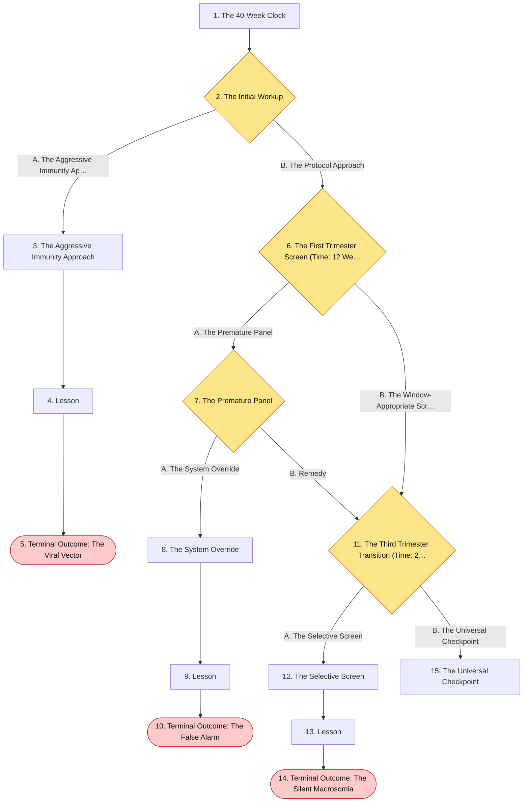
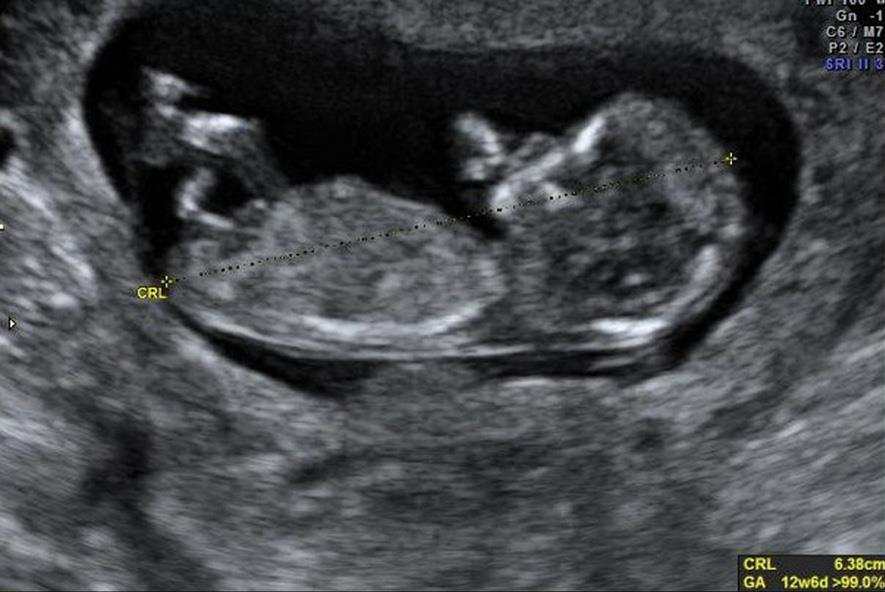
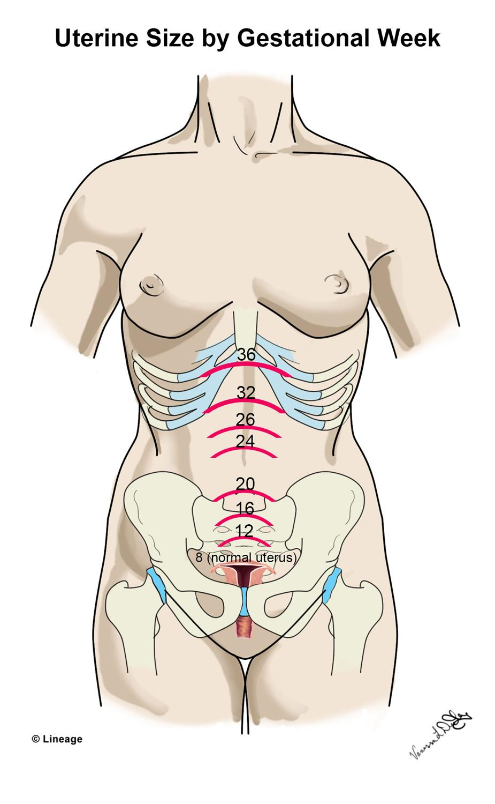
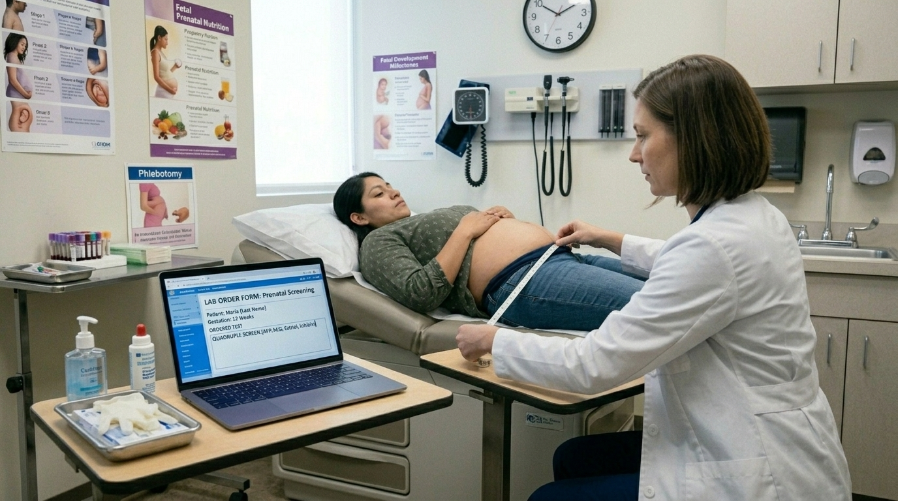
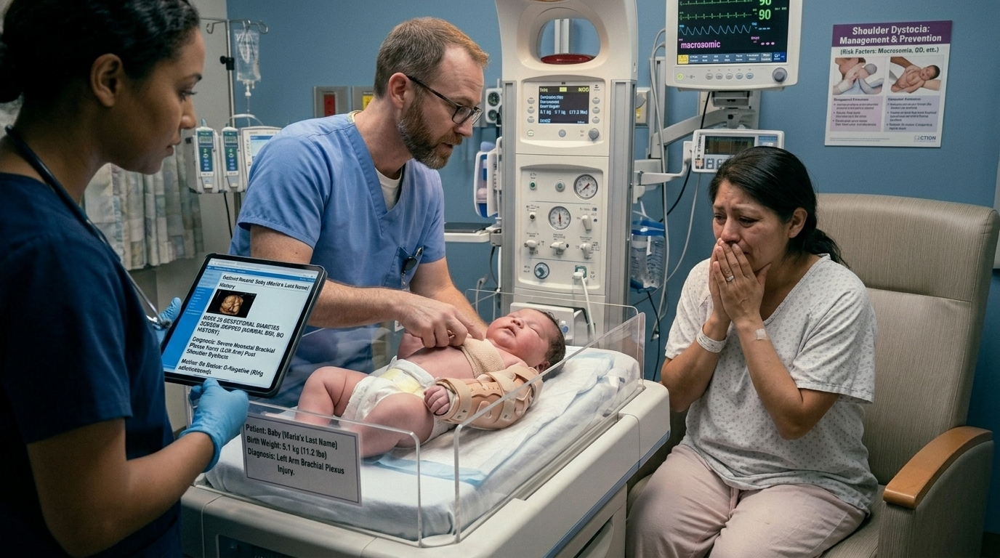
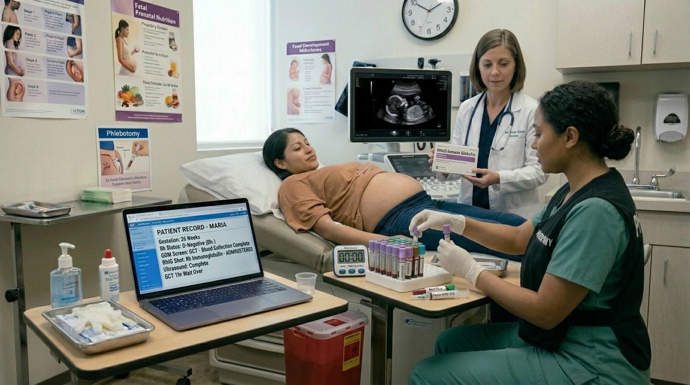

# The 40-Week Clock

> screening windows and preventative protocols

## Overview

| | |
|---|---|
| **Scenario key** | `prenatal care` |
| **Scenario ID** | `03d9b4c1-dda4-42e6-b8dc-11c41bda6e50` |
| **Story pages** | 8 |
| **Decision points** | 4 (8 choices) |
| **Endings** | 3 (0 checkpoint, 3 fail) |
| **Concepts** | `Diagnostic Timelines & Iatrogenic Cascades`, `Teratogenic Exposures & Live Vaccines`, `Universal Screening vs. Risk-Based Screening` |
| **Graph file** | [`prenatal-care.json`](prenatal-care.json) |

This is a branching case study. The learner reads each story page, then at every decision point picks one of the choices. A *misstep* leads to a fail ending that sends the learner back to try again; the *correct* path continues the story and reaches checkpoint endings that mark the concepts learned.

## Flowchart

## The Story

### 1. The 40-Week Clock

Patient Profile: Maria, a 26-year-old G1P0 female.
Initial State: She presents to the clinic for her first prenatal visit. She is estimated to be approximately 8 weeks gestation. She notes increased fatigue and occasional nausea. She is a recent immigrant with no immunization records and does not recall her vaccination history.

**Next:** [2. The Initial Workup](#decision-node-1)

---

### 2. Decision: The Initial Workup

You perform a physical exam and confirm the pregnancy. You need to order her initial laboratory workup and manage her preventative care, keeping in mind her unknown vaccination status.

**What do you do?**

- **A. The Aggressive Immunity Approach** _(wrong)_ — ince her vaccination status is unknown, immediately administer the MMR (measles, mumps, and rubella) vaccine along with the inactivated influenza vaccine to protect the fetus. Order a standard prenatal lab panel. → [3. The Aggressive Immunity Approach](#information-node-10)
- **B. The Protocol Approach** _(correct)_ — Prescribe prenatal vitamins with iron. Order a comprehensive lab panel including blood type and screen, CBC, HBsAg, Syphilis, HIV, Chlamydia, a urine culture, and a Rubella titer. Administer the inactivated influenza vaccine, but withhold the MMR vaccine. → [6. The First Trimester Screen (Time: 12 Weeks Gestation)](#decision-node-4)

---

### 3. The Aggressive Immunity Approach

You administer the MMR vaccine in the clinic. Because it is a live-attenuated vaccine, the rubella virus crosses the placenta and infects the developing fetus during the highly vulnerable first trimester. Weeks later, an ultrasound reveals severe fetal cardiac anomalies and growth restriction consistent with congenital rubella syndrome. By violating the absolute contraindication of live vaccines in pregnancy, you caused irreversible iatrogenic fetal harm.

**Next:** [4. Lesson](#information-node-11)

---

### 4. Lesson

Immunological management during pregnancy requires strict differentiation between live-attenuated and inactivated vaccines. While pregnant women are highly vulnerable to influenza and should receive the inactivated influenza vaccine, the MMR vaccine is a live-attenuated virus. Administering a live vaccine during pregnancy poses a direct theoretical risk of transmitting the virus to the fetus, potentially causing congenital rubella syndrome (which leads to deafness, cataracts, and cardiac defects). The correct protocol for a patient with unknown immune status is to draw a Rubella titer during the initial prenatal labs. If she is not immune, you counsel her to avoid exposure during pregnancy and administer the MMR vaccine immediately postpartum.

**Next:** [5. Terminal Outcome: The Viral Vector](#termination-node-6)

---

### 5. Ending: Terminal Outcome: The Viral Vector

> **Result:** fail · **Concept:** `Teratogenic Exposures & Live Vaccines`

The Flaw: Administering a live-attenuated vaccine (MMR) to a pregnant patient.

Actionable Improvement: Memorize the vaccine contraindications in pregnancy. Inactivated vaccines (Flu, Tdap) are safe and recommended. Live vaccines (MMR, Varicella, live-attenuated intranasal flu) are strictly contraindicated.

_End of this path._

---

### 6. Decision: The First Trimester Screen (Time: 12 Weeks Gestation)

Maria returns for her subsequent visit. Her fundal height is at the pubic symphysis, correlating perfectly with 12 weeks. You need to offer screening for fetal aneuploidy.

**What do you do?**

- **A. The Premature Panel** _(misstep)_ — Order a Quadruple Screen (AFP, hCG, estriol, and inhibin) to check for Down syndrome and neural tube defects. → [7. The Premature Panel](#decision-node-7)
- **B. The Window-Appropriate Screen** _(correct)_ — Order an ultrasound for nuchal translucency and a maternal blood draw for PAPP-A and free beta-hCG. → [11. The Third Trimester Transition (Time: 26 Weeks Gestation)](#decision-node-14)

---

### 7. Decision: The Premature Panel

The lab rejects your order for the Quadruple Screen.

**What do you do?**

- **A. The System Override** _(wrong)_ — Override the lab review and reorder the screening tests → [8. The System Override](#information-node-20)
- **B. Remedy** _(correct)_ — You review the testing timeline, cancel the Quadruple Screen, and order the nuchal translucency ultrasound with PAPP-A instead. → [11. The Third Trimester Transition (Time: 26 Weeks Gestation)](#decision-node-14)

---

### 8. The System Override

You pull rank, call the lab director, and force them to run the Quadruple Screen on the 12-week sample. Because the physiological levels of AFP and estriol are naturally nowhere near their second-trimester baselines, the computer algorithm flags the results as critically abnormal, indicating a massive, high-risk probability for Edwards Syndrome (Trisomy 18). You deliver this devastating news to Maria. Panicked and grieving, she consents to an immediate, urgent invasive diagnostic procedure based entirely on your faulty data. The procedure causes an iatrogenic premature rupture of membranes (PPROM). She loses the pregnancy. Weeks later, the microarray on the lost fetus returns: perfectly genetically normal.

**Next:** [9. Lesson](#information-node-21)

---

### 9. Lesson

Laboratory rejections are often critical systemic safeguards, not administrative hurdles. Maternal serum screening tests are meticulously calibrated to specific gestational windows based on the physiological production timelines of fetal proteins and placental hormones. The Quadruple Screen (AFP, hCG, estriol, and inhibin) is strictly validated for the second trimester (15-22 weeks, optimally 16-18 weeks). Drawing these markers at 12 weeks guarantees a completely uninterpretable result or a catastrophic false positive. Overriding a lab's safety stop to force an inappropriate test creates a cascade of "garbage in, garbage out" data that often leads to dangerous, unnecessary, and highly invasive follow-up procedures.

**Next:** [10. Terminal Outcome: The False Alarm](#termination-node-22)

---

### 10. Ending: Terminal Outcome: The False Alarm

> **Result:** fail · **Concept:** `Diagnostic Timelines & Iatrogenic Cascades`

The Flaw: Overriding a systemic clinical safeguard to order a time-specific screening test entirely outside of its validated gestational window.Identified Weakness: Hubris, ignoring systemic safety checks, and a critical misunderstanding of maternal serum biomarker timelines.Actionable Improvement: Respect laboratory rejections—they are the final net catching diagnostic errors. Memorize the strict timeline division: First Trimester Screen (11-14 weeks: NT + PAPP-A + hCG) vs. Second Trimester Screen (16-18 weeks: Quad Screen). Never interpret maternal serum markers outside of their validated dating windows.

_End of this path._

---

### 11. Decision: The Third Trimester Transition (Time: 26 Weeks Gestation)

Maria is now in her late second trimester. Her initial labs from week 8 showed her blood type is O-negative (Rh negative). She has no history of gestational diabetes, and her pre-pregnancy BMI was 22 (normal)

**What do you do?**

- **A. The Selective Screen** _(wrong)_ — Since she lacks high-risk factors for gestational diabetes (normal BMI, no prior history), skip the glucose challenge test. Focus purely on her Rh status and administer Rh immunoglobulin. → [12. The Selective Screen](#information-node-17)
- **B. The Universal Checkpoint** _(correct)_ — Order a 1-hour glucose challenge test. Separately, order a repeat type and screen, and administer Rh immunoglobulin → [15. The Universal Checkpoint](#information-node-23)

---

### 12. The Selective Screen

You send Maria home with her Rh immunoglobulin but no glucose screening. Over the next ten weeks, her undetected gestational diabetes causes prolonged fetal hyperglycemia. The fetus responds with hyperinsulinemia, acting as a powerful growth factor. At 39 weeks, Maria goes into labor. Because the fetus has grown silently macrosomic (excessively large), the head delivers but the anterior shoulder becomes impacted behind the maternal pubic symphysis (shoulder dystocia). The delivery becomes a catastrophic obstetrical emergency, resulting in a severe brachial plexus injury to the infant

**Next:** [13. Lesson](#information-node-18)

---

### 13. Lesson

Prenatal screening protocols are divided into "risk-based" and "universal" categories. While early screening for gestational diabetes (at the first prenatal visit) is reserved for patients with explicit high-risk factors (BMI > 30 kg/m^2, prior history), the screening window at 24-28 weeks is universal. All pregnant patients, regardless of their baseline risk factors, must undergo the 1-hour glucose challenge test during this timeframe because the diabetogenic hormones produced by the placenta peak during the late second and early third trimesters.

**Next:** [14. Terminal Outcome: The Silent Macrosomia](#termination-node-19)

---

### 14. Ending: Terminal Outcome: The Silent Macrosomia

> **Result:** fail · **Concept:** `Universal Screening vs. Risk-Based Screening`

Final Outcome: Failure / Undiagnosed GDM leading to Obstetrical Emergency

The Flaw: Conflating the criteria for early high-risk screening with the criteria for routine universal screening at 24-28 weeks.

Actionable Improvement: Memorize the strict 24-28 week checklist: 1-hour glucose challenge (universal), repeat type and screen, and administration of Rh immunoglobulin for Rh-negative mothers.

_End of this path._

---

### 15. The Universal Checkpoint

Ultimate Success. You flawlessly navigated the 24-28 week testing window. Administering Rh immunoglobulin prevents maternal alloimmunization, and performing the universal glucose challenge ensures no silent metabolic complications threaten the late stages of the pregnancy.

---
