# The Missing Milestone

> Evaluation and diagnosis

## Overview

| | |
|---|---|
| **Scenario key** | `primary amenorrhea` |
| **Scenario ID** | `f9a62c0c-9b3d-46b3-bf48-338f714b2fd6` |
| **Story pages** | 15 |
| **Decision points** | 7 (17 choices) |
| **Endings** | 7 (0 checkpoint, 7 fail) |
| **Concepts** | `Anatomical Prerequisites & Empirical Fallacies`, `Delivering the Diagnosis`, `Diagnostic Criteria & Delayed Care`, `Genotypic Discordance & Malignancy Risk`, `Medical Ethics & Adolescent Autonomy`, `Medical Ethics & Genetic Counseling` |
| **Graph file** | [`primary-amenorrhea.json`](primary-amenorrhea.json) |

This is a branching case study. The learner reads each story page, then at every decision point picks one of the choices. A *misstep* leads to a fail ending that sends the learner back to try again; the *correct* path continues the story and reaches checkpoint endings that mark the concepts learned.

## Flowchart

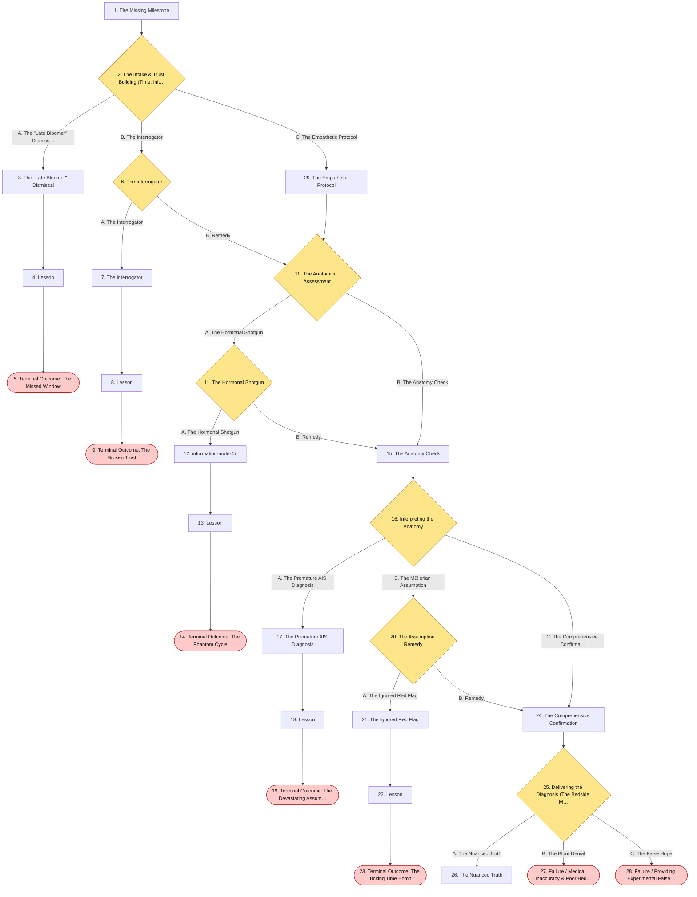

## The Story

### 1. The Missing Milestone

Patient Profile: Chloe, 17-year-old female.
Initial State: She presents to your clinic highly distressed. She states she is the only girl in her friend group who has not yet started her period. She reports being sexually active with her boyfriend for the past year and uses condoms consistently. She denies any pelvic pain, visual changes, or headaches.

**Next:** [2. The Intake & Trust Building (Time: Initial Consult)](#decision-node-1)

---

### 2. Decision: The Intake & Trust Building (Time: Initial Consult)

You enter the room. Chloe is visibly anxious and avoids eye contact. Given her age and the sensitive nature of the visit, establishing trust while executing the correct primary algorithm is critical.

**What do you do?**

- **A. The "Late Bloomer" Dismissal** _(wrong)_ — Reassure her that every body develops at its own pace. Since she has no pelvic pain, tell her to come back in a year if her period hasn't started by age 18. → [3. The "Late Bloomer" Dismissal](#information-node-6)
- **B. The Interrogator** _(misstep)_ — Focus immediately on her sexual activity. Ask her to detail her contraceptive use in front of the medical scribe, and immediately order a full STD panel and a pelvic exam without explaining why. → [6. The Interrogator](#decision-node-10)
- **C. The Empathetic Protocol** _(correct)_ — Ask the scribe/chaperone to step out for a moment to ensure confidentiality. Validate her anxiety, assuring her that investigating this is standard and safe. Then, order the most critical first test for any reproductive-age female with amenorrhea: a urine beta-hCG (pregnancy test). → [29. The Empathetic Protocol](#information-node-5)

---

### 3. The "Late Bloomer" Dismissal

You send Chloe home. She feels dismissed but trusts your authority. A year later, she presents to the emergency department with severe, acute cyclic pelvic pain. She actually had a transverse vaginal septum (an anatomical outflow obstruction). Because you delayed the workup, she developed severe retrograde menstruation and endometriosis, compromising her future fertility.

**Next:** [4. Lesson](#information-node-7)

---

### 4. Lesson

Primary amenorrhea is strictly defined as the absence of menarche by age >15 years in the presence of normal secondary sexual characteristics, or by age >13 years in the absence of secondary sexual characteristics. Dismissing a 17-year-old as a "late bloomer" is a severe clinical error that delays the diagnosis of potentially profound anatomical or genetic abnormalities. A full diagnostic workup must be initiated immediately.

**Next:** [5. Terminal Outcome: The Missed Window](#termination-node-8)

---

### 5. Ending: Terminal Outcome: The Missed Window

> **Result:** fail · **Concept:** `Diagnostic Criteria & Delayed Care`

You send Chloe home. She feels dismissed but trusts your authority. A year later, she presents to the emergency department with severe, acute cyclic pelvic pain. She actually had a transverse vaginal septum (an anatomical outflow obstruction). Because you delayed the workup, she developed severe retrograde menstruation and endometriosis, compromising her future fertility.

_End of this path._

---

### 6. Decision: The Interrogator

Chloe is crying and refusing the exam.

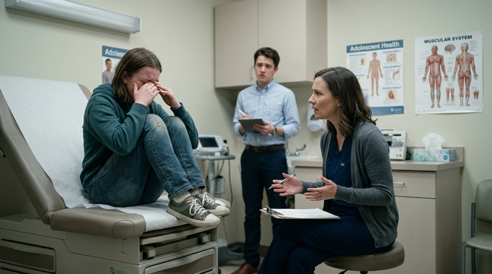

**What do you do?**

- **A. The Interrogator** _(wrong)_ — Instead of apologizing to Chloe when she shuts down, you remind her that since she is an underage minor engaging in sexual activity, you have an obligation to test her, threatening to bring her mother into the room if she doesn’t comply → [7. The Interrogator](#information-node-43)
- **B. Remedy** _(correct)_ — You must ask the scribe to leave, apologize for the abruptness, and explain that a pregnancy test and a non-invasive external exam are the standard first steps. You regain just enough trust to proceed. → [10. The Anatomical Assessment](#decision-node-13)

---

### 7. The Interrogator

Chloe is terrified by your threat. She abruptly stands up, refuses all care, and leaves the clinic against medical advice (AMA). Because you violated her trust, she becomes deeply averse to the healthcare system. She never follows up with another physician. Years later, she experiences painful intercourse (dyspareunia) due to her undiagnosed anatomical abnormality, suffering in silence and developing severe sexual trauma and anxiety because she is too afraid of doctors to seek help.

**Next:** [8. Lesson](#information-node-44)

---

### 8. Lesson

Adolescent gynecology requires a delicate balance of confidentiality, autonomy, and trust. While minors have different legal standing depending on the jurisdiction, using coercion or the threat of parental disclosure to force a physical exam on a stable, non-emergent patient is a profound ethical violation. It completely destroys the therapeutic alliance. A pelvic exam must always be performed with explicit, uncoerced consent, especially in young patients presenting for their first gynecological visit.

**Next:** [9. Terminal Outcome: The Broken Trust](#termination-node-45)

---

### 9. Ending: Terminal Outcome: The Broken Trust

> **Result:** fail · **Concept:** `Medical Ethics & Adolescent Autonomy`

Final Outcome: Failure / AMA and Healthcare Alienation

The Flaw: Utilizing coercion and violating patient autonomy to force clinical compliance.

Actionable Improvement: Master the ethics of adolescent confidentiality. If a patient refuses a non-emergent exam, respect their boundaries, explain the clinical reasoning, and offer to reschedule when they feel more comfortable.

_End of this path._

---

### 10. Decision: The Anatomical Assessment

Chloe's pregnancy test is negative. You proceed with a gentle physical exam with a chaperone present. You note she has normal, mature breast development (Tanner Stage V) and normal pubic and axillary hair.

**What do you do?**

- **A. The Hormonal Shotgun** _(misstep)_ — You assume this is a pituitary issue. You order a massive panel: FSH, LH, TSH, Prolactin, and Estradiol, and schedule her for a brain MRI. → [11. The Hormonal Shotgun](#decision-node-16)
- **B. The Anatomy Check** _(correct)_ — You recognize that secondary sexual characteristics are present, meaning her body is producing estrogen. You order a pelvic ultrasound to determine the presence or absence of a uterus. → [15. The Anatomy Check](#information-node-18)

---

### 11. Decision: The Hormonal Shotgun

The lab results return. Her FSH, LH, TSH, and Prolactin are all perfectly normal. The brain MRI is clear. You have wasted thousands of dollars and caused the patient unnecessary stress.

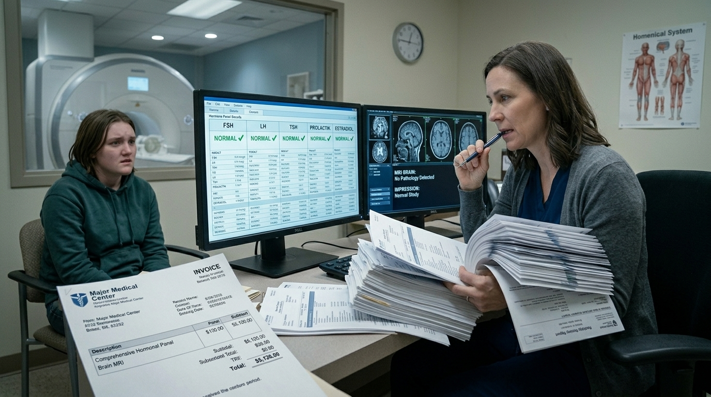

**What do you do?**

- **A. The Hormonal Shotgun** _(wrong)_ — When the massive hormone panel and brain MRI come back normal, you decide she just has functional hypothalamic amenorrhea from the "stress" of being a teenager. You prescribe oral contraceptive pills (OCPs) to jumpstart her cycle. → [12. information-node-47](#information-node-47)
- **B. Remedy** _(correct)_ — You realize you skipped the anatomical evaluation. You pivot and order the pelvic ultrasound. → [15. The Anatomy Check](#information-node-18)

---

### 12. information-node-47

You prescribe the OCPs and tell Chloe her period will start during the placebo week. She takes the medication faithfully for six months. Predictably, she never bleeds, because she has no endometrium to shed. Frustrated and experiencing side effects from the unnecessary estrogen, she seeks a second opinion. The new physician performs a 5-minute bedside ultrasound, immediately noting the absent uterus, and reports your negligent prescribing to the medical board.

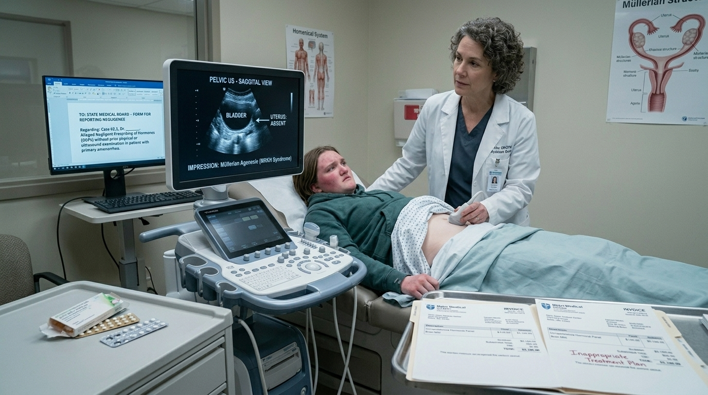

**Next:** [13. Lesson](#information-node-48)

---

### 13. Lesson

Prescribing a treatment without a confirmed anatomical diagnosis is a dangerous trap. You cannot chemically induce a period in a patient who lacks a uterus. In the primary amenorrhea algorithm, once a pregnancy test is negative and secondary sexual characteristics are confirmed, a pelvic ultrasound is strictly required to determine the presence of a uterus. Administering exogenous hormones blindly exposes the patient to unnecessary risks (like venous thromboembolism) without any possibility of resolving her chief complaint.

**Next:** [14. Terminal Outcome: The Phantom Cycle](#termination-node-49)

---

### 14. Ending: Terminal Outcome: The Phantom Cycle

> **Result:** fail · **Concept:** `Anatomical Prerequisites & Empirical Fallacies`

Final Outcome: Failure / Negligent Prescribing & Missed Diagnosis

The Flaw: Treating a symptom (amenorrhea) with empirical medical therapy without ruling out an anatomical outflow tract or structural absence first.

Actionable Improvement: Never skip the imaging step in primary amenorrhea. A pelvic ultrasound is a cheap, non-invasive, and mandatory tool to confirm Müllerian structures before initiating any hormonal therapy.

_End of this path._

---

### 15. The Anatomy Check

When a patient has primary amenorrhea but normal breast development, the very next step in the algorithm is a pelvic ultrasound to evaluate the Müllerian structures

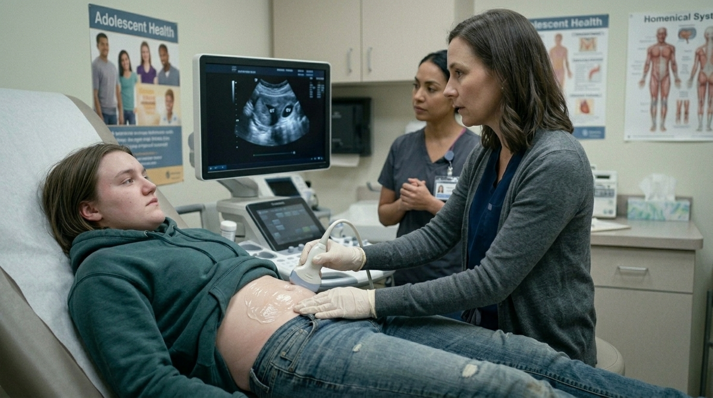

**Next:** [16. Interpreting the Anatomy](#decision-node-20)

---

### 16. Decision: Interpreting the Anatomy

The pelvic ultrasound results are back. The radiologist notes: "Normal appearing bilateral ovaries. The uterus and upper two-thirds of the vagina are entirely absent."

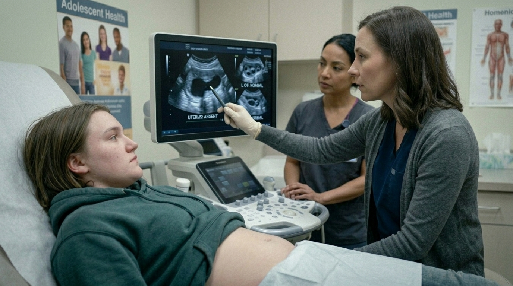

**What do you do?**

- **A. The Premature AIS Diagnosis** _(wrong)_ — Tell Chloe that she has Androgen Insensitivity Syndrome (AIS) and that she is genetically male → [17. The Premature AIS Diagnosis](#information-node-25)
- **B. The Müllerian Assumption** _(misstep)_ — Tell her she has Müllerian Agenesis (Mayer-Rokitansky-Küster-Hauser syndrome) and that she was born without a uterus. → [20. The Assumption Remedy](#decision-node-28)
- **C. The Comprehensive Confirmation** _(correct)_ — Explain the ultrasound findings gently, stating that her uterus did not develop in utero. Immediately order a Karyotype and a serum testosterone level to definitively distinguish the etiology. → [24. The Comprehensive Confirmation](#information-node-24)

---

### 17. The Premature AIS Diagnosis

You sit Chloe down and tell her she is genetically male. She suffers a massive psychological breakdown in the clinic, experiencing acute identity crisis and severe depression. Two weeks later, another physician pulls her labs and discovers she is 46, XX. She has Müllerian Agenesis, not AIS. Your premature assumption based purely on ultrasound findings caused profound, unnecessary psychological trauma. You face a severe malpractice and ethics board review.

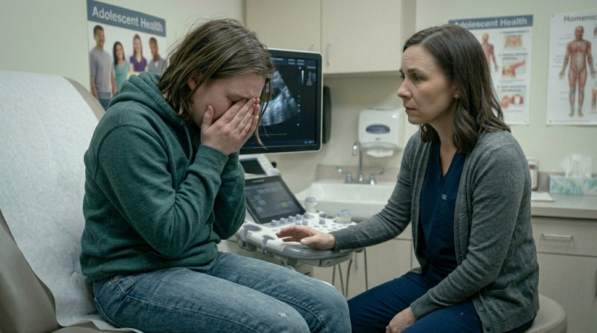

**Next:** [18. Lesson](#information-node-26)

---

### 18. Lesson

Delivering life-altering genetic and gender-identity information without objective confirmation is a catastrophic ethical and clinical failure. An absent uterus on ultrasound with normal breast development points to either Müllerian Agenesis (a 46, XX female) or Complete Androgen Insensitivity Syndrome (a 46, XY individual with mutated androgen receptors). You cannot differentiate these visually on an ultrasound.

**Next:** [19. Terminal Outcome: The Devastating Assumption](#termination-node-27)

---

### 19. Ending: Terminal Outcome: The Devastating Assumption

> **Result:** fail · **Concept:** `Medical Ethics & Genetic Counseling`

Final Outcome: Failure / Unprofessional Conduct & Psychological Harm

The Flaw: Diagnosing a complex disorder of sexual development without a karyotype. Furthermore, diagnosing AIS requires a multidisciplinary team (psychology, endocrinology, gynecology) to navigate the extreme sensitivity of the condition.

Actionable Improvement: Never deliver a life-altering genetic diagnosis without the objective genetic data (Karyotype) in hand.

_End of this path._

---

### 20. Decision: The Assumption Remedy

You tell her it is Müllerian Agenesis. Your attending pulls you aside and points out that her axillary and pubic hair are a bit sparse, a classic sign of AIS.

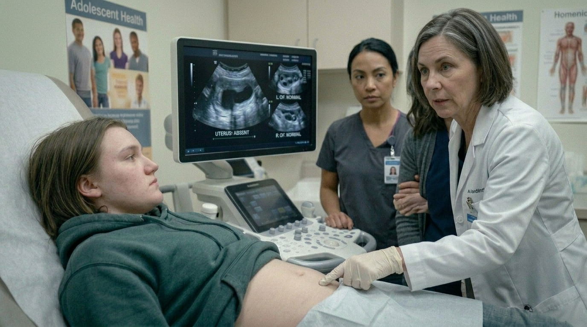

**What do you do?**

- **A. The Ignored Red Flag** _(wrong)_ — When the attending points out Chloe's sparse pubic and axillary hair, you dismiss it as a normal variant. You refuse to order the karyotype and counsel the family purely on Müllerian Agenesis. → [21. The Ignored Red Flag](#information-node-50)
- **B. Remedy** _(correct)_ — You acknowledge the oversight, order the Karyotype and serum testosterone, and tell the patient you are awaiting final genetic confirmation. → [24. The Comprehensive Confirmation](#information-node-24)

---

### 21. The Ignored Red Flag

You confidently diagnose Chloe with Müllerian Agenesis and discharge her. Because you assumed her ovaries were normal, you do not schedule any surgical follow-up. Chloe is actually 46, XY with Complete Androgen Insensitivity Syndrome. She has retained intra-abdominal testes. Ten years later, at age 27, she presents to the emergency department with a large abdominal mass. The retained testicular tissue has undergone malignant transformation into a highly aggressive gonadoblastoma. By dismissing a subtle physical exam finding and skipping the karyotype, you missed a critical prophylactic intervention.

**Next:** [22. Lesson](#information-node-51)

---

### 22. Lesson

Sparse or absent axillary and pubic hair in a phenotypic female with an absent uterus is the cardinal clinical sign of Complete Androgen Insensitivity Syndrome (CAIS). CAIS patients are genetically 46, XY and possess male gonads (testes) that are typically retained in the abdomen or inguinal canal. While Müllerian agenesis and CAIS can look identical on a basic ultrasound, the distinction is life-or-death. The retained intra-abdominal testes in CAIS carry a significant risk of malignant transformation (dysgerminoma or gonadoblastoma) after puberty. A karyotype is absolutely mandatory.

**Next:** [23. Terminal Outcome: The Ticking Time Bomb](#termination-node-52)

---

### 23. Ending: Terminal Outcome: The Ticking Time Bomb

> **Result:** fail · **Concept:** `Genotypic Discordance & Malignancy Risk`

Final Outcome: Fatal / Missed Malignancy Prevention

The Flaw: Dismissing clinical red flags (sparse hair) and failing to confirm the genetic sex in a patient with an absent uterus, leading to retained malignant-potential gonads.

Actionable Improvement: Any patient with an absent uterus must have a karyotype and serum testosterone level. If CAIS (46, XY) is confirmed, the standard of care requires a prophylactic gonadectomy after puberty is complete to prevent cancer.

_End of this path._

---

### 24. The Comprehensive Confirmation

Absent uterus with normal breasts has two main differentials: Müllerian Agenesis (46, XX) and Complete Androgen Insensitivity Syndrome (46, XY). You must have a karyotype and testosterone levels (which will be male-range in AIS) to confirm.

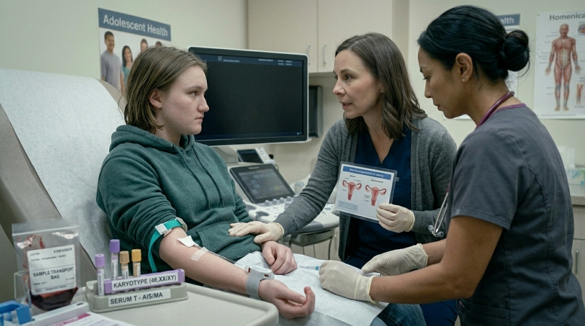

**Next:** [25. Delivering the Diagnosis (The Bedside Manner Test)](#decision-node-32)

---

### 25. Decision: Delivering the Diagnosis (The Bedside Manner Test)

The labs return. The Karyotype is 46, XX. Her serum testosterone is in the normal female range. The definitive diagnosis is Müllerian Agenesis.

You sit down with Chloe and her mother to explain that her uterus and upper vagina failed to develop during embryogenesis, but her ovaries are perfectly healthy. Chloe begins to cry. She looks at you and asks, "Does this mean I can never have my own biological children?"

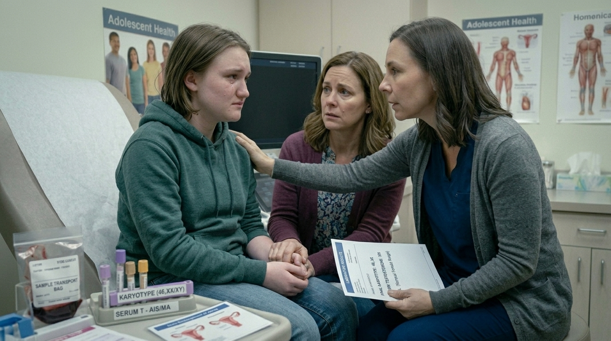

**What do you do?**

- **A. The Nuanced Truth** _(correct)_ — Hand her a tissue. Say, "You cannot carry a pregnancy yourself, but you are not sterile. Because your ovaries are healthy, you produce your own eggs. In the future, you can have biological children through IVF and a gestational surrogate." → [26. The Nuanced Truth](#information-node-36)
- **B. The Blunt Denial** _(wrong)_ — State clearly, "Yes, because you do not have a uterus, you are permanently sterile. You should look into adoption when you are ready." → [27. Failure / Medical Inaccuracy & Poor Bedside Manner](#termination-node-41)
- **C. The False Hope** _(wrong)_ — Tell her not to worry, because surgical science is advancing rapidly and she can simply get a uterine transplant in the future to carry a baby. → [28. Failure / Providing Experimental False Hope](#termination-node-42)

---

### 26. The Nuanced Truth

You successfully navigated a deeply emotional, complex medical diagnosis. You provided accurate scientific data without destroying her hope, blending high-level gynecological knowledge with impeccable bedside manner.

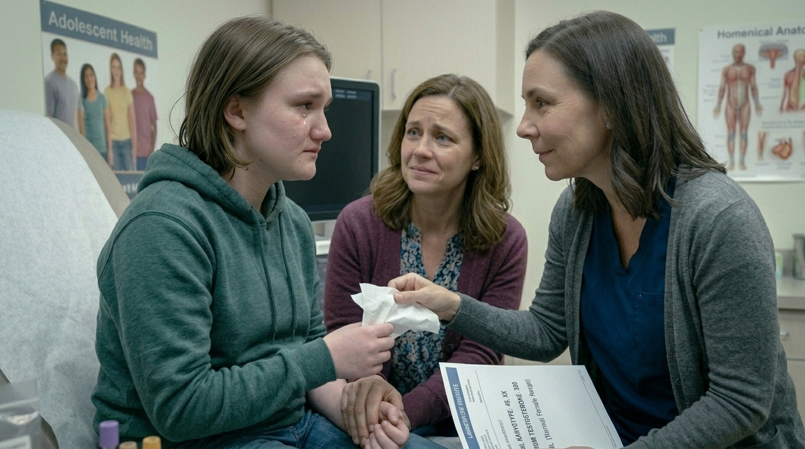

---

### 27. Ending: Failure / Medical Inaccuracy & Poor Bedside Manner

> **Result:** fail · **Concept:** `Delivering the Diagnosis`

The Flaw: Equating the inability to carry a pregnancy (absent uterus) with biological sterility (absent ovaries). In Müllerian Agenesis, the ovaries function perfectly. She can undergo oocyte retrieval for In Vitro Fertilization (IVF). Telling her she is sterile is factually wrong and unnecessarily cruel.

Actionable Improvement: Review the anatomy of Müllerian structures. The ovaries are derived from the genital ridge, not the Müllerian ducts. Therefore, they are unaffected in this condition.

_End of this path._

---

### 28. Ending: Failure / Providing Experimental False Hope

> **Result:** fail · **Concept:** `Delivering the Diagnosis`

The Flaw: Uterine transplants are currently highly experimental, incredibly dangerous, and not the standard of care. Promising this to a distressed 17-year-old violates the ethical principle of non-maleficence by setting her up for severe future disappointment and potential physical harm.

Actionable Improvement: Always counsel patients based on current, established standards of care (IVF with a gestational carrier), while offering psychological support and counseling resources for individuals with absolute uterine factor infertility.

_End of this path._

---

### 29. The Empathetic Protocol

You establish absolute trust. Even though she has primary amenorrhea, pregnancy is always the top differential to rule out in a sexually active female. The test returns negative.

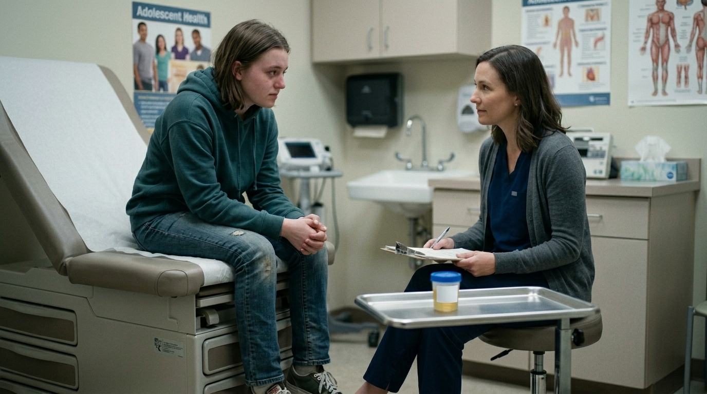

**Next:** [10. The Anatomical Assessment](#decision-node-13)

---
