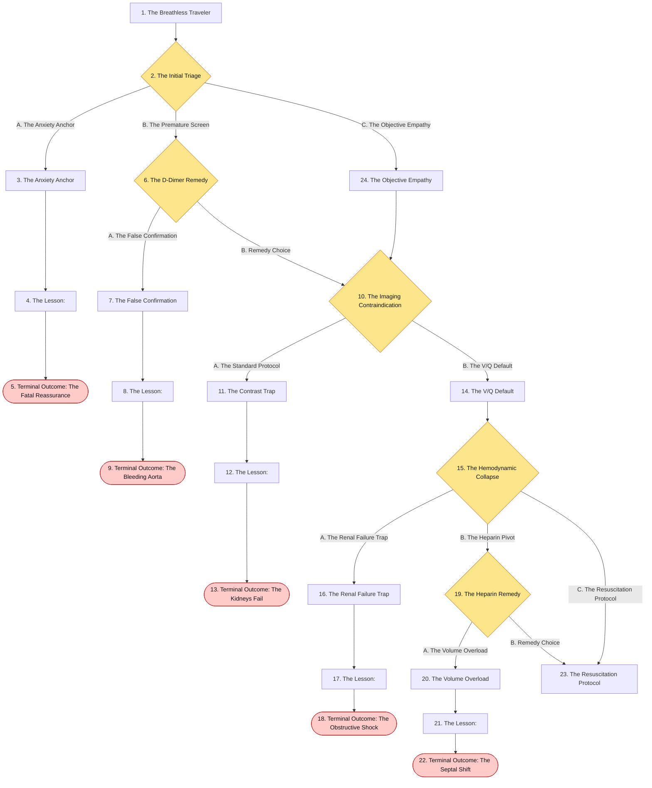
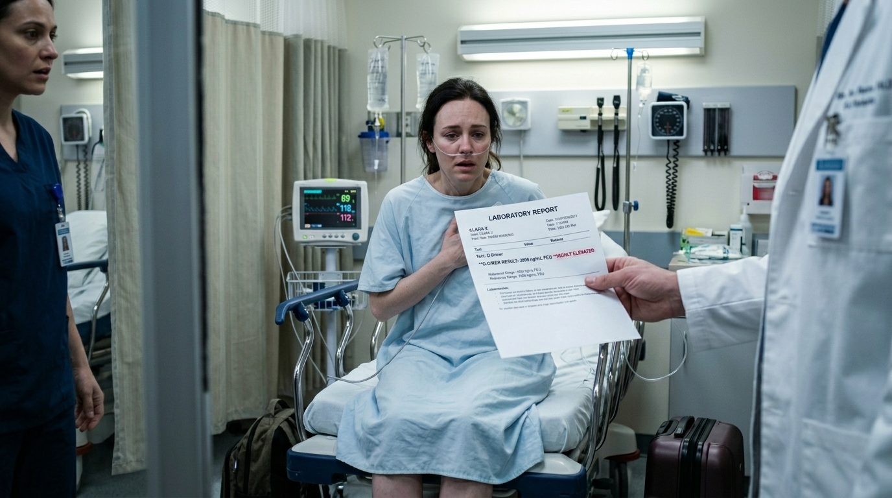
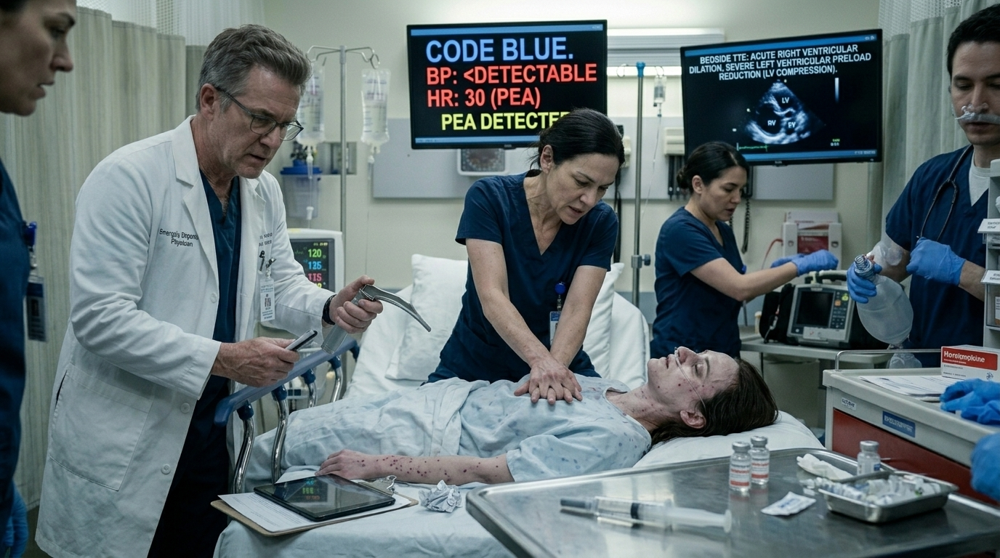
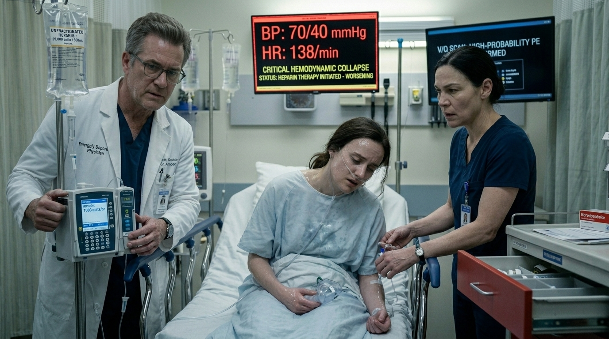
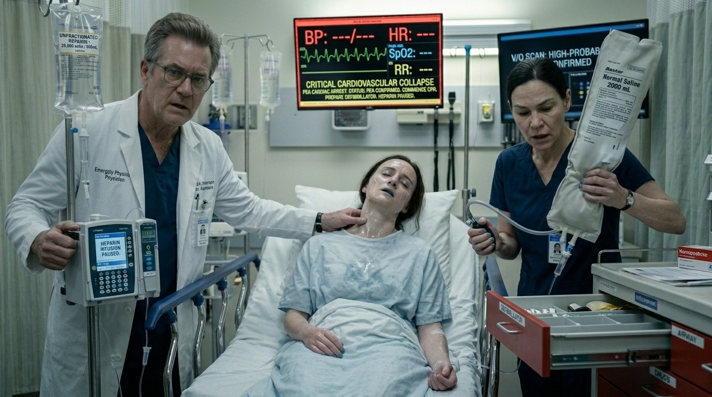

# The Breathless Traveler

> Pulmonary Embolism (PE)

## Overview

| | |
|---|---|
| **Scenario key** | `pulmonology and emergency triage` |
| **Scenario ID** | `394cf803-bf14-49ea-8dfd-21b984996b39` |
| **Story pages** | 14 |
| **Decision points** | 5 (12 choices) |
| **Endings** | 5 (0 checkpoint, 5 fail) |
| **Concepts** | `Diagnostic Anchoring & Objective Hypoxemia`, `Diagnostic Contraindications & Iatrogenic Nephropathy`, `Obstructive Shock & Ventricular Interdependence`, `Pharmacokinetics & Hemodynamic Shock`, `Test Specificity & Misguided Therapy` |
| **Graph file** | [`pulmonology-and-emergency-triage.json`](pulmonology-and-emergency-triage.json) |

This is a branching case study. The learner reads each story page, then at every decision point picks one of the choices. A *misstep* leads to a fail ending that sends the learner back to try again; the *correct* path continues the story and reaches checkpoint endings that mark the concepts learned.

## Flowchart

## The Story

### 1. The Breathless Traveler

Patient Profile: Ms. Clara Vance, a 36-year-old female.
The patient presents to the emergency department with worsening shortness of breath and pleuritic chest pain. She recently returned to the United States from a 14-hour overseas business flight. Her only medication is an oral contraceptive.Vitals: Temperature $98.6^{\circ}F$ ($37^{\circ}C$), Blood Pressure $135/82$ mmHg, Pulse $112/min$, Respirations $24/min$, Oxygen Saturation 89% on room air.

**Next:** [2. The Initial Triage](#decision-node-1)

---

### 2. Decision: The Initial Triage

You enter the room. Clara is gasping for air, clutching her chest, and crying. "I feel like I'm having a heart attack, I can't catch my breath!" she panics.

**What do you do?**

- **A. The Anxiety Anchor** _(wrong)_ — Assume her symptoms are a panic attack triggered by travel stress, given her young age and normal blood pressure. Reassure her dismissively, order an IV benzodiazepine (Lorazepam) to calm her down, and wait for her heart rate to drop. → [3. The Anxiety Anchor](#information-node-3)
- **B. The Premature Screen** _(misstep)_ — Order a stat D-dimer to rule out a PE, telling her you will return when the lab results are back. → [6. The D-Dimer Remedy](#decision-node-7)
- **C. The Objective Empathy** _(correct)_ — Validate her distress immediately. "I know it feels terrifying not to be able to breathe, but you are in the right place and we are going to find out why." You place her on supplemental oxygen and mentally calculate her Wells Score based on her tachycardia (>100/min), prolonged immobilization, and the fact that PE is the most likely diagnosis → [24. The Objective Empathy](#information-node-14)

---

### 3. The Anxiety Anchor

You administer the Lorazepam. Clara becomes sedated, and her respiratory drive decreases. Because her pulmonary vasculature is mechanically obstructed by a massive clot, her right ventricle is already straining against high pulmonary vascular resistance. The added hypoventilation pushes her into profound hypoxemia. She suffers a pulseless electrical activity (PEA) arrest from right ventricular failure.

**Next:** [4. The Lesson:](#information-node-4)

---

### 4. The Lesson:

Dyspnea, tachycardia, and pleuritic chest pain in a young woman on oral contraceptives who just endured prolonged immobilization is a Pulmonary Embolism until proven otherwise . Hypoxemia (SpO2 89%) is a hard, objective finding that is never caused by a primary panic attack. By administering a respiratory depressant (benzodiazepine) to a hypoxic patient while ignoring classic thrombotic risk factors, you actively worsen her respiratory failure.

**Next:** [5. Terminal Outcome: The Fatal Reassurance](#termination-node-5)

---

### 5. Ending: Terminal Outcome: The Fatal Reassurance

> **Result:** fail · **Concept:** `Diagnostic Anchoring & Objective Hypoxemia`

Final Outcome: Fatal / Anchoring Bias leading to Cardiac Arrest

The Flaw: Dismissing objective, life-threatening vital signs (SpO2 89%, HR 112) as a psychiatric manifestation.

Actionable Improvement: Never diagnose a panic attack in the setting of objective hypoxemia. Calculate the Wells score. Her score is at least 6.0 (HR >100 [1.5], Immobilization [1.5], PE most likely [3.0]), making her a moderate/high risk where immediate imaging is indicated .

_End of this path._

---

### 6. Decision: The D-Dimer Remedy

You order the D-dimer. Ninety minutes later, the lab calls to report it is highly elevated.

**What do you do?**

- **A. The False Confirmation** _(wrong)_ — Instead of realizing the D-dimer was the wrong test and pivoting to a V/Q scan, you assume the highly elevated D-dimer is definitive proof of a pulmonary embolism. You immediately start her on a therapeutic heparin drip without any imaging → [7. The False Confirmation](#information-node-9)
- **B. Remedy Choice** _(correct)_ — You review the Wells Criteria and realize D-dimer has a high sensitivity but poor specificity, and is generally only used to rule out PE if there is a low pre-test probability . Because she is moderate/high risk, the D-dimer was a waste of time. You pivot and prep her for imaging. → [10. The Imaging Contraindication](#decision-node-15)

---

### 7. The False Confirmation

You start the therapeutic heparin drip based solely on the positive D-dimer. Clara's pleuritic chest pain and shortness of breath were actually atypical presentations of an acute aortic dissection, which also heavily elevates D-dimer levels. By initiating systemic anticoagulation, you completely strip her body's ability to form a stabilizing clot. The dissection rapidly tears through the layers of her aorta and ruptures into her chest cavity. She bleeds to death in minutes.

**Next:** [8. The Lesson:](#information-node-10)

---

### 8. The Lesson:

A D-dimer has high sensitivity but poor specificity for a pulmonary embolism. It is strictly used to rule out a PE when there is a low pre-test probability. It can never be used to rule in a PE. Many severe cardiopulmonary emergencies—including myocardial infarctions and aortic dissections—will cause a massive spike in a D-dimer. Administering high-risk systemic anticoagulation without confirming the diagnosis with imaging (which can reliably differentiate a PE from an aortic dissection ) is a reckless gamble that can turn an alternative diagnosis into a fatal hemorrhage.

**Next:** [9. Terminal Outcome: The Bleeding Aorta](#termination-node-11)

---

### 9. Ending: Terminal Outcome: The Bleeding Aorta

> **Result:** fail · **Concept:** `Test Specificity & Misguided Therapy`

Final Outcome: Fatal / Iatrogenic Hemorrhage

The Flaw: Using a highly non-specific screening test as a definitive diagnostic tool and initiating dangerous therapy without imaging confirmation.

Actionable Improvement: Never treat a suspected PE with blood thinners based on a D-dimer alone unless the patient is far too unstable for the scanner. You must have a confirmatory study (CTA or V/Q scan).

_End of this path._

---

### 10. Decision: The Imaging Contraindication

You prepare to order imaging to confirm the PE. Her baseline stat labs return. Her basic metabolic panel is alarming: her Creatinine is $2.9~mg/dL$ (she has an acute kidney injury, likely from severe dehydration during her travels).

**What do you do?**

- **A. The Standard Protocol** _(wrong)_ — Order a CT Angiography (CTA) of the chest, because it is the preferred confirmatory test in most patients → [11. The Contrast Trap](#information-node-18)
- **B. The V/Q Default** _(correct)_ — Order a Ventilation/Perfusion (V/Q) scan → [14. The V/Q Default](#information-node-21)

---

### 11. The Contrast Trap

You push the CTA order through. The scan confirms a large saddle embolus, but the massive contrast load destroys her already struggling renal tubules. Over the next 48 hours, she becomes anuric. You successfully treat the PE, but she requires emergency hemodialysis and suffers permanent renal damage due to your failure to check her metabolic panel before ordering contrast.

**Next:** [12. The Lesson:](#information-node-19)

---

### 12. The Lesson:

While CT Angiography (CTA) is the preferred and most appropriate confirmatory test for a PE in the general population, it requires a heavy load of iodinated intravenous contrast . In a patient with a known, severe acute kidney injury (Cr 2.9), administering IV contrast will precipitate contrast-induced nephropathy, potentially pushing the patient into irreversible end-stage renal disease requiring dialysis. When CTA is contraindicated (renal failure, severe contrast allergy, or pregnancy to avoid high radiation), a V/Q scan is the standard alternative

**Next:** [13. Terminal Outcome: The Kidneys Fail](#termination-node-20)

---

### 13. Ending: Terminal Outcome: The Kidneys Fail

> **Result:** fail · **Concept:** `Diagnostic Contraindications & Iatrogenic Nephropathy`

Final Outcome: Suboptimal / Iatrogenic Renal Failure

The Flaw: Blindly following a "preferred" imaging algorithm without adjusting for patient-specific organ dysfunction.

Actionable Improvement: Always verify renal function (BUN/Creatinine) before ordering any CT with IV contrast.

_End of this path._

---

### 14. The V/Q Default

You correctly identified that a CTA requires IV contrast, which is strictly contraindicated in severe acute kidney injury. A V/Q scan is the indicated test for patients who cannot undergo a CTA of the chest .

**Next:** [15. The Hemodynamic Collapse](#decision-node-22)

---

### 15. Decision: The Hemodynamic Collapse

The V/Q scan results as "High-Probability," confirming the pulmonary embolism.Before you can write her admission orders, the monitor alarms. Clara's blood pressure drops abruptly to $80/50$ mmHg. She is pale, diaphoretic, and her heart rate spikes to $130/min$. The occlusion in her pulmonary vasculature has caused massive pulmonary vasoconstriction, leading to acute right ventricular dilation and decreased left ventricular preload . She is now hemodynamically unstable.

**What do you do?**

- **A. The Renal Failure Trap** _(wrong)_ — Start therapeutic Low-Molecular Weight Heparin (LMWH) injections to thin her blood. → [16. The Renal Failure Trap](#information-node-26)
- **B. The Heparin Pivot** _(misstep)_ — Start an Unfractionated Heparin drip, because it is preferred in kidney injury/failure . → [19. The Heparin Remedy](#decision-node-27)
- **C. The Resuscitation Protocol** _(correct)_ — Because she is now hemodynamically unstable, anticoagulation alone is insufficient. You immediately initiate thrombolytic therapy (tPA) to chemically dissolve the clot, or consult vascular surgery for an emergent mechanical embolectomy . → [23. The Resuscitation Protocol](#information-node-35)

---

### 16. The Renal Failure Trap

You administer the LMWH. Because of her renal failure, the drug accumulates to toxic levels, causing systemic bleeding. Meanwhile, her right ventricle continues to pump against the massive, unbroken clot. The LMWH does nothing to reduce the immediate pulmonary vascular resistance. Her left ventricular preload drops to zero. She codes and cannot be resuscitated.

**Next:** [17. The Lesson:](#information-node-28)

---

### 17. The Lesson:

This choice contains two critical errors. First, Low-Molecular Weight Heparin (LMWH) is heavily cleared by the kidneys and must be strictly avoided in renal failure; Unfractionated Heparin is the preferred agent for stable patients with kidney injury . Second, and more importantly, Clara is hemodynamically unstable. Anticoagulants (like heparin) only prevent the clot from getting larger; they do not dissolve the existing mechanical obstruction. In a peri-arrest or hypotensive patient, you must actively break the clot

**Next:** [18. Terminal Outcome: The Obstructive Shock](#termination-node-32)

---

### 18. Ending: Terminal Outcome: The Obstructive Shock

> **Result:** fail · **Concept:** `Pharmacokinetics & Hemodynamic Shock`

Final Outcome: Fatal / Incorrect Pharmacology & Missed EscalationThe Flaw: Using a renally-cleared drug in AKI, and failing to escalate to thrombolytics in a patient with obstructive shock.Actionable Improvement: If a PE patient becomes hypotensive ($<90$ mmHg systolic), they have transitioned to a "massive" PE. The treatment instantly shifts from anticoagulation to systemic thrombolytics or mechanical embolectomy

_End of this path._

---

### 19. Decision: The Heparin Remedy

You start the unfractionated heparin drip. It is the correct blood thinner for her renal status, but ten minutes later, her blood pressure drops further to $70/40$ mmHg.

**What do you do?**

- **A. The Volume Overload** _(wrong)_ — When her blood pressure drops to 70/40 mmHg on the heparin drip, you assume the hypotension is driven by severe dehydration from her long flight and her acute kidney injury. You order a rapid, massive 2-Liter bolus of IV normal saline to boost her blood pressure. → [20. The Volume Overload](#information-node-29)
- **B. Remedy Choice** _(correct)_ — You realize heparin will not dissolve the clot causing her obstructive shock. You immediately call a code, escalate therapy, and push systemic thrombolytics (tPA) to break the mechanical obstruction. → [23. The Resuscitation Protocol](#information-node-35)

---

### 20. The Volume Overload

You squeeze the rapid IV fluid bolus into her veins. The sudden rush of volume hits her right atrium and right ventricle. Because the massive clot prevents the blood from moving forward into the lungs, her right ventricle acutely balloons. The pressure crushes her left ventricle flat. Her cardiac output drops to absolute zero. She suffers a pulseless electrical activity (PEA) cardiac arrest right in front of you.

**Next:** [21. The Lesson:](#information-node-34)

---

### 21. The Lesson:

Hemodynamic collapse in a pulmonary embolism is a mechanical plumbing problem, not a volume problem. The occlusion in the pulmonary vasculature drastically increases pulmonary vascular resistance . The right ventricle fails because it is acutely dilated from pumping against that blockage. Aggressively pushing IV fluids into an already over-distended right ventricle causes the wall between the ventricles (the septum) to bow into the left ventricle. This acutely worsens the already decreased left ventricular preload, destroying whatever cardiac output the patient had left.

**Next:** [22. Terminal Outcome: The Septal Shift](#termination-node-33)

---

### 22. Ending: Terminal Outcome: The Septal Shift

> **Result:** fail · **Concept:** `Obstructive Shock & Ventricular Interdependence`

Final Outcome: Fatal / Iatrogenic Cardiac Arrest

The Flaw: Treating obstructive shock with aggressive volume resuscitation instead of immediately relieving the obstruction.

Actionable Improvement: Hypotension in the setting of a PE defines a "massive" PE. You must immediately escalate from standard anticoagulants (heparin) to thrombolytic therapy (tPA) or mechanical embolectomy to dissolve the clot and save the right ventricle . Fluid boluses will kill these patients.

_End of this path._

---

### 23. The Resuscitation Protocol

You recognized the shift from a stable PE to a massive, hemodynamically unstable PE. By utilizing thrombolytics or thrombectomy, you rapidly reduced the mechanical obstruction, salvaging her right ventricle and saving her life.

---

### 24. The Objective Empathy

You effectively establish a therapeutic alliance, stabilize her hypoxemia, and utilize objective clinical criteria rather than anchoring on anxiety.

**Next:** [10. The Imaging Contraindication](#decision-node-15)

---
