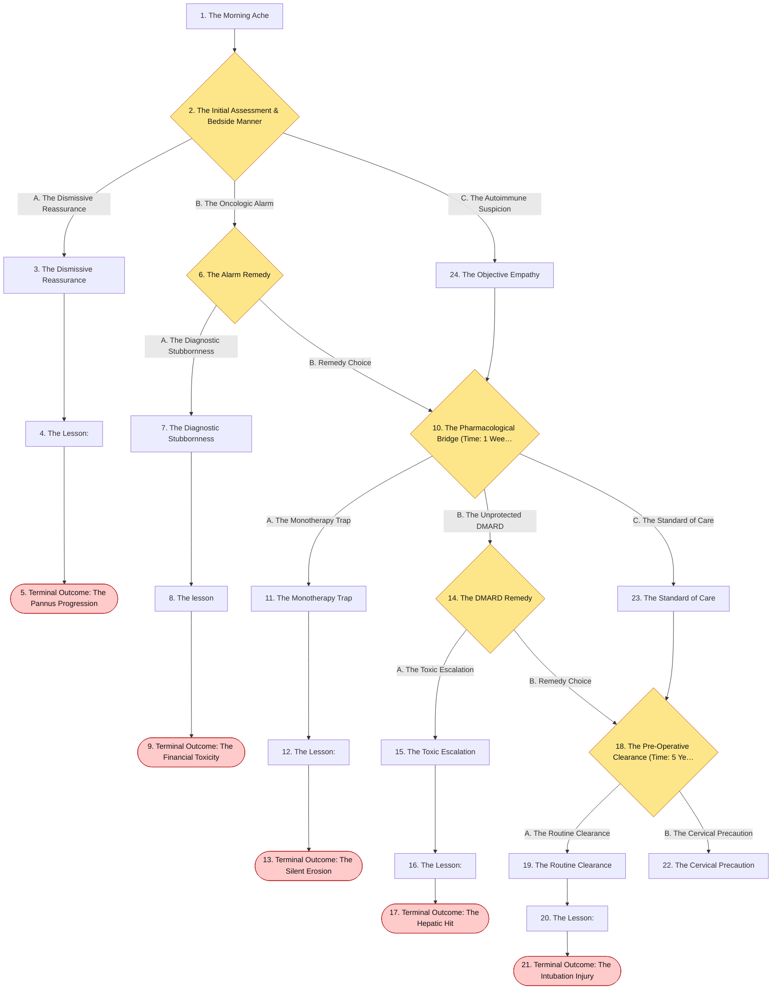
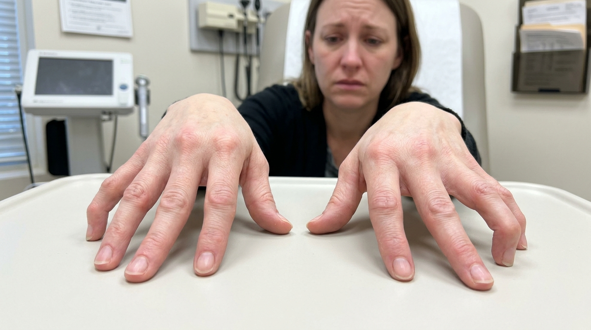
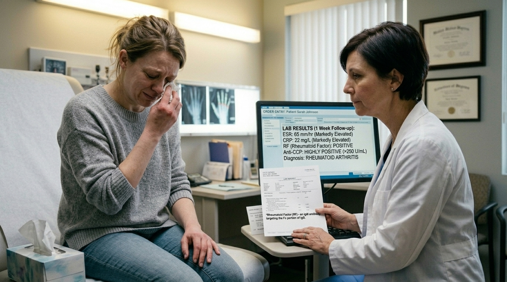
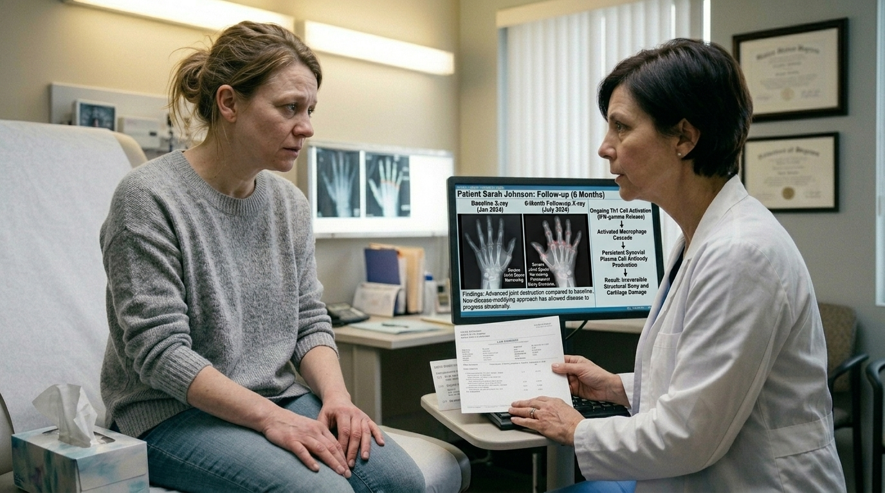
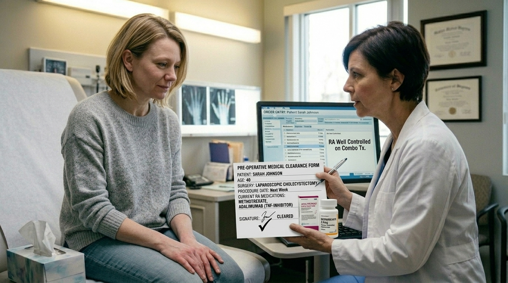
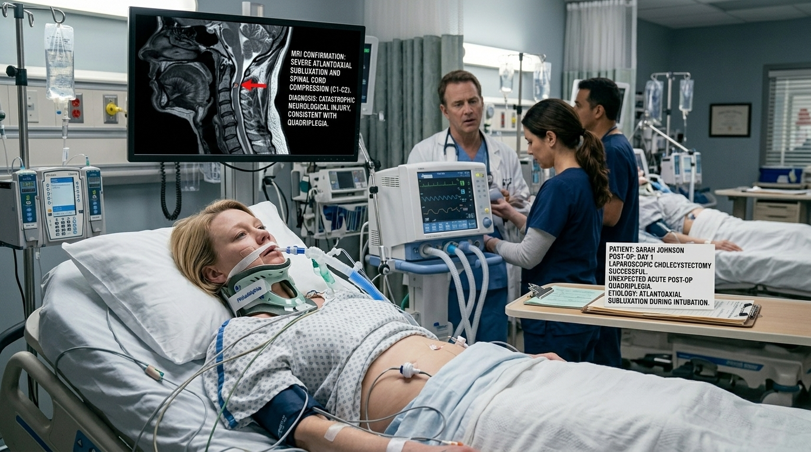
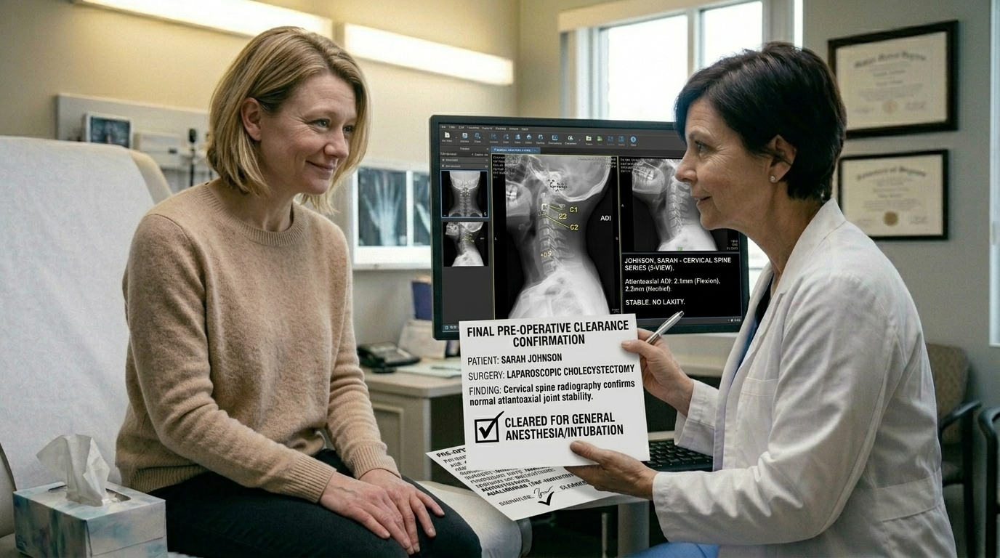

# The Morning Ache

> Rheumatology

## Overview

| | |
|---|---|
| **Scenario key** | `Rheumatoid Arthritis` |
| **Scenario ID** | `71974c48-4339-4007-9a4c-c389ec95ca49` |
| **Story pages** | 14 |
| **Decision points** | 5 (12 choices) |
| **Endings** | 5 (0 checkpoint, 5 fail) |
| **Concepts** | `Diagnostic Anchoring & Irreversible Joint Destruction`, `Diagnostic Parsimony & Financial Toxicity`, `Disease Modification vs. Symptom Control`, `Pharmacokinetics & Bridge Therapy`, `Surgical Clearance & Silent Subluxation` |
| **Graph file** | [`rheumatoid-arthritis.json`](rheumatoid-arthritis.json) |

This is a branching case study. The learner reads each story page, then at every decision point picks one of the choices. A *misstep* leads to a fail ending that sends the learner back to try again; the *correct* path continues the story and reaches checkpoint endings that mark the concepts learned.

## Flowchart

## The Story

### 1. The Morning Ache

Patient Profile: Sarah, a 35-year-old woman.

Initial State: She presents to your clinic with joint stiffness and pain in her hands and wrists that has progressively worsened over the last two months. She is exhausted, reporting fatigue and an unintentional 15-pound weight loss. During your interview, she emphasizes that her symptoms are most severe when she wakes up—with stiffness lasting well over an hour—and gradually improve in the afternoon. On physical exam, you note distinct swelling and tenderness at her metacarpophalangeal (MCP) and proximal interphalangeal (PIP) joints .

**Next:** [2. The Initial Assessment & Bedside Manner](#decision-node-1)

---

### 2. Decision: The Initial Assessment & Bedside Manner

Sarah is highly anxious. "My grandmother had osteoarthritis, but she was 80," she says. "Because I'm losing weight and so tired, my husband read online that this could be bone cancer. Is it?"

**What do you do?**

- **A. The Dismissive Reassurance** _(wrong)_ — Chuckle and tell her not to trust the internet. Reassure her that it is likely just early-onset osteoarthritis from typing too much, prescribe rest, and send her home. → [3. The Dismissive Reassurance](#information-node-3)
- **B. The Oncologic Alarm** _(misstep)_ — Validate her fear. Because she has constitutional symptoms (weight loss, fatigue), immediately order a full-body CT scan and refer her to oncology to rule out a malignancy. → [6. The Alarm Remedy](#decision-node-7)
- **C. The Autoimmune Suspicion** _(correct)_ — Empathize with her fear, explicitly reassuring her that her specific joint pattern points away from cancer. Explain that morning stiffness lasting > 1 hour, combined with MCP and PIP swelling, is the classic presentation of an inflammatory autoimmune process . You order Rheumatoid Factor (RF), anti-CCP antibodies, ESR, CRP, and baseline radiography of her hands and wrists → [24. The Objective Empathy](#information-node-14)

---

### 3. The Dismissive Reassurance

You send Sarah home with a diagnosis of osteoarthritis. Over the next two years, the uninhibited T- and B-cell response in her joints causes massive pannus formation . The pannus aggressively destroys her adjacent cartilage and bone. She eventually presents to another physician with irreversible ulnar deviation of her fingers and severe swan neck deformities . She has permanently lost significant functional capacity in her hands.

**Next:** [4. The Lesson:](#information-node-4)

---

### 4. The Lesson:

Osteoarthritis (wear-and-tear) typically worsens with use throughout the day and classically involves the Distal Interphalangeal (DIP) joints. Rheumatoid Arthritis is an inflammatory synovitis that causes prolonged morning stiffness (> 1 hour) and classically involves the MCP and PIP joints, sparing the DIPs . Dismissing constitutional symptoms (weight loss, fatigue)  and the specific joint distribution leads to a catastrophic delay in treatment.

**Next:** [5. Terminal Outcome: The Pannus Progression](#termination-node-5)

---

### 5. Ending: Terminal Outcome: The Pannus Progression

> **Result:** fail · **Concept:** `Diagnostic Anchoring & Irreversible Joint Destruction`

Final Outcome: Failure / Delayed Diagnosis and Irreversible Damage

The Flaw: Failing to recognize the classic diagnostic criteria for RA (morning stiffness > 1 hour, MCP/PIP involvement) and dismissing the patient's valid concerns.

Actionable Improvement: Memorize the mechanical vs. inflammatory joint pain paradigms. Inflammatory pain is worse in the morning and improves with use.

_End of this path._

---

### 6. Decision: The Alarm Remedy

The insurance company rejects your prior authorization for the full-body CT scan, stating that bilateral hand pain does not warrant pan-scanning for cancer.

**What do you do?**

- **A. The Diagnostic Stubbornness** _(wrong)_ — You bypass insurance, forcing Sarah to pay out-of-pocket for the full-body CT scan to hunt for a tumor. → [7. The Diagnostic Stubbornness](#information-node-9)
- **B. Remedy Choice** _(correct)_ — You review the clinical criteria, realize that symmetric PIP/MCP swelling with morning stiffness is a hallmark of RA, and order the correct localized X-rays and autoantibody labs (RF, anti-CCP) instead . → [10. The Pharmacological Bridge (Time: 1 Week Later)](#decision-node-36)

---

### 7. The Diagnostic Stubbornness

Sarah pays thousands of dollars out-of-pocket for the scan. It returns completely negative for malignancy. By the time you finally circle back to an autoimmune workup months later, she has suffered through severe, unmanaged pain, and her baseline hand X-rays now show early periarticular bony erosions. You violated the principle of diagnostic parsimony, inflicting severe financial toxicity and delaying disease-modifying treatment.

**Next:** [8. The lesson](#information-node-44)

---

### 8. The lesson

Diagnostic parsimony is critical. When a patient presents with classic criteria for an autoimmune etiology—such as symmetric morning stiffness lasting > 1 hour and specific PIP/MCP joint involvement —blindly hunting for an unlikely malignancy with expensive, high-radiation imaging violates the principle of "do no harm" (both physically and financially). Rheumatoid arthritis is diagnosed based on clinical presentation and targeted laboratory studies (RF, anti-CCP, ESR, CRP) alongside localized radiography , not whole-body pan-scanning.

**Next:** [9. Terminal Outcome: The Financial Toxicity](#termination-node-11)

---

### 9. Ending: Terminal Outcome: The Financial Toxicity

> **Result:** fail · **Concept:** `Diagnostic Parsimony & Financial Toxicity`

Final Outcome: Failure / Iatrogenic Financial Harm & Delayed Treatment

The Flaw: Refusing to pivot a differential diagnosis based on a classic clinical presentation and forcing unnecessary, expensive testing.

Actionable Improvement: Recognize the classic RA presentation. Start with targeted, high-yield tests (RF, anti-CCP, CRP, ESR, hand/wrist XR) before jumping to "zebra" diagnoses like occult malignancy.

_End of this path._

---

### 10. Decision: The Pharmacological Bridge (Time: 1 Week Later)

Sarah's labs return. Her ESR and CRP are markedly elevated . Her Rheumatoid Factor (an IgM antibody targeting the Fc portion of IgG) is positive, and her anti-CCP is highly positive . Her baseline hand X-rays show diffuse osteopenia but no erosions yet.You diagnose her with Rheumatoid Arthritis. She is currently in tears due to the severe pain in her hands.

**What do you do?**

- **A. The Monotherapy Trap** _(wrong)_ — Since her disease is early, you prescribe daily NSAIDs (Ibuprofen) for pain control and tell her to follow up in six months. → [11. The Monotherapy Trap](#information-node-18)
- **B. The Unprotected DMARD** _(misstep)_ — You correctly recognize the need to stop disease progression. You prescribe Methotrexate immediately. You tell her to take it and send her home without any other medications. → [14. The DMARD Remedy](#decision-node-38)
- **C. The Standard of Care** _(correct)_ — You prescribe Methotrexate, explaining it is the initial Disease-Modifying Antirheumatic Drug (DMARD) used to retard disease-associated damage . You simultaneously prescribe a short course of oral glucocorticoids and NSAIDs, explaining these will provide immediate symptomatic control while you wait weeks for the Methotrexate to take effect . → [23. The Standard of Care](#information-node-21)

---

### 11. The Monotherapy Trap

Sarah feels great on the high-dose NSAIDs. Her pain is masked. However, beneath the surface, Th1 cells are releasing interferon-$\gamma$ to activate macrophages, and her synovial plasma cells continue to produce antibodies against her joints . Six months later, she returns. Despite her pain being "controlled," her repeat X-rays show severe joint space narrowing and permanent periarticular bony erosions .

**Next:** [12. The Lesson:](#information-node-19)

---

### 12. The Lesson:

NSAIDs and glucocorticoids provide excellent symptomatic control, but they do absolutely nothing to stop the underlying autoimmune destruction of the joint. In Rheumatoid Arthritis, Disease-Modifying Antirheumatic Drugs (DMARDs) like Methotrexate must be initiated to prevent, stop, or retard disease-associated damage .

**Next:** [13. Terminal Outcome: The Silent Erosion](#termination-node-20)

---

### 13. Ending: Terminal Outcome: The Silent Erosion

> **Result:** fail · **Concept:** `Disease Modification vs. Symptom Control`

Final Outcome: Failure / Progression of Autoimmune Disease

The Flaw: Failing to initiate a DMARD (Methotrexate) upon confirming an RA diagnosis.

Actionable Improvement: Never treat RA with NSAIDs or steroids as monotherapy for long-term management. DMARDs are mandatory to save the joints.

_End of this path._

---

### 14. Decision: The DMARD Remedy

Sarah calls the clinic three days later, sobbing. "I've been taking the Methotrexate, but my hands still hurt so badly I can't hold my coffee mug. The medicine isn't working!"

**What do you do?**

- **A. The Toxic Escalation** _(wrong)_ — You tell her that her disease must be incredibly aggressive. You drastically increase her Methotrexate dose to force an acute analgesic effect. → [15. The Toxic Escalation](#information-node-26)
- **B. Remedy Choice** _(correct)_ — You realize Methotrexate takes several weeks to reach therapeutic efficacy. You apologize for not providing bridge therapy and immediately call in a prescription for NSAIDs/glucocorticoids for symptomatic control while waiting for the DMARD response . → [18. The Pre-Operative Clearance (Time: 5 Years Later)](#decision-node-41)

---

### 15. The Toxic Escalation

Methotrexate is an immunosuppressant and disease-modifier, not an acute analgesic. Increasing the dose to toxic levels provides zero immediate pain relief for Sarah. Instead, she presents to the ER a week later with severe oral ulcers, macrocytic anemia, and fulminant hepatotoxicity (classic side-effects of high-dose Methotrexate) . You have poisoned your patient due to a fundamental misunderstanding of pharmacological kinetics.

**Next:** [16. The Lesson:](#information-node-28)

---

### 16. The Lesson:

Disease-Modifying Antirheumatic Drugs (DMARDs) like Methotrexate alter the underlying disease process by retarding associated damage, but they take weeks to months to achieve clinical efficacy. They are not acute analgesics. Escalating an immunosuppressant to toxic doses in an attempt to force immediate pain relief displays a fundamental misunderstanding of pharmacokinetics. Acute RA flares must be bridged with fast-acting anti-inflammatories (NSAIDs or glucocorticoids) for symptomatic control while waiting for the DMARD response .

**Next:** [17. Terminal Outcome: The Hepatic Hit](#termination-node-32)

---

### 17. Ending: Terminal Outcome: The Hepatic Hit

> **Result:** fail · **Concept:** `Pharmacokinetics & Bridge Therapy`

Final Outcome: Fatal Deficit / Drug Toxicity

The Flaw: Using a long-acting DMARD as an acute analgesic and overdosing the patient into hepatotoxicity.

Actionable Improvement: Memorize the bridge protocol. Always initiate NSAIDs or short-course steroids for immediate symptom control while waiting for DMARDs (Methotrexate) to take effect .

_End of this path._

---

### 18. Decision: The Pre-Operative Clearance (Time: 5 Years Later)

Sarah is now 40 years old. Her RA has been well-controlled on Methotrexate and a TNF-inhibitor (Adalimumab) . She comes to your clinic because she is scheduled for an elective laparoscopic cholecystectomy (gallbladder removal) next week requiring general anesthesia and intubation. She needs you to sign off on her pre-operative clearance.

**What do you do?**

- **A. The Routine Clearance** _(wrong)_ — You listen to her heart and lungs, note her stable vitals, and sign the clearance paperwork. She is young and her cardiovascular risk is low. → [19. The Routine Clearance](#information-node-29)
- **B. The Cervical Precaution** _(correct)_ — You recognized a silent, deadly complication of chronic RA. The neck X-ray is required to rule out atlantoaxial ligament laxity before any procedure requiring intubation. The X-ray shows stability, and you safely clear her for surgery. → [22. The Cervical Precaution](#information-node-45)

---

### 19. The Routine Clearance

You clear Sarah for surgery. In the OR, the anesthesiologist pushes paralytics and hyperextends her neck to visualize her vocal cords. Because you did not screen for atlantoaxial subluxation, the manipulation of her neck causes a catastrophic spinal cord compression . Sarah wakes up from her successful gallbladder surgery with hyporeflexia and irreversible quadriplegia .

**Next:** [20. The Lesson:](#information-node-34)

---

### 20. The Lesson:

Rheumatoid Arthritis frequently causes inflammation and destruction of the transverse ligament of the atlas in the cervical spine, leading to atlantoaxial subluxation. This is often asymptomatic. During general anesthesia, the anesthesiologist must manipulate and hyperextend the neck to insert the endotracheal tube. If the atlantoaxial joint is unstable, this manipulation can drive the dens of the axis directly into the spinal cord.

**Next:** [21. Terminal Outcome: The Intubation Injury](#termination-node-33)

---

### 21. Ending: Terminal Outcome: The Intubation Injury

> **Result:** fail · **Concept:** `Surgical Clearance & Silent Subluxation`

Final Outcome: Fatal Deficit / Iatrogenic Paralysis

The Flaw: Failing to screen a chronic RA patient for cervical spine instability prior to general anesthesia/intubation.

Actionable Improvement: Any patient with long-standing Rheumatoid Arthritis must have a cervical spine X-ray to rule out atlantoaxial subluxation before undergoing procedures that require manipulation of the neck .

_End of this path._

---

### 22. The Cervical Precaution

You recognized a silent, deadly complication of chronic RA. The neck X-ray is required to rule out atlantoaxial ligament laxity before any procedure requiring intubation. The X-ray shows stability, and you safely clear her for surgery.

---

### 23. The Standard of Care

You successfully treated both the underlying pathophysiology (preventing cartilage destruction) and the patient's acute suffering.

**Next:** [18. The Pre-Operative Clearance (Time: 5 Years Later)](#decision-node-41)

---

### 24. The Objective Empathy

You successfully de-escalated her anxiety with objective clinical reasoning. Anti-CCP is highly specific for rheumatoid arthritis, and baseline X-rays are crucial for tracking disease progression.

**Next:** [10. The Pharmacological Bridge (Time: 1 Week Later)](#decision-node-36)

---
