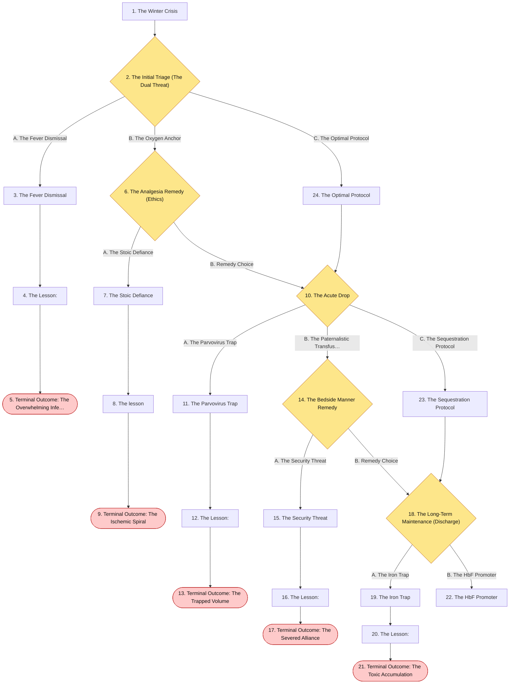
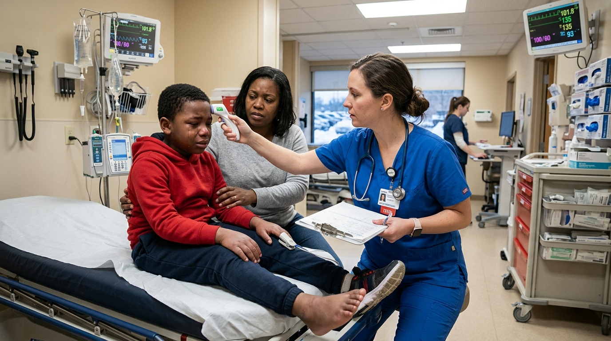
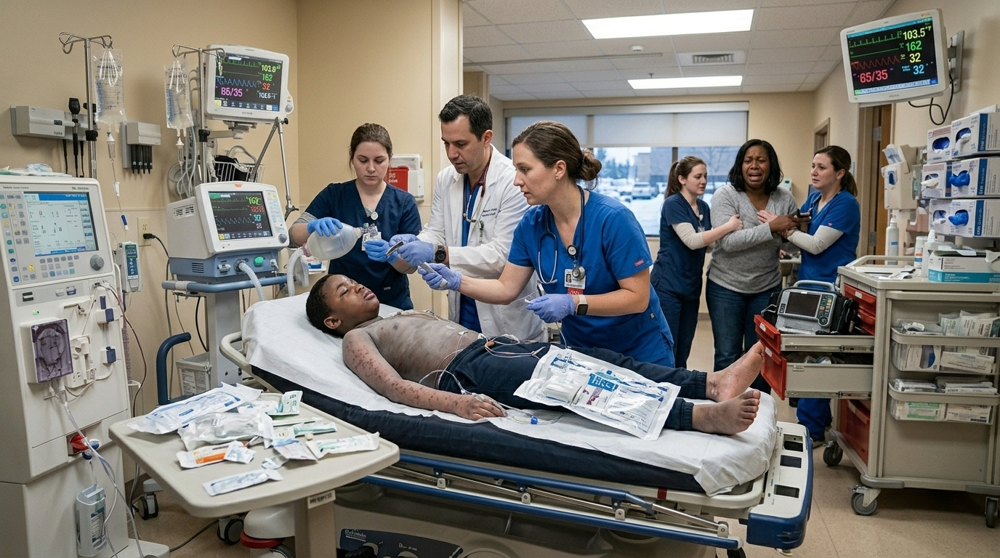
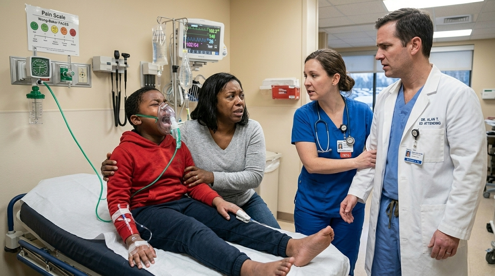
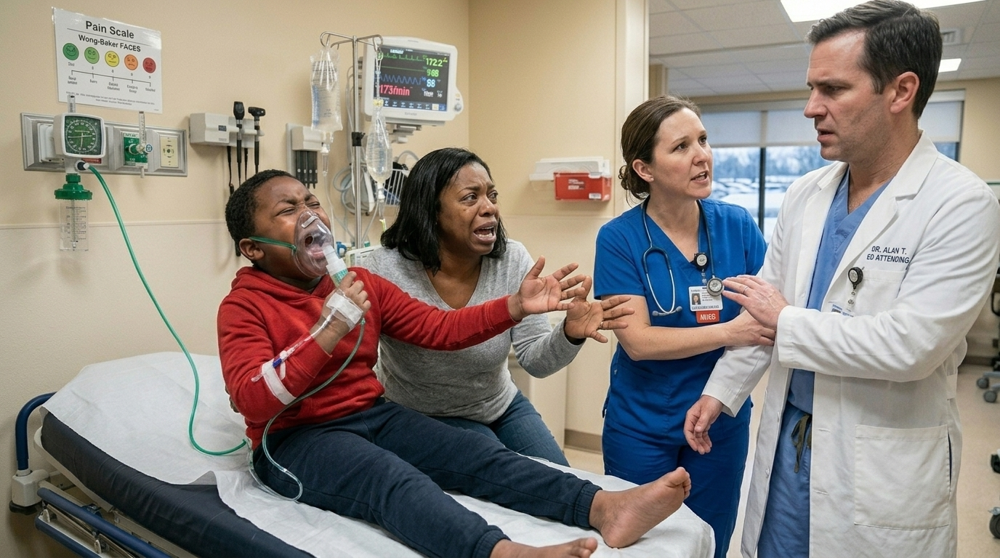
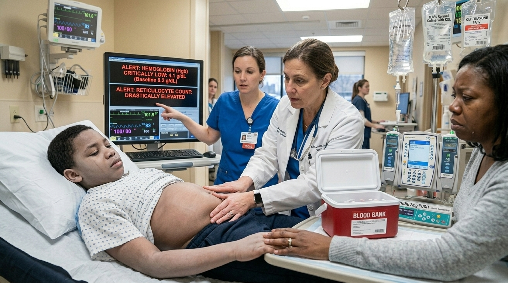
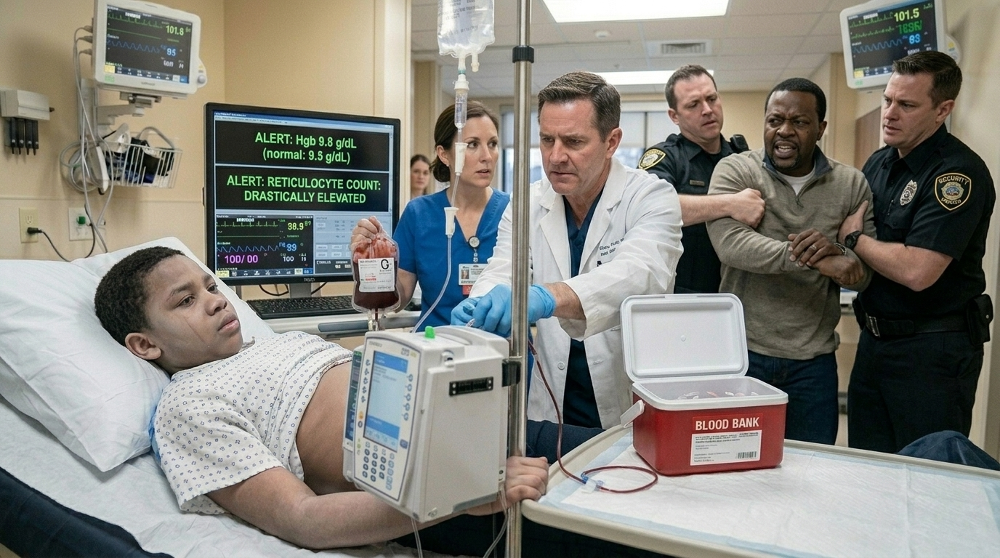
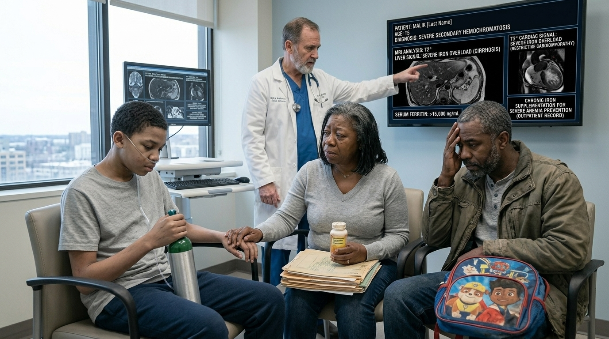
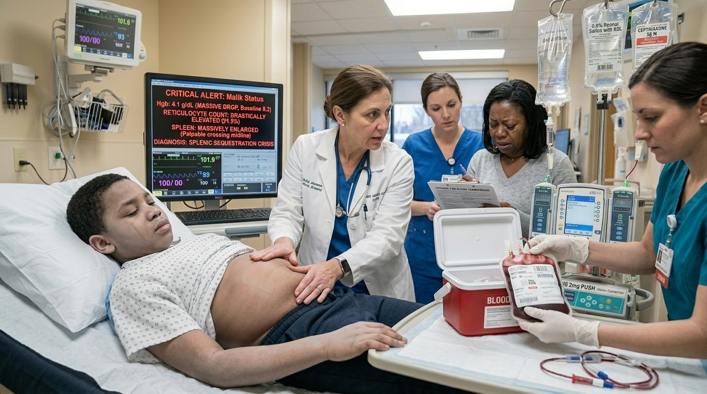

# The Winter Crisis

> Hematology

## Overview

| | |
|---|---|
| **Scenario key** | `Sickle cell anemia` |
| **Scenario ID** | `d0e8f501-6822-40ac-a63f-16b4ffb8a591` |
| **Story pages** | 14 |
| **Decision points** | 5 (12 choices) |
| **Endings** | 5 (0 checkpoint, 5 fail) |
| **Concepts** | `Diagnostic Differentiation & Hypovolemic Shock`, `Functional Asplenia & Encapsulated Sepsis`, `Hemolytic Anemia & Iatrogenic Hemochromatosis`, `Informed Consent & Medical Coercion`, `Pain Management Ethics & Sympathetic Overdrive` |
| **Graph file** | [`sickle-cell-anemia.json`](sickle-cell-anemia.json) |

This is a branching case study. The learner reads each story page, then at every decision point picks one of the choices. A *misstep* leads to a fail ending that sends the learner back to try again; the *correct* path continues the story and reaches checkpoint endings that mark the concepts learned.

## Flowchart

## The Story

### 1. The Winter Crisis

Patient Profile: Malik, an 8-year-old African American male.
Initial State: Malik is brought to the pediatric emergency department by his parents. He is crying inconsolably, clutching his hands and feet, which are visibly swollen and tender. His parents report he was playing outside in the snow when the pain started, and it has not responded to oral pain medications at home . He has a known history of Sickle Cell Anemia (HbSS) .  Vitals: Temperature $38.8^{\circ}C$ $(101.8^{\circ}F)$, Blood Pressure $100/60$ mmHg, Pulse $135/min$, Respirations $24/min$, Oxygen Saturation 93% on room air. Physical exam reveals pallor and palpable splenomegaly.

**Next:** [2. The Initial Triage (The Dual Threat)](#decision-node-1)

---

### 2. Decision: The Initial Triage (The Dual Threat)

Malik is experiencing a severe vaso-occlusive crisis (dactylitis) triggered by cold exposure . However, his vital signs reveal a second, potentially deadlier problem: a significant fever. You must direct the initial management.

**What do you do?**

- **A. The Fever Dismissal** _(wrong)_ — You assume the fever is simply a systemic inflammatory response to the severe pain and vaso-occlusion. You order IV fluids, supplemental oxygen, and aggressive IV Morphine for pain control, planning to monitor the fever. → [3. The Fever Dismissal](#information-node-3)
- **B. The Oxygen Anchor** _(misstep)_ — You are hyper-focused on reversing the sickling process. You order high-flow 100% oxygen and rapid IV fluids. Because opioids can depress respiratory drive, you refuse to order IV pain medications, telling the parents that the oxygen will stop the pain soon. → [6. The Analgesia Remedy (Ethics)](#decision-node-7)
- **C. The Optimal Protocol** _(correct)_ — You recognize that a fever in a patient with Sickle Cell Anemia is a medical emergency. You immediately draw blood cultures, order empiric broad-spectrum IV antibiotics (Ceftriaxone) to cover encapsulated organisms, and simultaneously order IV fluids and IV Morphine for aggressive pain control . → [24. The Optimal Protocol](#information-node-14)

---

### 3. The Fever Dismissal

You aggressively treat the pain but withhold antibiotics. Over the next 4 hours, Malik's heart rate climbs to 160/min, and his blood pressure plummets. The Streptococcus pneumoniae in his bloodstream, unopposed by a functioning spleen or empiric antibiotics, triggers profound septic shock. He develops disseminated intravascular coagulation (DIC) and multi-organ failure. He codes in the pediatric ICU and cannot be resuscitated.

**Next:** [4. The Lesson:](#information-node-4)

---

### 4. The Lesson:

Patients with Sickle Cell Anemia typically develop functional asplenia by 2-4 years of age due to repeated splenic infarctions from sickled red blood cells . The spleen is critical for clearing encapsulated bacteria. Consequently, these patients are at a highly increased risk for fatal infections from encapsulated organisms, particularly Streptococcus pneumoniae and Salmonella species . S. pneumoniae is the most common cause of sepsis and meningitis in this population. A fever in a sickle cell patient must be treated as life-threatening sepsis with immediate empiric antibiotics until proven otherwise.

**Next:** [5. Terminal Outcome: The Overwhelming Infection](#termination-node-5)

---

### 5. Ending: Terminal Outcome: The Overwhelming Infection

> **Result:** fail · **Concept:** `Functional Asplenia & Encapsulated Sepsis`

Final Outcome: Fatal / Untreated SepsisThe Flaw: Dismissing a fever in a functionally asplenic patient as a benign inflammatory response.Actionable Improvement: Any temperature $\ge 38.5^{\circ}C$ in a sickle cell patient warrants stat blood cultures and immediate empiric IV antibiotics to cover encapsulated organisms.

_End of this path._

---

### 6. Decision: The Analgesia Remedy (Ethics)

Malik is screaming in agony. His mother is crying, begging you to give him something for the pain. The pediatric nurse pulls you aside and says, "Doctor, withholding opioids during a severe vaso-occlusive crisis is inhumane. Oxygen alone will not break this pain cycle."

**What do you do?**

- **A. The Stoic Defiance** _(wrong)_ — You double down. You tell the mother and the nurse that opioids are highly addictive and you refuse to contribute to an opioid dependency in an 8-year-old child. You mandate Tylenol only. → [7. The Stoic Defiance](#information-node-9)
- **B. Remedy Choice** _(correct)_ — You realize you are violating the ethical principle of beneficence by allowing the child to suffer needlessly. You apologize, immediately order IV Morphine, and add empiric IV antibiotics for the fever. → [10. The Acute Drop](#decision-node-36)

---

### 7. The Stoic Defiance

You withhold the IV opioids. Malik's pain intensifies, driving his heart rate to 170/min. The severe sympathetic stress and tachypnea lead to further hypoxemia, causing a massive cascade of systemic sickling. He develops Acute Chest Syndrome, rapidly deteriorating into severe acute respiratory distress syndrome (ARDS). The parents, horrified by your refusal to treat their child's agony, demand an AMA discharge and attempt to drive him to another hospital, but he suffers a severe cerebrovascular accident (stroke) in the car.

**Next:** [8. The lesson](#information-node-44)

---

### 8. The lesson

Acute vaso-occlusive episodes (pain crises) are the hallmark of Sickle Cell Anemia, caused by sickled cells aggregating in the microvascular circulation, leading to tissue ischemia . The pain is excruciating, equivalent to ischemic cardiac pain. Withholding adequate analgesia (opioids) out of an unfounded fear of addiction in an acute pediatric crisis is a profound ethical violation and constitutes medical neglect. Severe, unmanaged pain causes massive sympathetic overdrive, hypertension, and tachycardia, which drastically increases cellular oxygen demand and dramatically worsens the sickling cascade.

**Next:** [9. Terminal Outcome: The Ischemic Spiral](#termination-node-11)

---

### 9. Ending: Terminal Outcome: The Ischemic Spiral

> **Result:** fail · **Concept:** `Pain Management Ethics & Sympathetic Overdrive`

Final Outcome: Severe Morbidity / Ethical Violation & Iatrogenic Deterioration

The Flaw: Withholding standard-of-care analgesia based on unfounded personal biases regarding opioid addiction.

Actionable Improvement: IV opioids are the standard of care for severe vaso-occlusive crises. Treat the pain aggressively and compassionately.

_End of this path._

---

### 10. Decision: The Acute Drop

Malik is admitted. His pain is controlled, and he is receiving IV Ceftriaxone. However, the next morning, the nurse calls you urgently. Malik is profoundly lethargic and pale.His stat morning labs show a catastrophic drop in his hemoglobin from his baseline of $8.2~g/dL$ to $4.1~g/dL$. His reticulocyte count is drastically elevated. On physical exam, his spleen is massively enlarged, firm, and tender, crossing the midline of his abdomen.

**What do you do?**

- **A. The Parvovirus Trap** _(wrong)_ — You suspect an aplastic crisis caused by a Parvovirus B19 infection. You order a stat Parvovirus PCR and hold off on blood transfusions to avoid volume overload, opting for supportive care. → [11. The Parvovirus Trap](#information-node-18)
- **B. The Paternalistic Transfusion** _(misstep)_ — You correctly recognize the need for blood. You barge into the room, yell for the nurses to hang uncrossmatched O-negative blood immediately, and ignore the parents when they ask what the risks of the transfusion are, telling them, "I'm saving his life, step back." → [14. The Bedside Manner Remedy](#decision-node-38)
- **C. The Sequestration Protocol** _(correct)_ — You correctly recognize an acute splenic sequestration crisis based on the massive splenomegaly, falling hemoglobin, and high reticulocyte count. You immediately order a stat crossmatch for a packed RBC transfusion and gently but quickly obtain informed consent from the parents, explaining that his blood is temporarily trapped in his spleen. → [23. The Sequestration Protocol](#information-node-21)

---

### 11. The Parvovirus Trap

You assume this is Parvovirus B19 and withhold the transfusion. However, Malik's bone marrow is working perfectly—his reticulocyte count is high. The problem is that his entire circulating blood volume is becoming trapped inside his massively expanding spleen. As you wait for the viral swab results, his intravascular volume depletes entirely. He crashes into profound hypovolemic shock, loses a pulse, and dies from cardiovascular collapse.

**Next:** [12. The Lesson:](#information-node-19)

---

### 12. The Lesson:

There are two major causes of a sudden, severe drop in hemoglobin in a sickle cell patient: Aplastic Crisis and Splenic Sequestration. An Aplastic Crisis is typically triggered by Parvovirus B19, which halts red blood cell production, presenting with a characteristically low reticulocyte count . Splenic Sequestration occurs when sickled cells occlude the splenic outflow, causing massive pooling of blood inside the spleen. This presents with acute, massive splenomegaly, hypovolemia, and a high compensatory reticulocyte count. Misdiagnosing sequestration as an aplastic crisis leads to a failure to aggressively resuscitate the patient's rapidly depleting intravascular volume.

**Next:** [13. Terminal Outcome: The Trapped Volume](#termination-node-20)

---

### 13. Ending: Terminal Outcome: The Trapped Volume

> **Result:** fail · **Concept:** `Diagnostic Differentiation & Hypovolemic Shock`

Final Outcome: Fatal / Missed Splenic SequestrationThe Flaw: Conflating Aplastic Crisis (low reticulocyte count, small spleen) with Splenic Sequestration (high reticulocyte count, massive spleen) .  Actionable Improvement: A rapidly enlarging spleen with a dropping hemoglobin and high reticulocytes is Splenic Sequestration. It requires immediate volume resuscitation and packed RBC transfusion.

_End of this path._

---

### 14. Decision: The Bedside Manner Remedy

The parents are terrified by your aggressive demeanor. The father blocks the IV pole, stating, "We aren't refusing, but my brother got a bad blood transfusion and had a massive reaction. You need to explain what you are giving my son!"

**What do you do?**

- **A. The Security Threat** _(wrong)_ — You refuse to explain. You threaten to call hospital security and child protective services to strip them of their medical decision-making rights if they don't move immediately. → [15. The Security Threat](#information-node-26)
- **B. Remedy Choice** _(correct)_ — You realize your authoritarian approach caused unnecessary panic. You pause, validate their very real fear of alloimmunization, and explain that you are giving leukocyte-reduced, phenotypically matched blood to minimize reaction risks. They consent immediately. → [18. The Long-Term Maintenance (Discharge)](#decision-node-41)

---

### 15. The Security Threat

You call security, and the father is restrained while you push the blood. Malik's sequestration resolves, and he survives. However, the parents are deeply traumatized by the medical system. Following discharge, they completely sever ties with your hospital and avoid medical care entirely. A year later, Malik develops another crisis, but the parents delay bringing him in due to their fear of your staff. By the time they arrive at another facility, he has suffered irreversible hypoxic brain damage.

**Next:** [16. The Lesson:](#information-node-28)

---

### 16. The Lesson:

While a physician has a duty to save a child's life in an absolute emergency, parents have the legal and ethical right to informed consent. In this scenario, the parents were not refusing life-saving treatment; they were simply asking for clarification based on a valid family history of transfusion reactions (alloimmunization is a very high risk in sickle cell patients who receive multiple transfusions). Utilizing threats of child protective services to bypass a 30-second clinical explanation is a catastrophic failure of medical professionalism and communication.

**Next:** [17. Terminal Outcome: The Severed Alliance](#termination-node-32)

---

### 17. Ending: Terminal Outcome: The Severed Alliance

> **Result:** fail · **Concept:** `Informed Consent & Medical Coercion`

Final Outcome: Clinical Success / Catastrophic Ethical & Long-Term Failure

The Flaw: Using coercion and threats instead of providing basic informed consent to willing but anxious parents.

Actionable Improvement: Empathy and clear communication are mandatory, even in high-stress resuscitations. Answer valid parental questions to maintain the therapeutic alliance.

_End of this path._

---

### 18. Decision: The Long-Term Maintenance (Discharge)

Malik fully recovers from his splenic sequestration. His hemoglobin stabilizes, and he is preparing for discharge. His parents are exhausted and ask, "Is there any medicine he can take every day to stop these awful pain crises from happening?"

You review his outpatient maintenance medications.

**What do you do?**

- **A. The Iron Trap** _(wrong)_ — Because he has a history of severe anemia, you prescribe daily oral Iron supplements to help his bone marrow build more red blood cells, alongside advising them to keep him warm and hydrated. → [19. The Iron Trap](#information-node-29)
- **B. The HbF Promoter** _(correct)_ — You prescribe Hydroxyurea. You explain that this medication increases the production of fetal hemoglobin (HbF), which has a higher affinity for oxygen and does not sickle, thereby decreasing the frequency and severity of attacks . You also prescribe daily folic acid to support his high RBC turnover. → [22. The HbF Promoter](#information-node-45)

---

### 19. The Iron Trap

The parents dutifully give Malik the iron supplements every day. Over the next several years, the excess iron deposits directly into his liver and myocardium. Because his body has no physiological mechanism to excrete excess iron, he develops severe secondary hemochromatosis. By age 15, he develops an irreversible restrictive cardiomyopathy and liver cirrhosis directly caused by your toxic prescription.

**Next:** [20. The Lesson:](#information-node-34)

---

### 20. The Lesson:

Sickle Cell Anemia is a chronic hemolytic anemia, not an iron-deficiency anemia. When sickled red blood cells undergo hemolysis (which happens constantly, as their lifespan is only 17 days), the iron from the destroyed cells is recycled and retained in the body. Furthermore, these patients receive multiple blood transfusions throughout their lives. Consequently, sickle cell patients are at a massive risk for iron overload (hemochromatosis), not iron deficiency. Prescribing exogenous iron supplements to a hemolytic patient actively poisons their organs.

**Next:** [21. Terminal Outcome: The Toxic Accumulation](#termination-node-33)

---

### 21. Ending: Terminal Outcome: The Toxic Accumulation

> **Result:** fail · **Concept:** `Hemolytic Anemia & Iatrogenic Hemochromatosis`

Final Outcome: Severe Morbidity / Iatrogenic Iron Toxicity

The Flaw: Conflating hemolytic anemia with iron-deficiency anemia and prescribing a hepatotoxic/cardiotoxic supplement.

Actionable Improvement: Never prescribe iron to a sickle cell patient unless there is proven, lab-confirmed superimposed iron deficiency. The correct daily supplements are Folic Acid (to support rapid cell turnover) and Hydroxyurea (to increase HbF) .

_End of this path._

---

### 22. The HbF Promoter

You flawlessly managed a complex pediatric sickle cell presentation. You recognized the critical danger of fever in functional asplenia, rapidly identified and treated a hypovolemic splenic sequestration crisis, and initiated the gold-standard outpatient pharmacological therapy to modify his disease progression and improve his quality of life.

---

### 23. The Sequestration Protocol

You accurately differentiated between the two major causes of acute anemia in sickle cell disease and initiated the life-saving reversal for hypovolemic shock.

**Next:** [18. The Long-Term Maintenance (Discharge)](#decision-node-41)

---

### 24. The Optimal Protocol

You correctly identified that functional asplenia puts this patient at massive risk for sepsis, treating the infection risk concurrently with the vaso-occlusive pain.

**Next:** [10. The Acute Drop](#decision-node-36)

---
