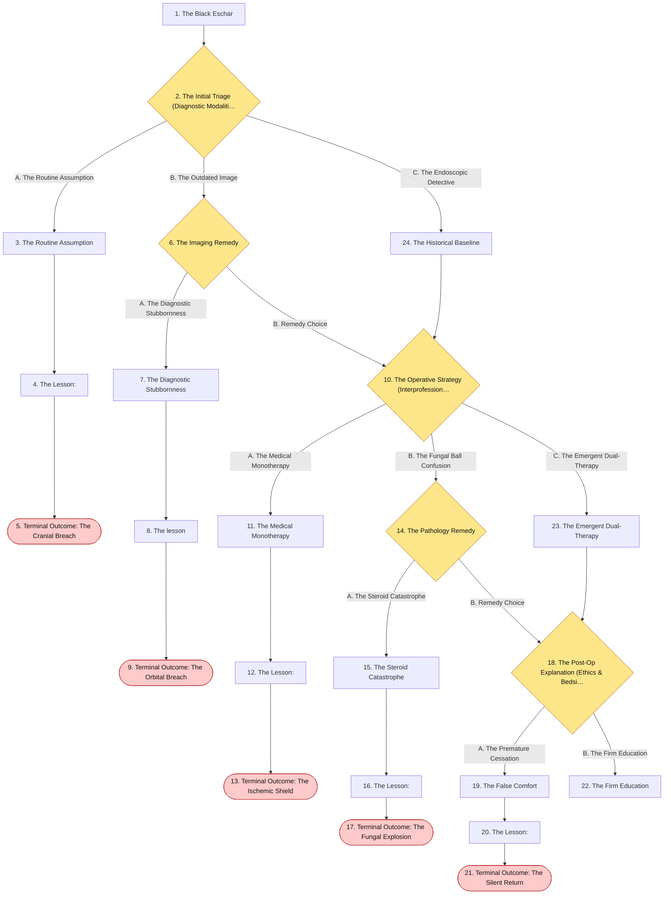
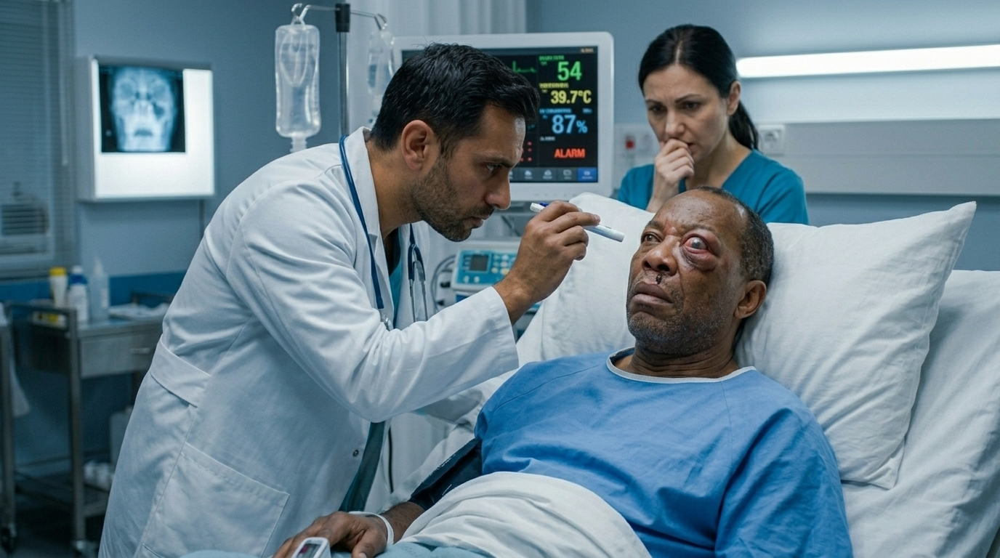
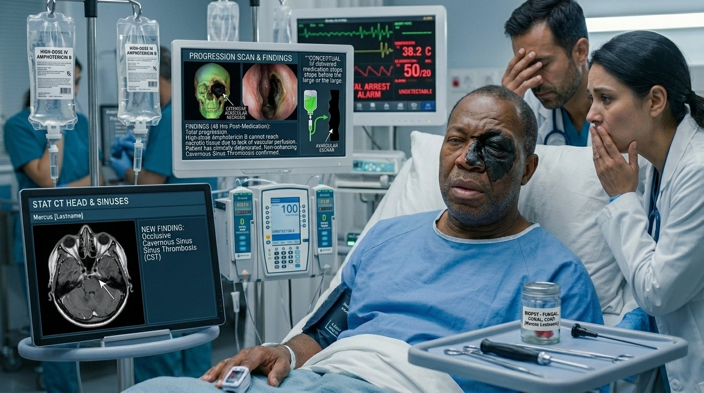
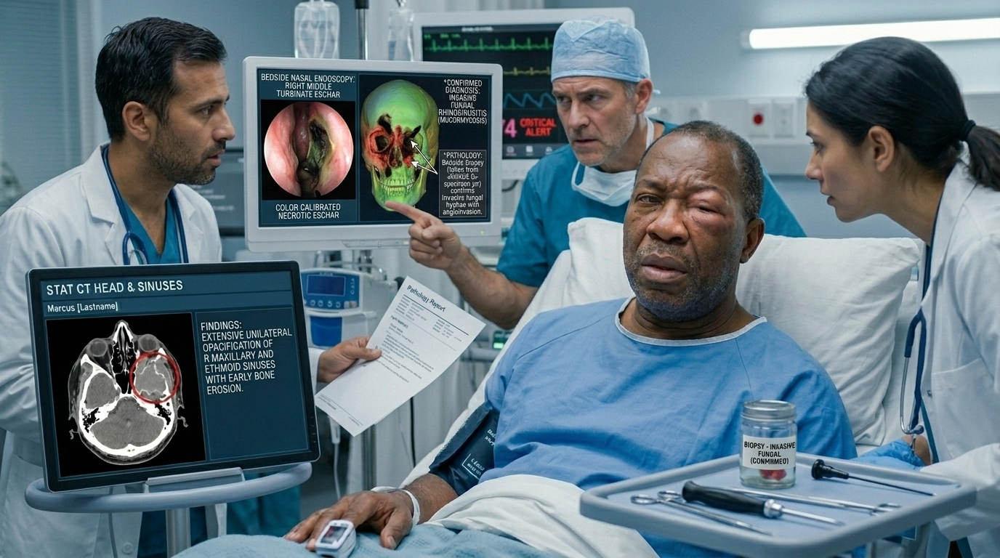
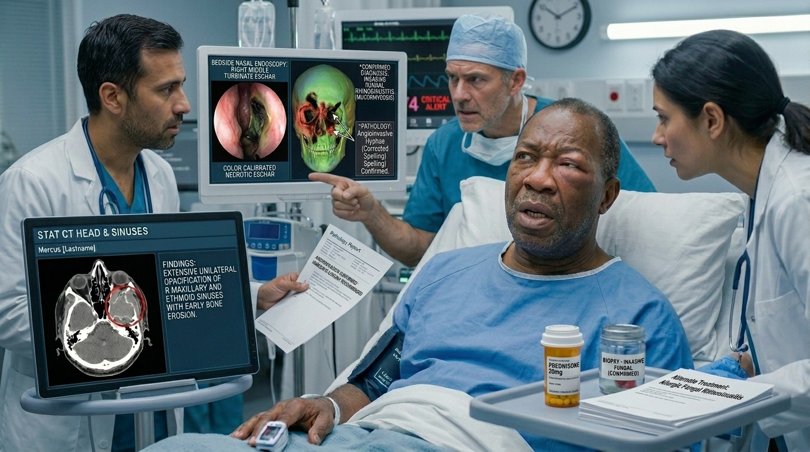
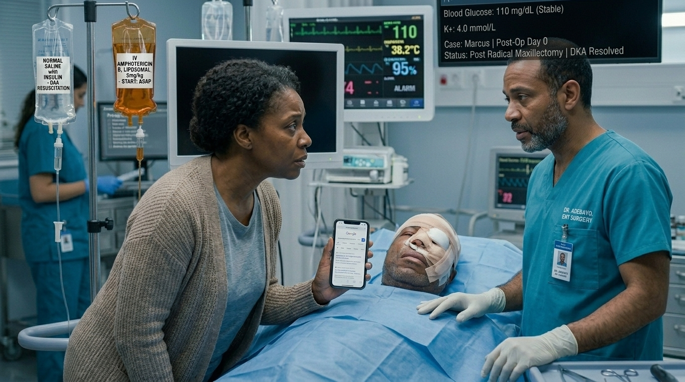
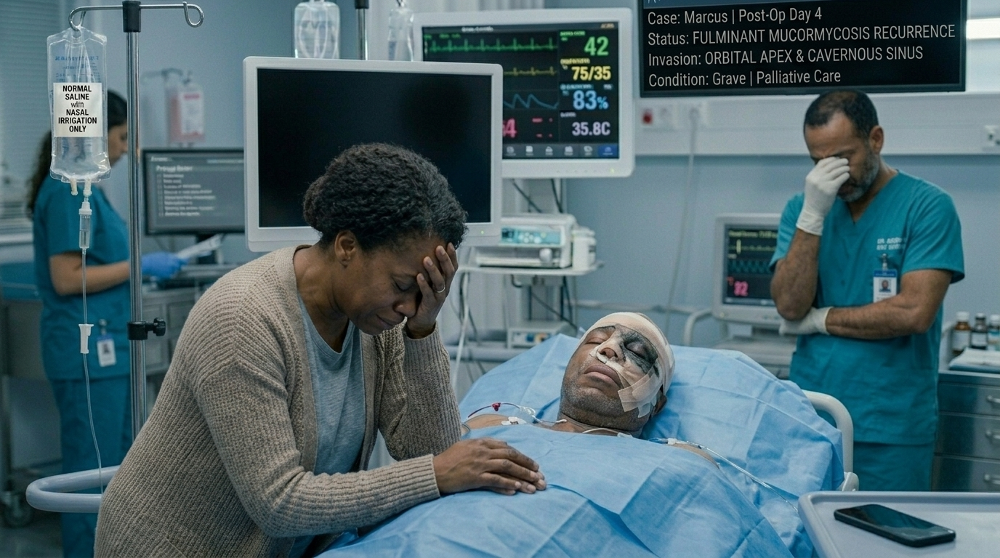
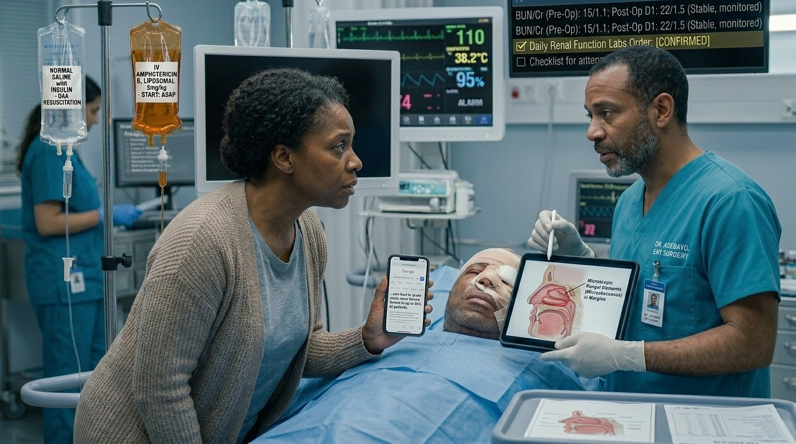
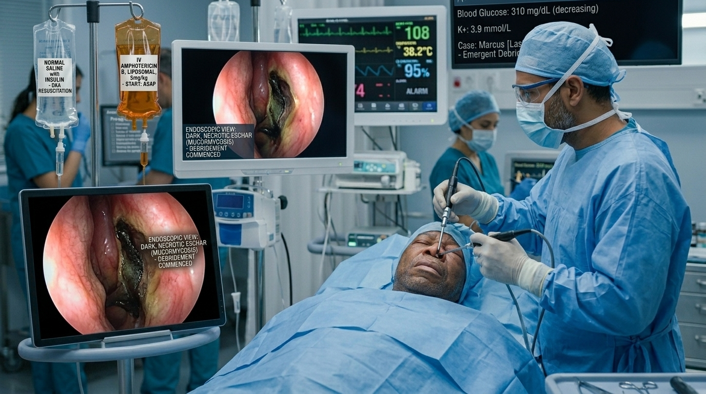
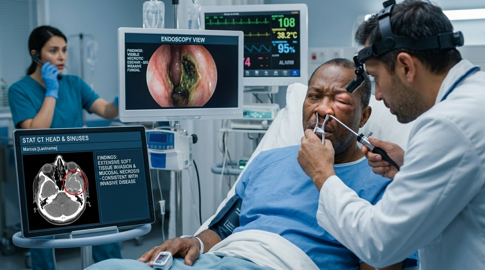

# The Black Eschar

> ENT

## Overview

| | |
|---|---|
| **Scenario key** | `Sinusitis` |
| **Scenario ID** | `0dc3a527-0765-4f97-bd7f-0ded510669e3` |
| **Story pages** | 14 |
| **Decision points** | 5 (12 choices) |
| **Endings** | 5 (0 checkpoint, 5 fail) |
| **Concepts** | `Angioinvasion & Source Control`, `Diagnostic Confusion & Iatrogenic Immunosuppression`, `Imaging Sensitivity & Diagnostic Delay`, `Immunocompromise & Vascular Invasion`, `Pharmacological Adherence & Microscopic Margins` |
| **Graph file** | [`sinusitis.json`](sinusitis.json) |

This is a branching case study. The learner reads each story page, then at every decision point picks one of the choices. A *misstep* leads to a fail ending that sends the learner back to try again; the *correct* path continues the story and reaches checkpoint endings that mark the concepts learned.

## Flowchart

## The Story

### 1. The Black Eschar

Patient Profile: Marcus, a 58-year-old male.
Initial State: Marcus is currently admitted to the medical intensive care unit for severe Diabetic Ketoacidosis (DKA). On hospital day 2, his blood glucose is slowly stabilizing, but he begins complaining of a new, severe right-sided facial pain, nasal congestion, and numbness over his right cheek. The nurse notes that his right eye appears slightly swollen and he has had a minor nosebleed . His temperature is 38.2°C.

**Next:** [2. The Initial Triage (Diagnostic Modalities)](#decision-node-1)

---

### 2. Decision: The Initial Triage (Diagnostic Modalities)

You are called to the bedside to evaluate Marcus. The combination of facial pain, congestion, and fever points to a sinus issue, but his underlying diabetic state adds a layer of complexity.

**What do you do?**

- **A. The Routine Assumption** _(wrong)_ — You diagnose typical acute bacterial sinusitis. You prescribe oral Amoxicillin-clavulanate (the first-line antibiotic), recommend nasal saline irrigation, and tell the nurse to monitor his fever . → [3. The Routine Assumption](#information-node-3)
- **B. The Outdated Image** _(misstep)_ — You want to confirm the presence of fluid in his sinuses before prescribing antibiotics. You order a standard plain radiograph (X-ray) of the paranasal sinuses. → [6. The Imaging Remedy](#decision-node-7)
- **C. The Endoscopic Detective** _(correct)_ — You recognize his severe facial pain, numbness, and orbital swelling in the setting of DKA as massive red flags. You immediately perform a bedside nasal exam with a speculum, looking for mucosal necrosis, and order a stat CT of the head and sinuses . → [24. The Historical Baseline](#information-node-14)

---

### 3. The Routine Assumption

You prescribe the Amoxicillin-clavulanate and leave the unit. Over the next 12 hours, the Mucormycosis rapidly invades Marcus's ethmoid and maxillary blood vessels, causing massive tissue infarction. The fungus erodes through the cribriform plate and enters his frontal lobe. By morning, Marcus is comatose with a blown right pupil. A stat CT reveals a massive cerebral abscess and cavernous sinus thrombosis . He passes away later that afternoon.

**Next:** [4. The Lesson:](#information-node-4)

---

### 4. The Lesson:

Immunosuppressed patients, particularly those with poorly controlled diabetes (like DKA), are at extreme risk for Invasive Fungal Rhinosinusitis, most commonly caused by Mucormycosis or Aspergillus . Acute bacterial sinusitis typically presents with localized pain and purulent discharge, but it rarely causes facial numbness or sudden orbital swelling. Mucormycosis grows rapidly and invades the vasculature, causing tissue ischemia and necrosis . Treating this vascular invasion with standard oral antibiotics is completely ineffective and allows the fungus to spread unchecked into the brain.

**Next:** [5. Terminal Outcome: The Cranial Breach](#termination-node-5)

---

### 5. Ending: Terminal Outcome: The Cranial Breach

> **Result:** fail · **Concept:** `Immunocompromise & Vascular Invasion`

Final Outcome: Fatal / Missed Invasive Fungal Disease

The Flaw: Assuming a routine bacterial infection in a highly immunosuppressed patient presenting with focal neurological deficits (numbness) and orbital signs.

Actionable Improvement: Any diabetic or immunosuppressed patient presenting with facial pain, numbness, or orbital swelling must be assumed to have Invasive Fungal Rhinosinusitis until proven otherwise via CT and nasal endoscopy .

_End of this path._

---

### 6. Decision: The Imaging Remedy

Two hours later, the plain radiograph is read by the radiologist as "Indeterminant opacity in the right maxillary sinus; poor sensitivity limits evaluation." The nurse pages you to report that Marcus's right eye is now visibly bulging (proptosis) and he cannot move it laterally.

**What do you do?**

- **A. The Diagnostic Stubbornness** _(wrong)_ — You complain about the radiologist's "vague" read. You refuse to order the CT, insisting that an opacity is enough to diagnose acute sinusitis. You start him on IV Ceftriaxone and plan to re-evaluate in 24 hours. → [7. The Diagnostic Stubbornness](#information-node-9)
- **B. Remedy Choice** _(correct)_ — You realize plain radiographs have fallen out of favor due to their poor sensitivity. You acknowledge the worsening orbital signs, immediately order a stat CT of the sinuses, and consult ENT. → [10. The Operative Strategy (Interprofessional Communication)](#decision-node-36)

---

### 7. The Diagnostic Stubbornness

You start the IV Ceftriaxone. Because the antibiotic has no effect on the invasive fungal hyphae, the mucormycosis continues to destroy the bone of the medial orbital wall. The infection invades the periorbital space, causing irreversible ischemic damage to the optic nerve. Marcus permanently loses his vision in the right eye, and the infection progresses to a fatal meningitis.

**Next:** [8. The lesson](#information-node-44)

---

### 8. The lesson

Plain radiographs are virtually useless for evaluating the complicated anatomy of the paranasal sinuses and the extent of bone erosion, which is why they have fallen out of favor. When a patient develops rapidly progressing orbital signs (proptosis, ophthalmoplegia), it indicates the infection has breached the sinus walls. Delaying a CT scan to stubbornly rely on a poor-quality X-ray blinds you to a rapidly fatal, destructive process.

**Next:** [9. Terminal Outcome: The Orbital Breach](#termination-node-11)

---

### 9. Ending: Terminal Outcome: The Orbital Breach

> **Result:** fail · **Concept:** `Imaging Sensitivity & Diagnostic Delay`

Final Outcome: Fatal / Iatrogenic Blindness and Meningitis

The Flaw: Relying on an outdated, insensitive imaging modality (plain X-ray) and ignoring acute clinical deterioration.

Actionable Improvement: CT is the gold standard for sinus imaging. Never use plain films for suspected complicated sinusitis.

_End of this path._

---

### 10. Decision: The Operative Strategy (Interprofessional Communication)

You order the stat CT, which shows extensive unilateral opacification of the right maxillary and ethmoid sinuses with early bone erosion. The ENT surgeon arrives and performs a bedside nasal endoscopy. They discover a dark, black, necrotic eschar on the right middle turbinate.

The diagnosis of Invasive Fungal Rhinosinusitis (Mucormycosis) is confirmed via bedside biopsy

**What do you do?**

- **A. The Medical Monotherapy** _(wrong)_ — ou immediately start high-dose IV Amphotericin B to kill the fungus and aggressively manage his insulin to reverse his DKA. However, you advise the ENT to hold off on surgery because Marcus is currently too metabolically unstable for general anesthesia. → [11. The Medical Monotherapy](#information-node-18)
- **B. The Fungal Ball Confusion** _(misstep)_ — You review the path report. You tell the ENT that since it's a fungus, it's likely just a "Fungus Ball." You suggest scheduling an elective endoscopic removal for later in the week once his DKA is fully resolved. → [14. The Pathology Remedy](#decision-node-38)
- **C. The Emergent Dual-Therapy** _(correct)_ — You understand the pathophysiology of the disease. You immediately start high-dose IV Amphotericin B, continue the DKA resuscitation, and explicitly clear Marcus for the operating room so the ENT can perform an emergent, aggressive surgical debridement of all necrotic tissue . → [23. The Emergent Dual-Therapy](#information-node-21)

---

### 11. The Medical Monotherapy

You pump Marcus full of IV Amphotericin B. Unfortunately, because the black eschar in his nasal cavity has no blood supply, not a single drop of the antifungal medication reaches the leading edge of the infection. Sheltered within the necrotic tissue, the fungus continues to proliferate. It invades his cavernous sinus, causing a massive, fatal cavernous sinus thrombosis.

**Next:** [12. The Lesson:](#information-node-19)

---

### 12. The Lesson:

Mucormycosis is an angioinvasive fungus; it invades blood vessels, thromboses them, and causes the surrounding tissue to die (ischemic necrosis) . Because the tissue is dead and lacks active blood flow, intravenous medications (like Amphotericin B) cannot reach the fungus. Therefore, relying solely on medical therapy is a fatal error. The only way to stop the spread is through early, aggressive surgical debridement to physically cut out the dead tissue until bleeding, healthy margins are reached .

**Next:** [13. Terminal Outcome: The Ischemic Shield](#termination-node-20)

---

### 13. Ending: Terminal Outcome: The Ischemic Shield

> **Result:** fail · **Concept:** `Angioinvasion & Source Control`

Final Outcome: Fatal / Lack of Source Control

The Flaw: Failing to recognize that systemic medications cannot penetrate avascular, necrotic tissue.

Actionable Improvement: Invasive fungal rhinosinusitis requires a triad of care: 1) Reverse immunosuppression, 2) IV Amphotericin B, AND 3) Early aggressive surgical debridement .

_End of this path._

---

### 14. Decision: The Pathology Remedy

The ENT surgeon stares at you in disbelief. "Doctor, a fungus ball is a non-invasive cluster of tangled hyphae that doesn't cause mucosal necrosis or bone erosion. This patient has dead tissue and bone destruction. If we wait until next week, he will be dead tomorrow."

**What do you do?**

- **A. The Steroid Catastrophe** _(wrong)_ — You get defensive. You argue that it's probably Allergic Fungal Rhinosinusitis and insist that the correct treatment is actually to start a high-dose prednisone taper to calm the inflammation. → [15. The Steroid Catastrophe](#information-node-26)
- **B. Remedy Choice** _(correct)_ — You realize you confused a benign Fungus Ball (mycetoma) with Invasive Fungal Rhinosinusitis. You immediately apologize, sign the surgical clearance, and push the IV Amphotericin B → [18. The Post-Op Explanation (Ethics & Bedside Manner)](#decision-node-41)

---

### 15. The Steroid Catastrophe

You override the surgeon and push the IV steroids. The prednisone suppresses Marcus's remaining macrophages. Uninhibited by the immune system, the mucormycosis exhibits explosive, rampant growth. Within 6 hours, the fungus destroys his entire maxilla and invades the brain parenchyma. He dies a horrific, agonizing death due to a profound iatrogenic medical error.

**Next:** [16. The Lesson:](#information-node-28)

---

### 16. The Lesson:

Allergic Fungal Rhinosinusitis is an immune reaction to fungus, treated with endoscopic removal of polyps and a prednisone taper . Invasive Fungal Rhinosinusitis thrives in immunosuppressed patients (like those on steroids). Confusing these two distinct clinical entities and administering high-dose systemic corticosteroids to a patient with an active, invasive fungal infection completely destroys whatever remaining immune response they have, pouring gasoline on a lethal fire.

**Next:** [17. Terminal Outcome: The Fungal Explosion](#termination-node-32)

---

### 17. Ending: Terminal Outcome: The Fungal Explosion

> **Result:** fail · **Concept:** `Diagnostic Confusion & Iatrogenic Immunosuppression`

Final Outcome: Fatal / Iatrogenic Immunosuppression

The Flaw: Confusing the treatment for Allergic Fungal Rhinosinusitis (steroids) with Invasive Fungal Rhinosinusitis (which requires the reversal of immunosuppression) .  
+1

Actionable Improvement: Never give steroids to a patient with suspected invasive fungal disease.

Node 3: The Post-Op Explanation (Ethics & Bedside Manner)
Marcus is rushed to the OR. The ENT performs a radical maxillectomy and ethmoidectomy, successfully clearing all visible necrotic tissue. Marcus is recovering in the ICU. His DKA is resolved, and he is receiving continuous IV Amphotericin B.

During rounds, Marcus's wife pulls you aside. She has been reading about Amphotericin B on her phone. "The internet says this drug destroys the kidneys," she says anxiously. "The surgeon said the operation was a success and they got all the dead tissue out. Since he is doing better, can't we stop this dangerous drug now to protect his kidneys?"

Choice A (The Premature Cessation): You agree that Amphotericin B is highly nephrotoxic. Since the surgeon achieved complete visual source control and Marcus is clinically stable, you discontinue the antifungal to preserve his renal function and switch him to nasal saline irrigations.

Outcome: TERMINATION NODE. See Path 3 Debrief below.

Choice B (The Firm Education): You validate her fear regarding the kidney toxicity, but gently and firmly explain the reality of the disease. You tell her that while the surgeon removed the visible dead tissue, microscopic fungal elements undoubtedly remain in the margins. You explain that stopping the Amphotericin B now would guarantee a fatal relapse, but assure her you will monitor his renal labs daily to manage the side effects safely.

Outcome: Ultimate Success. You flawlessly navigated one of the deadliest emergencies in otolaryngology. You bypassed the useless plain films for a stat CT, recognized the critical need for simultaneous surgical and medical intervention, and successfully educated the family on the necessity of prolonged, high-risk pharmacology to ensure the patient's ultimate survival.

Path 3: The Premature Cessation
(Following Node 3: Choice A - Stopping Amphotericin B early)

The Lesson:
Surgical debridement is required to remove the avascular, necrotic tissue that medications cannot penetrate. However, surgery alone is rarely curative because microscopic fungal hyphae invade the surrounding "healthy-appearing" tissue margins. Aggressive, prolonged systemic medical therapy with Amphotericin B is absolutely mandatory to eradicate these microscopic remnants . Stopping the antifungal therapy prematurely guarantees a rapid, often fatal recurrence.  

Concept Tag: [Pharmacological Adherence & Microscopic Margins]
Title: Terminal Outcome: The Silent Return
Content: You stop the Amphotericin B to save his kidneys. Marcus is transferred out of the ICU. Four days later, the microscopic fungal hyphae left behind in the margins of his surgical wound begin to replicate wildly. Because he has no systemic antifungal protection, the mucormycosis rapidly invades his orbital apex and cavernous sinus. By the time the symptoms reappear, the disease is far too advanced for a second salvage surgery. He succumbs to the infection. [SIMULATION END]

Debrief & Diagnostics
Learner Profile: Dr. Smith

Final Outcome: Fatal / Premature Cessation of Lifesaving Therapy

The Flaw: Prioritizing the avoidance of a manageable side effect (nephrotoxicity) over the treatment of a rapidly fatal underlying disease.

Actionable Improvement: Invasive fungal rhinosinusitis always requires a full, prolonged course of Amphotericin B post-operatively to eradicate microscopic disease. Side effects must be managed concurrently, not avoided by stopping the drug.

_End of this path._

---

### 18. Decision: The Post-Op Explanation (Ethics & Bedside Manner)

Marcus is rushed to the OR. The ENT performs a radical maxillectomy and ethmoidectomy, successfully clearing all visible necrotic tissue. Marcus is recovering in the ICU. His DKA is resolved, and he is receiving continuous IV Amphotericin B.

During rounds, Marcus's wife pulls you aside. She has been reading about Amphotericin B on her phone. "The internet says this drug destroys the kidneys," she says anxiously. "The surgeon said the operation was a success and they got all the dead tissue out. Since he is doing better, can't we stop this dangerous drug now to protect his kidneys?"

**What do you do?**

- **A. The Premature Cessation** _(wrong)_ — You agree that Amphotericin B is highly nephrotoxic. Since the surgeon achieved complete visual source control and Marcus is clinically stable, you discontinue the antifungal to preserve his renal function and switch him to nasal saline irrigations. → [19. The False Comfort](#information-node-29)
- **B. The Firm Education** _(correct)_ — You validate her fear regarding the kidney toxicity, but gently and firmly explain the reality of the disease. You tell her that while the surgeon removed the visible dead tissue, microscopic fungal elements undoubtedly remain in the margins. You explain that stopping the Amphotericin B now would guarantee a fatal relapse, but assure her you will monitor his renal labs daily to manage the side effects safely. → [22. The Firm Education](#information-node-45)

---

### 19. The False Comfort

You stop the Amphotericin B to save his kidneys. Marcus is transferred out of the ICU. Four days later, the microscopic fungal hyphae left behind in the margins of his surgical wound begin to replicate wildly. Because he has no systemic antifungal protection, the mucormycosis rapidly invades his orbital apex and cavernous sinus. By the time the symptoms reappear, the disease is far too advanced for a second salvage surgery. He succumbs to the infection.

**Next:** [20. The Lesson:](#information-node-34)

---

### 20. The Lesson:

Surgical debridement is required to remove the avascular, necrotic tissue that medications cannot penetrate. However, surgery alone is rarely curative because microscopic fungal hyphae invade the surrounding "healthy-appearing" tissue margins. Aggressive, prolonged systemic medical therapy with Amphotericin B is absolutely mandatory to eradicate these microscopic remnants . Stopping the antifungal therapy prematurely guarantees a rapid, often fatal recurrence.

**Next:** [21. Terminal Outcome: The Silent Return](#termination-node-33)

---

### 21. Ending: Terminal Outcome: The Silent Return

> **Result:** fail · **Concept:** `Pharmacological Adherence & Microscopic Margins`

Final Outcome: Fatal / Premature Cessation of Lifesaving Therapy

The Flaw: Prioritizing the avoidance of a manageable side effect (nephrotoxicity) over the treatment of a rapidly fatal underlying disease.

Actionable Improvement: Invasive fungal rhinosinusitis always requires a full, prolonged course of Amphotericin B post-operatively to eradicate microscopic disease. Side effects must be managed concurrently, not avoided by stopping the drug.

_End of this path._

---

### 22. The Firm Education

You flawlessly navigated one of the deadliest emergencies in otolaryngology. You bypassed the useless plain films for a stat CT, recognized the critical need for simultaneous surgical and medical intervention, and successfully educated the family on the necessity of prolonged, high-risk pharmacology to ensure the patient's ultimate survival.

---

### 23. The Emergent Dual-Therapy

You correctly recognized that medical therapy alone is useless because the necrotic tissue has no blood supply. Invasive fungal disease requires both Amphotericin B and emergent surgical debridement.

**Next:** [18. The Post-Op Explanation (Ethics & Bedside Manner)](#decision-node-41)

---

### 24. The Historical Baseline

You correctly recognized that an immunocompromised patient with localizing orbital symptoms and facial numbness must be evaluated for invasive fungal disease. A CT is the imaging modality of choice, not a plain X-ray.

**Next:** [10. The Operative Strategy (Interprofessional Communication)](#decision-node-36)

---
