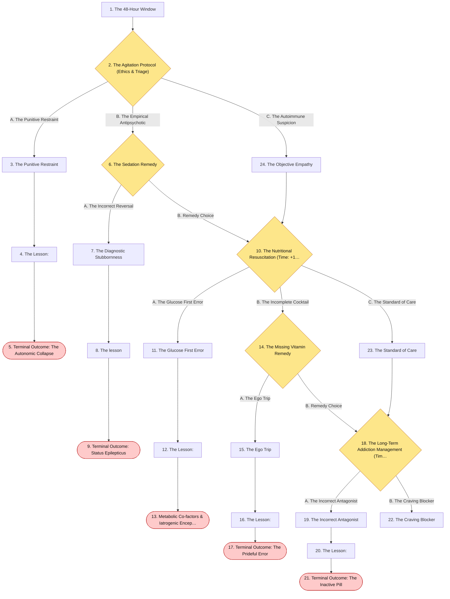
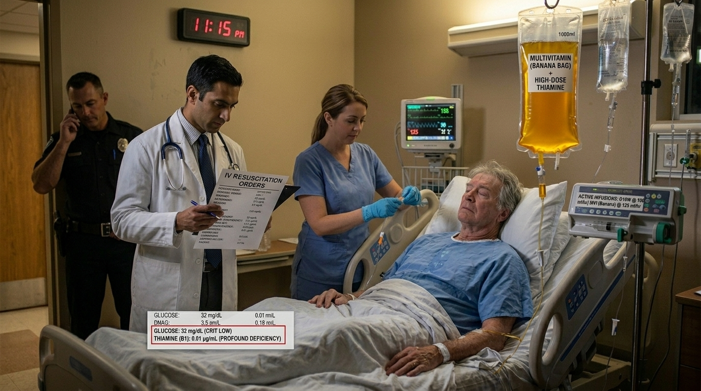
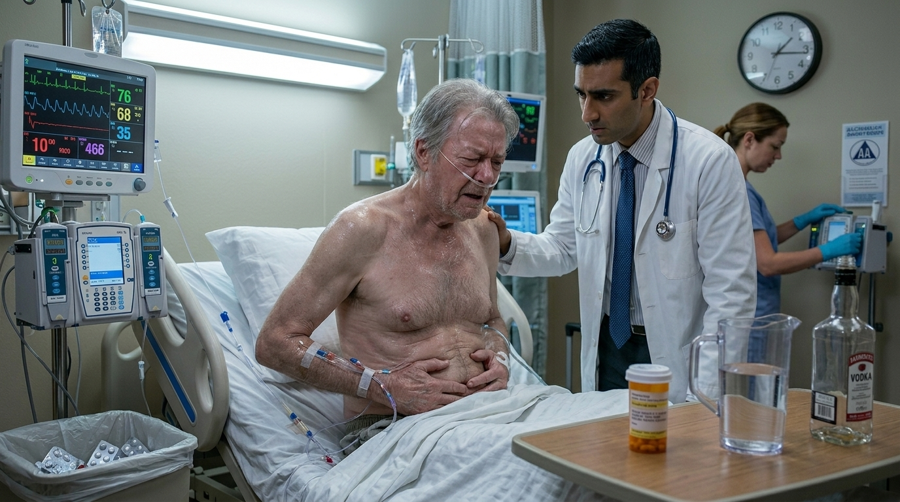
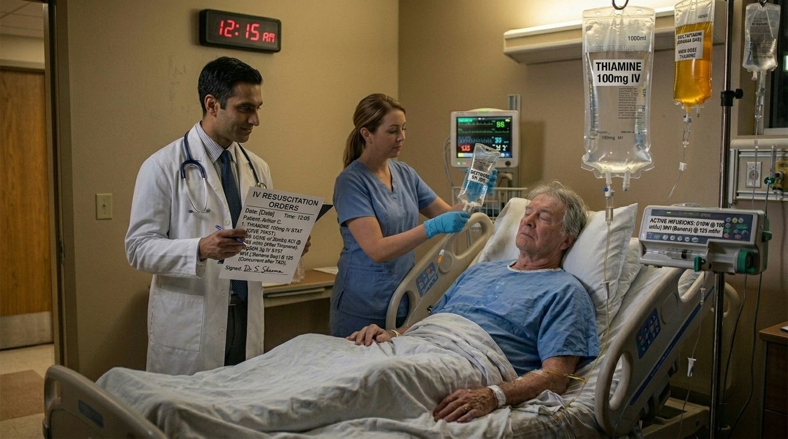

# The 48-Hour Window

> Psychiatry and Addiction Medicine

## Overview

| | |
|---|---|
| **Scenario key** | `substance withdrawal` |
| **Scenario ID** | `4b6bd568-3278-490e-8fc5-6578937fec84` |
| **Story pages** | 14 |
| **Decision points** | 5 (12 choices) |
| **Endings** | 5 (0 checkpoint, 5 fail) |
| **Concepts** | `Interprofessional Collaboration & Protocol Adherence`, `Metabolic Co-factors & Iatrogenic Encephalopathy`, `Pharmacokinetics & Addiction Maintenance`, `Pharmacological Reversal & Seizure Thresholds`, `Withdrawal Timelines & Restraint Contraindications` |
| **Graph file** | [`substance-withdrawal.json`](substance-withdrawal.json) |

This is a branching case study. The learner reads each story page, then at every decision point picks one of the choices. A *misstep* leads to a fail ending that sends the learner back to try again; the *correct* path continues the story and reaches checkpoint endings that mark the concepts learned.

## Flowchart

## The Story

### 1. The 48-Hour Window

Patient Profile: Arthur, a 69-year-old male.

Initial State: Arthur presented to the emergency department two days ago with sudden, severe epigastric pain and was admitted for acute pancreatitis . He has been kept NPO (nothing by mouth) and maintained on IV fluids. Now, exactly 48 hours into his admission, the floor nurse pages you urgently. Arthur is profoundly agitated, disoriented, and experiencing severe autonomic instability (tachycardia and sweating). He is screaming that there are "spiders crawling on the walls".

**Next:** [2. The Agitation Protocol (Ethics & Triage)](#decision-node-1)

---

### 2. Decision: The Agitation Protocol (Ethics & Triage)

The nurse is frustrated. "He’s combative and must have snuck cocaine or meth into his room," she says. "We need to tie him down before he hurts someone."

**What do you do?**

- **A. The Punitive Restraint** _(wrong)_ — Agree with the nurse’s suspicion of illicit stimulant use. Order 4-point physical restraints to protect the staff and leave him to calm down without medication. → [3. The Punitive Restraint](#information-node-3)
- **B. The Empirical Antipsychotic** _(misstep)_ — You aren't sure what he took, but you need to stop the hallucinations. You order a large IV dose of Haloperidol (an antipsychotic) to chemically sedate him. → [6. The Sedation Remedy](#decision-node-7)
- **C. The Autoimmune Suspicion** _(correct)_ — Stop the nurse. Explain that he has been hospitalized and NPO for exactly 48 hours. This timeline, combined with visual/tactile hallucinations and autonomic instability, points perfectly to Alcohol Withdrawal progressing toward Delirium Tremens (DTs) or withdrawal seizures. You immediately order a symptom-triggered Benzodiazepine taper (Lorazepam). → [24. The Objective Empathy](#information-node-14)

---

### 3. The Punitive Restraint

You tie Arthur to the bed. He continues to thrash violently against the restraints while his untreated alcohol withdrawal escalates. Because long-term alcohol use leads to a massive downregulation of inhibitory GABA channels and an upregulation of excitatory NMDA channels , his uninhibited nervous system spirals into overdrive. He suffers a massive, fatal tonic-clonic seizure followed by cardiovascular collapse. [

**Next:** [4. The Lesson:](#information-node-4)

---

### 4. The Lesson:

Substance use is typically denied or underreported, meaning patients admitted for unrelated medical issues (like pancreatitis) will suddenly go into withdrawal when cut off from their supply. Alcohol withdrawal is life-threatening. By 48-96 hours, patients can develop Delirium Tremens (DTs), characterized by severe autonomic instability, disorientation, and hallucinations. Furthermore, even if he was intoxicated on stimulants like cocaine or amphetamines, you must never physically restrain highly agitated patients without chemical sedation, as struggling against restraints rapidly causes fatal rhabdomyolysis

**Next:** [5. Terminal Outcome: The Autonomic Collapse](#termination-node-5)

---

### 5. Ending: Terminal Outcome: The Autonomic Collapse

> **Result:** fail · **Concept:** `Withdrawal Timelines & Restraint Contraindications`

Final Outcome: Fatal / Unmanaged Delirium Tremens

The Flaw: Yielding to stigma and using physical restraints instead of identifying the timeline for alcohol withdrawal and utilizing benzodiazepines.

Actionable Improvement: Always calculate the "Time Since Last Drink." At 48 hours, tactile/visual hallucinations and autonomic instability dictate immediate IV Benzodiazepines (Lorazepam/Diazepam).

_End of this path._

---

### 6. Decision: The Sedation Remedy

You push the Haloperidol. While it slightly blunts his hallucinations, it lowers his seizure threshold. Because you have not treated the underlying GABA/NMDA imbalance, Arthur begins to seize .

**What do you do?**

- **A. The Incorrect Reversal** _(wrong)_ — You panic and assume the seizure is a toxic reaction to a benzodiazepine he might have taken at home. You push Flumazenil. → [7. The Diagnostic Stubbornness](#information-node-9)
- **B. Remedy Choice** _(correct)_ — You realize Haloperidol does not prevent alcohol withdrawal seizures. You immediately push IV Lorazepam (a benzodiazepine) to abort the tonic-clonic seizure and stabilize his GABA receptors. → [10. The Nutritional Resuscitation (Time: +1 Hour)](#decision-node-36)

---

### 7. The Diagnostic Stubbornness

You push the Flumazenil. It violently strips any remaining inhibitory activity from his GABA receptors. Arthur's brain loses all regulatory ability, locking him into a continuous, unbreakable state of status epilepticus. His respiratory muscles paralyze, and he suffers permanent anoxic brain injury.

**Next:** [8. The lesson](#information-node-44)

---

### 8. The lesson

Flumazenil is a competitive GABAa antagonist used strictly for benzodiazepine intoxication . However, it is extremely dangerous because it can abruptly precipitate seizures, particularly if the patient is benzodiazepine dependent or already seizing . Pushing a GABA antagonist into a patient actively having a GABA-depleted alcohol withdrawal seizure is pouring gasoline on a fire

**Next:** [9. Terminal Outcome: Status Epilepticus](#termination-node-11)

---

### 9. Ending: Terminal Outcome: Status Epilepticus

> **Result:** fail · **Concept:** `Pharmacological Reversal & Seizure Thresholds`

Final Outcome: Fatal Deficit / Iatrogenic Status Epilepticus

The Flaw: Administering Flumazenil (a pro-convulsant in dependent patients) to an actively seizing patient .

Actionable Improvement: DO NOT treat benzodiazepine overdose with flumazenil generally, and absolutely never use it during an undifferentiated seizure.

_End of this path._

---

### 10. Decision: The Nutritional Resuscitation (Time: +1 Hour)

The Lorazepam successfully stabilizes Arthur. He is resting but heavily depleted. His labs return showing severe hypoglycemia and profound malnutrition, standard for chronic alcoholism. You need to write his IV resuscitation orders for the night.

**What do you do?**

- **A. The Glucose First Error** _(wrong)_ — Because his blood sugar is critically low, you order a rapid IV push of Dextrose, planning to order his vitamins tomorrow morning. → [11. The Glucose First Error](#information-node-18)
- **B. The Incomplete Cocktail** _(misstep)_ — You order IV Fluids and a Multivitamin, but you forget to specifically request Thiamine. → [14. The Missing Vitamin Remedy](#decision-node-38)
- **C. The Standard of Care** _(correct)_ — You explicitly order IV Thiamine to be administered first, followed by Dextrose, Magnesium, and a Multivitamin. → [23. The Standard of Care](#information-node-21)

---

### 11. The Glucose First Error

You push the IV Dextrose. Without Thiamine to process the glucose, Arthur's neurons suffer acute metabolic failure. The next morning, you find him awake but exhibiting profound ataxia, nystagmus, and severe anterograde amnesia. You successfully treated his withdrawal, but your improper sequencing of his IV fluids condemned him to irreversible Korsakoff Psychosis.

**Next:** [12. The Lesson:](#information-node-19)

---

### 12. The Lesson:

In chronic alcoholics, thiamine (Vitamin B1) stores are notoriously depleted. Thiamine is a mandatory co-factor for the metabolic breakdown of glucose. If you administer a massive load of Dextrose to a thiamine-deficient patient, the brain cannot process the glucose, causing immediate, catastrophic cellular damage to the mammillary bodies. This iatrogenically induces Wernicke's Encephalopathy.

**Next:** [13. Metabolic Co-factors & Iatrogenic Encephalopathy](#termination-node-20)

---

### 13. Ending: Metabolic Co-factors & Iatrogenic Encephalopathy

> **Result:** fail · **Concept:** `Metabolic Co-factors & Iatrogenic Encephalopathy`

Final Outcome: Fatal Deficit / Iatrogenic Wernicke-Korsakoff Syndrome

The Flaw: Administering IV Dextrose before replenishing Thiamine in a chronic alcoholic.

Actionable Improvement: Memorize the protocol sequence for alcohol intoxication/withdrawal: Thiamine, Magnesium, Multivitamin, Dextrose. Thiamine always precedes the sugar.

_End of this path._

---

### 14. Decision: The Missing Vitamin Remedy

The clinical pharmacist pages you immediately. "Doctor, you ordered fluids and a multivitamin for this alcohol withdrawal patient, but you didn't include IV Thiamine or Dextrose. Do you want to add them to the protocol?"

**What do you do?**

- **A. The Ego Trip** _(wrong)_ — You get defensive and tell the pharmacist not to question your orders. You refuse to add the Thiamine and just order the Dextrose. → [15. The Ego Trip](#information-node-26)
- **B. Remedy Choice** _(correct)_ — You thank the pharmacist for the safety catch, recognize the necessity of Thiamine in chronic alcoholism, and add Thiamine followed by Dextrose to his IV orders. → [18. The Long-Term Addiction Management (Time: Discharge Day)](#decision-node-41)

---

### 15. The Ego Trip

You push the Dextrose without the Thiamine. Over the next 24 hours, Arthur develops severe Wernicke's Encephalopathy. When the attending physician reviews the chart and sees that you explicitly rejected the pharmacist's recommendation for Thiamine, you are brought before the medical ethics committee for gross negligence and unprofessional conduct.

**Next:** [16. The Lesson:](#information-node-28)

---

### 16. The Lesson:

Clinical pharmacists are the ultimate safety net for medication and metabolic protocols. Ignoring a direct query regarding a standard-of-care protocol out of ego is a dangerous professional failure. The treatment for alcohol withdrawal and chronic intoxication strictly requires Thiamine.

**Next:** [17. Terminal Outcome: The Prideful Error](#termination-node-32)

---

### 17. Ending: Terminal Outcome: The Prideful Error

> **Result:** fail · **Concept:** `Interprofessional Collaboration & Protocol Adherence`

Final Outcome: Failure / Professional Negligence & Harm

The Flaw: Allowing ego to override standard interprofessional safety checks, resulting in patient harm.

Actionable Improvement: Always listen to the pharmacy. The "Banana Bag" (Thiamine, Folate, Multivitamin, Dextrose)  is a non-negotiable standard for a reason.

_End of this path._

---

### 18. Decision: The Long-Term Addiction Management (Time: Discharge Day)

Arthur has recovered from his acute DTs and his pancreatitis has resolved. During discharge counseling, he breaks down. "I don't want to drink anymore," he says. "But the cravings are so strong. Is there a pill that can make the cravings stop?"
You want to prescribe a medication to support his sobriety.

**What do you do?**

- **A. The Incorrect Antagonist** _(wrong)_ — You prescribe oral Naloxone, explaining that it will block the receptors in his brain and stop his alcohol cravings. → [19. The Incorrect Antagonist](#information-node-29)
- **B. The Craving Blocker** _(correct)_ — You prescribe oral Naltrexone. You explain that it is an opioid antagonist used to assist in blocking cravings for both opioids and alcohol . You pair this with a referral for individual and group psychotherapy. → [22. The Craving Blocker](#information-node-45)

---

### 19. The Incorrect Antagonist

You send Arthur home with oral Naloxone. Because it undergoes massive first-pass metabolism and is completely inactive when taken orally, it does absolutely nothing to curb his neurochemical cravings. Within three days, the cravings overwhelm him. He relapses, begins drinking heavily again, and is readmitted two weeks later with a severe recurrence of acute necrotizing pancreatitis.

**Next:** [20. The Lesson:](#information-node-34)

---

### 20. The Lesson:

Understanding the pharmacokinetic differences between Naloxone and Naltrexone is highly testable. Naloxone is an opioid receptor antagonist used strictly for acute opioid overdose reversal ; furthermore, naloxone is not active when taken orally (which is why it is combined with buprenorphine in Suboxone to prevent IV abuse) . Naltrexone is the opioid antagonist used to assist in blocking cravings for both opioids and alcohol in the long term .

**Next:** [21. Terminal Outcome: The Inactive Pill](#termination-node-33)

---

### 21. Ending: Terminal Outcome: The Inactive Pill

> **Result:** fail · **Concept:** `Pharmacokinetics & Addiction Maintenance`

Final Outcome: Failure / Ineffective Pharmacology & RelapseThe Flaw: Confusing Naloxone (inactive orally, used for acute overdose) with Naltrexone (active orally, used for craving maintenance) .Actionable Improvement: Memorize the "N" drugs. Naloxone = Acute Nasal/IV rescue. Naltrexone = Long-Term craving blocker.

_End of this path._

---

### 22. The Craving Blocker

You flawlessly managed a life-threatening acute withdrawal syndrome, perfectly sequenced his metabolic resuscitation, and correctly identified the long-term pharmacological support needed to maintain his sobriety.

---

### 23. The Standard of Care

You correctly identified that in chronic alcoholism, Thiamine must be replenished to facilitate glucose metabolism and protect the brain.

**Next:** [18. The Long-Term Addiction Management (Time: Discharge Day)](#decision-node-41)

---

### 24. The Objective Empathy

You successfully advocated for your patient, avoiding the stigma of "sneaking drugs" by applying the precise pharmacological timeline of alcohol withdrawal. Benzodiazepines are the gold standard to prevent life-threatening cardiovascular collapse and seizures.

**Next:** [10. The Nutritional Resuscitation (Time: +1 Hour)](#decision-node-36)

---
