# Case Study: Early Deterioration and Conflicting AI Signals

> Navigate a realistic clinical scenario involving patient Mr. Allen to learn about automation bias, over-reliance, and workflow integration.

## Overview

| | |
|---|---|
| **Scenario key** | `unit1-recognizing-risks` |
| **Scenario ID** | `f24ab7ad-3013-4ec8-9be9-dbd66fd0d16c` |
| **Story pages** | 20 |
| **Decision points** | 5 (11 choices) |
| **Endings** | 7 (3 checkpoint, 4 fail) |
| **Concepts** | `bias` |
| **Graph file** | [`unit1-recognizing-risks.json`](unit1-recognizing-risks.json) |

This is a branching case study. The learner reads each story page, then at every decision point picks one of the choices. A *misstep* leads to a fail ending that sends the learner back to try again; the *correct* path continues the story and reaches checkpoint endings that mark the concepts learned.

## Flowchart

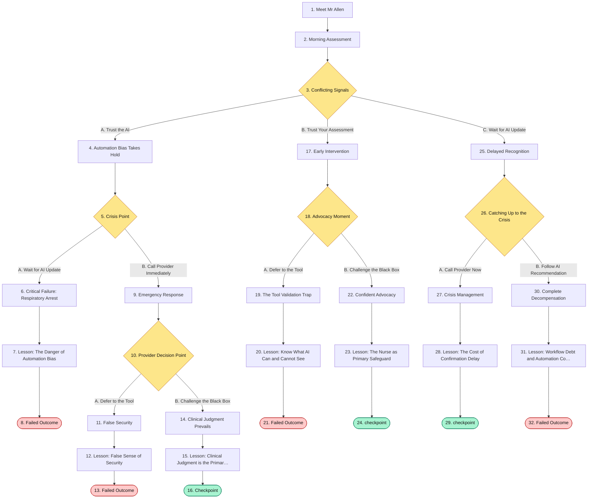

## The Story

### 1. Meet Mr Allen

You're beginning your morning shift on the medical-surgical unit. Your first patient is Mr. Allen, a 62-year-old man admitted 48 hours ago with community-acquired pneumonia.

**Patient Background:**
- Admitted with fever, productive cough, and infiltrate on chest X-ray
- Started on IV antibiotics (ceftriaxone and azithromycin)
- Initial vital signs showed mild tachypnea and low-grade fever
- No significant past medical history besides well-controlled hypertension

**Current Status:**
Mr. Allen has been stable throughout his stay. He's on continuous monitoring with the hospital's AI-powered early warning system, which analyzes vital signs, lab values, and clinical notes to predict patient deterioration. The system has consistently shown him as LOW RISK with confidence scores above 90%.

His care team has been pleased with his progress, and there's been discussion about transitioning him to oral antibiotics and preparing for discharge in the next 24-48 hours.

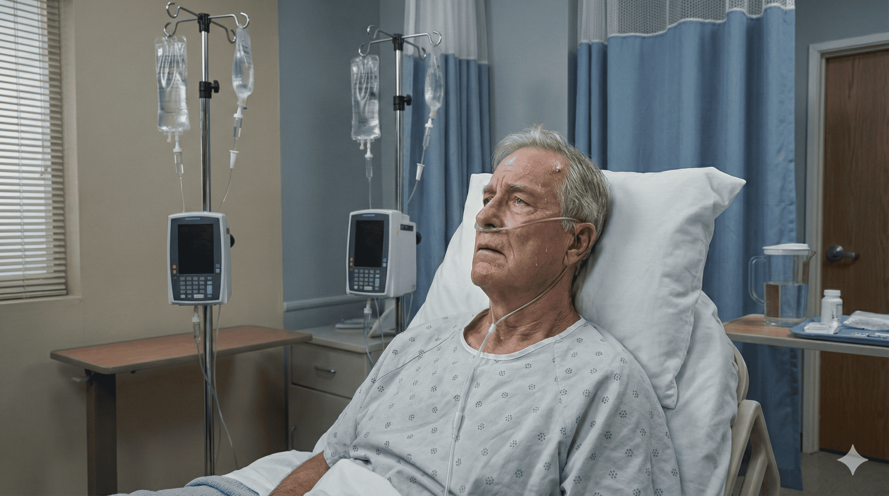

**Next:** [2. Morning Assessment](#information-node-1)

---

### 2. Morning Assessment

As you enter Mr. Allen's room for your morning assessment, something catches your attention.

**Your Clinical Observations:**
- Mr. Allen seems slightly more confused than yesterday - he's oriented to person and place, but keeps asking what day it is
- His breathing appears more labored - you notice subtle use of accessory muscles
- His skin feels warm and slightly clammy to touch
- He mentions feeling "a bit more tired today" and hasn't eaten breakfast
- His lung sounds have increased crackles in the right lower lobe

**The AI Dashboard:**
However, when you glance at the monitor, the AI early warning system still displays:
- **Status: LOW RISK**
- **Confidence: 94%**
- **Last Update: 30 minutes ago**
- **Recommendation: Continue current care plan**

The dashboard shows all vital signs within normal parameters:
- Heart rate: 88 bpm
- Blood pressure: 128/76 mmHg  
- Respiratory rate: 18 breaths/min
- SpO2: 95% on room air
- Temperature: 99.1°F

Your clinical instincts are telling you one thing, but the sophisticated AI system - which has been remarkably accurate throughout Mr. Allen's stay - is telling you something quite different.

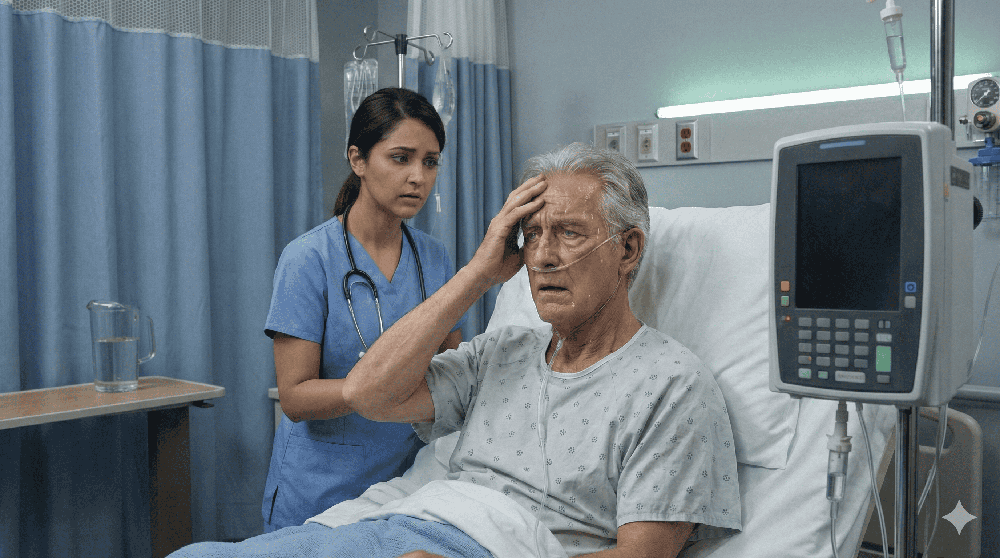

**Next:** [3. Conflicting Signals](#decision-node-2)

---

### 3. Decision: Conflicting Signals

You're facing a critical decision point. Your clinical assessment suggests early deterioration, but the AI system - which has proven reliable - indicates low risk with high confidence.

How do you proceed?

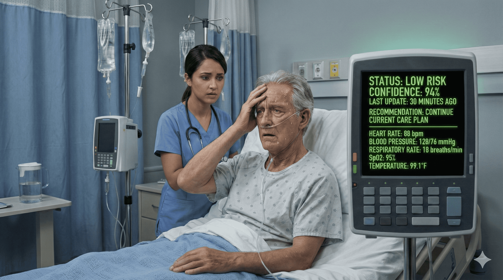

**What do you do?**

- **A. Trust the AI** _(misstep)_ — The system has been accurate and shows 94% confidence. Continue monitoring as planned. → [4. Automation Bias Takes Hold](#information-node-5)
- **B. Trust Your Assessment** _(correct)_ — Your clinical observations indicate early deterioration. Call the provider now. → [17. Early Intervention](#information-node-24)
- **C. Wait for AI Update** _(misstep)_ — Wait for the next automated vital signs check to see if the system alerts. → [25. Delayed Recognition](#information-node-34)

---

### 4. Automation Bias Takes Hold

You decide to trust the AI system's assessment. After all, it has been accurate throughout Mr. Allen's stay, and the vital signs do appear stable. Perhaps you're being overly cautious. **What Happens Next:**

You document your assessment in the chart, noting the subtle changes you observed, but you defer escalation based on the LOW RISK status. You tell yourself you'll reassess in 30 minutes during your next rounds.

**30 Minutes Later:**

As you return to check on Mr. Allen, you're intercepted by the CNA who helped him to the bathroom. She looks concerned.

"Something's wrong with Mr. Allen," she says urgently. "His lips look blue, and he's really confused now."

You rush to his room. The patient is clearly in respiratory distress:
- Marked use of accessory muscles
- Cyanosis around lips and nail beds
- Severe confusion, unable to follow commands
- Labored breathing at 28 breaths per minute

**The AI Dashboard:**
The screen still shows **LOW RISK (94% confidence)** - it hasn't received updated vital signs yet since the scheduled automatic reading isn't due for another 15 minutes.

Your earlier clinical judgment was correct. The AI system, while sophisticated, was analyzing outdated data and couldn't observe the subtle clinical signs you noticed.

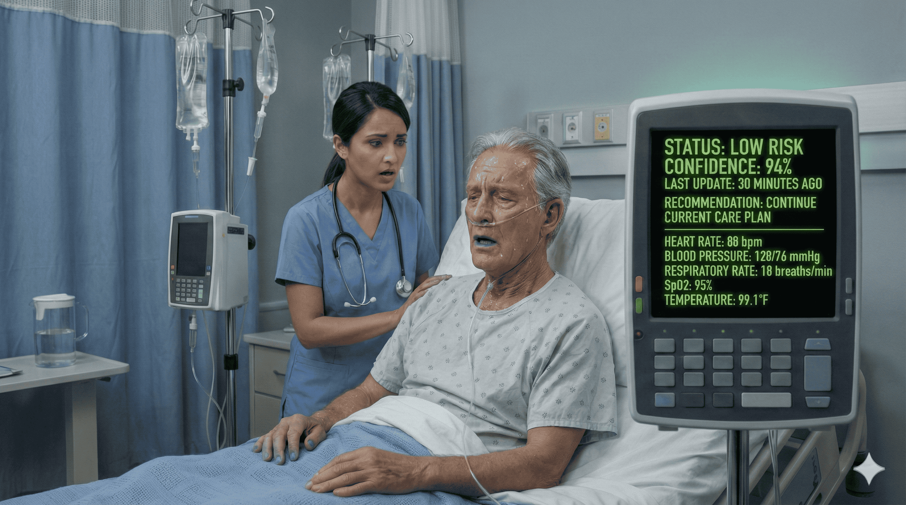

**Next:** [5. Crisis Point](#decision-node-6)

---

### 5. Decision: Crisis Point

Mr. Allen is clearly deteriorating rapidly. You have seconds to make a decision.

What do you do?

**What do you do?**

- **A. Wait for AI Update** _(wrong)_ — Get emergency help but wait for the automated system to update and confirm the emergency. → [6. Critical Failure: Respiratory Arrest](#information-node-11)
- **B. Call Provider Immediately** _(correct)_ — Clearly communicate the urgent situation to the provider right now. → [9. Emergency Response](#information-node-14)

---

### 6. Critical Failure: Respiratory Arrest

You hesitate, waiting for the automated vital signs to update and confirm what you're seeing. The AI system has been so reliable - surely it will alert you once the new readings come in.

You call for a rapid response but waste precious seconds waiting for the dashboard to update before clearly communicating the urgency of the situation.

**30 Minutes After Your Initial Assessment:**

By the time the rapid response team arrives and assesses Mr. Allen, he has progressed to full respiratory arrest. The team initiates emergency intubation and transfers him to the ICU.

**What Went Wrong:**

The automated vital signs system took readings every hour for stable patients. In the 30-minute window since the last automated check, Mr. Allen's condition deteriorated rapidly. The AI's "LOW RISK" assessment was based on data that was already outdated when you did your initial assessment.

Your clinical observation was correct from the start. The patient showed clear signs of deterioration that no algorithm could detect from vital signs alone: subtle changes in mental status, increased work of breathing, skin appearance, and the patient's subjective reports.

**The Critical Error:**

By deferring to the AI's confident assessment over your own clinical judgment, you lost the narrow window for early intervention that could have prevented respiratory failure.

**Later Investigation:**

The hospital's quality review revealed that Mr. Allen had developed a rapidly progressing pneumonia with sepsis. The AI system's algorithm was trained primarily on gradual deterioration patterns and wasn't sensitive to acute changes between vital sign readings. Your initial bedside assessment had detected what the technology could not.

**Next:** [7. Lesson: The Danger of Automation Bias](#information-node-13)

---

### 7. Lesson: The Danger of Automation Bias

**Automation Bias** occurs when humans over-trust automated systems, especially those that present information with high confidence, even when contradictory evidence exists.

**What Happened Here:**

1. **Confident AI Override:** The 94% confidence score created a false sense of certainty that overrode your valid clinical observations.

2. **Data Limitations:** The AI could only analyze what was measured and recorded. It couldn't observe:
   - Subtle changes in mental status
   - Increased work of breathing
   - Skin color and temperature
   - Patient's subjective experience
   - Changes between automated readings

3. **Timing Delay:** The AI worked with 30-minute-old data while the patient's condition was changing minute by minute.

**Key Takeaway:**

Licensed clinicians are responsible for clinical decisions, not the AI. When your bedside assessment conflicts with automated systems, **your clinical judgment must take precedence**. The AI is a tool to support your decision-making, not to replace it.

**Professional Responsibility:**

As the nurse at the bedside, you are the primary safeguard. No algorithm can replace the professional judgment that comes from direct patient assessment, clinical experience, and the integration of information that cannot be captured in data points.

**Next:** [8. Failed Outcome](#termination-node-12)

---

### 8. Ending: Failed Outcome

> **Result:** fail · **Concept:** `bias`

Mr. Allen experienced a preventable respiratory arrest due to delayed escalation of care. Use the timeline review to return to an earlier decision point and try a different approach.

_End of this path._

---

### 9. Emergency Response

Despite your earlier hesitation, you trust your assessment of the current crisis. You immediately call the provider.

"I need you to see Mr. Allen right away. He's showing signs of respiratory distress - cyanosis, severe confusion, respiratory rate of 28, marked accessory muscle use. I know the AI says low risk, but something is very wrong."

**10 Minutes Later:**

The provider arrives quickly and performs an assessment. You notice they immediately pull up the AI dashboard on the tablet.

"The system still shows low risk with 94% confidence," the provider observes, looking between the screen and the patient. "The vitals from 30 minutes ago were stable."

You can see the provider weighing the situation - the confident AI assessment versus your clinical report and the patient's current presentation.

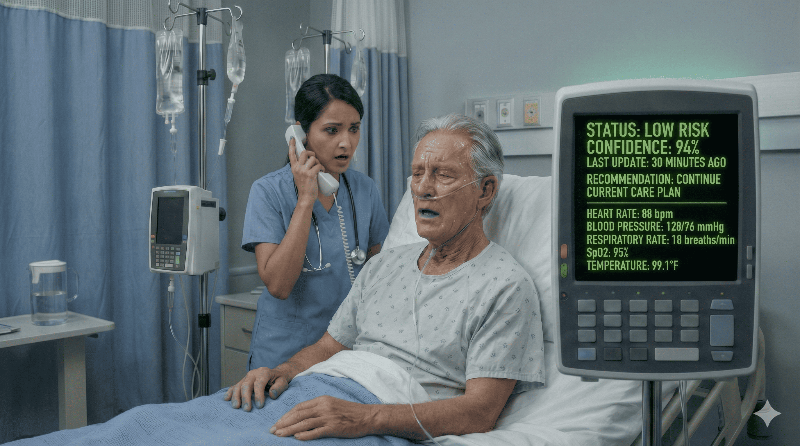

**Next:** [10. Provider Decision Point](#decision-node-15)

---

### 10. Decision: Provider Decision Point

The provider is looking at the AI dashboard showing LOW RISK while you're reporting clear signs of deterioration.

How do you advocate for your patient?

**What do you do?**

- **A. Defer to the Tool** _(wrong)_ — Acknowledge the provider's point about the validated system and agree to watch closely. → [11. False Security](#information-node-18)
- **B. Challenge the Black Box** _(correct)_ — Advocate that the AI has outdated data and your direct assessment should take priority. → [14. Clinical Judgment Prevails](#information-node-21)

---

### 11. False Security

You defer to the provider's hesitation, acknowledging that the AI system has been validated and is usually reliable. Perhaps you were being overly concerned.

"Let's watch him closely and get a set of vitals manually in 15 minutes," the provider decides. "If things change, call me immediately."

**15 Minutes Later:**

By the time you return with the manual vital signs equipment, Mr. Allen has progressed to respiratory failure. Emergency intubation is required at the bedside, and he's transferred emergently to the ICU.

**The Shift Change:**

At shift change, you learn that Mr. Allen required prolonged mechanical ventilation due to the delayed intervention. The rapid progression of his pneumonia to sepsis could have been caught earlier with immediate diagnostic workup.

**What Went Wrong:**

Both you and the provider fell victim to the **false sense of security** created by the AI's confident assessment. Even though you correctly identified the clinical deterioration, the technology's authority overrode collective clinical judgment.

The AI system provided validation for inaction when immediate action was needed.

**Next:** [12. Lesson: False Sense of Security](#information-node-19)

---

### 12. Lesson: False Sense of Security

**False Sense of Security** occurs when validated AI tools create an illusion of certainty that discourages critical thinking and appropriate escalation.

**What Happened Here:**

1. **Validation as Authority:** The fact that the tool was "validated" became a reason to dismiss clinical observations rather than investigate discrepancies.

2. **Confidence Misinterpretation:** The 94% confidence score represented the AI's certainty in its prediction based on available data - not the actual certainty of the patient's status.

3. **Technology Deference:** Both clinicians deferred to technology rather than trusting direct patient assessment.

**Critical Insight:**

"Validated" doesn't mean "infallible." AI systems are validated under specific conditions using historical data. They cannot account for:
- Data that wasn't recorded yet
- Clinical observations not in the dataset
- Rare or rapidly evolving situations
- The specific patient in front of you

**Professional Accountability:**

When clinical signs conflict with AI outputs, the appropriate response is **investigation**, not dismissal. Order new diagnostics, get updated vitals, consult with colleagues - but never let an algorithm substitute for clinical judgment.

**Remember:** You are accountable for patient outcomes. The AI system is not.

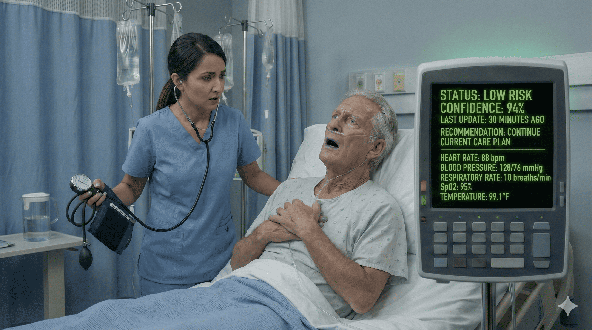

**Next:** [13. Failed Outcome](#termination-node-20)

---

### 13. Ending: Failed Outcome

> **Result:** fail · **Concept:** `bias`

Delayed escalation led to respiratory failure requiring emergency intubation. Use the timeline review to return to an earlier decision point.

_End of this path._

---

### 14. Clinical Judgment Prevails

You maintain your position firmly but professionally.

"I understand the AI shows low risk, but I assessed this patient 30 minutes ago and noted early signs of deterioration - increased confusion, more labored breathing, increased crackles. His current presentation with cyanosis and respiratory distress represents clear progression. The vital signs the AI is analyzing are outdated. I believe we need STAT diagnostics and respiratory therapy now."

The provider looks at Mr. Allen, then back at the dashboard, then at you.

"You're right," the provider says, closing the tablet. "Let's trust what we're seeing, not what the computer is telling us. I'm ordering STAT portable chest X-ray, repeat labs including lactate and blood cultures, and respiratory therapy for assessment. Let's get oxygen on him and consider transfer to step-down."

**What Happens Next:**

Within 30 minutes:
- Portable chest X-ray shows significant progression of pneumonia with new bilateral infiltrates
- Lactate is elevated at 3.2, indicating early sepsis
- Blood cultures are drawn before adding broader antibiotic coverage
- Respiratory therapy initiates bilevel positive airway pressure (BiPAP)
- Mr. Allen is transferred to the step-down unit for closer monitoring

**Two Days Later:**

Mr. Allen's condition stabilizes with aggressive treatment. The early intervention prevented respiratory failure and ICU-level care. He avoids intubation entirely.

During the quality review, the AI system's performance is evaluated. The algorithm is adjusted to be more sensitive to subtle changes and to flag cases where vital signs are older than 30 minutes in patients with respiratory diagnoses.

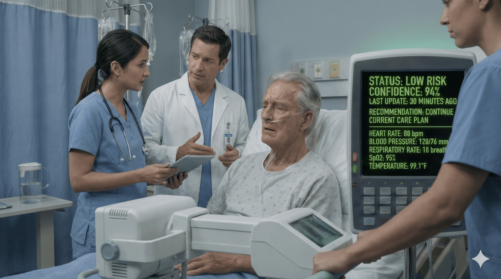

**Next:** [15. Lesson: Clinical Judgment is the Primary Safeguard](#information-node-22)

---

### 15. Lesson: Clinical Judgment is the Primary Safeguard

**Clinical Judgment** remains the primary safeguard in patient care, especially when it conflicts with AI-generated assessments.

**What Went Right:**

1. **Trust in Assessment:** You trusted your systematic bedside assessment over an automated system's confident prediction.

2. **Effective Advocacy:** You clearly communicated your clinical observations and the timeline of changes, helping the provider see beyond the dashboard.

3. **Appropriate Escalation:** Rather than deferring to technology, you pushed for immediate diagnostic workup to investigate the discrepancy.

**Critical Understanding:**

AI systems excel at pattern recognition in large datasets, but they have fundamental limitations:

- **They can't see what isn't measured:** Subtle changes in appearance, behavior, and subjective reports
- **They work with delayed data:** Automated vital signs may be minutes or hours old
- **They lack clinical context:** Understanding of disease progression, patient-specific factors, and situational awareness
- **They can't touch the patient:** No substitute for hands-on assessment

**Your Role as the Bedside Nurse:**

You are not just a data collector for AI systems. You are the **primary safeguard** - the professional who integrates:
- Real-time bedside observations
- Patient history and trends
- Clinical expertise and pattern recognition
- Data from AI systems as one input among many

**Remember:** AI should augment your clinical judgment, never replace it. When conflicts arise, investigate thoroughly, advocate strongly, and trust your professional assessment.

**Next:** [16. Checkpoint](#termination-node-23)

---

### 16. Checkpoint

> **Result:** checkpoint · **Concept:** `bias`

_End of this path._

---

### 17. Early Intervention

You trust your clinical assessment. Despite the AI dashboard showing LOW RISK, the subtle signs you're observing are concerning enough to warrant immediate escalation.

You call the provider before leaving Mr. Allen's room.

"I need you to see Mr. Allen this morning. I know the AI system shows low risk, but I'm seeing early signs of deterioration - increased confusion, more labored breathing, increased lung crackles, and he's using accessory muscles. Something doesn't feel right."

**15 Minutes Later:**

The provider arrives and performs their own assessment. You notice them checking the AI dashboard on their tablet.

"I see what you mean about the clinical changes," the provider says, "but the early warning system still shows low risk with 94% confidence. All the vital signs from the last automated check were stable."

You can see them weighing your bedside assessment against the confident AI prediction.

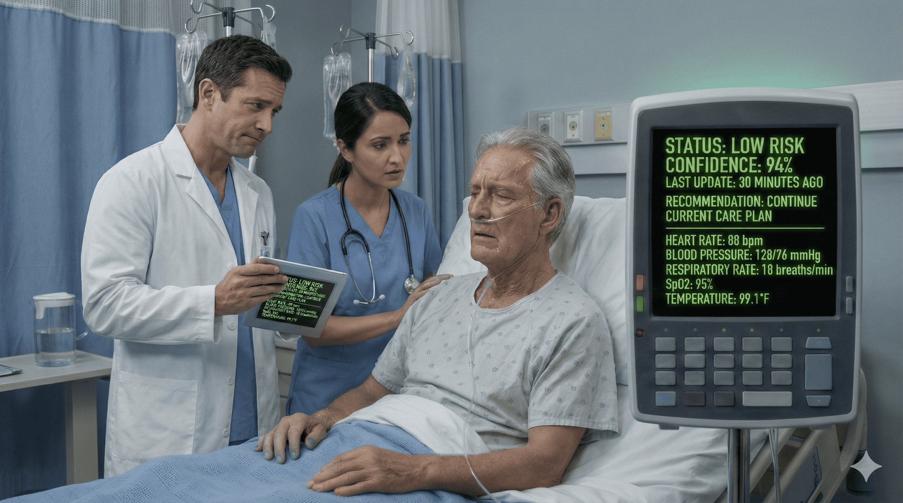

**Next:** [18. Advocacy Moment](#decision-node-25)

---

### 18. Decision: Advocacy Moment

The provider is questioning whether to order diagnostics based on your assessment or to trust the AI's low-risk prediction.

How do you respond?

**What do you do?**

- **A. Defer to the Tool** _(misstep)_ — Accept that the validated AI system may be more accurate than your observations. → [19. The Tool Validation Trap](#information-node-28)
- **B. Challenge the Black Box** _(correct)_ — Clearly articulate why your bedside assessment warrants immediate diagnostic workup. → [22. Confident Advocacy](#information-node-31)

---

### 19. The Tool Validation Trap

You hesitate in your advocacy. The provider's mention of the AI's validation and confidence makes you second-guess your assessment.

"Maybe I am being overly cautious," you think. "The system has been validated, and it's been accurate all along."

"Let's continue close monitoring," the provider decides. "Get a manual set of vitals now, and if anything changes or the AI alerts, call me immediately."

**45 Minutes Later:**

You've been busy with other patients when you hear the rapid response alarm. It's coming from Mr. Allen's room.

The CNA who was helping him to the bathroom found him in severe respiratory distress. By the time the rapid response team arrives, Mr. Allen requires emergency intubation. He's transferred to the ICU.

**What Went Wrong:**

Early intervention could have prevented respiratory failure. Your initial assessment was correct - Mr. Allen was showing signs of early deterioration that warranted immediate diagnostic workup.

By deferring to the AI system's assessment, both you and the provider fell into the **tool validation trap**: assuming that because a system is validated and usually accurate, it must be right in this specific situation.

The AI was working with outdated data and couldn't observe the clinical signs you noticed. Your professional judgment was the more accurate assessment tool.

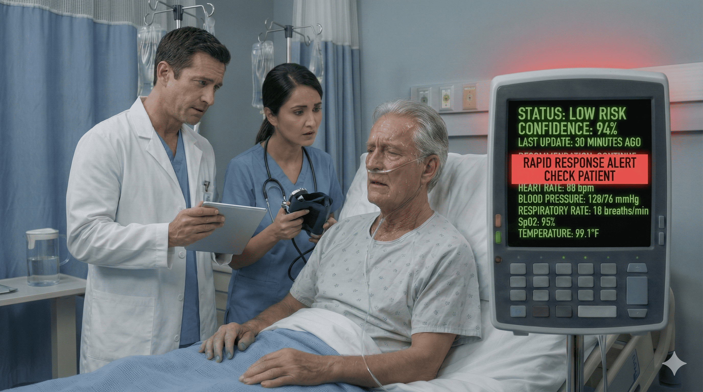

**Next:** [20. Lesson: Know What AI Can and Cannot See](#information-node-29)

---

### 20. Lesson: Know What AI Can and Cannot See

**The Tool Validation Trap** occurs when clinicians assume that validated AI systems are always more accurate than clinical judgment, even in situations outside the system's design parameters.

**What Happened Here:**

1. **Validation Misunderstanding:** "Validated" means the AI performed well on historical test data - not that it's infallible in every clinical situation.

2. **Invisible Limitations:** The AI couldn't observe:
   - Subtle changes in mental status
   - Visual assessment of respiratory effort
   - Skin color and temperature changes
   - Patient's subjective reports
   - Clinical trends you noticed from previous shifts

3. **Data Timing:** The AI was analyzing vital signs from 30+ minutes ago while the patient was actively deteriorating.

**Critical Insight:**

AI systems don't have "clinical judgment" - they have pattern recognition based on historical data. They cannot:
- Integrate multiple subtle observations the way human cognition does
- Account for information not captured in their training data
- Observe real-time changes between automated data collection points
- Apply clinical reasoning about disease progression

**Your Professional Responsibility:**

When you observe clinical changes that conflict with AI outputs:

1. **Investigate the discrepancy** - Why might the AI be wrong? What data is it missing?
2. **Advocate confidently** - Your bedside assessment captures information technology cannot
3. **Document thoroughly** - Record your observations and clinical reasoning
4. **Escalate appropriately** - Push for diagnostic workup to resolve the conflict

**Remember:** You are not "overriding" the AI when you escalate based on clinical assessment. You're fulfilling your professional duty to use all available information - including observations the AI cannot make.

**Next:** [21. Failed Outcome](#termination-node-30)

---

### 21. Ending: Failed Outcome

> **Result:** fail · **Concept:** `bias`

Despite early recognition, hesitant advocacy led to delayed intervention and respiratory failure. Use the timeline review to try a different approach.

_End of this path._

---

### 22. Confident Advocacy

You advocate firmly for your patient.

"I understand the system shows low risk, but I've assessed this patient directly and I'm seeing multiple concerning signs. The AI is working with data from the last automated vital sign check, which was taken before these changes appeared. I believe we need diagnostic workup now - chest X-ray, labs including lactate, and respiratory therapy assessment."

The provider considers your points carefully.

"You're absolutely right," they respond. "The dashboard is only as good as the data it has, and you're seeing changes it can't. Let's get STAT labs, portable chest X-ray, blood cultures, and broaden his antibiotic coverage. I'll call respiratory therapy."

**What Happens Next:**

Your early detection and confident advocacy lead to prompt intervention:

- STAT chest X-ray reveals progression of pneumonia with new bilateral infiltrates
- Labs show early sepsis with lactate of 2.8
- Blood cultures drawn before antibiotic adjustment
- Respiratory therapy provides supplemental oxygen and close monitoring
- Transfer to step-down unit for enhanced observation

**48 Hours Later:**

Mr. Allen's condition stabilizes with aggressive treatment. Your early recognition prevented respiratory failure and the need for ICU-level care or intubation.

During the shift change huddle, the charge nurse acknowledges your excellent clinical judgment: "This is a perfect example of why we can't rely solely on technology. Your bedside assessment caught what the AI missed."

The quality improvement team reviews the case and recommends modifications to the AI system to flag when vital signs data is more than 30 minutes old in patients with respiratory diagnoses.

**Next:** [23. Lesson: The Nurse as Primary Safeguard](#information-node-32)

---

### 23. Lesson: The Nurse as Primary Safeguard

**Primary Safeguard** - The bedside nurse serves as the essential safety check that technology cannot replace.

**What Went Right:**

1. **Trusted Your Assessment:** You recognized that your real-time, hands-on evaluation captured information the AI system could not.

2. **Understood AI Limitations:** You identified that the AI was working with outdated data and lacked access to subtle clinical observations.

3. **Advocated Effectively:** You communicated clearly why immediate action was needed despite the AI's contrary assessment.

4. **Prevented Harm:** Early escalation led to timely treatment and prevented serious deterioration.

**Why Bedside Nurses Are Irreplaceable:**

AI systems, no matter how sophisticated, cannot replace the bedside nurse because:

**You observe what isn't measured:**
- Subtle changes in appearance, behavior, mental status
- Patient's subjective experience and concerns
- Context that numbers can't capture
- Trends over time from your continuity of care

**You think clinically:**
- Integrate multiple data points in real-time
- Apply knowledge of disease progression
- Consider patient-specific factors
- Use professional judgment developed through experience

**You advocate:**
- Speak up when something "doesn't feel right"
- Push for diagnostic workup when needed
- Bridge communication between patient and provider
- Question systems that conflict with clinical reality

**Professional Identity:**

Being a nurse in the age of AI doesn't mean becoming a technology operator. It means being the **primary safeguard** - the professional who ensures that technology serves patients rather than substituting for clinical judgment.

**Core Principle:** When your clinical assessment conflicts with AI outputs, your responsibility is to investigate thoroughly, advocate confidently, and trust your professional judgment. The AI is one tool among many. You are the clinician responsible for the patient's care.

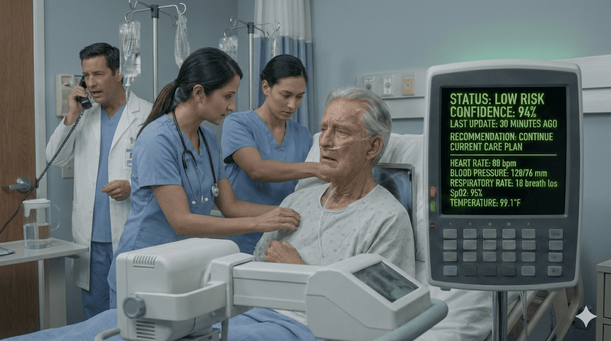

**Next:** [24. checkpoint](#termination-node-33)

---

### 24. Checkpoint

> **Result:** checkpoint · **Concept:** `bias`

_End of this path._

---

### 25. Delayed Recognition

You decide to wait for the AI system to update before escalating. After all, the next automated vital signs check is scheduled in about 30 minutes, and the system has been reliable throughout Mr. Allen's stay.

You document your observations and tell yourself you'll reassess after the system updates.

**45 Minutes Later:**

You've been occupied with medication administration for other patients. When you check the AI dashboard, it has finally updated:

**Status: MODERATE RISK**
**Confidence: 78%**
**Recommendation: Update vital signs every 30 minutes**

The dashboard now shows:
- Heart rate: 104 bpm (increased)
- Blood pressure: 118/68 mmHg (slightly decreased)
- Respiratory rate: 24 breaths/min (increased)
- SpO2: 92% on room air (decreased)
- Temperature: 99.8°F (increased)

You return to Mr. Allen's room to perform a manual assessment. His condition has clearly worsened:
- Significantly increased work of breathing
- More pronounced confusion
- Increased lung crackles bilaterally
- Skin is now pale and diaphoretic

The 45-minute delay has allowed his condition to progress considerably. The "subtle" signs you noticed earlier are now obvious clinical deterioration.

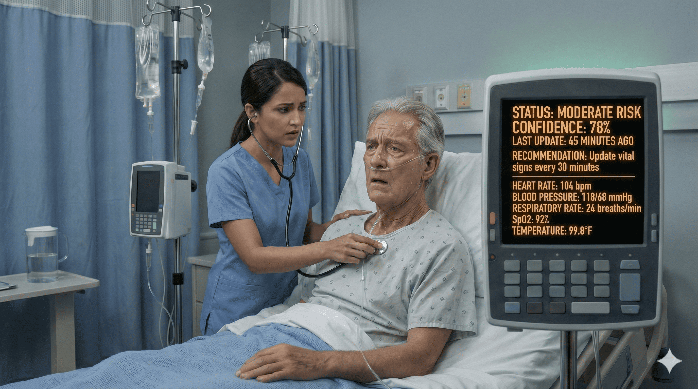

**Next:** [26. Catching Up to the Crisis](#decision-node-35)

---

### 26. Decision: Catching Up to the Crisis

Mr. Allen's condition has deteriorated significantly in the time you waited for the AI to update. You now have clear evidence of deterioration, but precious time has been lost.

What do you do?

**What do you do?**

- **A. Call Provider Now** _(correct)_ — Escalate immediately based on the clear clinical deterioration you're observing. → [27. Crisis Management](#information-node-38)
- **B. Follow AI Recommendation** _(wrong)_ — Follow the system's recommendation to update vitals every 30 minutes. → [30. Complete Decompensation](#information-node-40)

---

### 27. Crisis Management

You immediately call the provider, recognizing that the situation has escalated beyond your initial observations.

"I need you to see Mr. Allen now. He's showing significant respiratory distress - respiratory rate is 24 and climbing, work of breathing is markedly increased, oxygen saturation dropped to 92%, and he's becoming more confused. The AI system just updated to moderate risk, but he looks worse than moderate."

**10 Minutes Later:**

The provider arrives, but in that time Mr. Allen's condition has continued to decline. As they're performing the assessment, his respiratory status begins to fail. He requires immediate BiPAP (bilevel positive airway pressure) and emergency transfer to the ICU.

**In the ICU:**

Aggressive treatment stabilizes Mr. Allen over the next 24 hours. He avoids intubation but requires several days of ICU-level care.

STAT imaging and labs reveal:
- Rapidly progressive bilateral pneumonia
- Early sepsis with elevated lactate
- Significant hypoxemia requiring high-flow oxygen support

**The Debrief:**

The provider reviews the timeline with you: "When did you first notice the changes?"

"About 45 minutes before I called you," you admit. "I waited for the AI to update because it was showing low risk, and I thought I might be overreacting."

"Those 45 minutes mattered," the provider explains. "Early sepsis and respiratory deterioration have a narrow window for intervention. Your initial assessment was right - we could have started treatment before it became a crisis."

**What Happened:**

By waiting for the AI system to validate your clinical concerns, you introduced a critical delay. The automated vital signs weren't due to update for 30+ minutes, during which Mr. Allen's condition progressed from early deterioration to respiratory crisis.

Your initial clinical judgment was correct, but the delay in acting on it meant the difference between preventing deterioration and managing a crisis.

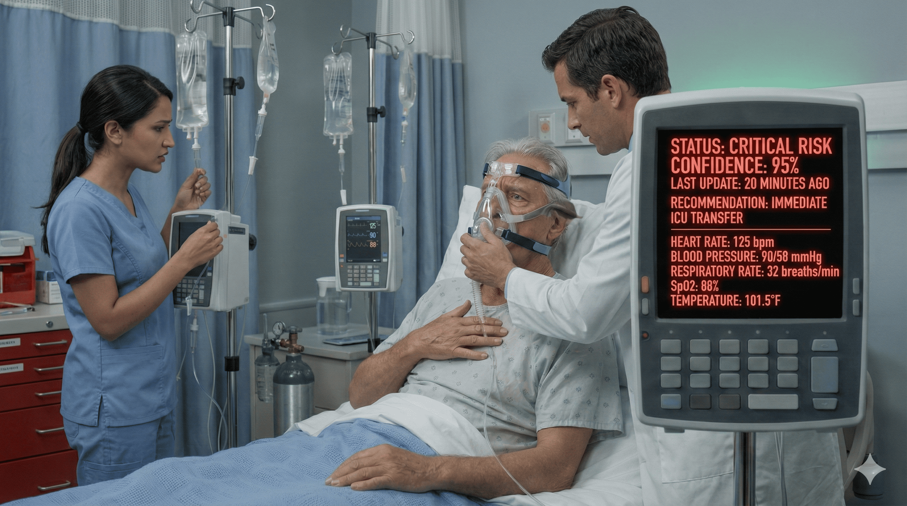

**Next:** [28. Lesson: The Cost of Confirmation Delay](#information-node-39)

---

### 28. Lesson: The Cost of Confirmation Delay

**Confirmation Delay** occurs when clinicians wait for AI systems to validate clinical observations before acting, introducing critical time lags in care escalation.

**What Happened Here:**

1. **Waiting for Digital Confirmation:** You had the clinical evidence needed to escalate but waited for the AI to "confirm" your assessment.

2. **Time-Dependent Deterioration:** In rapidly progressing conditions like sepsis and respiratory failure, a 45-minute delay can mean the difference between prevention and crisis.

3. **Crisis vs. Prevention:** Early intervention (at your first observation) would have been preventive. Delayed intervention became crisis management requiring ICU-level care.

**The Hidden Cost:**

Waiting for AI validation led to:
- Higher acuity outcome (ICU instead of step-down)
- More aggressive interventions required
- Longer hospital stay
- Greater risk to patient
- Higher resource utilization
- **Workflow debt** - increased complexity of care that could have been avoided

**Critical Understanding:**

AI systems are valuable tools, but they should not become **gatekeepers** for clinical decision-making. When you observe concerning changes:

1. **Act on your assessment** - Don't wait for technology to validate what you're seeing
2. **Time matters** - Early deterioration has optimal windows for intervention
3. **Trust your judgment** - If you're concerned enough to document it, you're concerned enough to escalate
4. **Advocate early** - It's better to escalate and be wrong than to delay and be right

**The Paradox:**

The more reliable an AI system appears, the more tempting it becomes to wait for its validation. But the system's reliability is based on historical performance - it tells you nothing about the patient in front of you right now.

**Professional Standard:**

Your clinical assessment should drive your actions. AI systems should inform your judgment, not constrain it. When you observe changes that concern you, escalate based on those observations rather than waiting for digital confirmation.

**Next:** [29. checkpoint](#termination-node-42)

---

### 29. Checkpoint

> **Result:** checkpoint · **Concept:** `bias`

_End of this path._

---

### 30. Complete Decompensation

You see the MODERATE RISK alert and the recommendation to "update vitals every 30 minutes." You decide to follow the system's guidance precisely - you'll get a manual set of vitals in 30 minutes as recommended.

You return to your other patients, setting a mental timer to recheck Mr. Allen.

**25 Minutes Later:**

You're preparing to get Mr. Allen's manual vital signs when you hear a commotion from his room. The patient care technician has entered to assist him to the bathroom and is calling for help.

You rush to the room to find Mr. Allen in severe respiratory distress progressing to respiratory arrest:
- Gasping respirations
- Severe cyanosis
- Unresponsive to verbal stimuli
- Oxygen saturation in the 70s

You call a code blue. The rapid response team arrives and initiates emergency interventions. Mr. Allen requires immediate intubation and is transferred to the ICU on mechanical ventilation.

**The Timeline:**

Looking back at the critical period:
- **T = 0 minutes:** You notice subtle signs of deterioration (first assessment)
- **T = 45 minutes:** AI updates to moderate risk; patient showing clear deterioration
- **T = 70 minutes:** Patient found in respiratory arrest

**What Went Wrong:**

At three different points, you deferred clinical decision-making to the AI system:

1. **Initial Assessment:** Waited for AI to update rather than acting on clinical observations
2. **AI Update:** Followed system's recommendation for 30-minute reassessment rather than recognizing the patient needed immediate intervention
3. **Clinical Judgment:** Trusted the AI's risk categorization ("moderate") over the severity of symptoms you could observe

**The Critical Error:**

The AI system categorized Mr. Allen as "moderate risk" based on vital signs that, while abnormal, didn't meet thresholds for high-risk alerts. But risk categories are statistical predictions - they don't capture the urgency of a specific clinical presentation.

You saw clear signs of respiratory distress, but instead of acting on that observation, you followed the AI's care recommendation. The system became not just a decision support tool, but the decision maker itself.

**Workflow Debt:**

The delay created a cascade of consequences:
- Emergency intubation instead of preventive intervention
- ICU admission with mechanical ventilation
- Significantly increased care complexity
- Greater risk of complications
- Extended hospital stay
- Preventable critical event

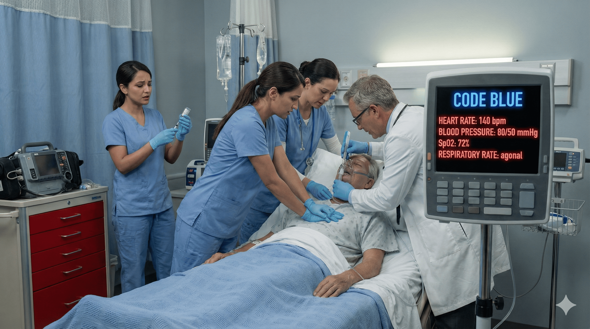

**Next:** [31. Lesson: Workflow Debt and Automation Complacency](#information-node-43)

---

### 31. Lesson: Workflow Debt and Automation Complacency

**Workflow Debt** is the accumulated burden of delayed or inadequate interventions that results in higher-acuity care demands downstream. **Automation Complacency** occurs when clinicians allow AI systems to drive decision-making rather than supporting it.

**What Happened Here:**

1. **Mistaking Risk Categories for Clinical Urgency:** "Moderate risk" became a reason to delay rather than a prompt to assess and intervene.

2. **Following Recommendations Blindly:** The AI's "update vitals every 30 minutes" recommendation was appropriate for stable moderate-risk patients - not for a patient in active respiratory distress.

3. **Complete Deference:** You allowed the system to dictate your workflow rather than using it to inform your clinical judgment.

**The Cascade Effect:**

Early escalation would have meant:
- STAT diagnostics and treatment
- Transfer to step-down unit
- Preventive intervention

Delayed escalation resulted in:
- Code blue situation
- Emergency intubation
- ICU admission with mechanical ventilation
- Higher risk of complications
- Dramatically increased care complexity

This is **workflow debt** - when delays create higher-acuity situations that demand more resources, time, and expertise than would have been needed with early intervention.

**The Automation Complacency Trap:**

When AI systems provide care recommendations (not just risk scores), there's a dangerous tendency to follow them without applying clinical judgment:

- **False Authority:** Treating AI recommendations as orders rather than suggestions
- **Responsibility Diffusion:** Feeling less personally accountable because "the system said..."
- **Cognitive Offloading:** Letting the AI system think instead of thinking critically yourself

**Professional Responsibility:**

AI systems can suggest, inform, and alert - but they cannot assess a patient, make clinical decisions, or be held accountable for outcomes. **You** must:

1. **Assess independently** - See the patient, not just the data
2. **Think critically** - Question whether AI recommendations fit the clinical situation
3. **Act decisively** - Escalate based on your assessment, not AI permission
4. **Stay accountable** - You are responsible for the patient's outcome

**Core Principle:**

AI systems should work for you, not the other way around. When your clinical assessment indicates urgency, act urgently - regardless of what risk category or recommendation the AI provides.

**Remember:** No algorithm can replace the professional judgment of a nurse who has assessed the patient directly. Trust your clinical skills.

**Next:** [32. Failed Outcome](#termination-node-44)

---

### 32. Ending: Failed Outcome

> **Result:** fail · **Concept:** `bias`

Complete deference to AI recommendations led to respiratory arrest and preventable code blue. Use the timeline review to return to an earlier decision point.

_End of this path._

---
